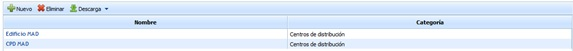
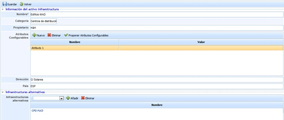

# Infraestructuras

El presente apartado permite definir aquellos activos de infraestructuras que posee la organización.

Al acceder a la opción se muestra una tabla que permite realizar las siguientes acciones:

* **Nuevo:** Permite incluir un nuevo activo en la tabla.
* **Eliminar:** Permite eliminar un activo de infraestructura ya definido. Para ello se ha de seleccionar la fila o filas deseadas y pulsa el botón ‘Eliminar’.
* **Descarga:** Permite descargar el listado de activos en un formato editable (.xlsx) o en formato .PDF

Al pulsar sobre el enlace del activos se muestran las opciones de parametrización del mismo, pudiendo definir los siguientes campos:

* **Nombre:** Permite definir el nombre del activo.
* **Categoría:** Ofrece la posibilidad de asignarle una categoría al activo.
* **Propietario:** Posibilita definir el recurso asignado para la gestión del activo
* **Atributos configurables:** Permite insertar atributos sobre un activo de infraestructuras. Para ello se pueden definir atributos pulsando sobre el botón 'Nuevo' lo que genera una nueva entrada en la tabla, modificable al pulsar dos veces sobre la misma celda. En caso de querer insertar atributos previamente configurados en el apartado 'Ajustes/Metodologías de Análisis' se ha de pulsar sobre el botón 'Proponer atributos configurables'.
* **Dirección:** Permite establecer la dirección donde se única el activo.
* **País:** Ofrece la posibilidad de establecer el país de ubicación del activo
* **Infraestructuras alternativas:** Ofrece la posibilidad de asociar al activo otras infraestructuras en las que apoyarse en caso de desastre.

## Valoración de Dimensiones

Esta sección del formulario permite realizar la valoración de la infraestructura en las dimensiones configuradas para el inventario de activos.

Las dimensiones que aparecen son configurables en 'Ajustes- Metodologías Análisis - Configuración General'. Se puede indicar qué dimensiones son visibles y cuales no. En caso de que no haya ninguna dimensión visible, esta sección no se muestra en el formulario de la infraestructura.
