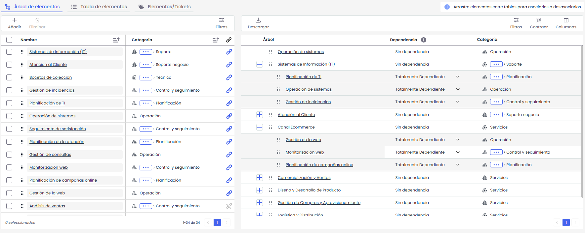
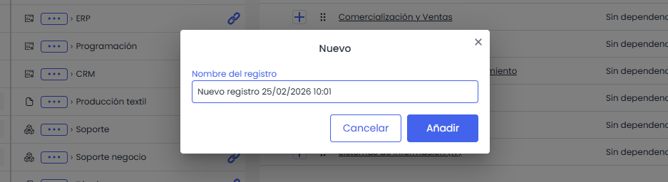
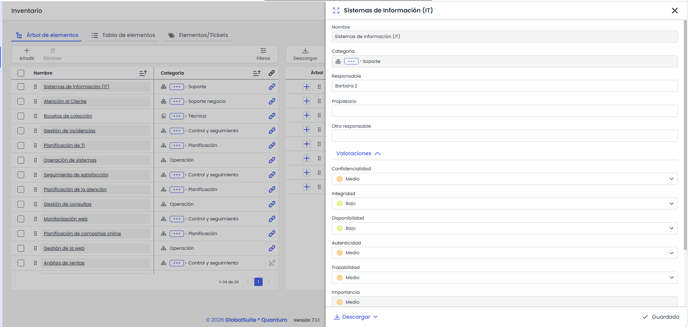
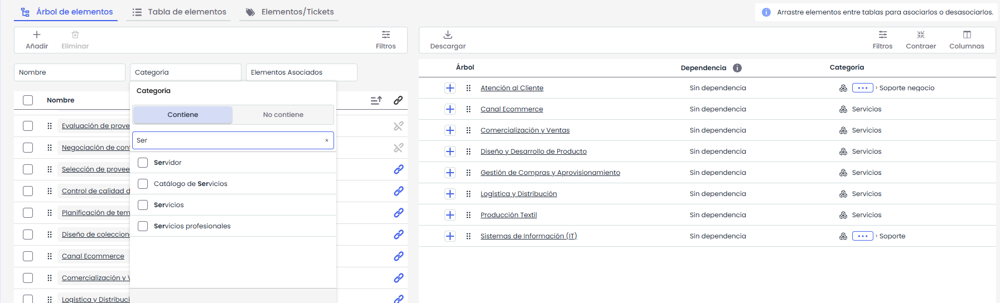
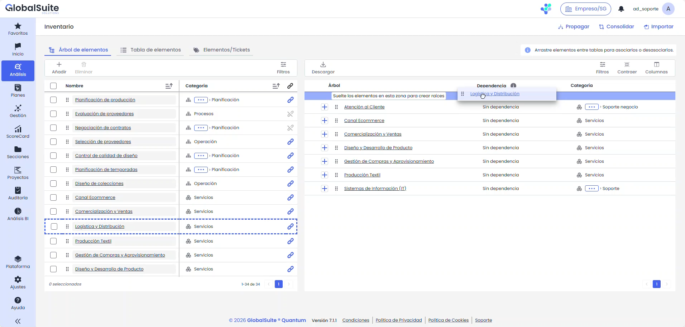
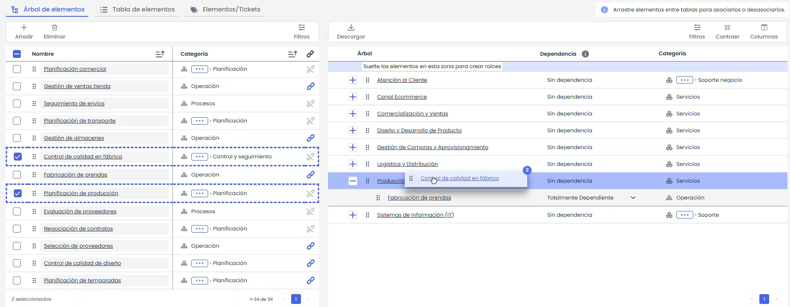
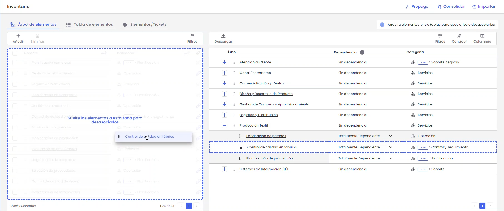
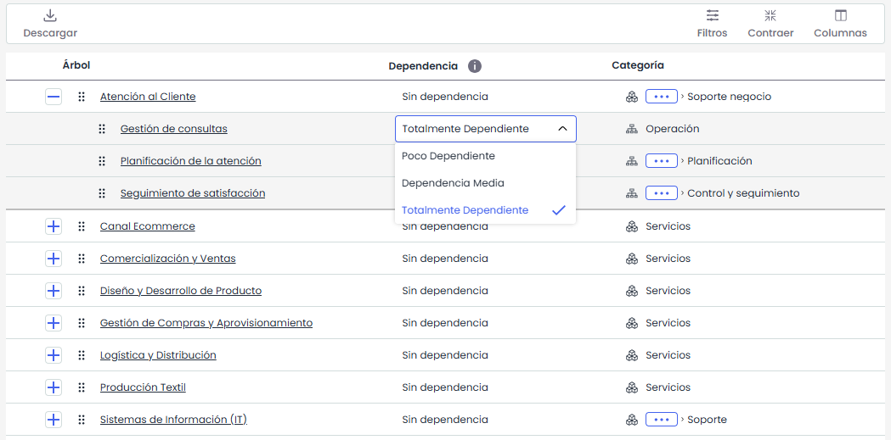
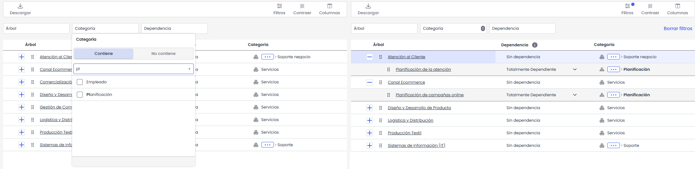

# Árbol de Elementos

La opción **Árbol de Elementos** muestra a la izquierda el **listado de elementos** de la organización, ordenado por fecha de creación (mostrando primero los más recientes), y a la derecha el **árbol con las dependencias** existentes entre los elementos

## Listado de elementos

La tabla de la derecha muestra la siguiente información de utilidad:

* **Añadir:** Permite crear un nuevo elemento.  
  Al pulsar **Añadir**, se solicitará introducir el nombre del elemento, que por defecto incluirá la fecha y la hora de creación.

  

  El nombre es obligatorio, no puede estar vacío ni repetido y debe tener menos de 512 caracteres.

  Tras guardar, el nuevo elemento se mostrará en la primera posición del listado y también será visible en la **Tabla de Elementos**.
* **Categoría:** Indica la categoría o subcategoría a la que pertenece el elemento.
* **Insertado:** Indica mediante un icono si el elemento ha sido insertado en el árbol de dependencias.

  *  → Incluido
  *  ->No incluido

Sobre el listado de elementos se permiten las siguientes acciones:

* **Añadir:** Permite crear un nuevo elemento.
* **Eliminar:** Permite eliminar uno o varios elementos seleccionados.  
  Solo se podrán eliminar los elementos que no pertenezcan a categorías especiales.
* **Edición:** Permite modificar directamente el nombre y la categoría del elemento desde la tabla.

  * **Nombre:** Solo se podrá modificar el nombre de los elementos que no pertenezcan a categorías especiales.
  * **Categoría:** La categoría podrá modificarse teniendo en cuenta lo siguiente:

    * Los elementos de categorías especiales solo podrán cambiarse a una subcategoría de su propia categoría.
    * El resto de los elementos podrán asignarse a cualquier categoría, excepto a las categorías especiales.


Se consideran \*\*categorías especiales\*\*: Servicios, Procesos, Personal, Proveedores, Instalaciones y Relaciones con el Negocio.


* **Consultar:** Al hacer clic sobre el nombre de un elemento en el listado, se abre un panel lateral con el detalle completo del elemento en el inventario.

  
* **Filtros:** Permite filtrar la información por cualquiera de las columnas del listado.

  

## Árbol de dependencias

El **Árbol de Elementos** muestra una estructura jerárquica con las relaciones y dependencias entre los elementos. Estará visible si esta marcada la opción “**Dependencias**” en **Ajustes > Elementos >** [**Configuración General Análisis**](https://help.globalsuitesolutions.com/es/globalsuite/v1/metodologia-elementos#Configuraci%C3%B3n-General-An%C3%A1lisis)

Por defecto, el árbol se visualiza contraído y ordenado alfabéticamente (A-Z) según la columna **Árbol**.

La tabla incluye las siguientes columnas, en función de la configuración definida en **Ajustes > Elementos >**[**Configuración General Análisis**](https://help.globalsuitesolutions.com/es/globalsuite/v1/metodologia-elementos#Configuraci%C3%B3n-General-An%C3%A1lisis)**> Grado de Dependencia Acumulada**:

* Si la configuración es **Global a todas las dimensiones**, se muestran las columnas:  
  **Árbol**, **Dependencia** y **Categoría**.
* Si la configuración es **Independiente por dimensión**, se muestran las columnas:  
  **Árbol**, **Categoría** y una columna adicional por cada dimensión configurada como acumulada.

Sobre el Árbol de dependencias se permiten las siguientes acciones:

* **Crear raíces:** Permite insertar uno o varios elementos como nodos raíz del árbol. Para ello, se deben soltar los elementos en la zona superior indicada con el mensaje *“Suelte los elementos en esta zona para crear raíces”*. Los elementos se insertarán como nodos raíz con nivel de dependencia **Sin dependencia**.

  

  No se permite guardar una raíz sin descendencia. Si un nodo se inserta como raíz pero no tiene elementos dependientes (nodos hijos), la inserción no se conservará al salir.
* **Asociar:** Permite asociar uno o varios elementos al árbol mediante la funcionalidad de arrastrar y soltar (drag & drop). Para ello, se deben arrastrar los elementos desde el listado hasta la posición deseada en el árbol.

  

  Al soltar los elementos, el sistema realiza automáticamente las validaciones antes de completar la asociación. No se permite:

  * Asociar un elemento más de una vez al mismo nivel.
  * Asociar un elemento como dependiente de sí mismo.

  Si la asociación se realiza correctamente, se mostrará un mensaje de confirmación. En caso de error, el sistema informará del motivo.


Cuando se asocia un elemento que contiene descendientes, se insertará la rama completa respetando su estructura jerárquica.


* **Desasociar:** Permite eliminar la relación entre un elemento y su nodo padre mediante arrastrar y soltar.

  Para ello, se debe arrastrar el nodo desde el árbol hacia la zona habilitada en el listado, indicada con el mensaje *“Suelte los elementos a esta zona para desasociarlos del Árbol”*. Si se suelta fuera de esta zona, la acción se cancela automáticamente.

  

  No se permite desasociar una raíz de primer nivel que tenga **elementos dependientes**. En este caso, el sistema mostrará un mensaje de error.

  Al desasociar un nodo, solo se elimina la relación con el **elemento superior** desde el que se arrastra:

  * Si el nodo sigue teniendo otro elemento superior, se mantendrá en el resto de ramas.
  * Si no tiene otros elementos superiores y tiene elementos dependientes, pasará a mostrarse como raíz, conservando su estructura.
  * Si no tiene elementos dependientes ni otros elementos superiores, se eliminará del árbol.
* **Edición:** Permite modificar directamente el nombre y la categoría del elemento desde la tabla.

  * **Nombre:** Solo se podrá modificar el nombre de los elementos que no pertenezcan a categorías especiales.
  * **Dependencia:** Permite modificar el grado de dependencia directamente desde la columna Dependencia o desde las columnas por dimensión, si están configuradas como independientes. En los elementos raíz (primer nivel) se mostrará el texto **“Sin dependencia”**, sin posibilidad de edición. En los elementos dependientes se mostrará un selector con los valores configurados en **Ajustes > Elementos > Grado de dependencia**.
  * 

    **Categoría:** La categoría podrá modificarse teniendo en cuenta lo siguiente:

    * Los elementos de categorías especiales solo podrán cambiarse a una subcategoría de su propia categoría.
    * El resto de los elementos podrán asignarse a cualquier categoría, excepto a las categorías especiales.


Se consideran \*\*categorías especiales\*\*: Servicios, Procesos, Personal, Proveedores, Instalaciones y Relaciones con el Negocio.


* **Filtros:** Permite filtrar la información por cualquiera de las columnas del árbol.

  
* **Contraer:** Contrae el listado de todos los servicios y elementos que se han asociado.
* **Columnas**: Se pueden ocultar y ordenar las columnas del arbol.
* **Descarga:** Permite la descarga la vista del árbol de dependencias en formato CSV. Descargará los elementos que se hayan filtrado desde la interfaz, o en su defecto, permitirá descargar el árbol de elementos completo.


Si se quiere convertir el informe descargado, en formato Excel, se puede realizar siguiendo los pasos explicados en la sección [Descargas Pendientes.](https://help.globalsuite.es/display/GlobalSUITEes/.Descargas+Pendientes+vv6.23)

