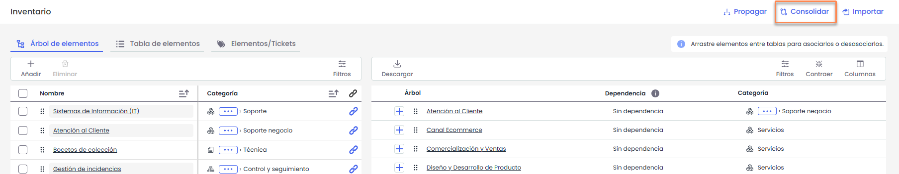
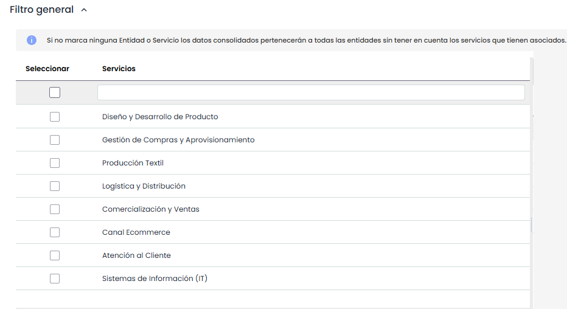
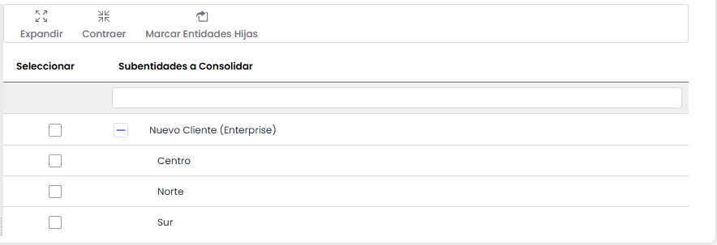
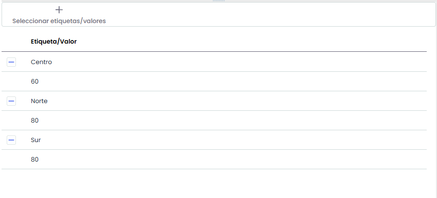
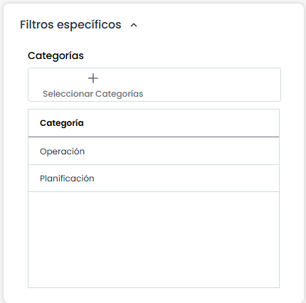
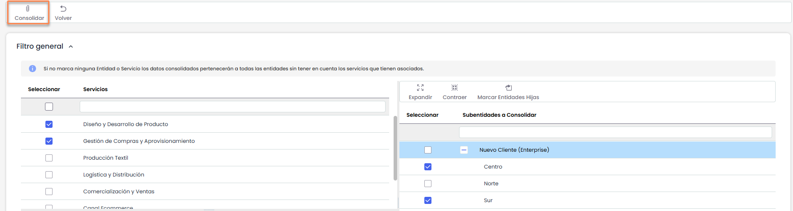
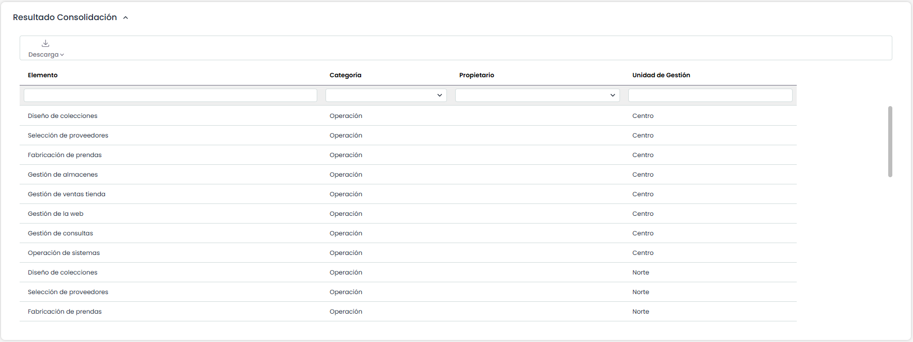

# Consolidación de Dependencias de Activos

La presente opción permite visualizar de manera resumida los diferentes activos asociados a la entidad y subentidades.

A continuación se desarrolla la funcionalidad que aporta cada una de las tablas disponibles.

## Filtro general:

* **Tabla Servicios:** La primer tabla que aparece arriba a la izquierda es la de servicios y permite al usuario filtrar los activos asociados a los Servicios seleccionados.

  
* **Tabla Subentidades:** A la derecha de la tabla Servicios se muestre la tabla de subentidades y da la posibilidad de filtrar los activos definidos en las subentidades seleccionadas.

  
* **Tabla Etiqueta/Valor:** Permite visualizar los activos que tengan asociados una etiqueta determinada.

  

## Filtros específicos:

* Ofrece la posibilidad de visualizar los activos filtrando por una o varias categorías.
* 

## Consolidar

Una vez establecidos los filtros necesarios, se debe pulsar **Consolidar** en la parte superior para generar la consulta.

Tras pulsar el botón, y en función de los filtros aplicados, los resultados se mostrarán en la tabla inferior **“Resultados de consolidación”**.

La información que aporta la tabla son las siguientes:

* **Elemento:** Permite visualizar el nombre del activo
* **Categoría:** Ofrece la posibilidad de visualizar la categoría a la que ha sido asociado el activo
* **Propietario:** Informa sobre el responsable del activo que ha sido establecido
* **Unidad de gestión:** Ofrece la posibilidad de visualizar la entidad o subentidad a la que está asociado el activo.
