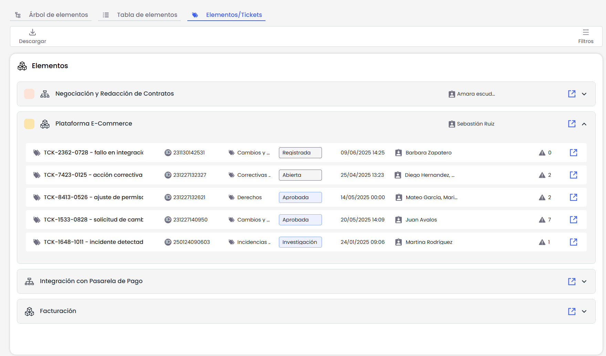
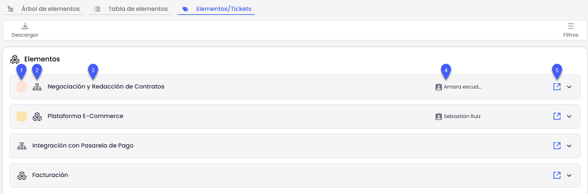
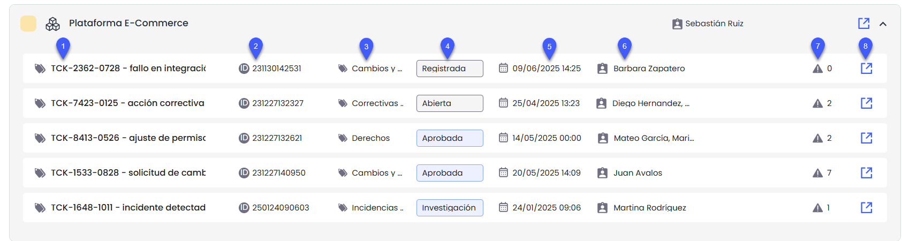
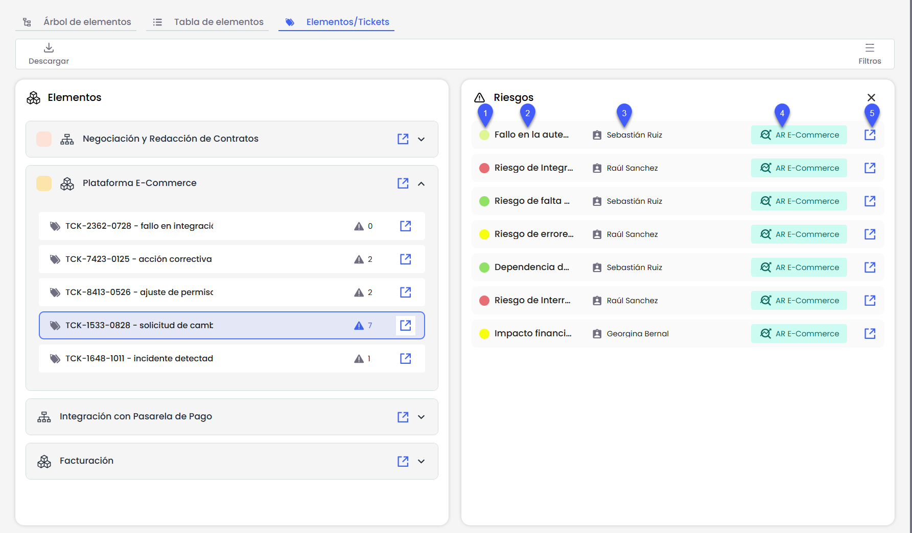
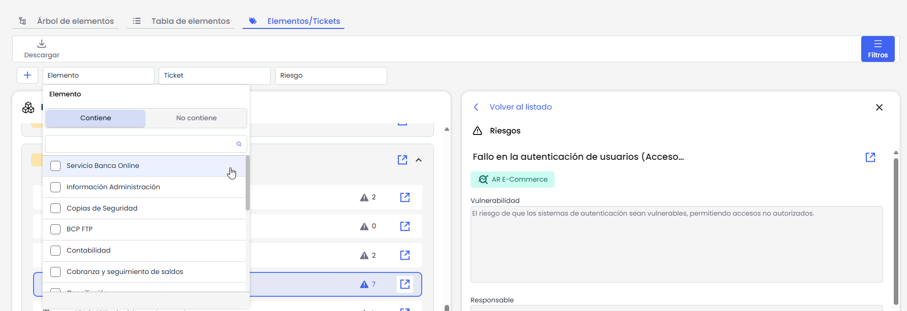
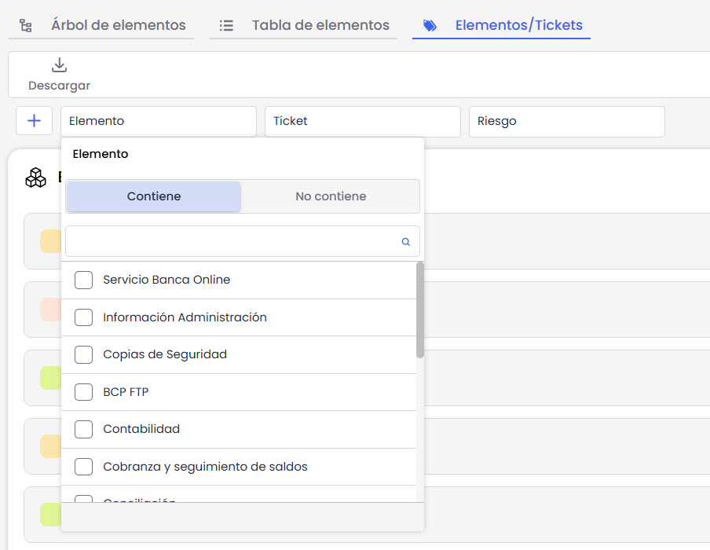
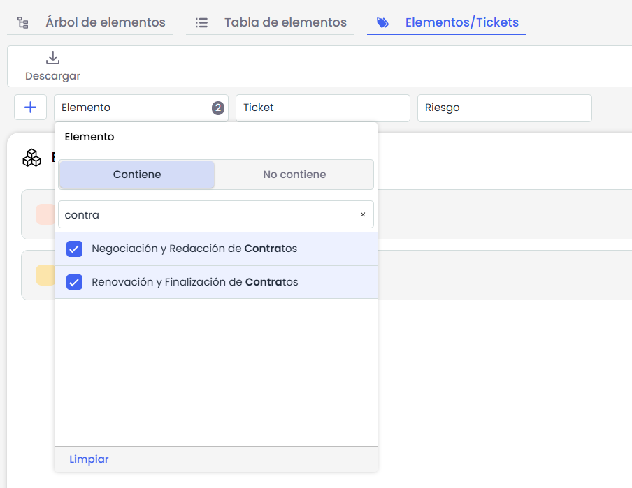
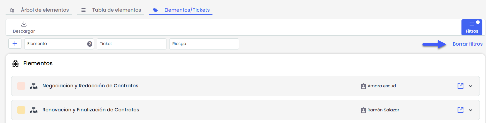

# Elementos/Tickets

Esta vista consolida en un solo sitio la relación entre elementos, tickets y riesgos, con el objetivo de facilitar el análisis y seguimiento de estas vinculaciones en el sistema.

La información se obtiene a partir del campo **THREATS** presente en los tickets, donde actualmente se vincula el elemento, el análisis de riesgos asociado y los riesgos seleccionados. Esta vista organiza toda esa información de forma jerárquica, permitiendo una navegación más clara y contextual..

### Estructura de la vista

La pantalla está organizada en tres niveles jerárquicos:

### Elementos

Cada elemento se representa como una tarjeta expandible que incluye:

1. Nivel de la dimensión de criticidad del Elemento. En el caso que la dimensión en Ajustes > [Metodología de elementos](https://help.globalsuitesolutions.com/es/globalsuite/v1/metodologia-elementos) sea cualitativa.
2. Icono según su categoría.
3. Nombre del elemento.
4. Responsable del elemento.
5. Botón “Ver detalles”: Al pulsarlo, se abre en una nueva pestaña, el formulario del elemento en el [Inventario](https://help.globalsuitesolutions.com/es/globalsuite/v1/tabla-de-elementos).

### 2. Tickets

Al hacer clic sobre la tarjeta de elementos se despliega el listado de tickets relacionados con ese elemento. Cada ticket mostrado está vinculado al elemento a través del campo **THREATS**. La información mostrada para cada ticket se define desde **Ajustes > Tickets >** [**Pantalla común**](https://help.globalsuitesolutions.com/es/globalsuite/v1/pantalla-comun) e incluye:

1. **Asunto del ticket**: en *Ajustes > Tickets >* [*Pantalla común*](https://help.globalsuitesolutions.com/es/globalsuite/v1/pantalla-comun) se debe seleccionar **un único campo** de tipo INPUT, que será el que se utilice como asunto del ticket. Este campo se mostrará truncado si su contenido es demasiado largo, y es el que aparecerá en esta posición.
2. **ID del ticket**: también debe definirse **un único campo de tipo ID** desde [*Pantalla común*](https://help.globalsuitesolutions.com/es/globalsuite/v1/pantalla-comun), que será el que se visualice en esta posición.
3. **Tipo de ticket**: etiqueta que indica la clasificación del ticket (por ejemplo: *Incidente*, *Cambio*, *No conformidad*, etc.).
4. **Estado**: muestra el estado actual del ticket, representado con un color distintivo según la fase del mismo: gris, azul o verde.
5. **Fecha**: para cada tipo de ticket, debe configurarse en [*Pantalla común*](https://help.globalsuitesolutions.com/es/globalsuite/v1/pantalla-comun) **un único campo de tipo DATE**. Solo se mostrará una fecha por ticket, **y es la que aparecerá en esta posición**.
6. **Responsable**: esta vista soporta **un único responsable por ticket**, configurable en [*Pantalla común*](https://help.globalsuitesolutions.com/es/globalsuite/v1/pantalla-comun) a partir de un campo de tipo **OWNER**, **EMPLOYEES** o **SUPERVISOR**, **y es el que aparecerá en esta posición**.
7. **Riesgos asociados**: si existen riesgos vinculados al ticket y al elemento correspondiente, se muestra un contador que indica la cantidad total de riesgos asociados.
8. **Botón "Ver detalles"**: al pulsarlo, se abre el formulario completo del ticket en una nueva pestaña del navegador.


Puede suceder que alguno de estos campos no se configure en \*Pantalla común\*. En ese caso, dicho campo no se mostrará en la vista y no será reemplazado por ningún otro campo de distinto tipo. La posición correspondiente quedará vacía.


### 3. Riesgos asociados

El panel lateral que se abre al pulsar en un ticket muestra los **riesgos vinculados** al vínculo entre ese ticket y ese elemento.

1. **Nivel de riesgo**: muestra la valoración del riesgo según la dimensión principal definida en Ajustes >Metodologías de Riesgos > [Elegir Dimensión Riesgo.](https://help.globalsuitesolutions.com/es/globalsuite/v1/metodologia-riesgos#MetodologíaRiesgos-Nivelesdedimensiones)
2. **Nombre del riesgo**: identificador del riesgo según lo definido en el Análisis de Riesgo.
3. **Responsable del riesgo**: persona asignada como responsable en el análisis correspondiente.
4. **Análisis de Riesgo**: nombre del análisis en el que está definida la relación entre el riesgo y el elemento.
5. **Botón "Ver detalles"**: permite acceder a la ficha completa del riesgo, que se abre en una nueva pestaña del navegador en modo solo lectura.

### Detalle del riesgo

Desde el panel lateral, al hacer clic en un riesgo del listado se accede al formulario completo del riesgo en modo solo lectura. Este formulario presenta:

* El campo principal del riesgo (ej. “Amenaza”), según configuración en **Ajustes > Riesgos >** [**Campos configurables**.](https://help.globalsuitesolutions.com/es/globalsuite/v1/metodologia-riesgos#MetodologíaRiesgos-ConfiguraciónDimensionesdelaMetodología)
* Nombre del Análisis de Riesgo al que pertenece.
* Resto de campos de la metodología (excepto el principal).
* Responsable.
* Dimensiones del riesgo.

### Filtros

En la parte superior de la pantalla se encuentran disponibles los siguientes filtros para limitar los datos mostrados:

* Elemento
* Ticket
* Tipo de ticket
* Riesgos
* Responsable del elemento
* Responsable del ticket
* Responsable del riesgo

#### **Funcionamiento de los filtros:**

Cada filtro permite seleccionar uno o varios valores mediante un selector múltiple, y su funcionamiento incluye las siguientes opciones:

* **Contiene / No contiene:** esta opción filtra los resultados dentro del listado de opciones disponibles en el selector, no sobre los datos visibles en la vista. Es decir, ayuda a encontrar rápidamente valores dentro del desplegable.

* **Selector múltiple**: puedes marcar una o varias opciones dentro del filtro. Al seleccionarlas, la vista se actualiza automáticamente para mostrar solo los registros que coincidan con los criterios elegidos.

* **Limpieza de filtros**: a la derecha de los filtros aparece un botón **"Borrar filtros"**, que permite eliminar todos los valores seleccionados y restablecer la vista completa.

### Descarga

La vista ofrece un botón **“Descargar”** que permite descargar los datos visibles en un archivo .csv. La exportación respeta los filtros aplicados y solo está activa si existen resultados en pantalla.

El archivo generado incluye una fila por cada combinación única Elemento–Ticket–Riesgo, con las siguientes columnas:

* Nombre del elemento
* Categoría del elemento
* Responsable del elemento
* Dimensión de criticidad del elemento
* Nombre del ticket
* Campos definidos en Pantalla común de tickets
* Nombre del riesgo
* Dimensión final del riesgo
