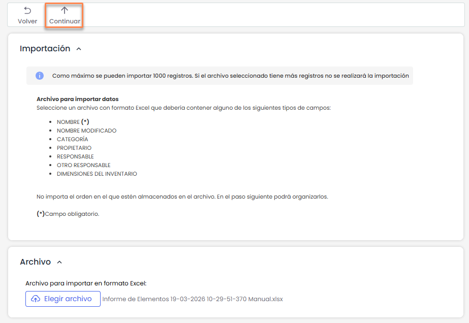

# Importar Elementos (Inventario)

La opción **Importar** permite cargar y actualizar registros en el inventario de activos a partir de un archivo Excel.

Es posible importar tanto la información de los elementos como sus dependencias o valoraciones. El único dato obligatorio es el **nombre del elemento**, mientras que el resto de la información es opcional y dependerá de la configuración de cada cliente.

Previo a la importación, es necesario descargar el **modelo de importación** desde **Inventario > Tabla de elementos > Descargar > Modelo de importación**, que sirve como referencia para la estructura del archivo.

## Importación

Al acceder a la opción, se muestra una pantalla informativa con las condiciones de la importación:

* Se permite importar un máximo de **1000 registros**.
* El archivo debe estar en formato **Excel**.
* No es necesario que las columnas del archivo estén en un orden específico, ya que posteriormente se podrán mapear.

La selección del archivo se realiza mediante el botón **Seleccionar archivo** y, a continuación, se debe pulsar **Continuar** para avanzar al siguiente paso.

Al pulsar **Continuar**, la herramienta realiza validaciones sobre el archivo cargado, verificando aspectos como:

* El formato del archivo.
* La estructura requerida para la importación.
* La coherencia de la información incluida.

Por este motivo, se recomienda utilizar el **modelo de importación** proporcionado por la herramienta.

## Mapeo de campos

En el siguiente paso se muestra la pantalla de mapeo entre los campos del archivo y los de GlobalSuite.

* En la parte izquierda se visualizan los **campos de GlobalSuite**.
* En la parte derecha se deben seleccionar las **columnas del archivo Excel** que corresponden a cada campo.

Si el nombre de la columna del Excel coincide con el del campo en GlobalSuite, el sistema realiza el mapeo automáticamente.

El usuario puede ajustar manualmente las correspondencias antes de ejecutar la importación.

## Acciones

### Importar

Ejecuta la importación de los datos según el mapeo definido.

La importación se realiza en segundo plano. Una vez finalizada, el sistema genera un **archivo de log** en **Descargas pendientes**, que contiene el resultado del proceso.

Si existen dimensiones automáticas de valoración que no han sido calculadas durante la importación, será necesario ejecutar la opción **Calcular AR** desde el inventario para obtenerlas.
