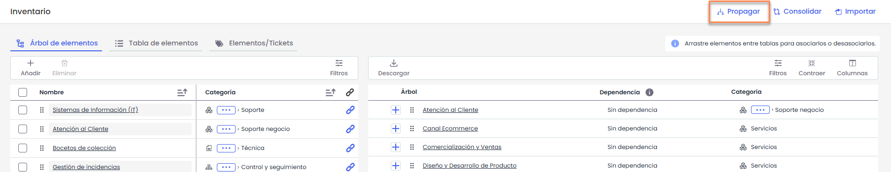
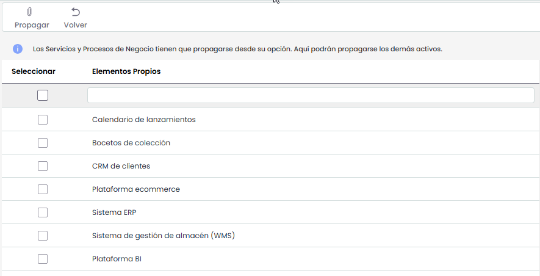
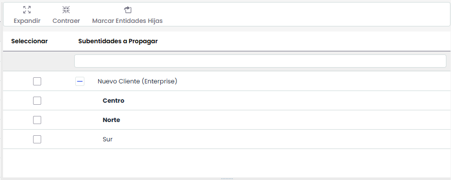
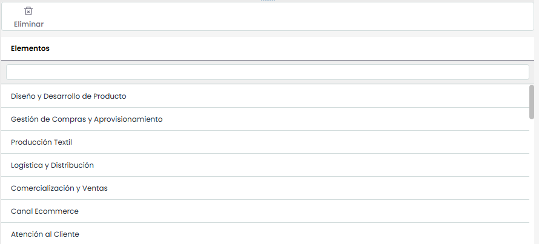

# Propagación de Dependencias de Activos

Esta opción permite propagar las dependencias de los activos definidos en la empresa matriz a las subentidades que dependen de ella.

A continuación se desarrolla la funcionalidad que aporta cada una de las tablas disponibles.

**Tabla Activos propios:** A la izquierda se muestra el listado de activos definidos en la empresa matriz

**Tabla Subentidades:** A la derecha se muestra el listado de subentidades a las que se pueden asociar las dependencias de los activos de la empresa matriz. La tabla permite expandir o contraer el listado de subentidades.

**Tabla Activos:** En la parte inferior derecha, una vez seleccionada una subentidad, se muestran los activos y dependencias asociados a la misma. Es posible eliminar un activo asociado seleccionando la fila correspondiente y pulsando **Eliminar**.

**Propagar:** Para realizar la propagación, se deben seleccionar los activos en la tabla de la izquierda y las subentidades en las que se desea propagarlos y pulsar Propagar.
