# Tabla de Elementos

La tabla de elementos permite valorar una serie de características o atributos que hacen valioso un elemento, también llamadas dimensiones.

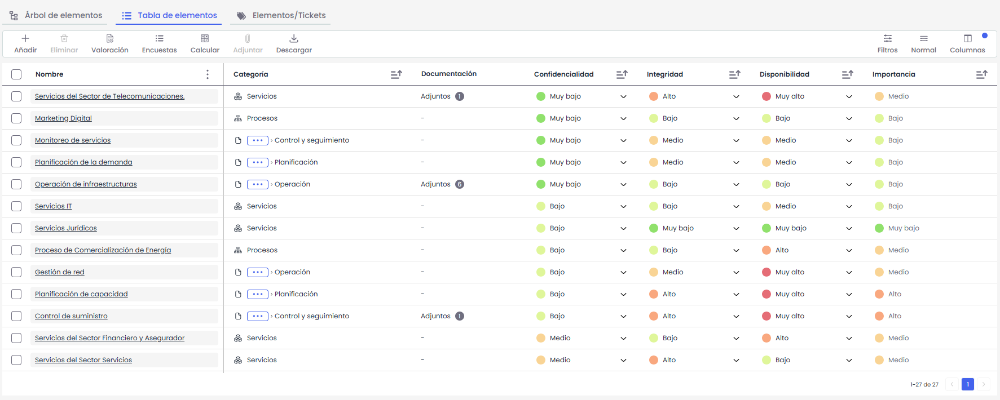

## Tabla de elementos

Dentro de la tabla se puede:

* **Editar el nombre** de aquellos elementos que no pertenezcan a una categoría especial.
* **Asignar o modificar la Categoría** del elemento:

  * Si la categoría está vacía, se mostrará la opción **“Añadir”**.
  * Si la categoría ya está informada, se mostrará el icono de **lápiz** para su edición.

    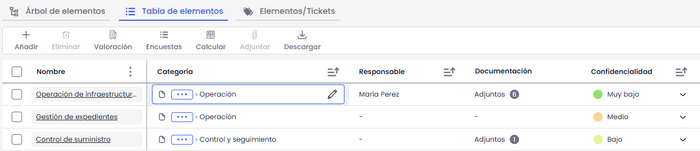
* **Modificar Propietario:** Permite indicar el recurso de la organización encargado de la gestión final del elemento.
* **Asignar un responsable**

  * Si el elemento no tiene responsable , se mostrará la opción **“Añadir”**.
  * Si está informado, se mostrará el icono de **lápiz** para su edición.

    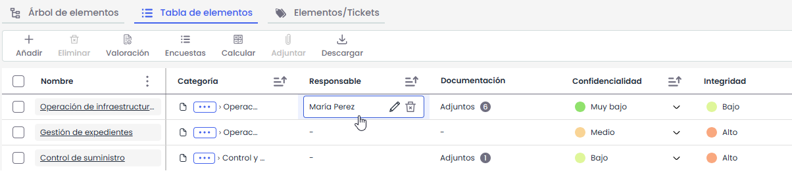
* **Adjuntar documentación**

  * Desde el Gestor Documental: Permite seleccionar uno o varios documentos del Gestor documental y asociarlos al documento.
  * Desde el Ordenador: Permite seleccionar hasta 10 ficheros del ordenador para adjuntar al elemento.

    * Desde aquí al presionar editar, se pueden eliminar ficheros

      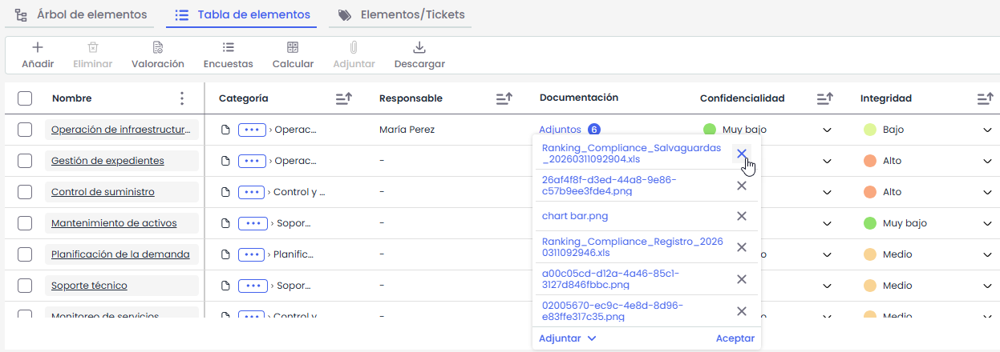


Para visualizar esta opción se debe habilitar en Ajustes> Metodologías > [Elementos](https://help.globalsuitesolutions.com/es/globalsuite/v1/metodologia-elementos)


* **Evaluar dimensiones**

Las dimensiones son características o atributos que determinan el valor de un elemento. La herramienta muestra las dimensiones definidas en **Ajustes >** [**Metodologías de Análisis**.](../../../ajustes/metodologias/metodologia-elementos.md)

En función de la metodología configurada, la valoración de las dimensiones puede ser cualitativa o cuantitativa.

Para cada dimensión, el usuario puede seleccionar uno o varios niveles desde el desplegable disponible en la tabla, o bien introducir un valor o una respuesta textual, en función de la configuración de la metodología.

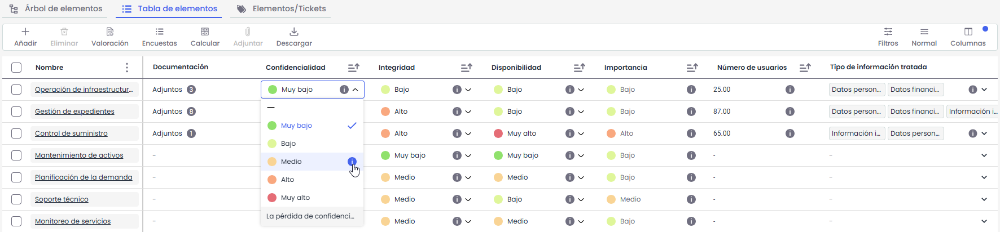

Si la dimensión dispone de niveles con descripción definida en la metodología se muestra un **icono de información** junto al nivel/valor. Al hacer clic sobre este icono, se abre un pop-up con la descripción completa

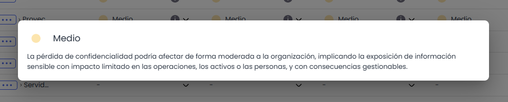

* **Dimensiones Acumuladas:** La herramienta muestra aquellas dimensiones acumuladas que se han definido en el apartado Ajustes/Metodologías de Análisis'.

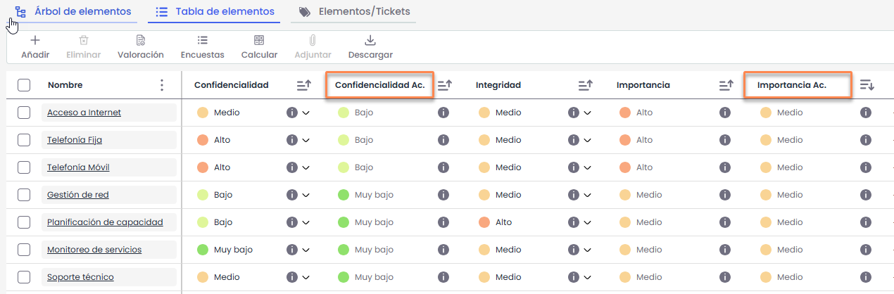

## Acciones

En la barra superior, se listan una serie de acciones que se detallan a continuación:

**Añadir:** Permite crear un nuevo elemento. Al pulsar **Añadir**, se solicitará introducir el nombre del elemento  
El nombre es obligatorio, no puede estar vacío ni repetido y debe tener menos de 512 caracteres.

Tras guardar, el nuevo elemento se mostrará en la primera posición de la tabla y también será visible en el listado del **Árbol de Elementos**.

**Eliminar:** Permite eliminar uno o mas elementos de la tabla. Seleccionando la fila o filas deseadas y pulsando el botón ‘Eliminar’. Al eliminar un elemento se borra también de la pestaña Árbol de Dependencias. Solo se pueden eliminar elementos que no sean de categorias especiales.


\*\*Nota:\*\* No es posible eliminar elementos pertenecientes a las categorías especiales \*\*Servicios, Procesos, Personal, Proveedores\*\* y \*\*Relaciones con el Negocio\*\*


**Valoración**: Permite acceder a una tabla desde la que realizar la valoración general de todos los elementos pertenecientes a una misma categoría. Más información en [**Valoración General**](valoracion-general.md)**.**

**Encuestas**: Incluye las opciones de **Ver resultados** y **enviar encuestas**. Más información en [**Ver resultados de encuestas**](resultado-de-encuestas-inventario.md) y [**Envío de encuestas**.](envio-de-encuestas-inventario.md)

**Calcular**: Incluye las opciones de **Calcular Dimensiones Acumuladas** y **Calcular AR**.

* **Calcular Dimensiones Acumuladas**: realiza el cálculo de las dimensiones acumuladas definidas en base a las dependencias establecidas entre los elementos del árbol.
* **Calcular AR**: ejecuta el recálculo de las valoraciones del análisis de riesgos, aplicando las modificaciones realizadas o, en su caso, una nueva metodología de análisis de riesgos definida.

**Adjuntar**: Permite incorporar documentación a uno o varios elementos desde el equipo local del usuario, siempre que la columna **Documentación** esté visible en la tabla.


Para visualizar esta opción se debe habilitar en Ajustes> Metodologías > [Elementos](https://help.globalsuitesolutions.com/es/globalsuite/v1/metodologia-elementos)


**Relacionar CIs:** Permite relacionar los elementos de configuración (CIs) registrados en la CMDB con los elementos definidos en el Inventario de Elementos. Esta funcionalidad está disponible únicamente para licencias **Global CMDB**. Más información [**Relacionar CIs**](relacionar-cis.md)  
**Descarga:**

* **Informe Excel:** Permite la descarga del inventario de elementos y sus atributos a un archivo editable (.xlsx). En función del volumen de información del Inventario, es posible que se descargue en un único fichero .xslx o en varios.
* **Modelo de Importación:** Esta opción permite descargar un modelo de archivo para realizar la importación de elementos si se tiene dicha funcionalidad activada.
* **Plantillas:** En caso de tener habilitadas Plantillas para el inventario, estás aparecen aqui


Para configurar las plantillas, acceda a \*\*Ajustes > Plantillas > Informes\*\*


## Opciones de filtrado y visualización

### Filtros

Se permite filtrar la información mostrada en la tabla en función de los valores de sus columnas.

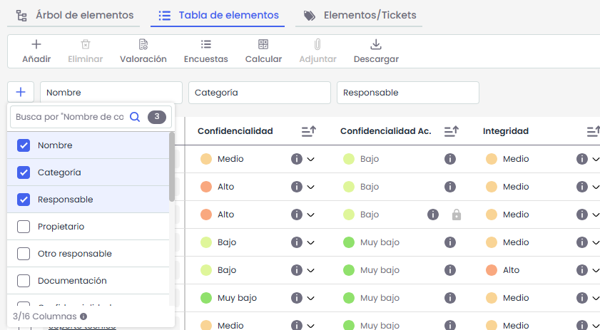

Por defecto, se muestran los filtros de los campos **Nombre**, **Categoría** y **Responsable**. Para añadir nuevos filtros, se debe pulsar el botón **“+”**, donde se listan todas las columnas disponibles de la tabla. Al seleccionar un campo, este se añade automáticamente como nuevo filtro.

El comportamiento del filtro dependerá del tipo de campo:

* En campos de tipo texto, se permite buscar valores que contengan o no contengan un determinado texto.

  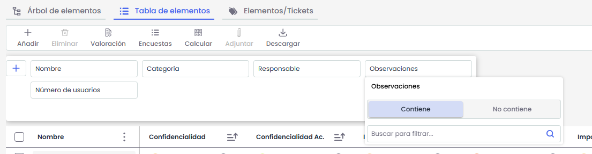
* En campos de tipo lista, se pueden seleccionar uno o varios valores.

  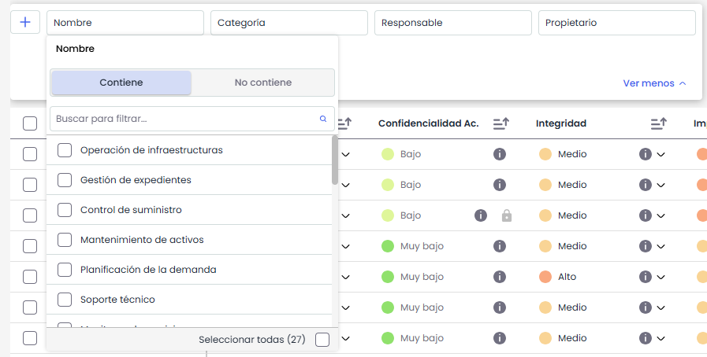
* En campos numéricos, se pueden aplicar condiciones como **igual a**, **mayor que**, **menor que** o **rango**.

  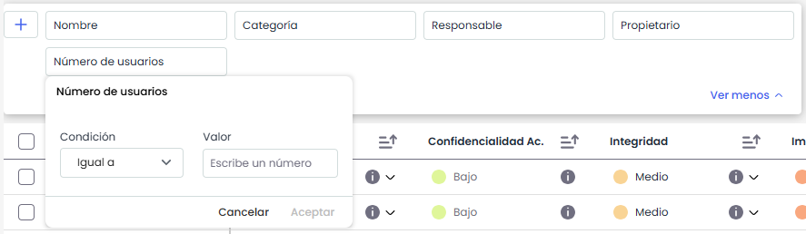

Todos los filtros que incluyen búsqueda disponen de un **campo de búsqueda interno**, que permite localizar valores dentro del propio filtro. La búsqueda se activa a partir del **tercer carácter introducido**.

Los filtros aplicados se reflejan automáticamente en la tabla, mostrando únicamente los elementos que cumplen las condiciones definidas.

### Filtros predefinidos

Esta opción solo se mostrará si hay filtros predefinidos configurados. Al seleccionar un filtro, el sistema actualizará la tabla y mostrará los elementos de la categoría con las dimensiones configuradas en ese filtro.

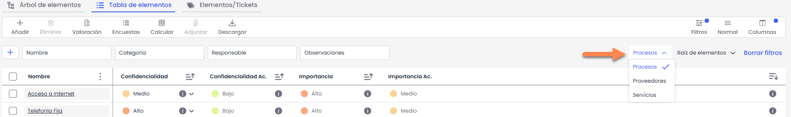

Solo se puede aplicar un filtro predefinido a la vez y cada vez que seleccionamos un filtro, se habilitará la opción “Borrar filtros”, para que la tabla vuelva a su estado por defecto.

**Raíz de elementos**  
Permite hacer un filtro sobre los elementos, pudiendo optar entre mostrar el listado con todos los elementos (Todos) o mostrar de manera individual los elementos de un único servicio.

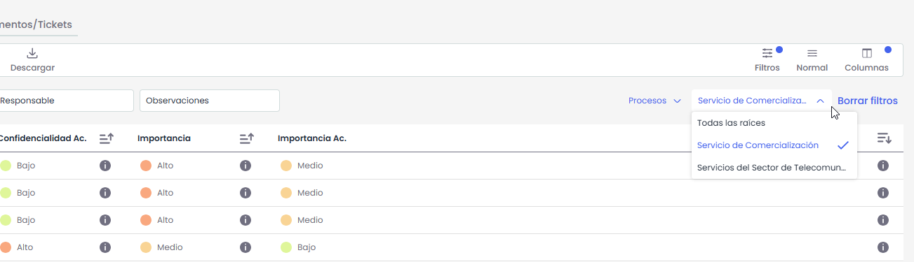


Todos los filtros son combinables entre sí. Esto incluye los filtros de tabla, los filtros predefinidos y otros filtros como el de raíz de elementos. Es posible aplicar varios filtros de forma simultánea, acotando progresivamente la información mostrada en la tabla.


### Columnas

Esta opción permite configurar la visualización de la tabla, posibilitando mostrar u ocultar columnas según las necesidades del usuario, así como reorganizar su orden.

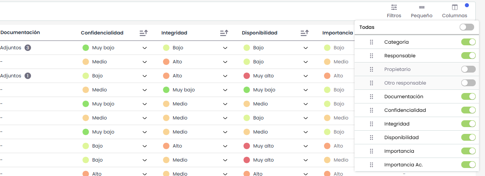

### **Vista (Normal / Pequeño / Cómodo)**

Permite ajustar la densidad de visualización de la tabla.  
Por defecto, la vista se muestra en modo **Normal**. Al hacer clic sobre esta opción, se puede alternar entre los modos **Pequeño** y **Cómodo**, lo que modifica la altura de las filas para mostrar más o menos información en pantalla.
