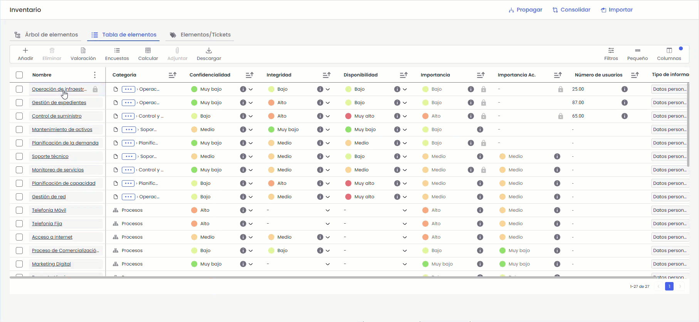
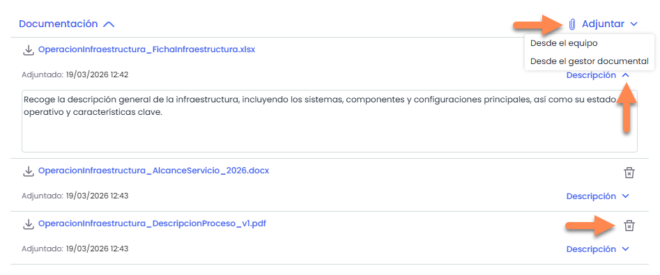
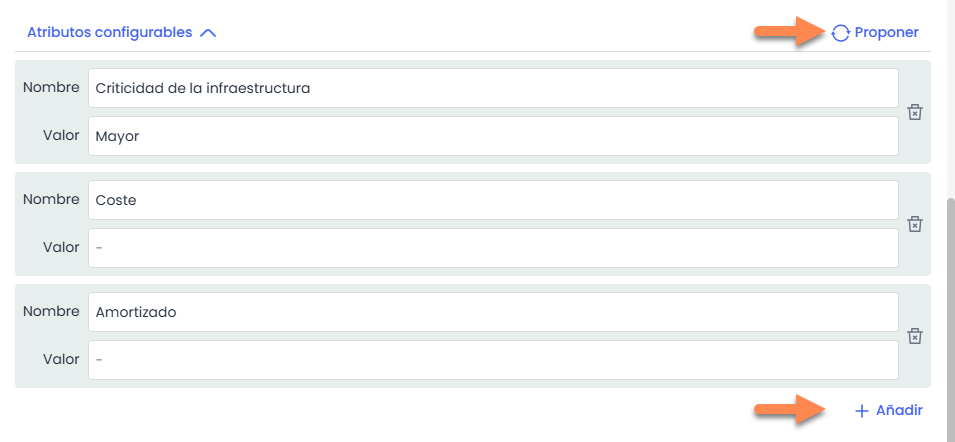
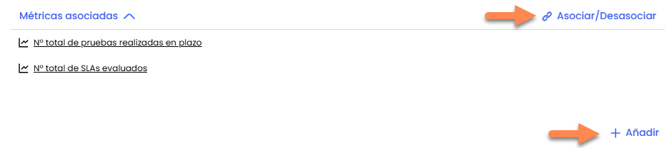
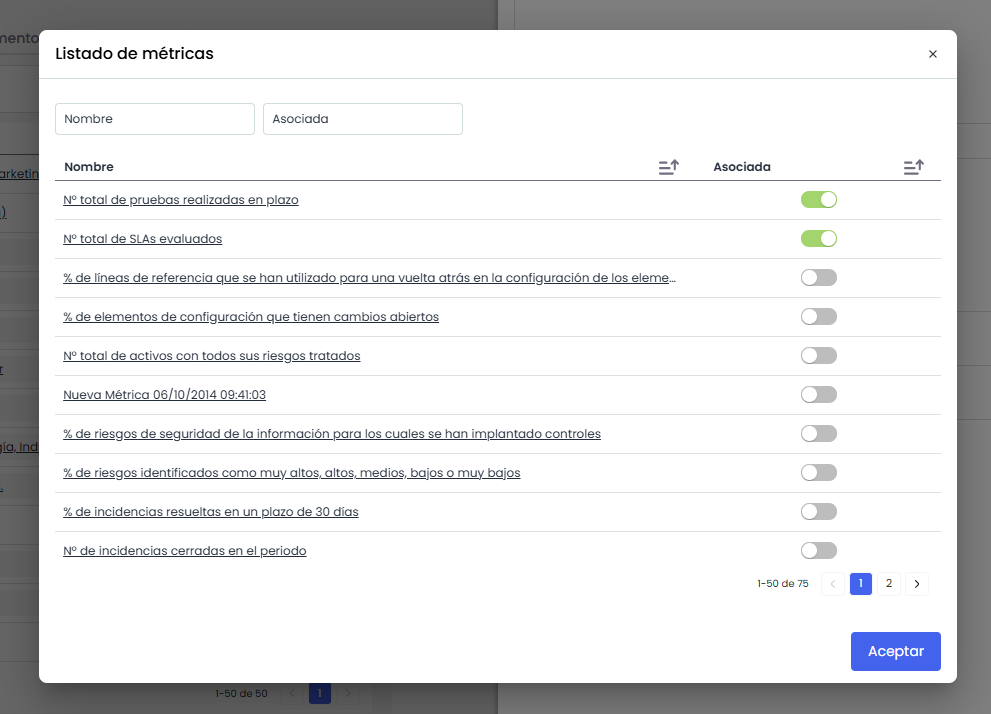

# Detalle de un elemento

Al hacer clic sobre el nombre de un elemento, se abre su **detalle en un panel lateral (sidepanel)**, desde el cual es posible consultar y editar la información asociada.

Este panel puede **expandirse** para facilitar la visualización.

## Detalle del elemento

El panel lateral muestra la información estructurada en distintos bloques:

### Datos generales del elemento

En la parte superior se visualizan los datos generales del elemento, como el nombre, la categoría y los responsables.

El comportamiento de edición depende del tipo de elemento:

* **Nombre:** no es editable en elementos pertenecientes a **categorías especiales**.
* **Categoría:** puede modificarse, pero en elementos de **categorías especiales** solo es posible seleccionar categorías del mismo tipo (categorías hermanas o hijas), sin cambiar el tipo de elemento.

### **V**aloraciones

A continuación, se muestran las **valoraciones**, correspondientes a las dimensiones definidas en la metodología. Estas pueden editarse directamente y su formato dependerá de la configuración (selector, numérico, etc.).

### Documentación

El bloque de Documentación permite gestionar los archivos asociados al elemento. Este bloque solo estará visible cuando la opción “**Visible en formulario**” esté activada en **Ajustes > Metodología de Elementos >** [**Documentación.**](../../../ajustes/metodologias/metodologia-elementos.md#Visibilidad-de-Opciones)

Desde este apartado es posible:

* **Añadir documentos:** Se pueden añadir documentos desde el equipo (hasta 10 documentos a la vez) o desde el gestor documental.
* **Editar la descripción** de cada documento.
* **Eliminar** documentos mediante el icono de papelera.

  

### Atributos configurables

El bloque de **Atributos configurables** solo estará disponible en aquellas SG que tengan definidos atributos en **Ajustes > Metodología Elementos>** [**Atributos configurables**.](../../../ajustes/metodologias/metodologia-elementos.md)

Desde este apartado es posible:

* **Añadir atributos**: Permite incorporar nuevos atributos particular a este elemento.
* **Proponer:** Añade todos los atributos definidos en en **Ajustes > Metodología Elementos>** [**Atributos configurables**](../../../ajustes/metodologias/metodologia-elementos.md)
* **Eliminar** atributos mediante el icono de papelera.

### Métricas asociadas

El bloque de **Métricas asociadas** permite visualizar y gestionar las métricas vinculadas al elemento.

* **Asociar/Desasociar**: Abre una ventana modal en la que se muestran las métricas disponibles, definidas en **Scorecard >** [**Métricas**](../../../scorecard/metricas.md), desde donde es posible asociarlas o desasociarlas del elemento.

  
* **Añadir** crea una nueva métrica. Al hacer clic sobre el nombre de una métrica, se abre en una nueva ventana el [**detalle de la métrica**](../../../scorecard/metricas.md#Datos-de-la-m%C3%A9trica) para poder configurarla.
