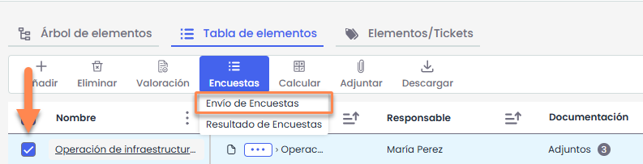
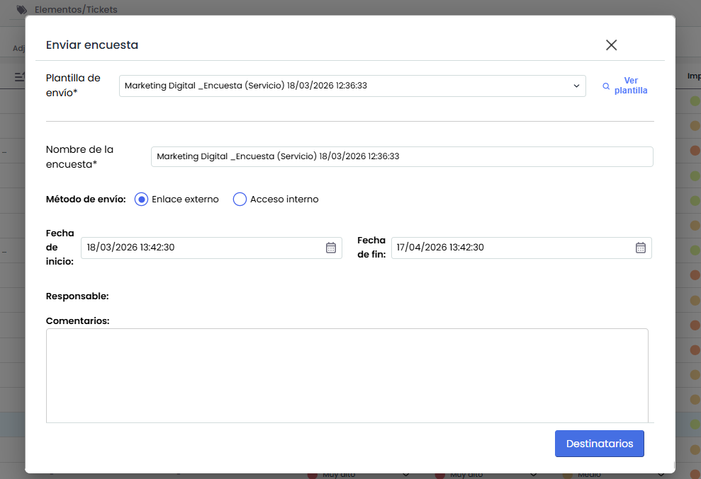
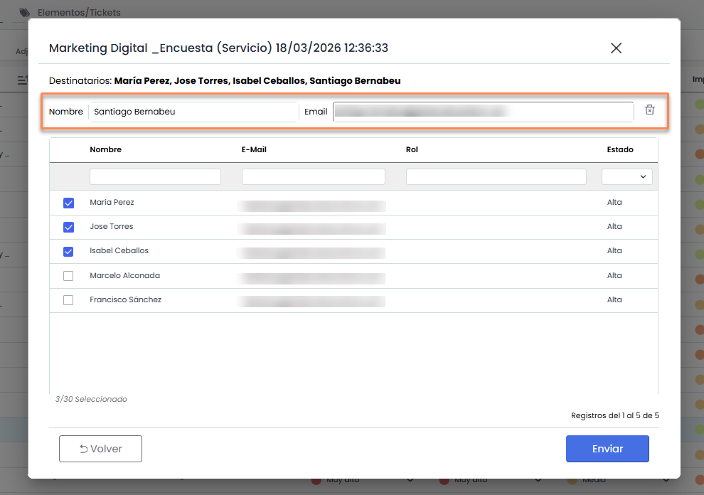
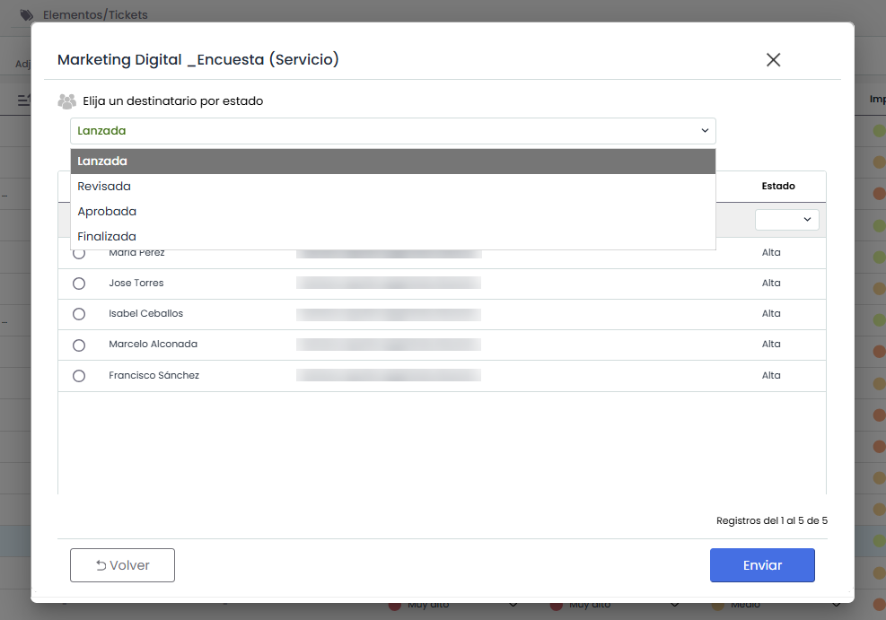

# Envío de encuestas (Inventario)

La aplicación permite enviar encuestas directamente desde la **Tabla de elementos** mediante el uso de [plantillas](../../../gestion/encuestas/configurar-encuestas/encuestas-elementos-riesgos-y-controles-configuracion.md#Plantilla) de envío previamente configuradas.

Para ello, es necesario seleccionar uno o varios elementos del inventario y pulsar la opción **Encuestas> Envío de Encuestas**.

### Configuración de envío

* **Plantilla de Envío:** Se listan todas las plantillas creadas para encuestas de a partir de una configuración de un Modelo de tipo “Encuesta de elemento”.
* **Ver plantilla:** Abre el detalle de la plantilla en [Configuración de encuestas](../../../gestion/encuestas/configurar-encuestas/encuestas-elementos-riesgos-y-controles-configuracion.md#Plantilla)
* **Nombre de encuesta:** Se muestra el nombre de la plantilla. Se puede modificar, pero no modifica el nombre de la plantilla, solo el de las encuestas que se enviaran.
* **Método de envío:**

  * Enviar encuestas Acceso Interno: Envía la encuesta sin publicación
  * Enviar encuestas Enlace Externo: Envía la encuesta con publicación

    * En este caso, se muestran los campos Fecha de Inicio y Fecha de Fin
* **Responsable**: El responsable configurado en la Plantilla.
* **Comentarios:** En este apartado se muestra el texto asociado a la plantilla, el cual se puede editar. Este texto será el que se visualice en la landing de las encuestas completadas. Si el campo queda vacío, se añadirá automáticamente un texto por defecto.

### Selección de Destinatarios - Plantilla sin estados.

**Destinatarios:** En este apartado se pueden seleccionar los destinatarios de la encuesta. Este campo puede estar prellenado si la plantilla lo incluye. Si el campo está vacío, se asignará automáticamente al responsable del elemento, siempre y cuando todos los elementos tengan el mismo responsable. Si no cumplen esta condición, el campo quedará vacío, y será obligatorio seleccionar al menos un destinatario para que se habilite el botón "Enviar"

* **Añadir nuevo:** Si es necesario incluir un destinatario que no sea empleado de la empresa, se puede ingresar su correo electrónico de forma manual para añadirlo.

  

### Selección de Destinatarios - Plantilla con estados

Si la encuesta incluye estados, la tabla de destinatarios estará prellenada según la configuración de la plantilla.

Si no hay destinatarios asignados para el primer estado, que es obligatorio, se tomará automáticamente al responsable del elemento, siempre que todos los elementos seleccionados tengan el mismo responsable. Si esta condición no se cumple, el campo quedará vacío, y será obligatorio seleccionar al menos un destinatario para el primer estado del flujo para que se habilite el botón "Enviar".

* 

### Envío de encuestas

Al presionar el botón "Enviar", el sistema realiza las siguientes acciones:

* **Creación de configuración:** Se genera la configuración correspondiente a la encuesta.
* **Generación de encuestas:** El sistema crea una encuesta para cada destinatario, vinculada a los elementos seleccionados desde el análisis.

  * **Origen "Análisis de Riesgos":** Se asociarán a cada elemento los riesgos y todos los controles que estén vinculados a esos riesgos en el análisis de riesgos.
  * **Origen "Catálogo":** Se asociarán a cada elemento únicamente los riesgos seleccionados que coincidan en categoría. Si la categoría del elemento no coincide con la del riesgo, este no será incluido.
* **Publicación:** Si el método de envío es "Enlace externo", el sistema crea también la publicación que incluye las encuestas.
