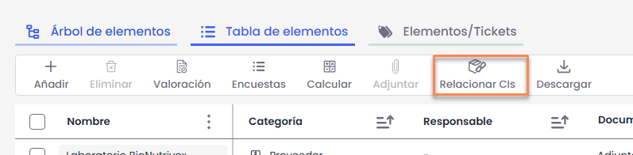
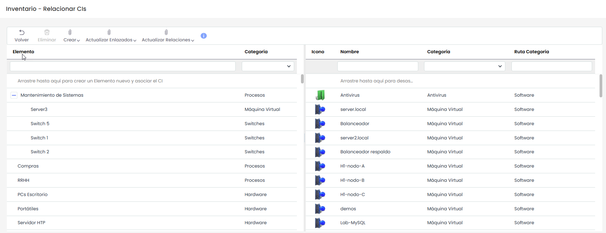
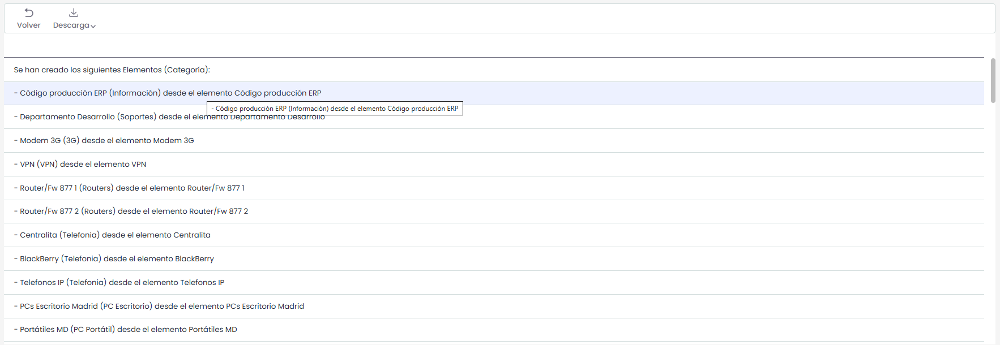

# Relacionar CIs

Permite relacionar los elementos de configuración (CIs) registrados en la CMDB con los elementos definidos en el Inventario de Elementos. Un mismo elemento del inventario puede estar compuesto por uno o varios elementos de configuración.

Al pulsar **“Relacionar CIs”**, se abre una ventana que muestra, en la parte izquierda, los elementos del Inventario y, en la parte derecha, los elementos de configuración disponibles en la CMDB.

Las asociaciones se realizan mediante la funcionalidad de **“Drag and Drop” (arrastrar y soltar)**. Para ello, se debe seleccionar un elemento de configuración de la tabla derecha y arrastrarlo sobre el elemento del inventario correspondiente en la tabla izquierda.

Para eliminar una asociación, es necesario seleccionar el elemento de configuración asociado (ubicado como segundo nivel dentro del elemento del inventario en la tabla izquierda) y arrastrarlo nuevamente hacia la tabla derecha.

A continuación, se detallan las acciones disponibles en las tablas.

**Crear**

El botón **“Crear”** permite generar nuevas relaciones entre elementos del Inventario y elementos de configuración (CIs), así como crear automáticamente nuevos elementos a partir de dichas relaciones. Dispone de dos opciones:

* **Elementos desde CMDB**: permite crear nuevos elementos en el Inventario a partir de los elementos de configuración existentes en la CMDB. Al utilizar esta opción, se generan elementos del inventario tomando como base la información de los CIs seleccionados, estableciendo además la relación entre ambos.
* **CIs desde Inventario**: permite crear nuevos elementos de configuración en la CMDB a partir de los elementos ya existentes en el Inventario. De esta forma, se pueden dar de alta CIs basados en elementos del inventario que aún no estén registrados en la CMDB, quedando automáticamente vinculados.

**Actualizar enlazados**

El botón **“Actualizar enlazados”** permite sincronizar la información entre los elementos del Inventario y los elementos de configuración (CIs) que ya están relacionados. Dispone de dos opciones:

* **CIs CMDB**: actualiza la información de los elementos de configuración en la CMDB tomando como referencia los datos del Inventario. Esta opción se utiliza cuando se han realizado cambios en los elementos del inventario y se desea que dichos cambios se reflejen en los CIs asociados.
* **Elementos**: actualiza la información de los elementos del Inventario a partir de los datos existentes en los CIs de la CMDB. De este modo, cualquier modificación realizada en la CMDB puede trasladarse a los elementos del inventario ya vinculados.

**Actualizar relaciones**

El botón **“Actualizar relaciones”** permite sincronizar la estructura de relaciones (jerarquías y dependencias) entre los elementos del Inventario y los elementos de configuración (CIs) de la CMDB. Dispone de dos opciones:

* **Árbol de Elementos desde CMDB**: actualiza la estructura jerárquica de los elementos del Inventario tomando como referencia las relaciones definidas en la CMDB. Esta opción replica en el inventario las dependencias existentes entre los CIs, ajustando el árbol de elementos en consecuencia.
* **CMDB desde Árbol de Elementos**: actualiza las relaciones entre los elementos de configuración en la CMDB a partir de la estructura definida en el Inventario. De este modo, las dependencias configuradas en el árbol de elementos se trasladan a los CIs asociados.

Estas opciones permiten mantener alineadas las relaciones entre ambos entornos, asegurando que tanto la CMDB como el Inventario reflejen la misma estructura de dependencias.

Tras ejecutar cualquiera de las opciones disponibles (**Crear**, **Actualizar enlazados** o **Actualizar relaciones**), la aplicación muestra una pantalla de resultado con el detalle de los cambios realizados.

En esta vista se presenta un **log de ejecución**, donde se listan todas las acciones llevadas a cabo por el sistema, indicando los elementos afectados y las operaciones realizadas en cada caso.

Esta pantalla permite validar el resultado del proceso y, adicionalmente, ofrece la posibilidad de **descargar el listado de resultados**, facilitando su revisión o tratamiento posterior fuera de la herramienta.

