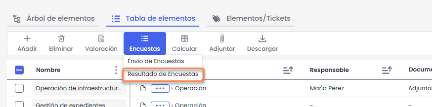
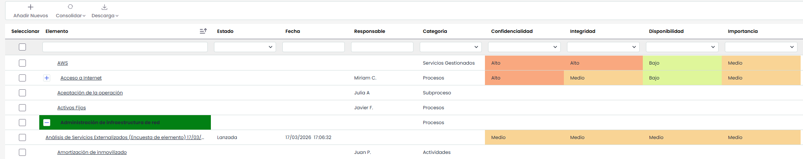
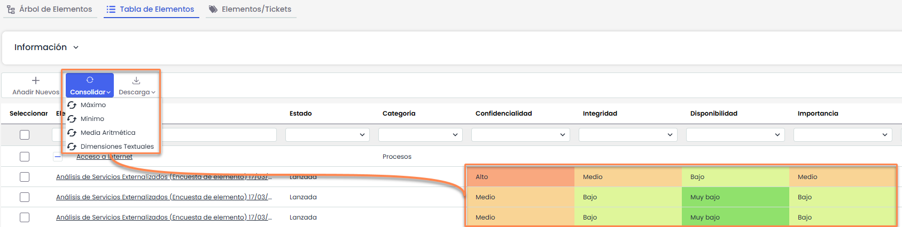
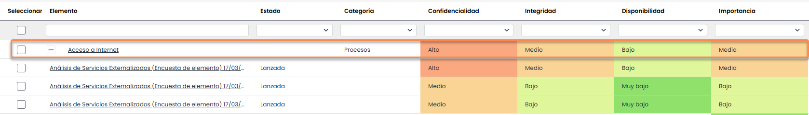

# Resultado de Encuestas (Inventario)

La opción permite visualizar la valoración de los activos que se han realizado en las diferentes encuestas de tipo 'Elementos y Riesgos'.

## Árbol de elementos y encuestas

Al acceder a la opción, se muestra un **árbol jerárquico** en el que se visualizan los activos y, dentro de cada uno, las encuestas que se han realizado sobre ellos.

Cada fila puede corresponder tanto a un activo como a una encuesta asociada, mostrando la siguiente información:

* **Elemento**: indica el nombre del activo o de la encuesta asociada.
* **Estado**: muestra el estado de la encuesta.
* **Fecha**: indica la fecha de lanzamiento de la encuesta.
* **Responsable**: indica el recurso de la organización encargado de la gestión del activo.
* **Categoría**: muestra la categoría o subcategoría a la que pertenece el activo.
* **Dimensiones**: refleja las características o atributos del activo, así como sus valoraciones.

En el caso de los activos, las dimensiones mostradas corresponden a las valoraciones actuales registradas en el inventario.

En las encuestas asociadas se visualizan las valoraciones obtenidas en cada una de ellas, lo que permite comparar los distintos resultados antes de realizar la consolidación.

## Acciones

**Añadir nuevo**

Permite insertar en el inventario de activos aquellos activos nuevos identificados en las encuestas.

* Los activos nuevos se muestran **resaltados en verde**.
* Se puede seleccionar qué activos añadir y cuáles no.

  

**Consolidar**

Permite unificar las valoraciones de un mismo activo obtenidas a través de diferentes encuestas.

Esta acción actualiza las valoraciones en **Análisis > Inventario de Activos > Tabla de elementos**, aplicando un criterio de consolidación.

Opciones disponibles:

* **Máximo**: registra la valoración más alta.
* **Mínimo**: registra la valoración más baja.
* **Media aritmética**: calcula el promedio de las valoraciones.

Las siguientes imágenes muestran una consolidación con valores máximos.

* **Dimensiones textuales:**  
  Para este tipo de dimensiones no se aplica un criterio de cálculo. Es necesario seleccionar una única encuesta, ya que no es posible consolidar múltiples valores textuales.  
  La acción toma el valor textual de la encuesta seleccionada y lo aplica directamente al activo en el inventario, sobrescribiendo el valor existente.

**Descarga**

Permite exportar los resultados de la encuesta de activos, junto con sus atributos y valoraciones.

Formatos disponibles:

* **.xlsx**
* **.PDF**
