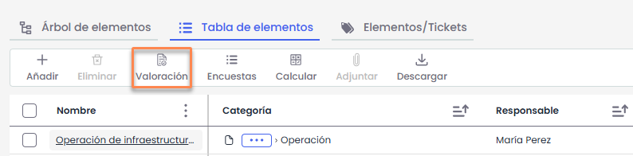
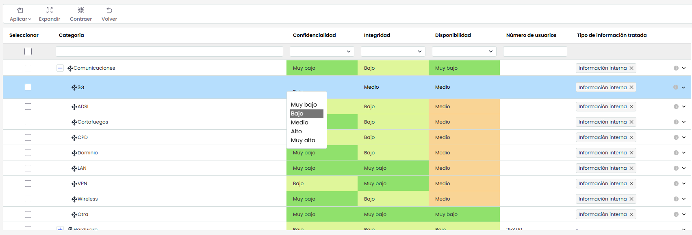
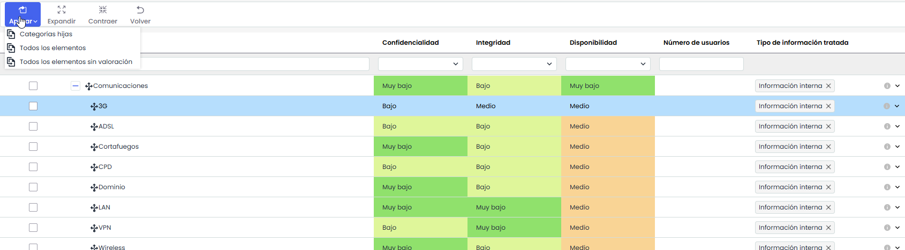

# Valoración General

La funcionalidad de **Valoración** permite asignar valores a las dimensiones configuradas como **manuales** en las categorías de activos. Estas dimensiones corresponden a las definidas en los **ajustes de la metodología de elementos**.

La valoración puede realizarse de forma individual por elemento o aplicarse de manera masiva sobre varias categorías cuando comparten el mismo criterio.

Al acceder a esta opción, se abre una ventana donde se gestionan las valoraciones de forma centralizada.

## Árbol de Categorías

La pantalla muestra una tabla jerárquica de **categorías y subcategorías de activos**, junto con las **dimensiones definidas en la metodología de elementos**.

* Cada fila corresponde a una categoría o subcategoría.
* Las columnas representan las dimensiones disponibles para su valoración. Solo se pueden valorar las **dimensiones no textuales**.
* Es posible asignar valores directamente sobre cada celda de dimensión.

La edición del valor se realiza directamente sobre la celda y el tipo de campo dependerá de la configuración de la dimensión (cualitativos, cuantitativa y multinivel)

## Acciones

### Aplicar

Este botón muestra un menú con acciones de aplicación masiva sobre las categorías seleccionadas.

* **Categorías hijas**  
  Aplica la valoración de las dimensiones de las categorías seleccionadas a todas sus subcategorías asociadas.  
  Es necesario seleccionar previamente una o varias categorías.
* **Todos los elementos**  
  Aplica la valoración de las dimensiones de las categorías seleccionadas a todos los activos del inventario que pertenezcan a dichas categorías.  
  Es necesario seleccionar previamente una o varias categorías.  
  Al ejecutarlo, se muestra una **ventana de confirmación** que permite decidir si se desea generar un histórico del inventario antes de aplicar la nueva valoración.
* **Todos los elementos sin valoración**  
  Aplica la valoración de las dimensiones de las categorías seleccionadas únicamente a los activos del inventario que pertenezcan a dichas categorías y que no tengan una valoración previa.  
  Es necesario seleccionar previamente una o varias categorías.  
  Esta acción no sobrescribe valoraciones existentes.  
  Al ejecutarlo, se muestra una **ventana de confirmación** que permite decidir si se desea generar un histórico del inventario antes de aplicar la nueva valoración.
