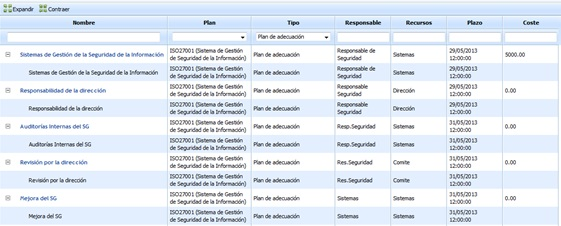
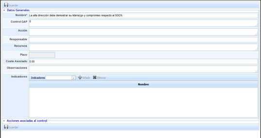
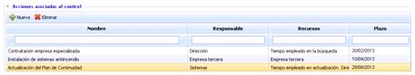

# Resumen de planes

La opción 'Resumen de planes' ofrece un listado de todos los planes que la organización ha definido, mostrando un listado de los controles definidos en las opciones 'Inicio/Plan de Adecuación' y 'Análisis/Gestión de Riesgos'.'

Las acciones que se pueden realizar sobre la tabla de controles son las siguientes:

* **Expandir:** Expande el listado de todos los controles.
* **Contraer:** Contrae el listado de todos los controles.

La información que muestran las distintas columnas de la organización son las siguientes:

* **Nombre:** Identifica el nombre del control.
* **Plan:** Muestra el nombre del catálogo al que está asociado el control.
* **Tipo:** Permite identificar si el control viene derivado de un plan de adecuación o de un plan de tratamiento.
* **Responsable:** Muestra la información del responsable del control.
* **Recursos:** Muestra el listado de recursos asignados al control.
* **Plazo:** Identifica el plazo de implantación definitiva del control.
* **Coste:** Ofrece información sobre el coste de implantación del control.

Si pulsamos sobre el enlace de un control se muestra un formulario sobre el que podemos definir los siguientes conceptos:

* **Nombre:** Identifica el nombre del control que se mostrara en la tabla inferior.
* **Control GAP:** Permite identificar el control al que está asociado.
* **Acción:** Ofrece la posibilidad de describir más en detalle en que consiste el control
* **Responsable:** Identifica el responsable dentro de la organización de verificar la implantación del control en los plazos definidos.
* **Recursos:** Permite identificar los recursos o departamentos de la organización que van a estar implicados en la implantación del control.
* **Plazo:** Identifica el plazo en el cual el control debe estar implantado en la organización.
* **Coste Asociado**: Posibilita definir el coste que tiene para la organización la implantación del control.
* **Observaciones:** Permite indicar cualquier anotación adicional asociada al control.
* **Indicadores:** Permite asociar uno o varios indicadores definidos en el apartado ‘ScoreCard/Indicadores’.

**Acciones asociadas al control**

Permite definir las acciones necesarias para la implantación del control pulsando sobre el botón ‘Nueva’. Esto genera una nueva entrada en la tabla que permite definir los siguientes parámetros:

* **Nombre:** Permite identificar el nombre de la acciones pulsando dos veces sobre la celda.
* **Responsable:** Identifica el responsable o departamento dentro de la organización encargado de verificar la finalización de la acción en el plazo definido.
* **Recursos:** Permite identificar el/los recursos o departamentos implicados en la realización de la acción.
* **Plazo:** Identifica el plazo en el cual la acción debe estar completada. Este plazo no debe ser superior al plazo de implantación definitivo del control.

En caso de querer eliminar una acción, se ha de seleccionar la fila o filas deseadas y pulsar el botón ‘Eliminar’.
