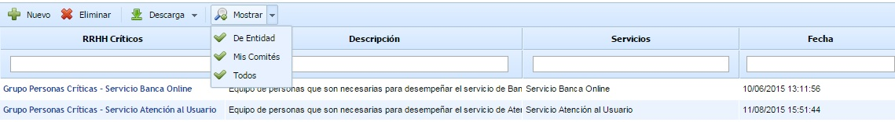
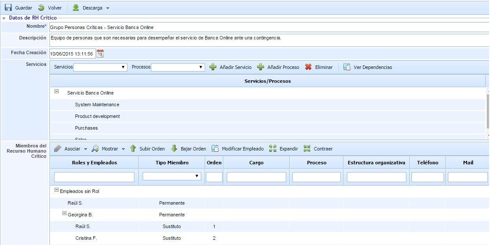
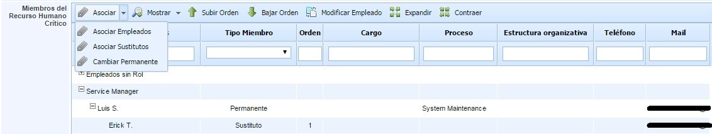
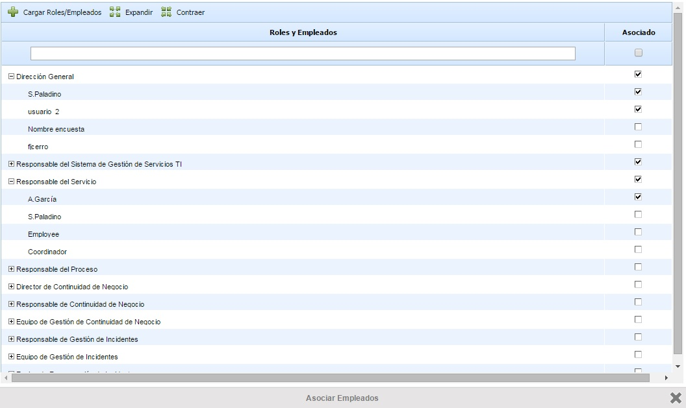

# RRHH Críticos

Esta opción permite definir grupos de personas que son críticos para la organización, como por ejemplo Equipos de Emergencia o Equipos de Recuperación ante Desastres.

Para crear un grupo de personas críticas se debe pulsar el botón de ‘Nuevo’ y a continuación aparecerá una nueva entrada en la tabla. Para eliminar un grupo creado se deberá seleccionar la fila o filas que se desean eliminar y a continuación pulsar sobre el botón ‘Eliminar’.

El botón ‘Descarga’ permite descargar el listado de grupos de RRHH en formato editable (.xlsx) o en formato .PDF

El botón 'Mostrar' permite filtrar los grupos de personas críticas que se muestran en la tabla. Cada opción permite:

* **De Entidad:** Muestra todos los RRHH Críticos de la entidad con la que se está trabajando. Es la vista por defecto al ingresar en la opción.
* **Mis Comités:** Muestra los RRHH Críticos dónde el usuario pertenece.
* **Todos:** Muestra todos los RRHH Críticos definidos, tanto de la entidad con la que se está trabajando como de las entidades que se encuentran por debajo.

Para definir los detalles de un grupo de personas críticas debe ingresar en el formulario pulsando directamente en el nombre del mismo.

El formulario permite realizar las siguientes acciones:

* **Guardar:** Permite guardar todos los cambios o modificaciones realizadas en el formulario.

* **Volver:** La herramienta regresa a la pantalla anterior, donde figura el listado con todos los RRHH Críticos.

* **Descarga:** Permite descargar la información de los RRHH Críticos en formato editable (.docx).

El formulario está compuesto por la siguiente información:

* **Nombre:** Nombre descriptivo del grupo de personas críticas que aparecerá en la tabla inicial de la opción.

* **Descripción:** Permite realizar una descripción más detallada de la función del grupo de personas.

* **Fecha Creación:** Identifica la fecha de creación del grupo.

* **Servicios:** Permite asociar a los RRHH Críticos los servicios y los procesos de negocio de la organización. Para asociar un servicio se debe seleccionar en el desplegable el servicio deseado y pulsar el botón ‘Añadir Servicio’. Para asociar un proceso, se debe seleccionar un servicio ya insertado y un proceso del desplegable, y pulsar el botón 'Añadir Proceso'. En caso de querer eliminar un servicio o un proceso de la tabla, se debe seleccionar el servicio o proceso en la tabla y pulsar el botón ‘Eliminar’.

* **Miembros del Grupo de Personas Críticas:** Esta tabla permite asociar a los RRHH críticos los empleados que lo componen. En la siguiente sección se detalla su funcionamiento.

## Miembros del Grupo de Personas Críticas

La tabla de miembros del comité permite asociar empleados dados de alta en GlobalSuite a los RRHH Críticos. Esta tabla permite asociar empleados permanentes, sustitutos e invitados al grupo.

Las opciones disponibles para establecer los empleados del grupo de RRHH Críticos son:

* **Asociar Empleados:** Pulsando sobre esta opción aparece una ventana con todos los roles y empleados definidos en la opción 'Roles y Responsabilidades'. También aparecen los empleados que no están asociados a ningún rol. A través de las casillas de selección de la derecha se permite asociar los empleados al grupo. Una vez seleccionados hay que pulsar sobre el botón 'Cargar Roles/Empleados" para añadirlos a la tabla.

Los empleados añadidos al grupo de RRHH Críticos se registran, por defecto, como empleados de tipo 'Permanente'. Se permite cambiar el tipo en la columna 'Tipo Miembro' pudiendo definir un empleado como 'Sustituto' o 'Invitado'.

* **Asociar Sustitutos:** Esta opción permite asociar empleados sustitutos a un empleado del tipo 'Permanente' (para los tipos 'Sustituto' o 'Invitado' no se permite asociar empleados sustitutos). Para ello, hay que seleccionar el empleado y pulsar sobre el botón 'Asociar Sustitutos', mostrándose una tabla con todos los empleados de la organización pudiendo seleccionar uno o varios empleados sustitutos.

* **Mostrar:** Este botón permite filtrar la tabla para mostrar/ocultar los empleados sustitutos asociados a los empleados permanentes.

* **Subir/Bajar Orden:** Estos botones permiten ordenar los empleados sustitutos que están asociados a un empleado 'Permanente'. Para ello, hay que seleccionar un empleado sustituto y pulsar el botón correspondiente en función de si se desea subir o bajar el orden.

* **Modificar Empleado:** Esta opción permite modificar los datos identificativos de un empleado seleccionado en la tabla. Aparece una ventana emergente con todos los campos del formulario de empleado.

* **Expandir/Contraer:** Estos botones permiten mostrar todos los empleados o contraer los elementos para que sólo se muestren los roles, respectivamente.
