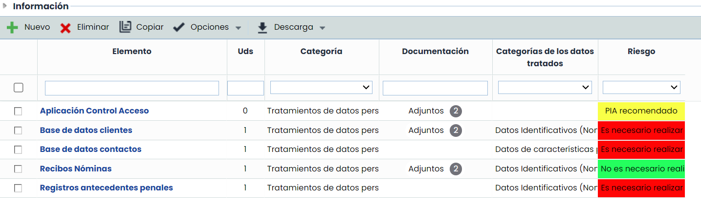
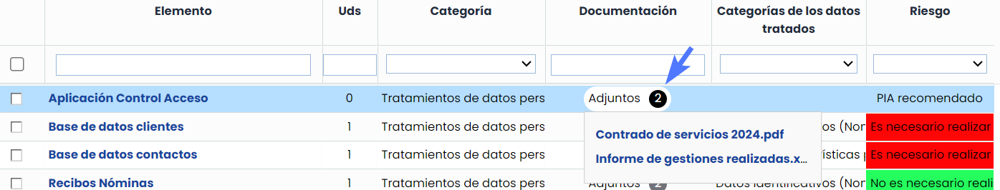
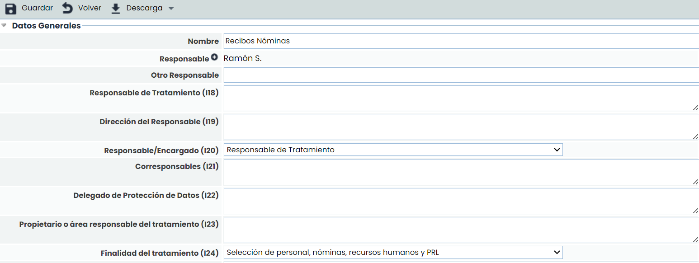

# Tratamientos

Esta opción permite al usuario definir, catalogar y valorar los distintos tratamientos de datos personales de la organización que se deseen registrar.

La tabla de tratamientos permite realizar las siguientes acciones:

* **Nuevo:** Permite insertar un nuevo tratamiento en la tabla. Este nuevo tratamiento también se mostrará en la opción ‘Inventario', con la categoría definida como "Tratamiento" en 'Ajustes’.
* **Eliminar:** Permite eliminar un tratamiento de la tabla seleccionando la fila o filas deseadas y pulsando el botón ‘Eliminar’. Al eliminar un tratamiento se borra también de la opción 'Inventario'.
* **Copiar:** Permite copiar un tratamiento de la tabla seleccionando la fila o filas deseadas y pulsando el botón ‘Copiar’. Al copiar un tratamiento se incluye también en la opción 'Inventario'.
* **Opciones - Importar:** GlobalSuite posibilita importar listados de tratamientos en formato Excel. En el botón 'Descarga" existe un **modelo de archivo** con los campos que se pueden importar en la tabla de tratamientos. Pulsando sobre esta opción se pueden ver los campos que se van a importar, el único dato obligatorio es el nombre del elemento, el resto de datos se pueden o no incluir en la importación. La selección del archivo se realiza a través del botón ‘Seleccionar archivo’ y pulsar sobre el botón 'Continuar'.

### Asociar y adjuntar Documentación

Al habilitar la visibilidad de la documentación en tabla será posible incorporar documentación desde dos fuentes:

* **Adjuntar Documentos desde el Equipo Local:** Será posible adjuntar documentos directamente desde el equipos local de cada usuario, simplificando la incorporación de nueva documentación relevante.
* **Asociar Documentos desde el Gestor Documental:** Se podrán asociar los documentos previamente almacenados en el [Gestor Documental](https://help.globalsuitesolutions.com/es/globalsuite/v1/gestor-documental), así como desasociarlos cuando sea necesario. Esto permite centralizar y facilitar el acceso a toda la documentación relevante.

Toda la documentación adjunta se verá reflejada en el campo “Documentación”


\*\*Nota\*\*
Para visualizar esta opción deberás habilitarla en Ajustes> Metodologías > [Elementos](https://help.globalsuitesolutions.com/es/globalsuite/v1/metodologia-elementos)


* **Descarga (Informe RAT):** Permite descargar el informe RAT (Registro de Actividades de Tratamiento) en formato WORD, de los Tratamientos que se hayan seleccionado en la tabla. Este informe contiene información acerca de los riesgos y controles relacionados con el tratamiento en los análisis de riesgos, así como de los elementos que estén relacionados con el mismo en el árbol de dependencias. Esta opción también permite descargar un modelo de archivo para realizar la importación de tratamientos.

Al pulsar sobre el enlace del tratamiento se muestran los campos de la ficha del tratamiento, pudiendo rellenar los siguientes campos:

* **Nombre:** Permite definir el nombre del tratamiento.
* **Responsable:** Identifica el responsable del tratamiento dentro de la organización. Este responsable se puede seleccionar del conjunto de Empleados (ver apartado en pestaña Gestión).
* **Otro Responsable:** Identifica el responsable del tratamiento dentro de la organización, pudiendo definirlo de manera textual.
* **Resto de campos:** A continuación, pueden rellenarse todas las dimensiones o campos que se hayan configurado para la ficha del tratamiento. La herramienta muestra aquellas dimensiones que se han definido en el apartado 'Ajustes/Metodologías de Análisis'.
