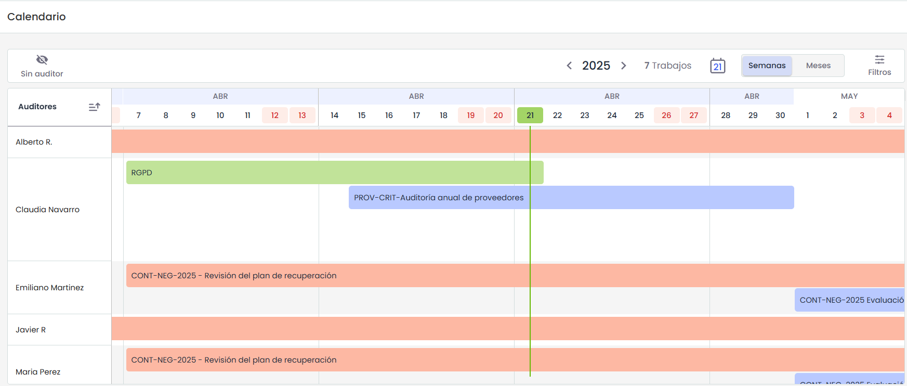
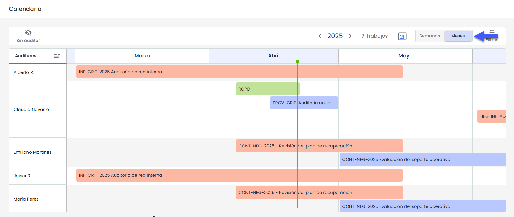
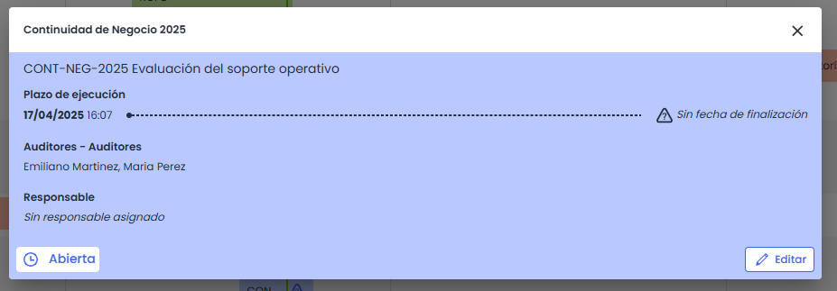
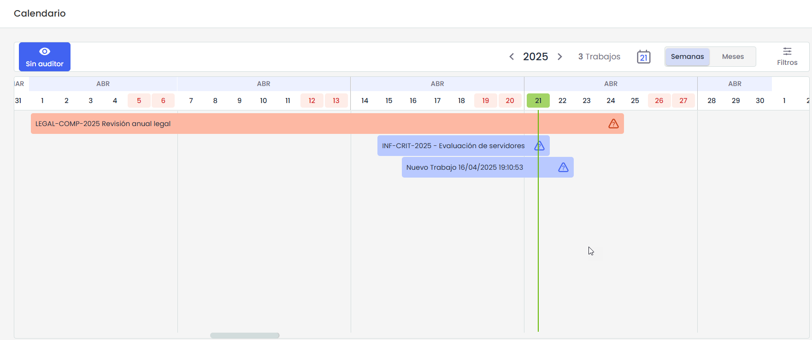
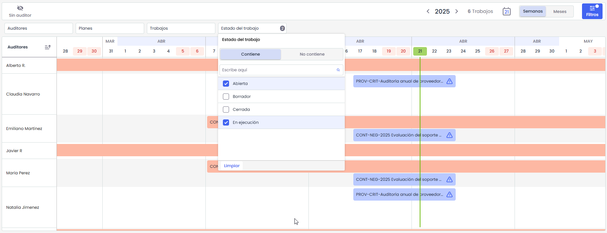

# Calendario de Auditores

El Calendario de Auditores permite visualizar de forma gráfica la planificación semanal de los trabajos asignados a los distintos auditores. Está organizado en una vista tipo tabla, donde las filas corresponden a los auditores y las columnas a los días de la semana.

### Calendario

Al abrir el calendario, la vista se muestra por defecto en formato Semanas, donde se presentan todos los días del año, incluyendo los fines de semana. En la cabecera se pueden ver los días de la semana, y una división visual permite identificar fácilmente el cambio de semanas y de meses, lo que facilita la lectura de la planificación.

Desde el toolbar, es posible cambiar la escala a formato Meses. Al seleccionarlo, la vista se adapta para mostrar las duraciones de los trabajos dentro de cada mes, permitiendo una visualización más general del plan de trabajo.

En ambas vistas, el calendario destaca el día actual mediante una línea verde vertical, que permite identificar rápidamente la fecha actual.

### Auditores

Cada fila del calendario representa a un auditor. Solo se mostrarán aquellos auditores que tengan al menos un trabajo asignado en el año seleccionado. Si un auditor no tiene trabajos planificados durante ese período, no aparecerá en la vista.

### Trabajos

Los trabajos se disponen visualmente por auditor, según su fecha de inicio y fin. Si un trabajo no tiene fecha de fin, se mostrará con una duración estándar de una semana.

Cuando varios trabajos coinciden en fechas y se solapan, se organizan uno encima del otro, ampliando el espacio asignado al auditor en el calendario. En estos casos, el trabajo que comienza primero se posiciona siempre por encima del resto.

Si un trabajo tiene información incompleta, como la ausencia de fecha de fin o de auditor asignado, se mostrará un icono de advertencia directamente en la vista del calendario para señalar que hay datos pendientes de completar.

Colores por estado:

* **Borrador**: Gris
* **Abierto:** Azul
* **En ejecución:** Rojo
* **Cerrado:** Verde

### Navegación

El calendario permite la navegación dentro de un año completo. Desde el toolbar se puede seleccionar el año deseado, y la vista se actualizará automáticamente para mostrar únicamente los trabajos correspondientes a ese período.  
Dentro del año seleccionado, es posible desplazarse horizontalmente usando el scroll para recorrer los distintos días y semanas del calendario.do.  
El sistema solo mostrará auditores con trabajos asignados en el año seleccionado.

### Detalle de trabajos

Al hacer clic sobre un trabajo en el calendario, se abre un pop-up con la información detallada del mismo. En esta vista se muestra el plazo de ejecución, los auditores asignados, y el responsable del trabajo.

Si el trabajo tiene datos incompletos, también se visualiza un icono de advertencia dentro del pop-up, indicando claramente qué información falta. Esto permite al usuario identificar rápidamente los campos pendientes, incluso desde el detalle del trabajo.

### Opciones:

* **Vista “Sin auditor”**  
  El calendario incluye una vista especial llamada **"Sin auditor"**, que muestra una única fila con los trabajos que aún no han sido asignados a ningún auditor. Esta vista permite identificar rápidamente las tareas pendientes de distribución y facilita su reasignación desde el propio calendario.

* **Ir al día de hoy**  
  En el toolbar se encuentra un icono con forma de calendario que muestra la fecha actual. Al hacer clic sobre él, el sistema desplaza automáticamente la vista hacia el día de hoy, sin importar en qué parte del calendario nos encontremos.
* **Filtros**:

El calendario incluye una barra de filtros ubicada en la parte superior, que permite refinar la visualización de los trabajos mostrados según distintos criterios. Los filtros disponibles actualmente son: Auditores, Planes, Trabajos, Estado del trabajo

Al hacer clic sobre cualquiera de los filtros, se despliega un menú donde es posible seleccionar condiciones como "Contiene" o "No contiene", además de una lista con las opciones disponibles para ese campo. Cada opción puede seleccionarse de forma individual mediante un checkbox, y también se incluye un campo de búsqueda para facilitar la localización de valores en listas extensas.

Los filtros aplicados afectan directamente a la visualización del calendario, mostrando únicamente aquellos trabajos que cumplan con los criterios seleccionados
