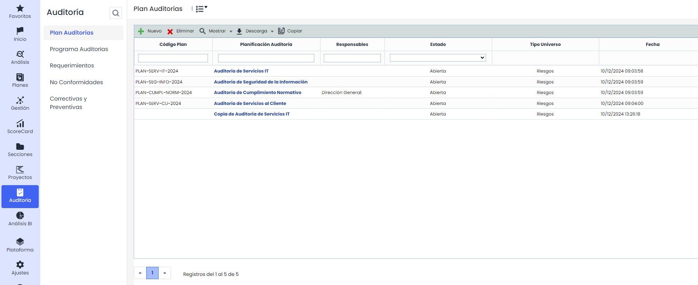
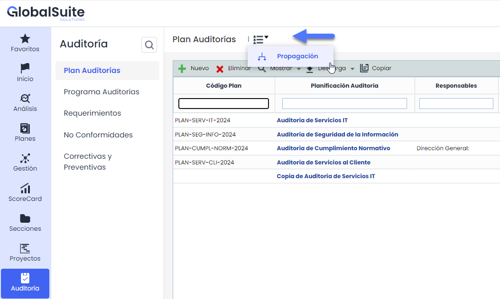
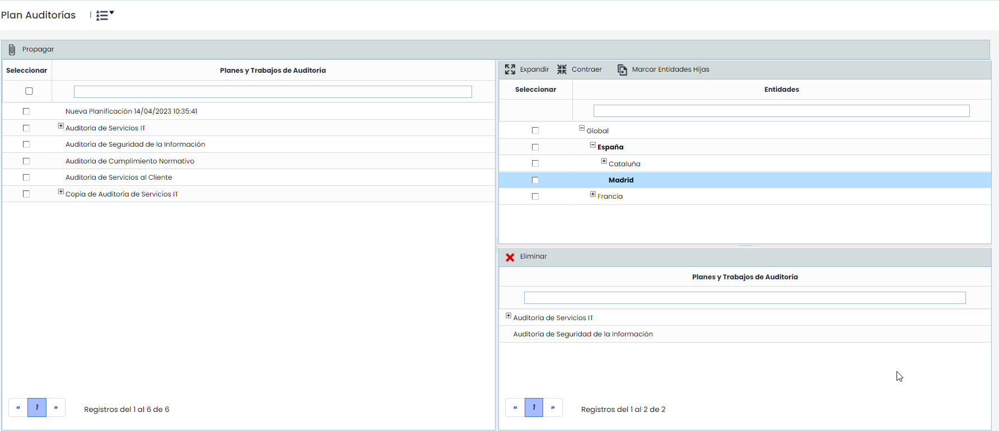

# Plan Auditorías


La opción de Plan de Auditorías, permite gestionar las distintas planificación de auditorías de la organización, así como la priorización de los elementos a auditar en función de la metodología utilizada.


* [Plan Auditoría](plan-auditoria.md)
* [Planificación Trabajos](planificacion-trabajos.md)

Al acceder a la opción la herramienta ofrece las siguientes opciones:

* **Nuevo**: Permite crear una nueva planificación de auditorias. Para ello se ha de pulsar el botón ‘Nuevo’ y se creará una nueva planificación.
* **Eliminar:** Permite eliminar un plan de auditoría. Para ello se ha de seleccionar la fila o filas deseadas y pulsar el botón ‘Eliminar’.
* **Mostrar:** Ofrece la posibilidad de visualizar las planificaciones de auditorías definidas, por un lado ‘Todas', 'Borrador’ y 'Solo abiertas', este última es la opción por defecto para ver las que están abiertas o pendientes de cerrar.
* **Descarga:** Permite obtener el listado de Planes de Auditoría gestionados en el apartado.
* **Copiar:** Sirve para realizar una copia del Plan de Auditoría con toda la información incluida, también los Trabajos de auditoría asociados ([Programa Auditorías](../programa-auditorias/README.md))

## Propagación de Planes de Auditoría

En caso de disponer una estructura de [Subentidades](../../ajustes/subentidades.md), será posible propagar Planes de Auditoría a otras entidades. Para ello, habrá que pulsar en el apartado de 'Propagación' que aparecerá en el menú superior.

Una vez se ha accedido a la opción, se muestran las siguientes tablas:

* **Planes y Trabajos de Auditoría:**Muestra el listado de todos los Planes y sus Trabajos en estado Abierto y Borrador que se han definido en la entidad actual. Las opciones que permite la tabla son:

  * **Propagar:** Una vez seleccionados los planes y trabajos deseados permite propagar los mismos a las subentidades seleccionadas.
  * **Volver:** Ofrece la posibilidad de volver a la pantalla inicial de servicios.
* **Tabla Subentidades:**Muestra el listado de subentidades a las que se pueden asociar planes. Las opciones que permite la tabla son la de expandir o contraer el listado de subentidades, además de poder marcar todas las subentidades pulsando sobre el botón 'Marcar Entidades Hijas'
* **Tabla Planes y Trabajos de Auditoría:** Una vez seleccionada la subentidad en la tabla superior, muestra los planes que se han asociado a la misma. La herramienta ofrece la posibilidad de eliminar un plan de la subentidad, para ello se ha de seleccionar la fila deseada y pulsar sobre el botón 'Eliminar'

Esta propagación realizará una copia de todos los planes y trabajos seleccionados, incluidos sus códigos (si estos están visibles/activados), así como de los elementos involucrados en los mismos, salvo los empleados del equipo auditor, ya que son propios de cada subentidad.
