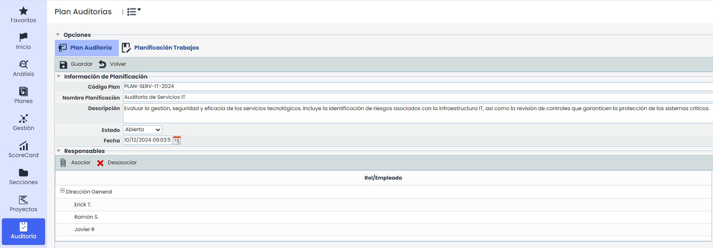
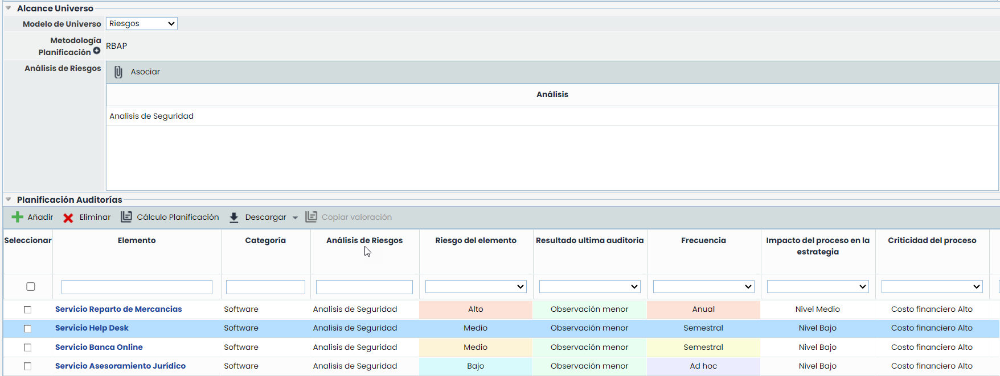
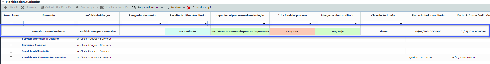
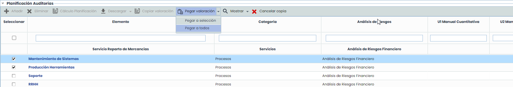

# Plan Auditoría


Una vez dentro de un Plan de Auditoría, en la parte superior se muestran dos opciones. Por defecto, se carga el apartado de Plan Auditoría.
Este apartado permite definir los parámetros con los que poder configurar la planificación de auditoría. Se compone de diversas secciones que se indican a continuación.


## Información de Planificación y Responsables

### Información de Planificación

* **Código de Plan:** Identifica el código asignado a la planificación de auditoría. Se puede configurar su visibilidad en Ajustes>[Metodologías de Auditorias.](https://help.globalsuitesolutions.com/es/globalsuite/v1/metodologias-auditorias)
* **Nombre:** Identifica el nombre de la planificación de auditoría que se mostrará en el listado visto anteriormente.
* **Descripción:** Permite tener una descripción más detallada y extensa de la planificación de auditoría.
* **Estado:** Permite definir el campo estado de la planificación de auditoría que se está configurando. Se puede seleccionar varios estados:

  * **Abierta:** Es un estado inicial de planificación, se pueden ver desde el listado visto anteriormente las planificaciones que estén en este estado. Estarán por definir o planificar por el equipo auditor.
  * **Borrador:** Estado que permite crear borradores de auditorías que funcionan como plantillas o trabajos de auditoría base, los cuales pueden copiarse y no se muestran por defecto en la tabla principal.
  * **Planificada:** Estado en el cual se esta llevando a cabo la planificación de la auditoría, por estar ya definida o planificada.
  * **Cerrada:** Es un estado final, se aplica en los casos en los que esta ya realizada la planificación de la auditoría y se puede ya dejar cerrada.
* **Fecha:** Permite indicar la fecha de la planificación de la auditoría.

### Responsables

Esta sección permite identificar a los responsables de la planificación de la auditoría.

* **Asociar:** Ésta opción permite asociar uno o varios responsables a la planificación. Para ello se selecciona el botón Asociar, y en la ventana emergente que aparece, se pueden seleccionar los roles o las personas concretas que se quieran asignar.
* **Desasociar:** Permite desasociar uno o varios responsables a la planificación. Para ello se debe seleccionar el responsable que se quiera desasociar y se pulsa sobre el botón 'Desasociar'.

## Alcance Universo y Planificación Auditoría

### Alcance Universo

* **Modelo del Universo:** Este modelo es el que está definido en la metodología de auditoría.
* **Metodología Planificación:** Permite elegir una metodología de auditorías de entre las definidas en Ajustes.
* **Análisis de Riesgos:**

  * **Asociar:** Ésta opción permite asociar los análisis de riesgos que utilizan la metodología de riesgos asociada a la metodología de planificación utilizada. Se podrán seleccionar varios análisis de riesgos de entre los que utilicen dicha metodología.

### Planificación Auditorías

En este apartado se muestran todos los elementos que están incluidos en los Análisis seleccionados. Se muestran todas las dimensiones utilizadas en la planificación.

En caso de que se seleccione una metodología de planificación de tipo Elementos, en esta tabla se cargarán por defecto, todos los elementos del inventario. Si se desea definir el alcance de este tipo de auditorías específicamente a los elementos incluidos en uno o más Análisis de riesgos, se podrán seleccionar desde la opción “Asociar”. Esta acción dinámica reemplazará los elementos cargados por defecto en la tabla de planificación con los elementos asociados a los análisis de riesgos seleccionados.

* **Cálculo Planificación:** Permite realizar los cálculos de la planificación y actualizar las dimensiones de la metodología de planificación.
* **Copiar Valoración:** Permite al usuario realizar la copia de la valoración de un elemento y pegarla a todos o los que desee.

  * Una vez que seleccionamos un elemento de la tabla, se podrá utilizar la funcionalidad de copia Valoración.
  * Al presionarlo, en la cabecera de la tabla se fijara el elemento seleccionado y se mostraran las opciones relacionadas con la copia de valoración:

    
  * **Pegar Valoración**

    * **Pegar a todos**: Esta opción aplicará la valoración del elemento seleccionado a todos los elementos visibles en la tabla. Si hay filtros activos, solo se aplicará a los elementos visibles.
    * **Pegar a selección:** Permite aplicar la valoración del elemento seleccionado a los elementos que seleccionados en la tabla. Si hay filtros aplicados, solo se aplicará a los elementos visibles dentro de la selección

      

      En ambos casos, saldra un mensaje de confirmación que se debe aceptar para realizar la copia. Solo se copiarán/pegaran las dimensiones manuales; las automáticas deberán actualizarse manualmente con la opción "Calcular Planificación”
  * **Mostrar**:

    * Mostrar dependencias: Muestra los elementos relacionados con el elemento fijado para copiar.
  * **Cancelar Copia**: Esta opción vuelve la tabla al estado incial, quitando el elemento fijado y ocultando las opciones relacionadas a “Copiar valoración”.
* **Seleccionar:** Se utiliza para marcar los registros para hacer el calculo de la planificación. Si no se selecciona ningún elemento, se actualizarán los valores para todos los elementos del alcance.
* **Elemento:** Nombre del registro de análisis de Riesgos seleccionado.
* **Categoría:** En la cual se encuentra el registro del análisis de Riesgos seleccionado.
* **Ruta Categoría:** Es la opción que se usa mas genérica dentro de la Categoría.
* **Análisis de Riesgos:** Permite identificar el/los análisis de riesgos en el que está incluido cada elemento.
* **Dimensiones de la planificación:** Se deben ir rellenando para completar la planificación. Son las dimensiones que tuviera el Análisis de Riesgos seleccionado dentro de la Metodología de Auditorías, estos campos pueden ocultarse pulsando encima de los mismos con el botón derecho del ratón por si queremos mostrar u ocultar alguno de ellos. Estas dimensiones se van editando, habrá algunas automáticas que se irán completando según se vayan rellenando las manuales.

#### Incorporar Nuevos Registros

Esta opción permitirá añadir nuevos registros de elementos riesgos y controles al plan, independientes a los que pertenecen a los análisis de riesgos existentes.

Los botones **Añadir** y **Eliminar** se habilitarán únicamente si se habilita la opción “Incorporar nuevos registros” en Ajustes > Metodologías > [Auditorías](https://help.globalsuitesolutions.com/es/globalsuite/v1/metodologias-auditorias) y son de uso exclusivo para estos nuevos registros.


\*\*NOTA:\*\* Los elementos con fondo amarillo corresponden a los elementos añadidos al habilitar la opción.

