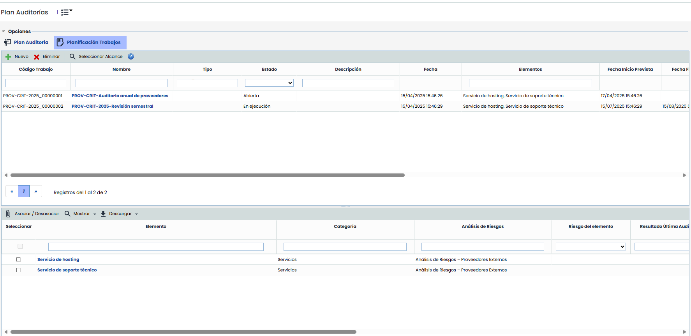
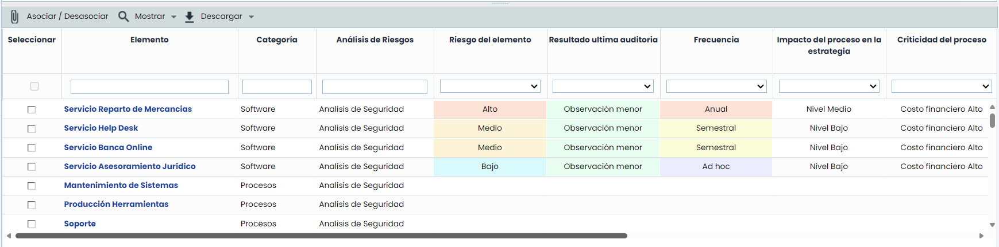

# Planificación Trabajos

Este apartado permite, una vez realizada la evaluación de la planificación en el apartado anterior, es posible asignar trabajos a los distintos elementos del alcance. Cuenta con dos tablas diferenciadas.

En la parte superior, se encuentra una tabla con los trabajos de auditoría incluidos en el plan. Contiene una columna "Elementos" donde se muestran los elementos asociados al trabajo.


\*\*Nota\*\*
Se podrán configurar campos personalizables para esta tabla en Ajustes > Metodologías > [Auditorías](https://help.globalsuitesolutions.com/es/globalsuite/v1/metodologias-auditorias). Estos campos se mostrarán a continuación de los campos predeterminados.


* **Nuevo:** Permite crear un nuevo Trabajo de auditoría dentro del Plan.
* **Eliminar:** Permite eliminar un Trabajo del listado. Para ello se ha de seleccionar la fila deseada y pulsar el botón ‘Eliminar’.
* **Seleccionar Alcance:** Permite, para el trabajo seleccionado, asociar los elementos del alcance del trabajo utilizando la vista del Árbol de Elementos.

**NOTA:** Al pulsar en el link del nombre del trabajo, se abre en una nueva pestaña el formulario del trabajo, en la opción del menú "Programa de Auditorías", que se explica a continuación.

Los trabajos que ya se encuentran en ejecución o finalizados se muestran en rojo, y no podrá modificarse el alcance de los mismos.

La parte inferior de esta vista muestra los elementos con los resultados de la planificación, así como una columna adicional "Trabajos Asociados" indicando en qué trabajos está incluido cada elemento.

Cuando se selecciona un trabajo en la tabla superior, en la inferior se muestran seleccionados los elementos del alcance.

Se tienen los mismos Elementos que teníamos en el Plan de Auditoría, con lo campos antes descritos. Dentro de cada uno de ellos, se pueden asociar Nuevos trabajos en la parte inferior. Primero habrá que crear esos trabajos, y se tienen ya para asociarlos a cualquiera de los procesos de arriba. Solo habrá que pulsar encima de un elemento para que se marque y seleccionar el trabajo marcando la casilla Seleccionar para que quede unido.

* **Mostrar:** Este desplegable permite filtrar las categorías, para que se vean Todos los elementos o Elementos sin trabajo, que son los que no tiene un trabajo asociado.
* **Asociar / Desasociar:** Una vez que se tenga un trabajo seleccionado en la tabla superior, se verán los elementos incluidos en el alcance en la parte inferior. Es posible marcar o desmarcar otros elementos, que se guardarán al pulsar este botón.
* **Descarga:** Permite generar un informe excel con el listado de elementos del plan de auditoría.
