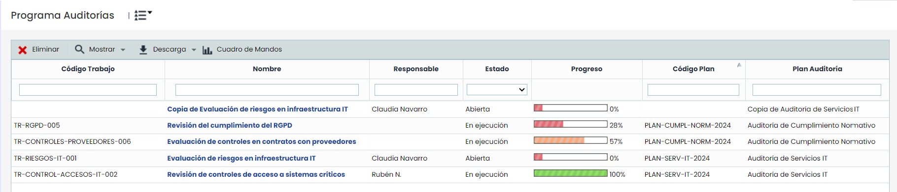

# Programa Auditorías

En esta sección es posible gestionar los trabajos creados en los distintos Planes de Auditoría definidos en la opción anterior.


\*\*Nota\*\*
Se podrán configurar campos personalizables para esta tabla en Ajustes > Metodologías > [Auditorías](https://help.globalsuitesolutions.com/es/globalsuite/v1/metodologias-auditorias). Estos campos se mostrarán a continuación de los campos predeterminados.


* **Eliminar:** Permite eliminar un Trabajo del listado. Para ello se ha de seleccionar la fila o filas deseadas y pulsar el botón ‘Eliminar’. Los trabajos de auditoria se crean asociados a un Plan de Auditoria, desde la opción anterior.
* **Mostrar:** Ofrece la posibilidad de filtrar el listado de trabajos, pudiendo optar entre visualizar Abiertas o Todas, según el Estado que tengan los trabajos. Por defecto, se muestran solamente los trabajos abiertos o en ejecución.
* **Descargar**: Permite generar un informe Excel con la información de los trabajos de auditoria existentes.
* **Cuadro de Mando:** Permite acceder a un apartado para visualizar el Dashboard de Auditoría, y poder generar informes excel con los resultados de los mismos.

Al pulsar en el link que aparece en el nombre del trabajo, se accede al detalle del mismo, el cual consta de varios apartados.

* [Plan de Trabajo Auditoría](plan-de-trabajo-auditoria.md)
* [Ejecución del Trabajo](ejecucion-del-trabajo.md)
* [Informe del Trabajo](informe-del-trabajo.md)
* [Cuadro de Mandos Auditoría](cuadro-de-mandos-auditoria.md)
