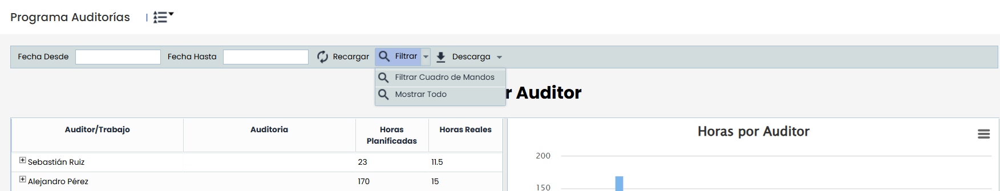
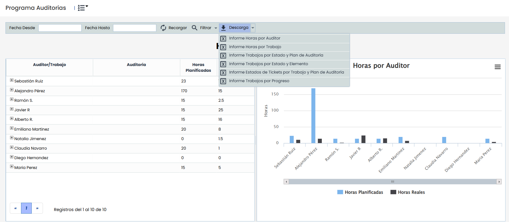
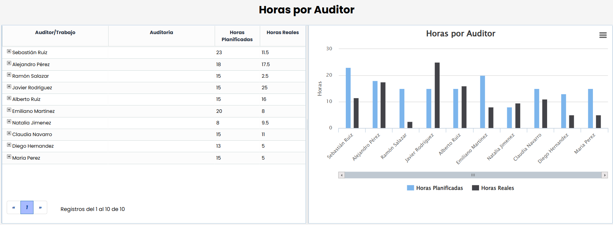
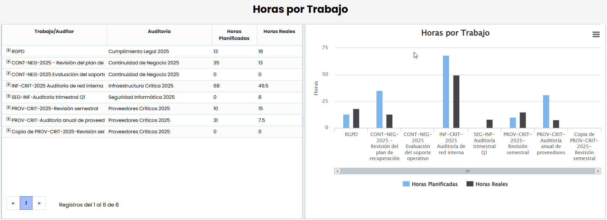
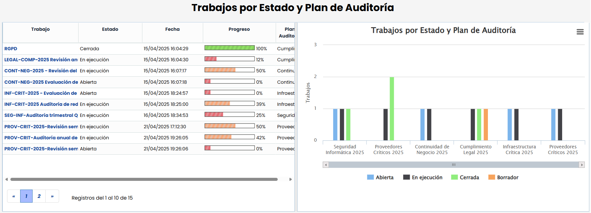
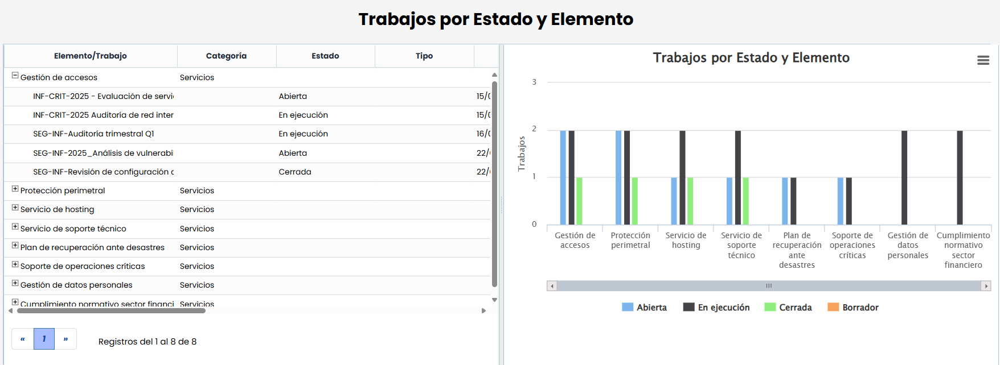
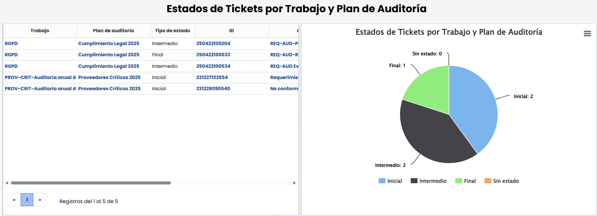
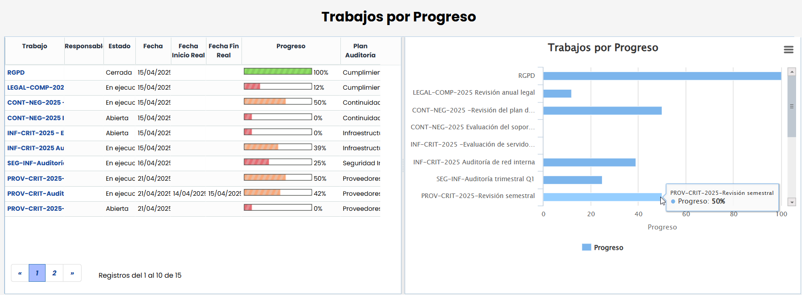
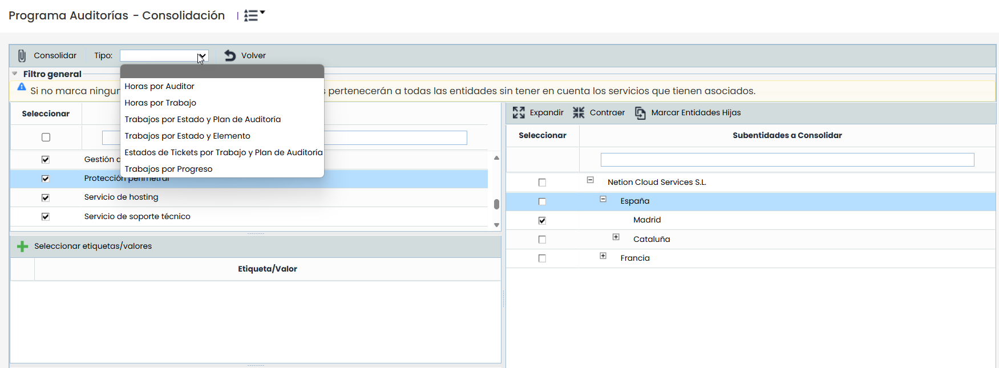
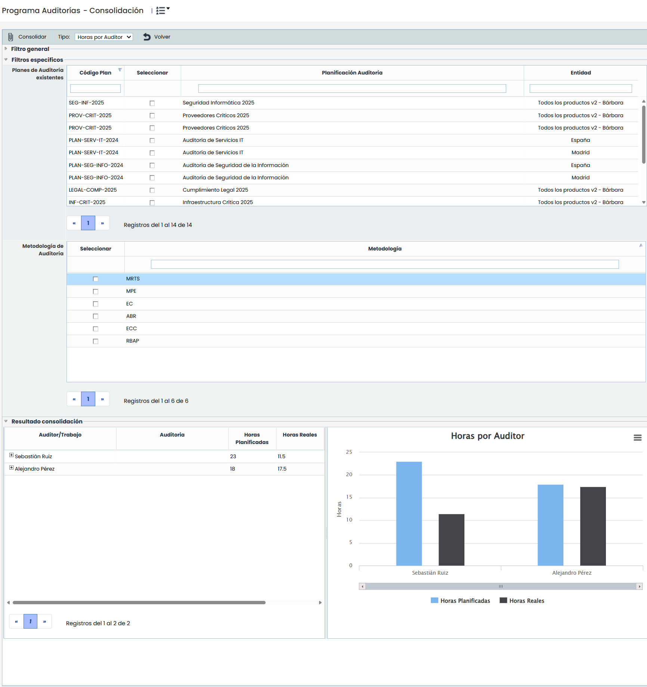

# Cuadro de Mandos Auditoría

En este apartado se puede monitorizar el estado de los Planes y Trabajos de Auditoría a través de una serie de gráficas e informes.

Por defecto, nos muestra toda la información de todos los trabajos y elementos auditados, pero es posible aplicar filtros para acotar estos resultados:

* Filtro de Fechas: Es posible filtrar los trabajos realizados antes o después de una fecha, para lo que se pueden definir en los campos de la barra superior. Para aplicar los filtros, hay que pulsar el botón 'Recargar'. Si se quiere eliminar el filtro, simplemente se tiene que borrar las fechas y volver a pulsar el botón.

* Filtro de elementos: Además es posible seleccionar qué elementos queremos visualizar en el dashboard, para acotar la información por los servicios, procesos, áreas o activos que se quiera revisar.

  * Para ello, si se pulsa el botón Filtrar Cuadro de Mandos, nos aparecerá en una ventana el árbol de elementos definidos, pudiendo seleccionar los que se quieran visualizar.
  * Si se dispone de unos elementos filtrados, si se quiere visualizar toda la información completa, debe pulsar Mostrar Todo

* Descarga: En el desplegable nos aparece la posibilidad de extraer la información de cada gráfica en un informe excel. Este informe se generará en segundo plano y se podrá obtener en [Descargas Pendientes](../../general/area-de-usuario/descargas-pendientes.md)

A continuación, nos aparecen las gráficas que tengamos visibles según la configuración realizada. Estas gráficas son:

### Horas por Auditor

Nos muestra la imputación de horas previstas y reales que han ejecutado los miembros del equipo auditor para cada uno de los trabajos.

En el cuadro de mando se tendrán en cuenta dos tipos de registros de tiempo:

* Los registros hechos manualmente a través de la funcionalidad Registrar horas.
* Los registros de horas vinculados a tareas de los proyectos en los que los auditores participaron.

**Horas por Trabajo**

Muestra la dedicación prevista y real de cada uno de los trabajos de auditoría, a partir de los tiempos de los auditores.

En el cuadro de mando se tendrán en cuenta dos tipos de registros de tiempo:

* Los registros hechos manualmente a través de la funcionalidad Registrar horas dentro del trabajo.
* Los registros de horas vinculados a tareas del proyecto vinculado al trabajo.

**Trabajos por Estado y Plan de Auditoría**

Esta gráfica muestra el estado y grado de progreso en el que se encuentra cada uno de los trabajos de auditoría, agrupados por cada Plan.

**Trabajos por Estado y Elemento**

Gráfica que muestra en qué trabajos está incluido cada uno de los elementos auditados, y el estado en el que se encuentran (independientemente del Plan al que pertenezcan)

**Estados de Tickets por Trabajo y Plan de Auditoría**

En esta gráfica se indican cuántos tickets (No Conformidades, Hallazgos, Requerimientos, etc.) generados en los trabajos de auditoría, y en qué estados se encuentran.

**Trabajos por Progreso**

Esta gráfica muestra muestra el porcentaje de progreso o avance de cada trabajo de auditoría. Este progreso se obtiene en función de las tareas o acciones de auditoría que se hayan planificado.

## Consolidación del Cuadro de Mando de Auditoría

En caso de disponer una estructura de [Subentidades](https://help.globalsuite.es/display/GlobalSUITEes/.Subentidades+vv5.1), será posible comparar las diferentes gráficas entre cada una de las subentidades. Para ello, habrá que pulsar en el apartado de 'Consolidación' que aparecerá en el menú superior.

Una vez dentro, se podrá realizar la consolidación de información entre las distintas subentidades, seleccionando qué gráfica del Cuadro de Mando se quiere visualizar y pulsando 'Consolidar'. Pudiendo aplicar varios filtros para limitar los resultados de la gráfica.

