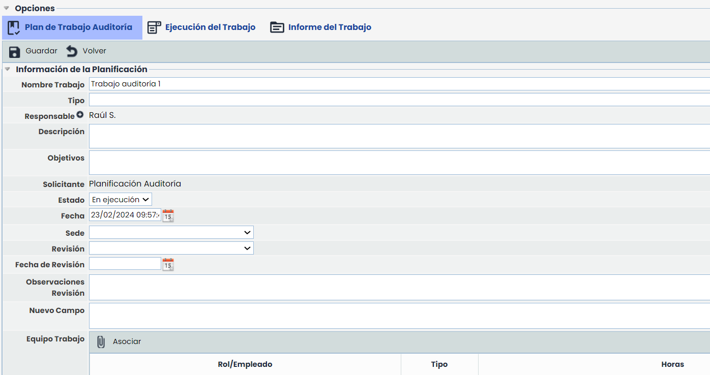
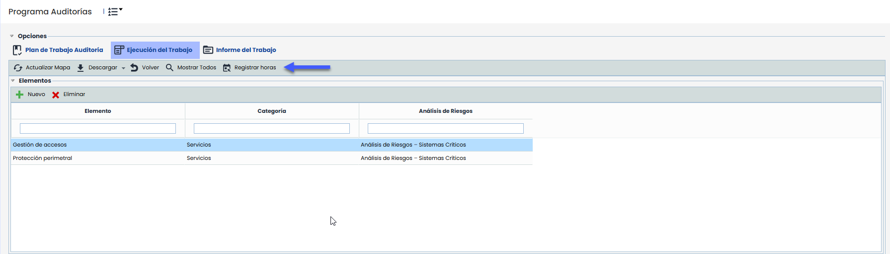
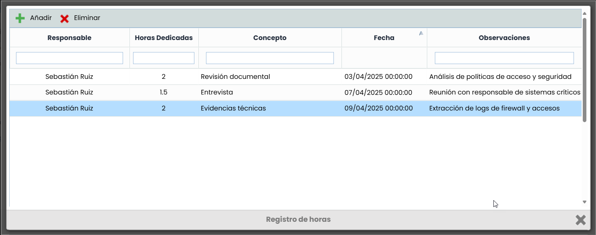
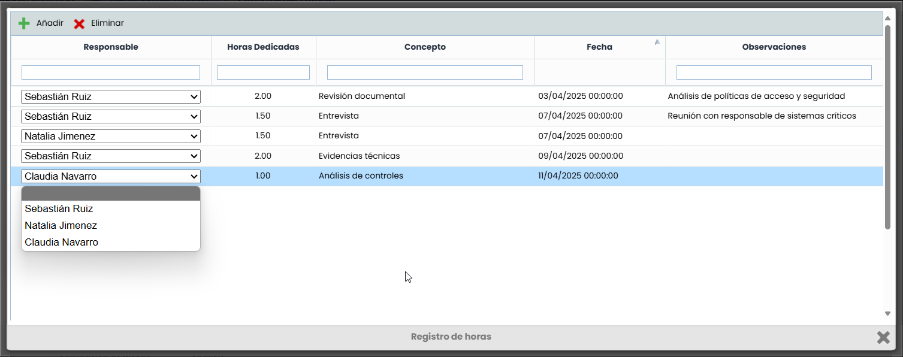
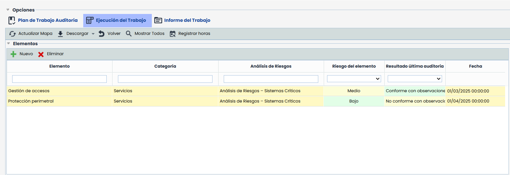
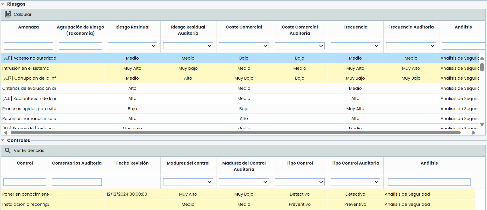
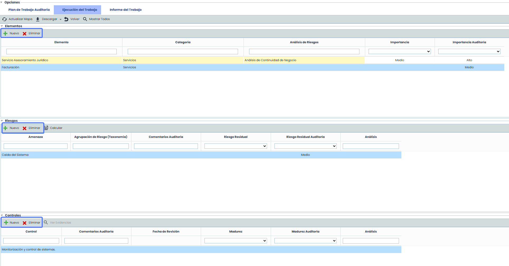
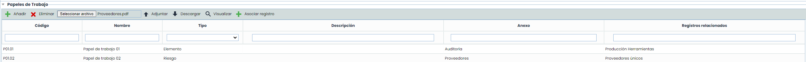
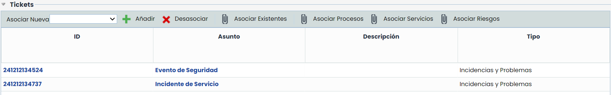

# Ejecución del Trabajo

Cuando un trabajo se cambia al estado "En ejecución", se realiza una copia de la información y evaluación de los elementos incluidos en el mismo. Aparece un mensaje de confirmación indicando: "Se van a realizar una captura de los datos de los análisis de la auditoria. Este proceso puede tardar ¿Desea continuar?"

Al finalizar la copia de la información, aparecen las opciones del menú superior de "Ejecución del Trabajo" e "Informe del Trabajo" en el formulario del trabajo.

### Registrar horas

Al presionar el botón Registrar horas, el sistema verifica si el usuario forma parte del equipo de trabajo definido en el Plan de trabajo.  
Si el usuario pertenece al equipo, podrá acceder al registro y realizar las siguientes acciones sobre sus registros:

* Crear y eliminar registros de horas.
* Indicar la cantidad de horas dedicadas.
* Añadir el motivo/concepto y observaciones de la imputación.
* Seleccionar la fecha correspondiente al registro.

Cuando un responsable o un administrador accede al registro de horas, podrá visualizar las horas registradas por todos los miembros del equipo de trabajo.  
Tiene la posibilidad de añadir y editar registros. Al crear o modificar un registro, podrá seleccionar como responsable únicamente a los usuarios que formen parte del equipo definido en el Plan de trabajo.

## Tabla Elementos

En esta vista aparece una primera tabla con los elementos incluidos en el trabajo, y las dimensiones configuradas en la [metodología de auditoría](https://help.globalsuitesolutions.com/es/globalsuite/v1/metodologias-auditorias) para evaluar los elementos.

## Tablas Riesgos y Controles

Cuando se selecciona un elemento, en la tabla inferior se cargan los riesgos identificados en el análisis para dicho elemento.

Se muestran las dimensiones de valoración de los riesgos según se configuró en la [metodología de auditoría](https://help.globalsuitesolutions.com/es/globalsuite/v1/metodologias-auditorias), la cual puede incluir las dimensiones originales y las modificaciones o propuestas de cambio durante la ejecución del trabajo auditado.

Si se selecciona un riesgo, en la tabla inferior se mostrarán los controles aplicados a ese riesgo, así como las dimensiones de valoración, pudiendo sugerir cambios.

Los riesgos y controles modificados en el trabajo, se marcarán en amarillo para identificarlos.

A través del botón "Calcular" disponible en la tabla de riesgos, se actualizarán todas las dimensiones automáticas en función de los valores introducidos. Y mediante el botón "Ver Evidencias" se podrán consultar las evidencias asociadas a los controles en el apartado [Gestión de Controles](../../analisis/gestion-de-controles/README.md).

### Incorporar Nuevos Registros

En caso de habilitar esta opción en Ajustes> Metodologías > [Auditorías](https://help.globalsuitesolutions.com/es/globalsuite/v1/metodologias-auditorias), en las tablas de elementos, riesgos y controles se habilitará la posibilidad de añadir nuevos registros, así como eliminarlos.

## Papeles de trabajo

A continuación, se dispone de un apartado para incorporar los Papeles de Trabajo utilizados durante la ejecución del mismo. Mediante los botones "Añadir" y "Eliminar", se pueden incorporar y borrar los mismos. Para cada registro, es posible adjuntar un archivo para agregarlo al registro o descargar el mismo si estuviese ya adjunto.

También es posible, a través del botón "Asociar registro", enlazar cada papel de trabajo al elemento, riesgo o control auditado para llevar la trazabilidad del mismo.  Adicionalmente, los papeles de trabajo que se creen cuando se tenga seleccionado un elemento, quedarán asociados al mismo de manera automática.

Los archivos incluidos como papeles de trabajo que sean imágenes o documentos pdf podrán ser visualizados sin necesidad de descargarlos. a través de la opción "Visualizar"

Por defecto, se muestran todos los papeles de trabajo de la auditoría, sin embargo, al seleccionar un elemento o un riesgo la tabla se filtra para mostrar solo los asociados. Si se quiere volver a mostrar todos, se deberá pulsar en el botón de la parte superior de la vista "Mostrar Todos".

## Tickets

En este último apartado de esta vista de Ejecución del trabajo, se pueden también generar tickets para tratar los hallazgos identificados, en caso de ser necesario.

* **Añadir:** Permite dar de alta un ticket directamente asociado al trabajo.
* **Desasociar:** Mediante este botón, se puede quitar la relación del ticket con el trabajo actual.
* **Asociar Existentes:** Permite seleccionar un ticket ya creado en la opción correspondiente y enlazarlo al trabajo.
* **Asociar Procesos:** Permite asociar procesos del alcance del trabajo al ticket. Para ello, el ticket deberá tener un campo de tipo PROCESSES
* **Asociar Servicios:** Permite asociar servicios del alcance del trabajo al ticket.
* **Asociar Riesgos:** Permite asociar riesgos del trabajo de auditoría al ticket. Para ello, deberá tener configurado un campo tipo THREATS

La visibilidad de los tickets, por defecto muestra todos los asociados al trabajo de auditoría, pero si se selecciona un elemento o riesgo, la tabla se filtra para mostrar solo los asociados a ese registro. Si se quiere volver a mostrar todos, se deberá pulsar en el botón de la parte superior de la vista "Mostrar Todos".

Es posible extraer toda la información de la ejecución de trabajo de auditoría, a través del botón "Descargar", disponible en la parte superior de la vista.
