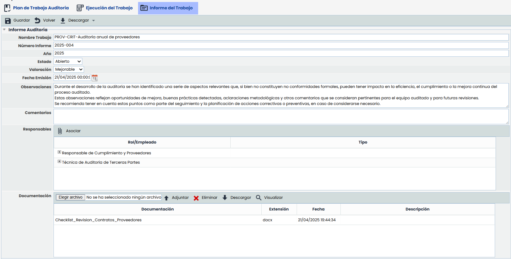
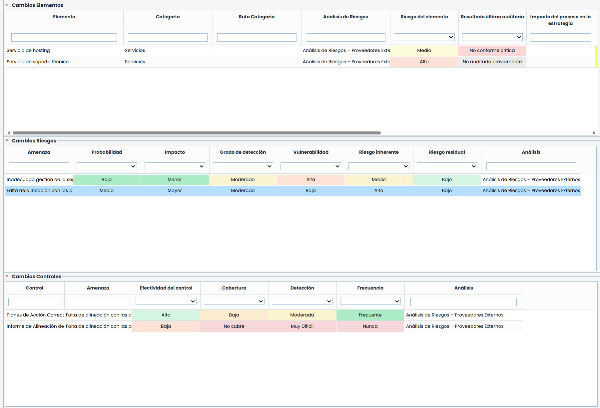
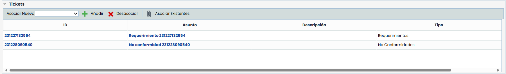
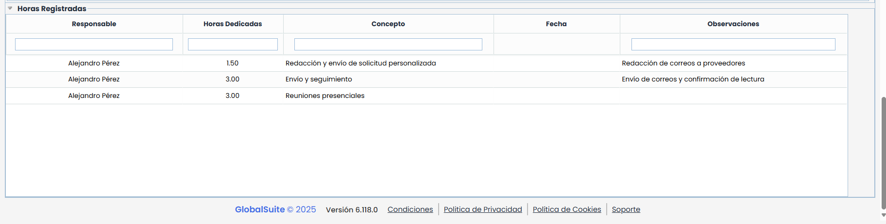

# Informe del Trabajo

Dentro de la vista de Informe del Trabajo, es posible revisar los resultados de la ejecución de la auditoría, y elaborar y extraer el informe final del mismo.

## Informe Auditoría

* **Nombre trabajo:**Identifica el nombre del trabajo de auditoría.
* **Número informe:**Muestra el numero de informe, con el que se identifica el trabajo de auditoría.
* **Año:**Permite mostrar el año para posteriormente tener un listado de informes de auditoría por años.
* **Estado:**Permite identificar el estado del informe del trabajo. Los posibles estados son Abierto, Validación o Cerrado para identificar cada una de las fases del Informe de Auditoría.
* **Valoración:**Este campo muestra la nota o valoración de los elementos auditados en el trabajo, en función de las siguientes opciones: Buena, Aceptable, Sin calificar, Mejorable, Deficiente.
* **Fecha emisión:**Es la fecha en la que se genera el informe del trabajo de auditoría.
* **Observaciones:**Permite incluir las observaciones y datos relevantes para justificar el informe de trabajo.
* **Comentarios:**Posibilita incorporar cualquier comentario adicional al informe del trabajo.
* **Responsables:**Esta opción permite asociar responsables de la elaboración del Informe del trabajo, a nivel de roles o roles y personas concretas. Al pulsar Asociar se abrirá en una ventana el listado de roles y empleados del sistema, para poder asociarlos.

### Documentación

Adicionalmente, en este apartado es posible adjuntar uno o varios documentos utilizados en el trabajo.

* **Seleccionar Archivo - Adjuntar** Los documentos se agregan directamente pulsando el botón 'Seleccionar el archivo' y pulsando Adjuntar.

  * **Eliminar** De igual modo, para eliminarlos, se pulsa encima de alguno de ellos y se pulsa en Eliminar.
  * **Descargar** Permite descargar los documentos añadidos.
  * **Visualizar:** Para los ficheros pdf y las imágenes, es posible previsualizarlos en una pantalla emergente sin necesidad de descargarlo.

### Cambios

* **Cambios Elementos:** Muestra un resumen de los cambios propuestos sobre los elementos evaluados durante la auditoría. Esta sección permite identificar las diferencias respecto al inventario actual y dejar registro de las modificaciones planteadas
* **Cambios Riesgos:**Muestra un resumen de los cambios propuestos en la valoración de los riesgos, de forma que se tienen identificadas las diferencias respecto al análisis de riesgos y se muestren en el informe.
* **Cambios controles:**Permite identificar de igual forma las propuestas de cambios en los controles aplicados a esos riesgos.

* **Tickets:**Muestra los tickets registrados durante la fase de ejecución, además de permitir dar de alta nuevos, en la fase de elaboración del informe. Esto permite tratar los hallazgos del trabajo de auditoría como Requerimientos o No Conformidades en la propia plataforma.

* **Horas Registradas**

Esta tabla permite visualizar el tiempo dedicado al trabajo por parte de los distintos responsables, combinando los registros manuales y los vinculados a tareas del proyecto. Es una tabla informativa, sin acciones de edición, y se actualiza en tiempo real.

* Las columnas incluidas son:
* Responsable
* Horas dedicadas
* Concepto
* Fecha
* Observaciones

La tabla mostrará:

* Los registros hechos manualmente a través de la funcionalidad Registrar horas, únicamente cuando tengan horas completas cargadas.
* Los registros asociados a tareas del proyecto, siempre que tengan un responsable y una duración real (horas) completas. En estos casos, la columna Fecha permanecerá vacía.

Los permisos de visualización varían según el tipo de usuario:

* Los perfiles Administrador de plataforma, Administrador Enterprise, Administrador de auditoría y el responsable del trabajo pueden ver todos los registros.
* El resto de usuarios solo puede ver los registros propios.
