# Plan de Trabajo Auditoría

Este formulario permite realizar la planificación del trabajo de auditoría.

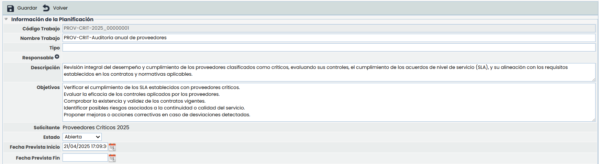

**Información de la Planificación**

* **Código de Trabajo:** Identifica el código asignado al trabajo de auditoría. Se puede configurar su visibilidad y formato en Ajustes>[Metodologías de Auditorias.](https://help.globalsuitesolutions.com/es/globalsuite/v1/metodologias-auditorias)

  * Este campo no será editable si el código de trabajo está configurado como automático.
* **Nombre Trabajo:** Permite modificar el registro del trabajo cambiándole el nombre.
* **Tipo:** Adicionalmente se puede poner una tipología concreta si se desea.
* **Responsable:** Se abrirá una ventana que permite elegir un responsable dentro de la lista introducida en la herramienta.
* **Descripción:** Se puede añadir una descripción mas extensa del trabajo si se desea.
* **Objetivos:** Permite introducir objetivos que tenga el trabajo descrito.
* **Solicitante:** Describe la Planificación a la que hace referencia este trabajo que se esta configurando. Esta una opción que no se puede modificable.
* **Estado:** Permite asignarle un estado al trabajo entre las siguientes opciones: Abierta, Borrador, En Ejecución, Cerrada.

  * Edición de trabajos: Una vez que el estado del trabajo pase a Estado Cerrado, el mismo no será editable. Sin embargo, si es necesario realizar modificaciones en un trabajo en estado "Cerrada", se podrá cambiar el estado a "En Ejecución" para permitir la edición nuevamente.

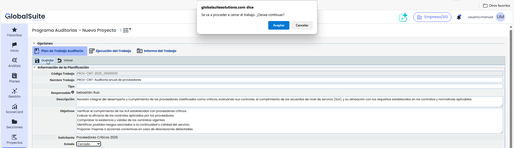

* **Fecha prevista de inicio**  
  Este campo se completa automáticamente con la fecha y hora en la que se crea el trabajo. Es editable y obligatorio.
* **Fecha prevista de fin**  
  Corresponde a la fecha estimada de finalización del trabajo. Puede ser definida manualmente por el usuario, siempre que el trabajo no esté vinculado a un proyecto.

En caso de que el trabajo esté asociado a un proyecto, ambos campos —fecha de inicio y fecha de fin— dejarán de ser editables y tomarán automáticamente las fechas establecidas en el proyecto.

Si al guardar el trabajo el sistema detecta que se han modificado las fechas, realizará una validación para comprobar que los miembros del equipo asignado no tengan otros trabajos planificados en el mismo período. En caso de solapamiento, se mostrará un mensaje informando del conflicto, listando los empleados y los trabajos con los que se solapan las fechas.

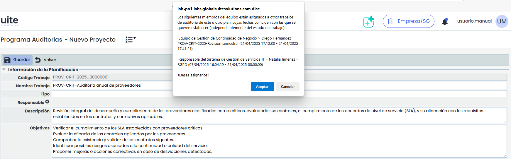


\*\*Nota\*\*
Se podrán configurar campos personalizables para este formulario en Ajustes > Metodologías > [Auditorías](https://help.globalsuitesolutions.com/es/globalsuite/v1/metodologias-auditorias). Estos campos se mostrarán a continuación del campo \*Fecha\*


* **Equipo Trabajo:**

 Permite seleccionar los empleados responsables de la ejecución de los trabajos, se pueden seleccionar a varios.

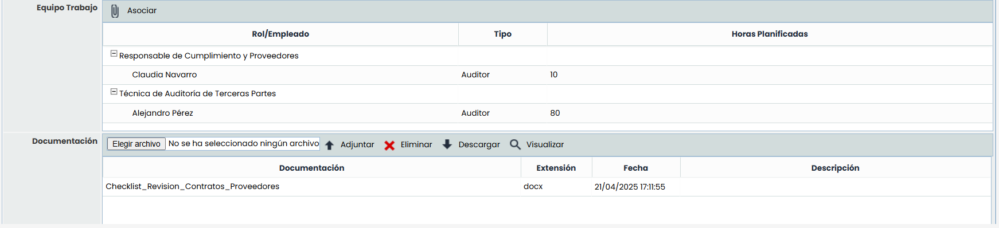

Cada vez que se añada un miembro al equipo de trabajo, el sistema validará automáticamente si esa persona ya tiene otros trabajos asignados en las fechas previstas de inicio y fin del trabajo. En caso de que se detecten solapamientos, se mostrará un mensaje de advertencia que incluirá el nombre del empleado y el detalle de los trabajos con los que entra en conflicto.

Esta validación se realiza en el momento de la asignación, permitiendo al usuario decidir si continuar o ajustar la planificación.

* **Documentación:** Adicionalmente, en esta parte es posible adjuntar uno o varios documentos.

  * **Adjuntar:** Los documentos se agregan directamente pulsando el botón 'Seleccionar archivo', y una vez elegido el fichero a subir, pulsando Adjuntar.
  * **Eliminar:** Permite eliminar un documento ya asociado. Para ello, se pulsa encima de alguno de ellos y se pulsa en Eliminar.
  * **Descargar:** Permite descargar el documento seleccionado.
  * **Visualizar:** Para los ficheros pdf y las imágenes, es posible previsualizarlos en una pantalla emergente sin necesidad de descargarlo.

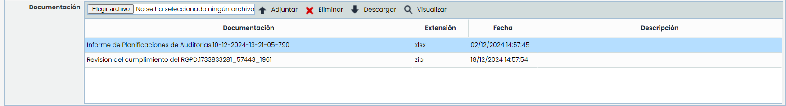

**Metodologías de Ejecución**: En este apartado se podrán seleccionar las metodologías que se utilizarán para ejecutar el trabajo de auditoría. Por defecto, aparecen cargadas las que están definidas así en la metodología de Auditoría.

* Metodología de ejecución de Elementos: A través del botón rojo, se podrá elegir la metodología de elementos a utilizar, entre las que estén asociadas a la metodología de auditoría.
* Metodología de ejecución de Riesgos: Permite seleccionar qué metodología de riesgos se usará en el trabajo.
* Metodología de ejecución de Controles: La metodología de ejecución de controles no se elegirá directamente, sino que se utilizará la que esté asociada a la metodología de riesgos.

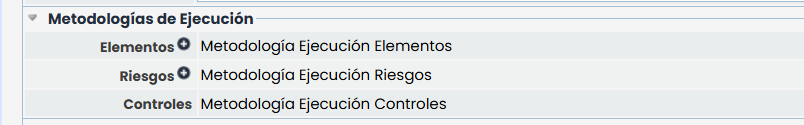

**Alcance**: En esta tabla se muestran los elementos incluidos en el trabajo, con la valoración realizada en el plan de auditoría.

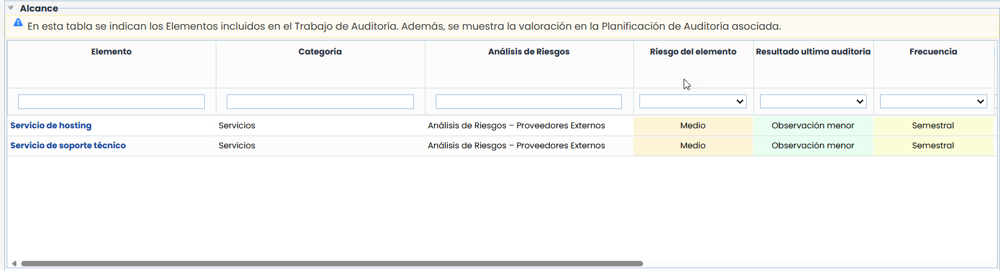

**Planificación - Datos del Proyecto:**Este apartado permite realizar un proyecto para planificar y realizar seguimiento del trabajo de auditoría.

En caso de no haber un proyecto definido, aparece la opción siguiente:

* **Crear proyecto:** Permite agregar un proyecto al trabajo, se puede crear desde cero, o seleccionar un modelo existente. Estos modelos de proyecto se definen en el panel de Ajustes.

  * Para crear un proyecto será necesario seleccionar la Fecha prevista de fin

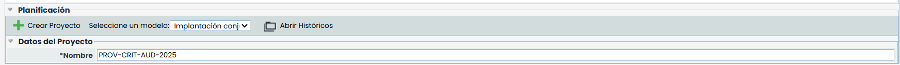

En el caso que ya haya un proyecto definido, es posible realizar ajustes y seguimiento del mismo, permitiendo al usuario gestionar el avance del trabajo.

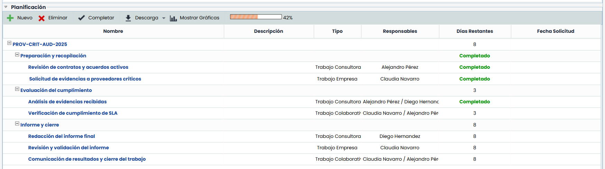

* **Nuevo:** Permite insertar diferentes tareas o subtareas al proyecto.
* **Eliminar:** Permite eliminar diferentes tareas del proyecto. Para ello se ha de seleccionar la fila deseada y pulsar el botón ‘Eliminar’.
* **Completar:** Permite marcar cuando una tarea ha sido finalizada.
* **Descarga:** Permite crear un archivo histórico con el grado de avance del proyecto.
* **Porcentaje completado:**Permite ver el porcentaje de avance que se tiene del proyecto.
* **Mostrar Gráficas:** Ofrece la posibilidad de visualizar diferentes aspectos del proyecto en formato gráfico, tal y como se muestra en la siguiente imagen.

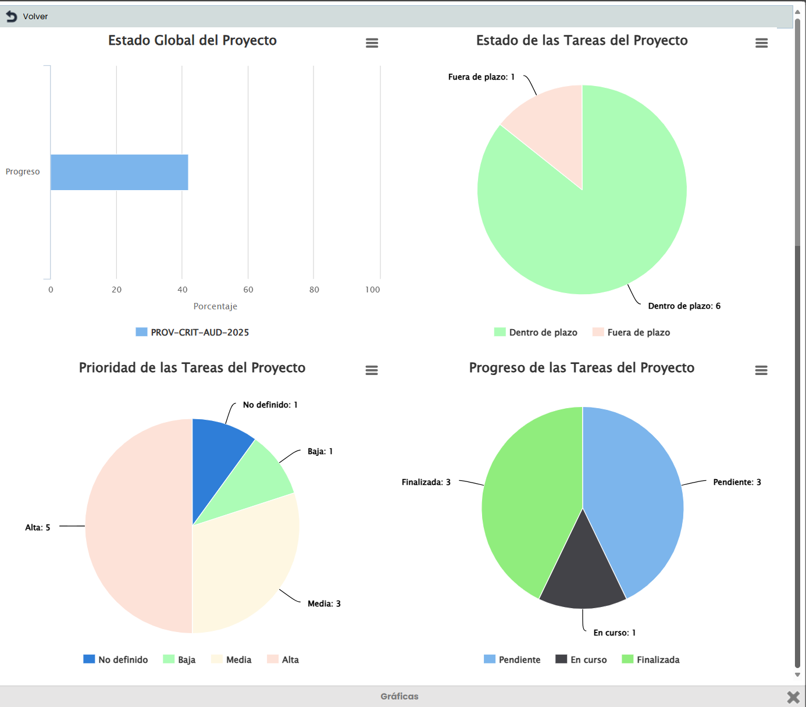

Una vez definido el proyecto se ofrecen las siguientes columnas:

* **Nombre:** Identifica el nombre de las distintas tareas generadas, donde el primer nivel identifica el nombre del proyecto y el resto de niveles son los distintos hitos y tareas definidos.
* **Tipo:** Identifica la tipología de la tarea generada.
* **Responsables:** Muestra el responsable asignado a la consecución de la tarea.
* **Días restantes:** Identifica los días que faltan para que la tarea se ejecute en los tiempos definidos. El cálculo se realiza en base a los valores de fecha inicio/fin.
* **Fecha Inicio:** Muestra la fecha de inicio de la tarea.
* **Fecha Fin:** Muestra la fecha de finalización de la tarea.


\*\*NOTA:\*\* Cada una de las tareas es modificable pulsando sobre el nombre.


* **Proyecto(Primer Nivel):** Si pulsamos sobre el nombre del proyecto se muestra un formulario sobre el que podemos definir los siguientes puntos:

  * **Datos Proyecto:**Aquí se podrá configurar el nombre del proyecto. Las fechas se iran heredando de las subtareas a medidas que el proyecto se completa

    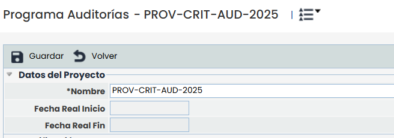
  * **Planificación:**

    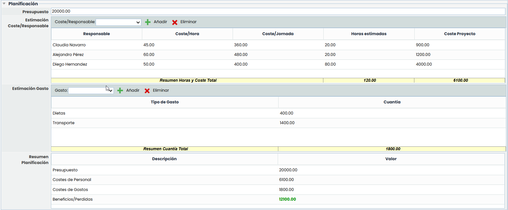

    El apartado de planificación permite definir los costes asociados al proyecto, pudiendo definir los siguientes parámetros:

    * **Presupuesto:** permite definir el presupuesto asociado el proyecto.
    * **Estimación Coste/Consultor:** ofrece la posibilidad de definir el coste del equipo consultor asociado el proyecto, pudiendo definir los costes/Hora y las horas estimadas de trabajo, con lo que la herramienta calcula automáticamente Coste/jornada y Proyecto del consultor.
    * **Estimación Gasto:** Permite definir de las tipologías de Gasto que se definen en la opción Ajustes/Proyectos', la cuantía económica que supone el concepto en el proyecto.
    * **Resumen planificación:** Ofrece un resumen de la información identificada en este apartado, destacando los beneficios o pérdidas del proyecto.
  * **Resumen**
  * Esta opción muestra un resumen detallado de la información definida en el apartado anterior, destacando los beneficios o pérdidas del proyecto.

    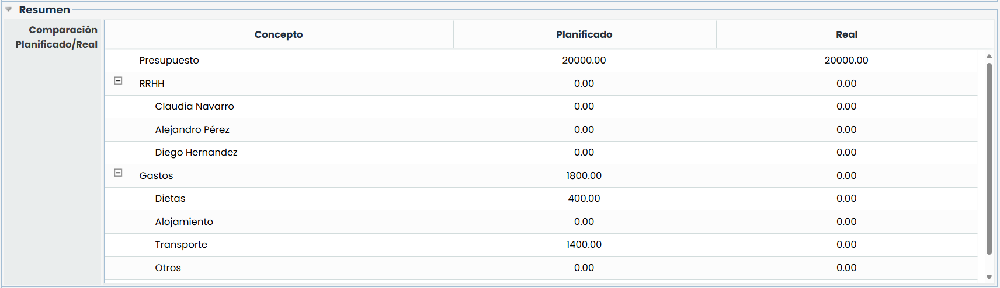
  * **Seguimiento**

Muestra de manera centralizada las horas dedicadas y gastos asociados de las tareas que le han sido imputadas al auditor.

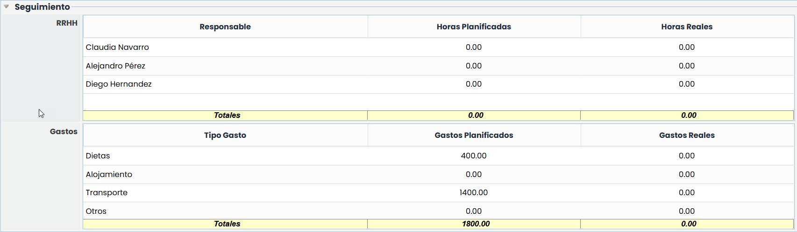

* **Tareas (Niveles):** Al pulsar una tarea las opciones de modificación son las siguientes:

  * **Datos de la tarea**

    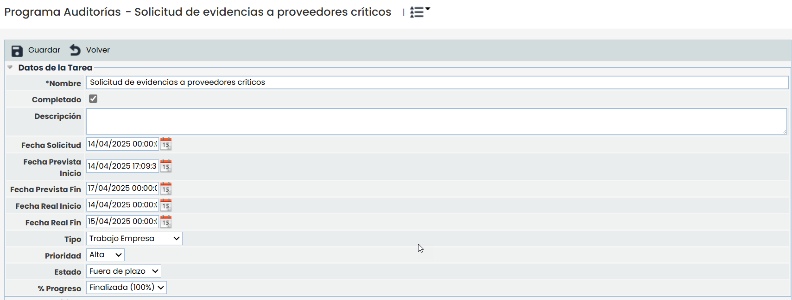
    * **Nombre:** Permite modificar el nombre de la tarea.
    * **Completado:** La opción indica si la tarea ha sido o no completada.
    * **Descripción:** Permite realizar una descripción más extensa de la tarea.
    * **Fecha Solicitud:** Ofrece la posibilidad de definir la fecha en la que se solicita que la tarea debe estar finalizada
    * **Fecha Prevista Inicio:** Permite definir la fecha estimada de inicio de la tarea
    * **Fecha Prevista Fin:** Permite definir la fecha estimada de finalización de la tarea
    * **Fecha Real Inicio:** Define la fecha definitiva de inicio de la tarea
    * **Fecha Real Fin:** Establece la fecha definitiva de fin de la tarea
    * **Tipo:** Posibilita indicar la tipología de la tarea.
    * **Estado**: Este campo indica si el trabajo se encuentra dentro o fuera de plazo, en función de la fecha prevista de fin y el estado actual del trabajo.

      * **Dentro de plazo**: la tarea sigue en curso o pendiente de finalizar, y la fecha actual no ha superado la fecha prevista de fin.
      * **Fuera de plazo**: la fecha actual ha superado la fecha prevista de fin y el trabajo aún no ha sido cerrado.
    * **% Progreso:** Este campo permite seleccionar el nivel de avance del trabajo según los niveles de progreso configurados en Ajustes > [Configuración Proyectos.](https://help.globalsuitesolutions.com/es/globalsuite/v1/configuracion-general-proyectos)
  * **Documentación**

    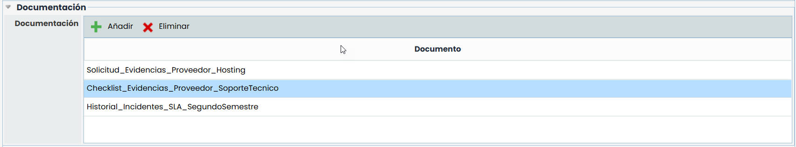

    Este apartado ofrece la posibilidad de identificar y asociar documentación relacionada con la tarea a realizar. Para ello se ha de pulsar sobre el botón 'Añadir', lo cual genera una nueva entrada en la tabla. Para modificar el nombre del documento se ha de pulsar dos veces sobre la celda deseada. En caso de querer eliminar un documento asociado, se ha de seleccionar la fila deseada y pulsar sobre el botón 'Eliminar'.
  * **Seguimiento**

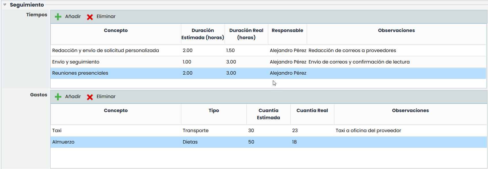

Esta opción permite imputar los siguientes conceptos en la tarea seleccionada, como son:

* **Tiempos:** Permite imputar los tiempos dedicados a la realización de la tarea, pudiendo definir el nombre del concepto, la tipología asociada, las horas dedicadas, el auditor asociado y observaciones.
* **Gastos:** Ofrece la posibilidad de imputar los gastos asociados a la tarea, pudiendo definir el nombre del concepto, la tipología de gasto asociada, la cuantía económica y observaciones.


\*\*NOTA:\*\* Los tiempos y gastos asociados a una tarea, se verán reflejados en el apartado de Proyecto.

