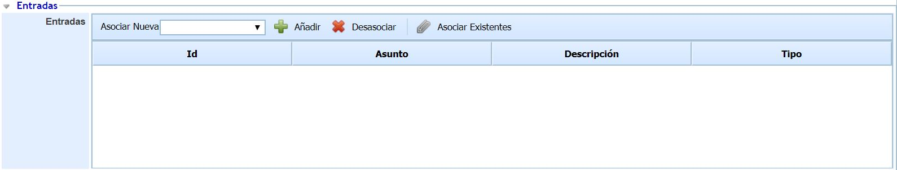
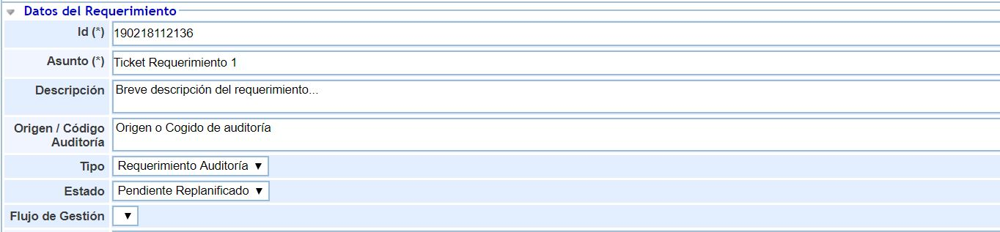
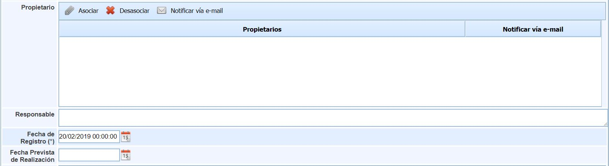
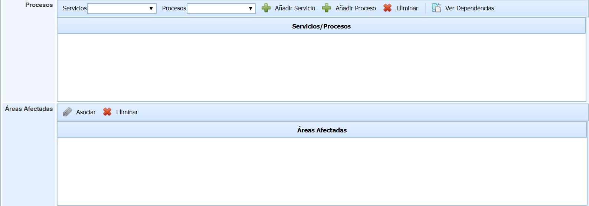
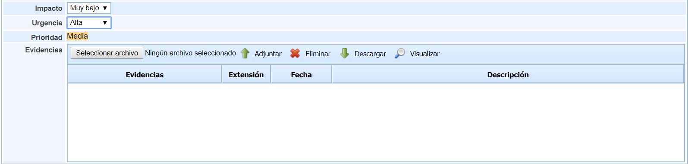
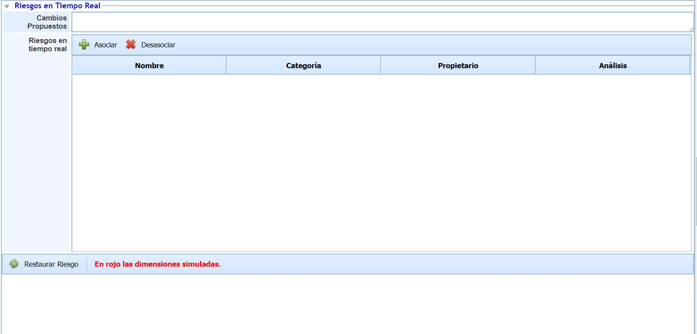
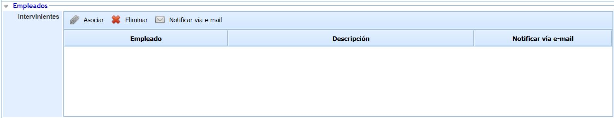
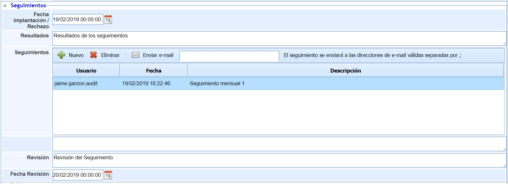
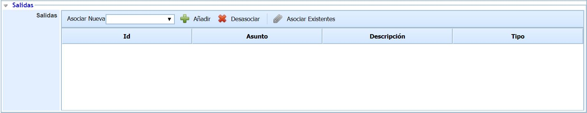

# Formulario de Requerimientos

## Entradas

* **Entradas:** Esta sección está compuesta por una tabla con el listado de entradas del requerimiento. Cada entrada del requerimiento se crea pulsando el botón ‘Añadir’, permitiéndose editar el nombre y la descripción de la entrada haciendo doble click sobre el campo correspondiente. En caso de querer eliminar una entrada se debe seleccionar la fila o filas deseadas y pulsar el botón ‘Eliminar’. Proporcionando la herramienta las siguientes columnas:

  * *Id*
  * *Asunto*
  * *Descripción*
  * *Tipo*

## Datos del requerimiento

A continuación se definen todos los campos que le permitirán realizar un adecuado registro de los requerimientos.

* **Identificador (Id):** Este será generado de forma automática y corresponderá a un número único de requerimiento que permita identificarlo.
* **Asunto:** Permite asignar un nombre que describa el requerimiento.
* **Descripción:** Permite especificar el cuerpo del requerimiento.
* **Origen/Código Auditoría:** Identifica el origen o el código del trabajo de Auditoría, para relacionar el requerimiento con la auditoría donde se registró.
* **Tipo:** Existen dos opciones de selección. Permite seleccionar para asignarle la tipología de requerimiento, entre Requerimiento Auditoría y Requerimiento interno.
* **Estado:** Define cómo se encuentra durante su gestión la no conformidad. La solución nos proporciona las siguientes opciones:

  * *Pendiente atender:* Se establece este estado cuando se debe atender el requerimiento.
  * *Pendiente replanificado:* Se cambia a este estado cuando se debe volver a planificar con otros términos el requerimiento.
  * *Atendido:* Una vez planificada, el cambio a este estado indica que se ha iniciado el proceso de atención al requerimiento.
  * *Rechazado:* Determina que tras el análisis se considera que no se trata de un requerimiento real y por tanto se rechaza una posible solución.
  * *Cerrado/Revisado:* Establece que se ha propuesto una solución para el requerimiento.
* **Flujo de Gestión:** Es la opción correspondiente al Workflow que se tiene por defecto, aparece ya configurado a falta de los usuarios. Es totalmente configurable por si se desean cambiar los estados.

* **Propietario:** Indica la persona o personas que reportaron o que deben realizar seguimiento y estar informados del estado del requerimiento. Para seleccionar un nuevo propietario se ha de pulsar sobre Asociar para elegirlo de entre los empleados del sistema. También ofrece la posibilidad de Notificar vía email al usuario.
* **Responsable:** Determina la persona encargada de gestionar el requerimiento.
* **Fecha de Registro:** Es un campo obligatorio para poder guardar el ticket. Permite introducir la fecha de creación del requerimiento.
* **Fecha Prevista de Realización:** Establece la fecha en la cual se considera que se procederá a cerrar el requerimiento.
* **Procesos:** Podrán seleccionarse los Servicios y los Procesos que se vean afectados por el requerimiento. Añadiéndolos al mismo para que se puedan apreciar las dependencias del mismo.

* **Áreas Afectadas:** A su vez dentro de la definición de cada una de las no conformidades, se puede identificar las áreas que están bajo la influencia del requerimiento. Podrán seleccionarse aquellas áreas que se han visto afectadas por el requerimiento definido.

* **Impacto:** Establece la afectación que supone el no llevar a cabo la resolución del requerimiento registrado.
* **Urgencia:** Establece la necesidad de resolución con la que se debe tratar el requerimiento.
* **Prioridad:** Este valor se obtiene a partir de los valores definidos en el impacto y la urgencia, y permite priorizar los requerimientos a gestionar.
* **Evidencias:** Esta opción permite adjuntar documentos que se quieran subir para vincularlos al requerimiento. Se podrán Adjuntar desde una ubicación, y luego eliminar si se desea, Descargar o Visualizarlos sin descargarlos.

## Riesgos en tiempo real

* **Cambios propuestos:** Permite definir los cambios que quieren proponerse en este requerimiento.
* **Riesgos en tiempo real:** Consigue asociar la tabla con las dimensiones nombre, categoría, propietario, análisis de los riesgos.

  * **Asociar:** Una vez seleccionado el elemento, permite insertar el mismo en la tabla.
  * **Desasociar:** Permite eliminar uno o varios elementos de la tabla. Para ello se ha de seleccionar la fila deseada y pulsar sobre el botón 'Eliminar elemento'
* **Restaurar Riesgo:** Este botón permite restaurar un riesgo que se quiera, previamente cargado para que se puede ver el efecto en rojo de las dimensiones simuladas.

## Empleados

* **Intervinientes:** Indica personas adicionales a los responsables del Workflow que se encarguen de la gestión del requerimiento. Para seleccionar una o varias personas se ha de pulsar sobre Asociar y marcar los correspondientes en el listado de empleados. También ofrece la posibilidad de Notificar vía email al usuario.

## Seguimientos

* **Fecha Implantación / Rechazo:** Es la fecha en la que se implanta / rechaza el requerimiento.
* **Resultados:** Permite definir según los seguimientos los resultados que se vayan teniendo.
* **Seguimientos:** Indica los seguimientos que se quieren tener y es la parte encargada de la gestión de los seguimientos asociados al requerimiento. Para crear un nuevo recurso se ha de pulsar sobre Nuevo donde aparece un seleccionable, o para quitarlo seleccionarlo y pulsar Eliminar. También ofrece la posibilidad de Notificar vía email al usuario.
* **VACIO:**
* **Revisión:** Define las revisiones de los seguimientos de los requerimientos, donde se pueden poner comentarios de revisión del mismo.
* **Fecha revisión:** Es la fecha en la que se revisan los seguimientos del requerimiento.

## Salidas

* **Salidas:** Si los resultados de la evaluación no son los esperados por parte del usuario, el campo ‘Salidas’ posibilita abrir diferentes tickets (incidencia, acción correctiva, etc.) que gestionen el cumplimiento del SLA. Para ello se ha de seleccionar el tipo ticket en el desplegable y pulsar el botón ‘Añadir’. Esta acción crea automáticamente un ticket en el apartado de ‘Gestión’. Para eliminar el ticket, se ha de seleccionar la fila deseada y pulsar el botón ‘Eliminar’. Proporcionando la herramienta las siguientes dimensiones:

  * *Id*
  * *Asunto*
  * *Descripción*
  * *Tipo*
