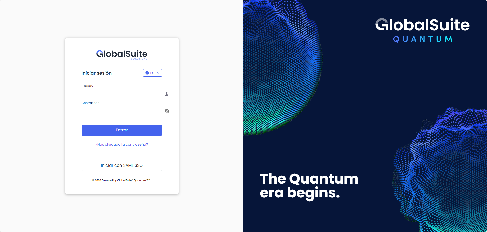
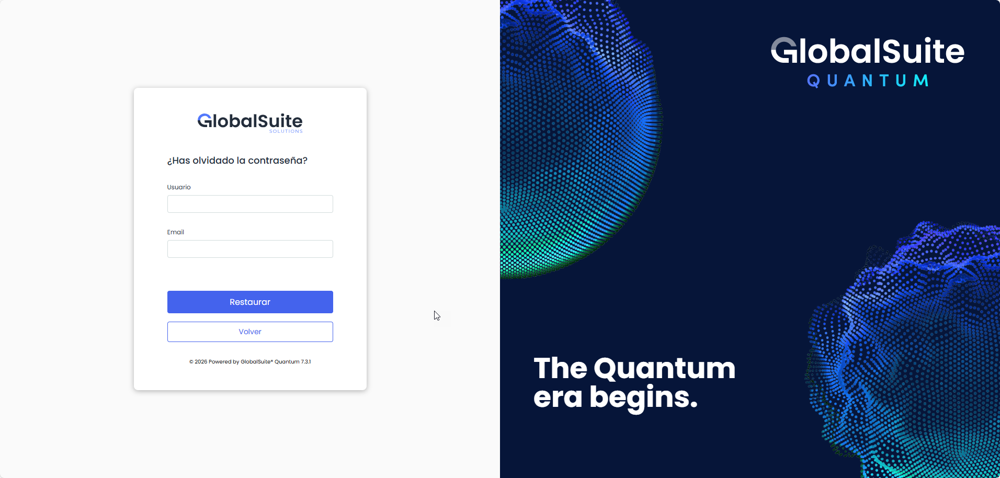
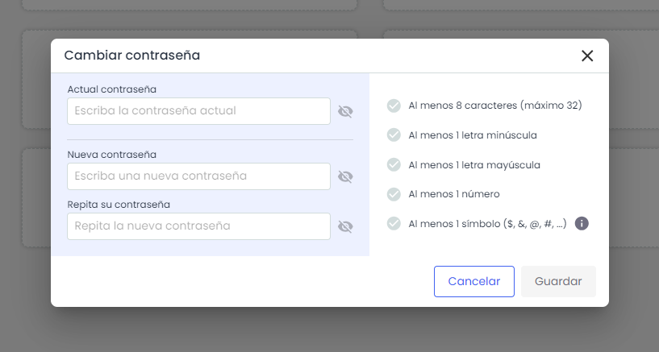
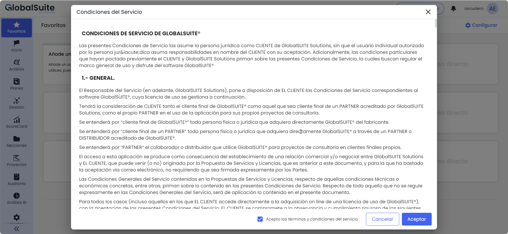
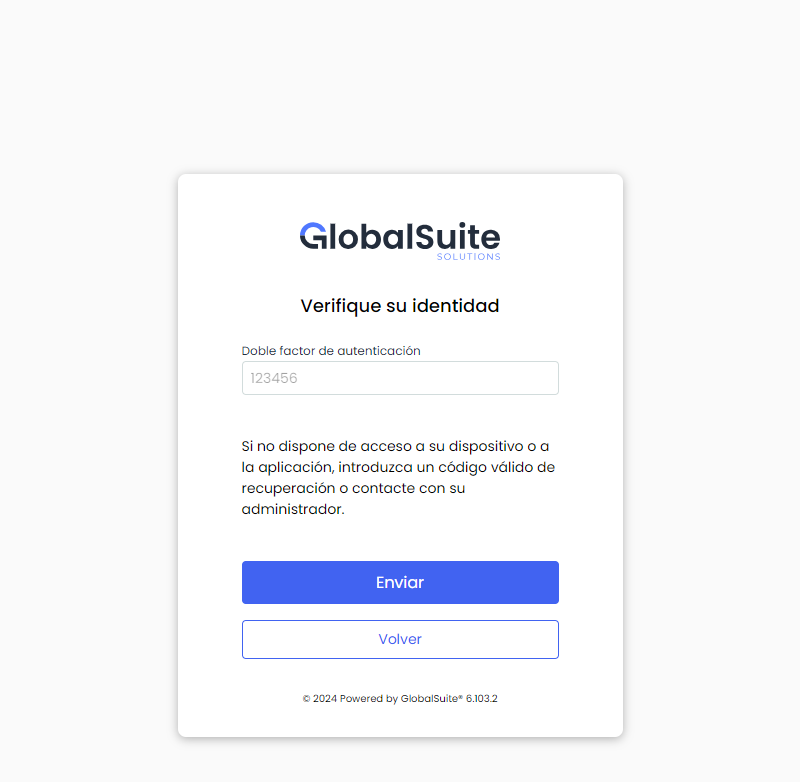
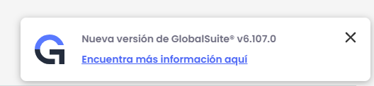
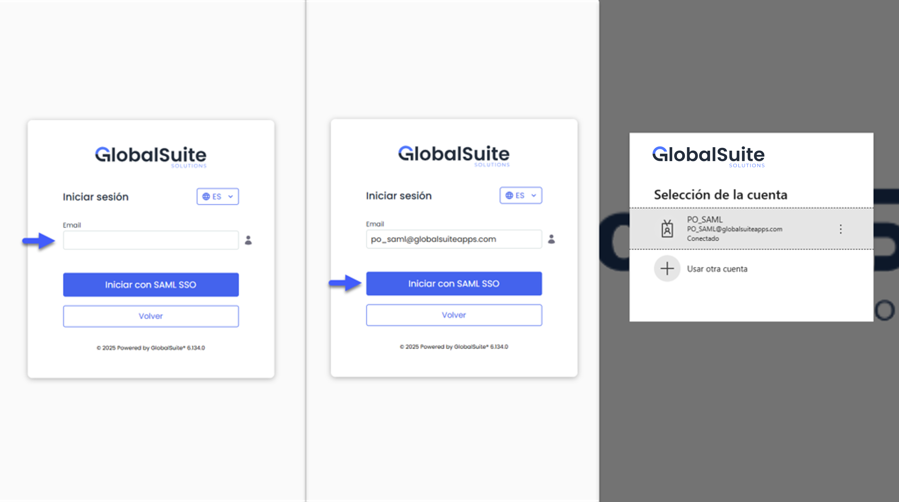
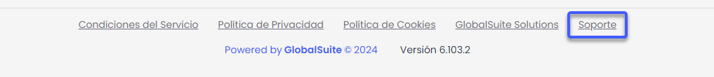

# Acceso a la Plataforma

## ¿Cómo acceder a la plataforma?

El acceso a GlobalSuite® se realiza a través de [https://sg.globalsuite.es](https://sg.globalsuite.es/)/ en caso de la modalidad de distribución de Cloud General. Si la modalidad adquirida es Cloud Dedicado u On Premise, la URL será la que se haya definido durante el proceso de contratación.

Para acceder a la plataforma deberá introducir el usuario y la contraseña que le habrá llegado al correo electrónico facilitado en el proceso de contratación o el que dispone su organización.

**¿Ha olvidado su contraseña?**

En el enlace **¿Ha olvidado su contraseña?** podrá obtener una nueva contraseña en caso de olvido si el usuario dispone de autenticación local al producto. En caso de acceso a través de AD, LDAP o ADFS deberá ponerse en contacto con el responsable de su organización

Para restaurar la contraseña local, necesitará indicar el nombre de usuario y la cuenta de correo asociada para que pueda llegarle un e-mail con los nuevos datos de acceso.

Tanto si es la primera vez que accede a GlobalSuite como si se trata de una restauración de contraseña, el sistema le pedirá que modifique la misma:

Las contraseñas introducidas deben cumplir la siguiente política de contraseñas seguras para usuarios locales:

* Caducidad: las contraseñas tendrán una caducidad máxima de 180 días (6 meses).
* Complejidad: Tener al menos 8 caracteres y contener minúsculas, mayúsculas, números y símbolos ($, &amp;, @, ., #).
* Histórico de últimas contraseñas: Cuando se solicite cambio de contraseña la nueva deberá ser distinta a la actual y no debe coincidir con las cinco últimas contraseñas utilizadas.
* Bloqueo de usuarios: Ante un número de intentos fallidos consecutivos en el proceso de autenticarse, el usuario quedará bloqueado temporalmente.

Si es el primer acceso a la plataforma, o si se ha realizado un cambio en las políticas de acceso, el sistema le pedirá aceptación de las mismas, para poder continuar:


\*\*NOTA:\*\*En caso de que se tenga activado el Doble Factor de Seguridad en Ajustes> General > [Empresa](https://globalsuitesolutions.atlassian.net/wiki/spaces/GlobalSUITEes/pages/266862617/Configuraci+n+Empresa) se solicitará el código 2F obtenido luego de realizar los pasos indicados en [Mi perfil.](https://help.globalsuitesolutions.com/es/globalsuite/v1/mi-perfil)


Una vez se ha autenticado correctamente se accede a la pantalla inicial de la plataforma GlobalSuite, desde la cual podrá acceder a las distintas opciones del Sistema de Gestión seleccionado.

Si el acceso a la plataforma es el primero que se realiza tras una actualización de versión, aparecerá el siguiente mensaje en la parte inferior derecha:

Donde a través de un enlace, se podrá acceder al [Historial de Cambios de GlobalSuite®](https://changelog.globalsuitesolutions.com/changelog/) para consultar los cambios y mejoras incorporadas.

#### Acceso mediante SAML SSO

Si la organización tiene habilitado el inicio de sesión mediante SAML SSO, la pantalla de acceso mostrará la opción **“Iniciar con SAML SSO**”.  
Al seleccionarla, se solicitará introducir únicamente el correo electrónico del usuario. GlobalSuite® identificará automáticamente la conexión configurada y realizará la autenticación sin necesidad de introducir la contraseña local ni utilizar una URL específica.

En caso de que existan varias cuentas asociadas al mismo correo electrónico, el sistema iniciará sesión con el usuario principal y permitirá seleccionar con cuál de las cuentas asociadas operar.

Si es la primera vez que un usuario accede y aún no tiene una cuenta creada, se mostrará el campo **Alias de Conexión**, que permite identificar en qué Sistema de Gestión debe generarse su usuario. Este alias se momento de crear la conexion en el entorno en Ajustes>[Conexiones](https://help.globalsuitesolutions.com/es/globalsuite/v1/conexiones)

## ¿Cómo Acceder al Portal del Centro de Soporte a Clientes GlobalSuite®?:

Para facilitar el acceso a nuestro [Portal de Soporte](https://support.globalsuite.es/servicedesk/customer/portal/1), hemos incluido un acceso directo en la parte inferior de la herramienta. Este acceso directo te permitirá acceder rápidamente a nuestro Portal de Soporte, donde podrás registrar dudas, solicitudes o incidencias relacionadas con el servicio.

Para utilizar el acceso directo, simplemente haz clic en el link ubicado en el pie de la herramienta. Una vez que hayas hecho click en el link, se abrirá automáticamente una ventana de navegador que te llevará al Portal de Soporte.

