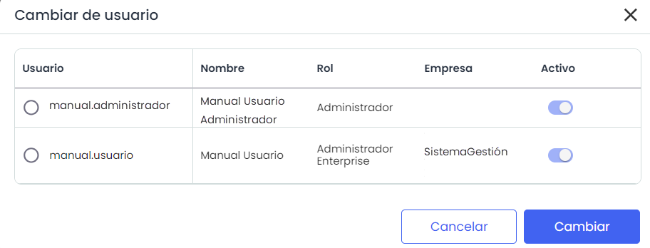
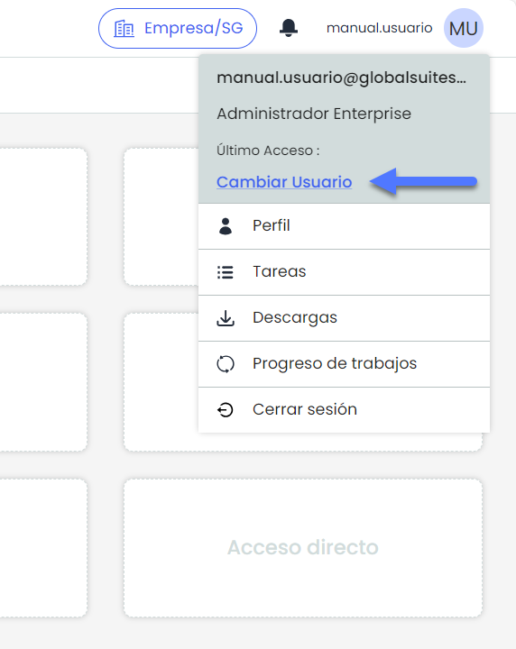

# Acceso a múltiples sistemas


Esta opción permite a los usuarios con permisos en varias entidades o empresas de tipo Enterprise gestionar de manera flexible el acceso a distintos entornos desde una misma cuenta. Es útil para aquellos que necesitan alternar entre empresas o entidades dentro de GlobalSuite, facilitando el trabajo en múltiples sistemas sin requerir credenciales diferentes para cada uno.


## Acceso

Si el usuario cuenta con acceso a varias entidades o empresas, al autenticar con el usuario y la contraseña se abrirá una ventana emergente que permitirá elegir a qué entidad o empresa acceder, de acuerdo con la configuración del usuario.


\*\*NOTA:\*\* Para definir esta configuración, se debe revisar la opción Usuarios en el apartado [Tipo de Autenticación](https://help.globalsuitesolutions.com/es/globalsuite/v1/tipo-de-autenticacion).


## Cambiar Usuario

Se podrá cambiar el tipo de acceso pulsando sobre las opciones del usuario en la parte superior derecha de la ventana dónde indica "Cambiar Usuario".

