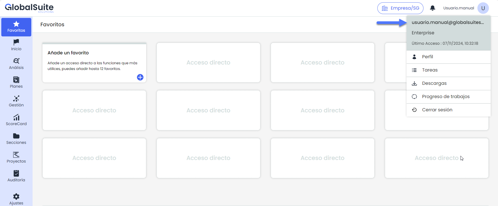

# Área de Usuario


Desde la parte superior derecha de la interfaz, el \*\*Área de Usuario\*\* proporciona acceso directo a varias opciones relacionadas con la gestión del perfil del usuario y las actividades dentro de GlobalSuite. Este menú está diseñado para ofrecer una vista rápida de las funciones personales y herramientas administrativas disponibles para cada usuario.


Dentro del " Área de Usuario", se pueden encontrar las siguientes opciones:

* **Perfil**: Acceso a la configuración y detalles personales del usuario.
* **Tareas**: Acceso a la lista de tareas asignadas y pendientes.
* **Descargas**: Sección donde se encuentran las descargas disponibles para el usuario.
* **Progreso de trabajos**: Información sobre el avance y el estado de los trabajos, incluyendo el progreso de los cálculos actuales
* **Cerrar sesión**: Opción para salir de la cuenta de manera segura.
