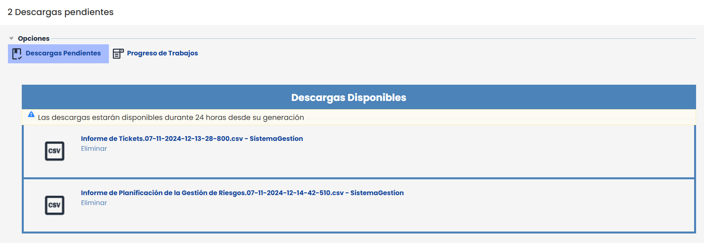
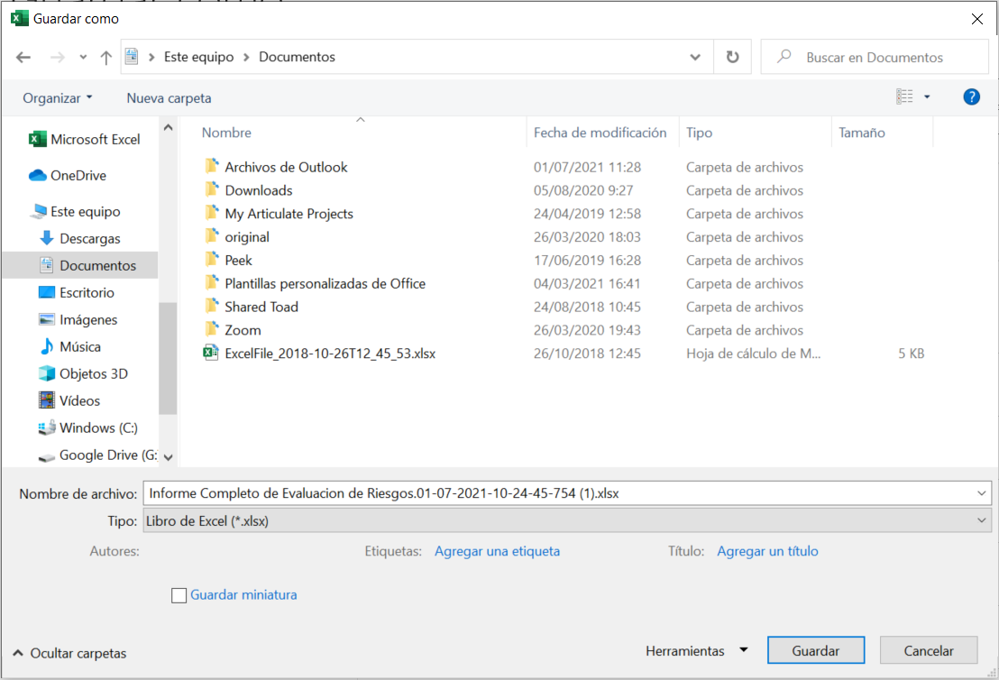

# Descargas Pendientes


La opción de "Descargas pendientes" permite acceder a los informes y archivos generados en diversas secciones de la aplicación, como el Gestor Documental, el módulo de Riesgos y el de Compliance, entre otros. Desde esta funcionalidad, es posible gestionar las descargas de documentos generados en las distintas áreas de trabajo de manera centralizada.


## Descargar

Al seleccionar la descarga de un informe o archivo, el sistema muestra un mensaje indicando: "Se ha iniciado la generación del informe. Cuando esté disponible se le notificará y podrá realizar la descarga desde la opción Descargas pendientes". Una vez disponible, el archivo podrá descargarse directamente desde esta sección.

Para descargar un archivo desde la sección de "Descargas pendientes": Localizar el archivo en la lista de descargas disponibles y pulsar sobre el enlace con el nombre del archivo. La descarga se iniciará automáticamente y el archivo se guardará en la carpeta de descargas predeterminada del dispositivo.

### Eliminar descarga

En caso de no querer descargar un archivo, el mismo se puede eliminar pulsando sobre el botón **Eliminar** ubicado debajo del archivo correspondiente.


\*\*NOTA\*\*: Los archivos en "Descargas pendientes" se eliminan de manera automática cada 24 horas desde su generación.


## Archivos CSV

Este formato CSV es un estándar que permite la explotación y volcado de la información en otros sistemas, facilitando la interconexión y explotación de las mismas.

Si se quiere convertir el informe descargado en formato CSV, en formato Excel, se puede realizar siguiendo estos pasos:

1. Abra el archivo .csv descargado de GlobalSUITE® que desee convertir.
2. Haga clic en **Archivo** > **Guardar como**.

   
3. En **Sitios**, seleccione el lugar donde desea guardar el archivo.

   
4. En el cuadro de diálogo **Guardar como**, vaya a la ubicación deseada.

   
5. En la lista **Guardar como tipo**, haga clic en el formato de archivo "*Libro de Excel (\*.xlsx)*". Haga clic en las flechas para desplazarse a los formatos de archivo que no se vean en la lista.  
   
