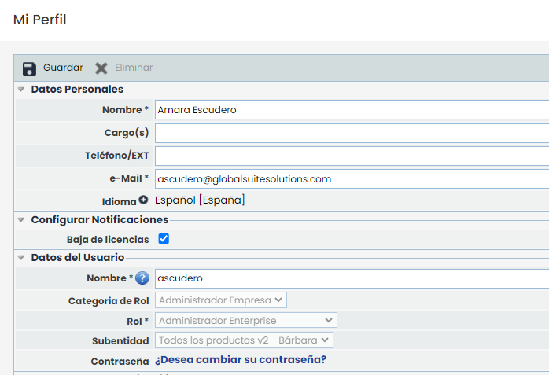
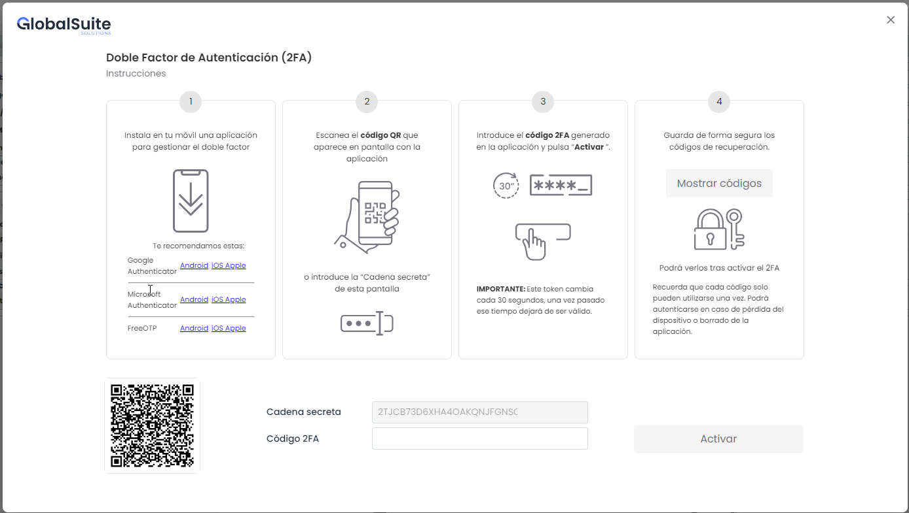
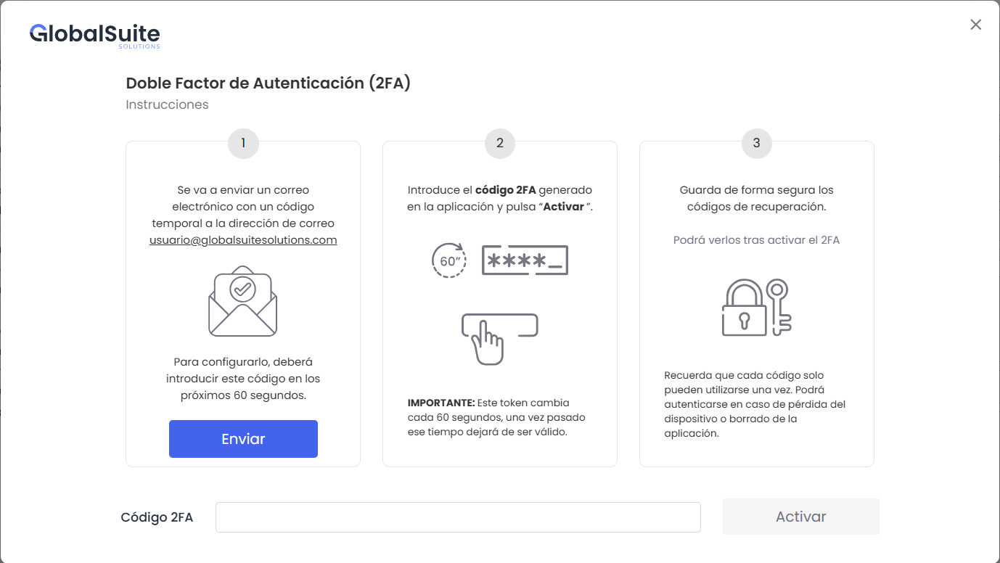
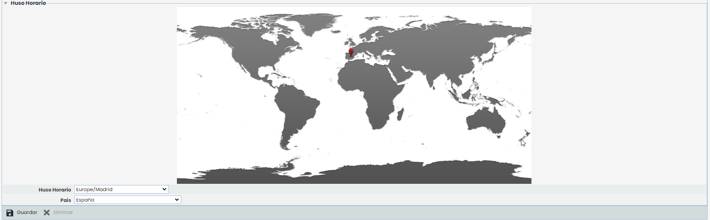

# Mi Perfil


La opción Mi Perfil permite al gestor modificar los datos correspondientes a su usuario.


# **Datos Personales**

GlobalSUITE ofrece la posibilidad de definir los siguientes datos personales:

* **Nombre:** Permite identificar el nombre del gestor de la plataforma.
* **Cargo(s):** Ofrece la posibilidad de definir el cargo que ocupa en la organización.
* **Teléfono/EXT:** Permite identificar el número de teléfono del gestor además de su extensión personal en caso de tenerla.
* **e-Mail:** Ofrece la posibilidad de indicar el correo corporativo del gestor.
* **Idioma:** Permite definir el idioma con el que el usuario visualizará la plataforma. El listado de idiomas a seleccionar por el usuario será el mismo que los idiomas configurados a nivel de empresa (ver la opción [Datos Empresa](../../ajustes/datos-empresa.md)).

# **Configurar Notificaciones y Datos del Usuario**

Las notificaciones son correos electrónicos que GlobalSUITE envía de forma automática, en el caso de estar marcada la casilla, para alertar al usuario de la proximidad a la caducidad de las licencias de la propia empresa o de las empresas dependientes en el caso de ser un usuario organizativo.

Todos los correos electrónicos de notificaciones se envían, por defecto, desde la cuenta [notificaciones@globalsuitesolutions.com](mailto:notificaciones@globalsuitesolutions.com), cuenta habilitada para el envío de las notificaciones pero no para la recepción de mensajes.

**El apartado de datos del usuario** muestra el nombre del usuario y permite cambiarlo por otro que no esté en uso dentro de la plataforma.

También muestra información sobre el rol asignado al usuario (ver opción [Tipos de Usuario](../../ajustes/usuarios/tipos-de-usuario.md)), el perfil asignado dentro de la empresa (sub-rol) así como información de la estructura organizacional a la que puede acceder el usuario (Subentidad). Estos datos son informativos para el usuario el cual no puede modificar el tipo de usuario o perfil asignado a sí mismo. Estos cambios sólo pueden ser realizados por usuarios administradores de la organización

En caso de que el usuario desee modificar la contraseña, puede cambiarla pulsando sobre el enlace ‘¿Desea cambiar su contraseña?’. La contraseña seleccionada debe cumplir la política de contraseña de la plataforma, detallada en el apartado [Acceso a la Plataforma.](../acceso-a-la-plataforma.md)

# **Doble Factor Autenticación**

Este apartado permite a los usuarios la posibilidad de activar o desactivar el Doble factor de seguridad, solo en el caso de que se haya configurado como Opcional en Ajustes > Configuración > General > [Configuración empresa](https://help.globalsuite.es/pages/viewpage.action?pageId=78808338)

Se deberá pulsar el botón Activar Doble factor y seguir los pasos indicados en la ventana emergente. Dichos pasos dependerán de si el 2FA es por TOTP o Correo Electrónico:

## **Doble Factor Autenticación - TOTP.**


\*\*NOTA:\*\* Esta ventana es la misma que aparece cuando un usuario accede por primera vez si el Doble Factor esta configurado como obligatorio en Ajustes> Configuración > General > [Configuración empresa](https://help.globalsuite.es/pages/viewpage.action?pageId=78808338)


## **Doble Factor Autenticación - Correo Electrónico.**


\*\*NOTA:\*\* Esta ventana es la misma que aparece cuando un usuario accede por primera vez si el Doble Factor esta configurado como obligatorio en Ajustes> Configuración > General > [Configuración empresa](https://help.globalsuite.es/pages/viewpage.action?pageId=78808338)


## **Desactivar Doble Factor Autenticación .**

En ambos casos, si lo que se quiere es desactivarlo, se deberá pulsar el botón Desactivar Doble Factor. Si la Doble Autenticación se configuró como obligatoria, tras desactivarla se requerirá activarlo de nuevo para poder continuar.

# **Huso horario**

GlobalSUITE permite mediante este apartado, definir el huso horario con el cual gestionar la plataforma. Para ello se puede elegir entre diferentes continentes y países en los desplegables situados en la parte inferior del apartado. Una vez seleccionado se ha de pulsar sobre el botón ‘Guardar’ para que los cambios queden guardados.

En función del huso horario seleccionado se visualizarán los campos de fechas, horas y temporalidades acorde a dicha selección. La selección realizada o el cambio d dicho huso horario no afecta a los datos almacenados en la plataforma, únicamente a la visualización de los mismos.
