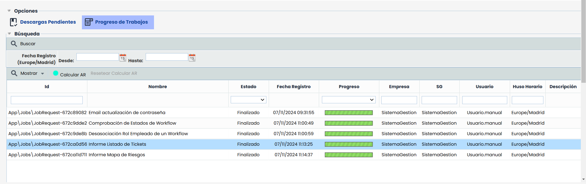
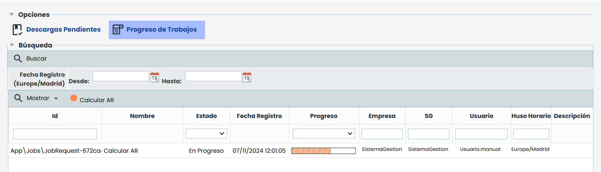
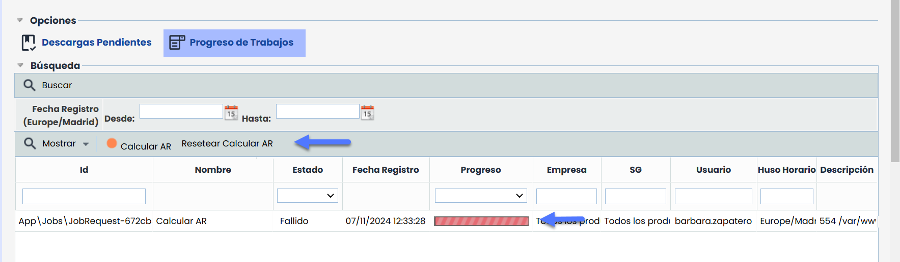

# Progreso de trabajos


La sección de Progreso de Trabajos permite consultar todos los trabajos en segundo plano que se están ejecutando y los lanzados previamente en el sistema de gestión. Estos trabajos incluyen tanto la generación de informes y documentos como procesos específicos, como el de [Calcular AR](https://help.globalsuitesolutions.com/es/globalsuite/v1/analisis-de-riesgos#An%C3%A1lisisdeRiesgos-Opciones).


## Filtros y Funcionalidades

* **Fecha Registro (Europe/Madrid):** Permite filtrar los trabajos por su fecha de registro, especificando un rango entre las fechas Desde y Hasta para visualizar los trabajos registrados en ese intervalo.
* **Botón Mostrar:** Este botón permite filtrar los trabajos por su estado. Las opciones de filtrado son:

  * **Pendientes:** Muestra solo los trabajos que están en proceso.
  * **Finalizados:** Muestra únicamente los trabajos que ya han concluido.
  * **Todos:** Muestra todos los trabajos, independientemente de su estado.

### Indicador "Calcular AR"

Según la cantidad de elementos y la complejidad de las dependencias involucradas, el tiempo requerido para completar Calcular AR puede variar. Para facilitar el seguimiento de este proceso, el indicador Calcular AR en la barra de herramientas de la tabla principal muestra el estado de forma rápida:

* Rojo: Indica que el cálculo está en curso o que ha ocurrido un fallo en el proceso.

* Verde: Indica que el cálculo ha finalizado correctamente.

Si ocurre un error durante la ejecución, el indicador permanece en rojo para señalar el fallo y en estos casos, los administradores del sistema pueden ver la opción Resetear Calcular AR, que permite volver a lanzarlo desde el módulo de análisis de riesgos.

## Tabla Principal

* **Id:** Identificador único del trabajo en el sistema. Este valor es asignado automáticamente y facilita la referencia específica de cada trabajo.
* **Nombre:** Describe el trabajo en ejecución o realizado.
* **Estado:** Indica el estado actual del trabajo. Los posibles valores son:

  * **Registrado:** El trabajo ha sido creado y está en espera de ejecución.
  * **En progreso:** El trabajo se encuentra en ejecución activa.
  * **Finalizado:** El trabajo ha concluido exitosamente.
  * **Fallido:** El trabajo no pudo completarse debido a un error.
* **Fecha Registro:** Fecha y hora en que el trabajo fue registrado en el sistema, en formato DD/MM/AAAA HH:MM
* **Progreso:** Visualización gráfica del avance del trabajo, generalmente en forma de barra de progreso.
* **Empresa:** Nombre de la empresa desde donde se ejecutó el trabajo.
* **SG:** Sistema de gestión desde donde se ejecutó el trabajo.
* **Usuario:** Nombre del usuario que inició el trabajo.
* **Huso Horario:** Huso horario en el que se registró el trabajo.
* **Descripción:** En caso de que el estado del trabajo sea **Fallido**, esta columna puede incluir detalles sobre el motivo del fallo, como problemas de conexión, errores en los datos de entrada o fallos en el sistema de gestión. Revisar esta información puede ayudar a identificar la causa del error y facilitar la resolución o el reintento de la operación.
