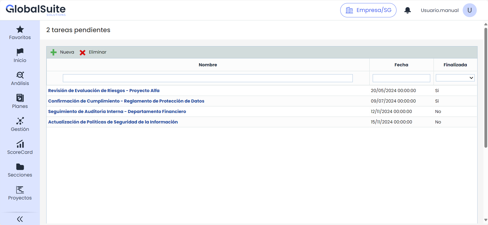
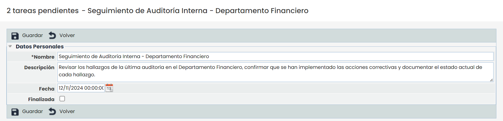

# Tareas Pendientes


La opción ‘Tareas pendientes’ es propia del usuario independientemente del sistema de gestión escogido. Sirve para llevar una lista de tareas pendientes o notas del propio usuario.


## Nueva Tarea

Desde la pantalla principal, al hacer clic en 'Nuevo' se crea una nueva tarea. Al seleccionar el enlace de la tarea, se abre un formulario que contiene los siguientes campos:

* **Nombre**: Permite especificar el nombre de la tarea.
* **Descripción**: Campo para detallar la descripción de la tarea.
* **Fecha**: Permite asignar una fecha a la tarea.
* **Finalizado**: Un checkbox que se puede marcar para indicar que la tarea ha sido completada.

## Eliminar Tarea

Para eliminar una tarea, desde la tabla principal se debe seleccionar la tarea y hacer clic en el botón' Eliminar'. A continuación, se muestra un mensaje de confirmación: "¿Confirma que desea eliminar la tarea seleccionada?". Se debe seleccionar Aceptar para confirmar la eliminación o Cancelar para anular la acción.
