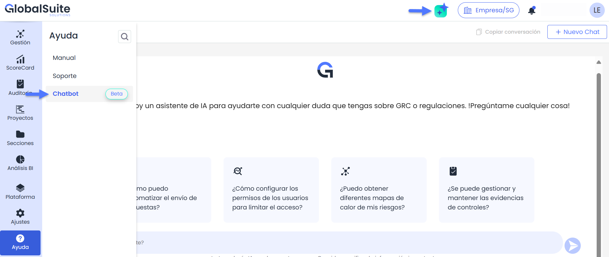

# Asistente de IA

## Asistente de IA GlobalSuite®


GlobalSuite® ha incorporado un nuevo Asistente de IA diseñado para ofrecer soporte instantáneo y facilitar el acceso a información clave de manera rápida y eficiente. Este asistente está disponible para ayudarte con cualquier consulta relacionada con el uso de la plataforma, productos, regulaciones y mejores prácticas relacionadas con el ámbito de GRC.


### ¿Cómo acceder al Asistente de IA?

El asistente puede accederse de dos formas:

1. **Acceso directo desde la interfaz:** En cualquier momento, puedes abrir el asistente directamente desde la aplicación para recibir asistencia inmediata en tiempo real.
2. **Desde la sección de ayuda:** Puedes hacer clic en el icono de ayuda ubicado en la parte superior derecha de la pantalla para abrir el asistente. Desde ahí, podrás iniciar una conversación y obtener respuestas rápidas a tus preguntas.

### ¿Qué puede hacer el Asistente de IA por ti?

* **Gobernanza, Riesgo y Cumplimiento (GRC)**: Proporcionar información sobre mejores prácticas, gestión de riesgos, continuidad de negocio, cumplimiento regulatorio, gobierno corporativo y auditoría interna.
* **Estándares y Regulaciones Internacionales**: Orientación sobre estándares como ISO 27001, ISO 22301, ENS, DORA, NIS2, GDPR, SOC 2, COBIT, TPRM, ISO 19601 y otros marcos de cumplimiento.
* **Software GlobalSuite**: Ayuda con las funcionalidades, características, implementación y especificaciones de la API del software GlobalSuite.
* **Changelog de GlobalSuite**: Consultar cambios y actualizaciones de versiones específicas del software GlobalSuite.

### Ventajas adicionales

* **Soporte 24/7:** Disponible en cualquier momento para brindar asistencia sin interrupciones.
* **Eficiencia mejorada:** Reduce el tiempo en consultas y optimiza la gestión de tareas.
* **Optimización constante:** El asistente se actualiza periódicamente para adaptarse mejor a tus necesidades y ofrecerte una experiencia cada vez más personalizada.


Disponible en la versión Enterprise o versiones superiores.

