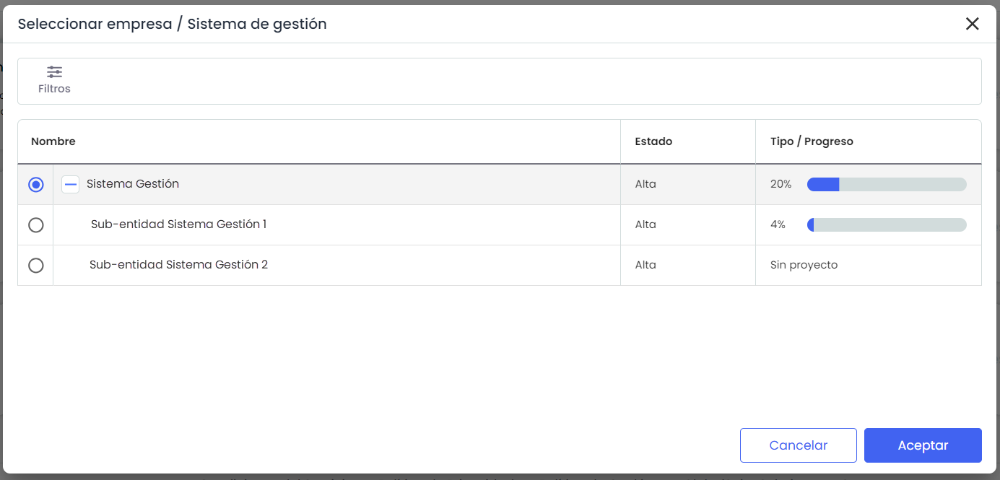

# Elegir SG


La plataforma GlobalSuite® permite a los clientes organizarse en distintos sistemas de gestión, facilitando la selección y administración del sistema de gestión de la empresa en la que desean trabajar. A través de la opción Empresa/SG, ubicada en la parte superior derecha de la pantalla, los usuarios pueden acceder a un directorio de empresas a las que tienen permisos de acceso. Este directorio muestra las empresas disponibles, organizadas según el perfil de acceso del usuario, y permite gestionar la vista y el acceso al sistema de gestión correspondiente de cada empresa.


Tras acceder a la plataforma, se puede seleccionar el sistema de gestión en el cual se desea trabajar. Para ello, se utiliza la opción **Empresa/SG**, ubicada en la parte superior derecha de la pantalla.

Para acceder a la empresa deseada es necesario seleccionarla y pulsar “Aceptar”

En la tabla aparecen todas las empresas a las que puede acceder el usuario logueado. Dependiendo del perfil del usuario se tendrá acceso a distintas vistas del sistema.

* **Enterprise:** únicamente accede a la empresa a la que pertenece dicho usuario.
* **Consulting:** accede a las empresas en las que está asignado como consultor/coordinador en el equipo de trabajo.


\*\*NOTA:\*\* Si al acceder a esta pantalla no visualiza la empresa que desea, diríjase a la opción de Ajustes para comprobar que la empresa se ha creado correctamente y usted está incluido como consultor.


El directorio de empresas muestra la siguiente información:

* **Empresa:** listado de empresas que pueden ser visualizadas por el usuario logado. Si se visualizan varias empresas aparecerán estas a modo de árbol dependiendo cada una de su empresa consultora/coordinadora/distribuidora directamente superior. En un primer momento se muestra sin desplegar teniendo que pulsar el icono + de la parte de la izquierda del nombre de la herramienta para poder visualizar las empresas inferiores.
* **Estado:** Muestra si la empresa se ecuentra dada de alta o baja
* **Consultora/Distribuidora:** Coincide con la empresa de la que depende en el árbol de empresas.
* **Progreso:** Indica el porcentaje de avance del proyecto de las empresas. Este porcentaje únicamente aparece si la empresa tiene asociado un proyecto en la gestión de proyectos.

La opción que permite la herramienta sobre la tabla es 'Mostrar' el listado de todas las empresas, o filtar por aquellas dadas de alta o baja.


\*\*NOTA:\*\* Aunque la empresa disponga de múltiples servicios contratados, el sistema de gestión es único. La herramienta cargará las opciones de cada sistema de gestión de la empresa consiguiendo así un alineamiento completo de las normas y una gestión e implantación de los mismos mucho más ágil.

