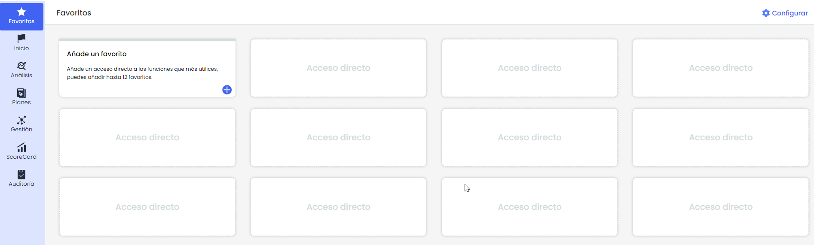
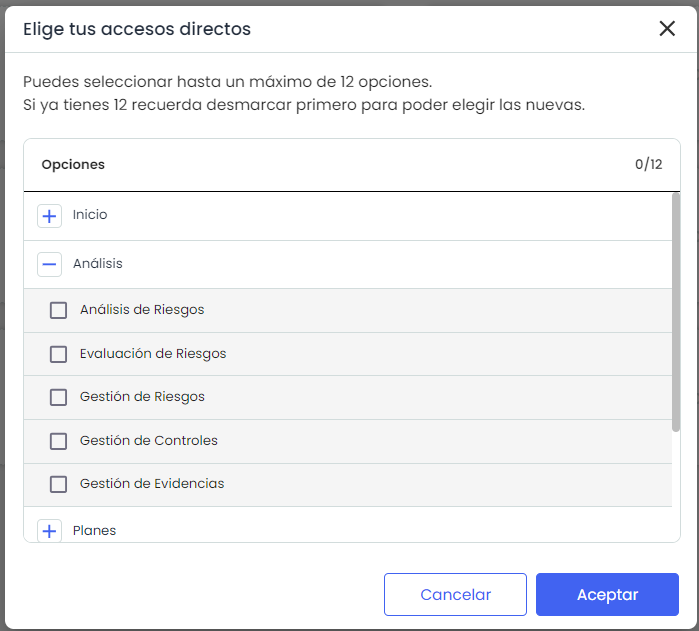
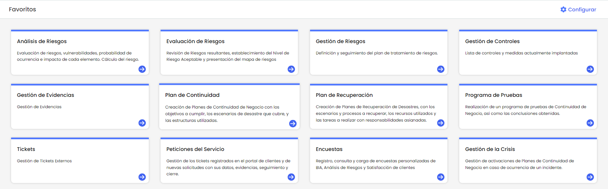

# Favoritos


La sección de Favoritos permite crear accesos directos en la pantalla principal para las opciones más utilizados dentro de la aplicación, gestionándolos a nivel Empresa. Esta opción proporciona una manera rápida y personalizada de acceder a las funcionalidades mas utilizadas, optimizando la experiencia del usuario y reduciendo el tiempo de navegación. Es posible añadir hasta un máximo de 12 favoritos, los cuales se pueden modificar o eliminar en cualquier momento según las necesidades.


## Añadir un Favorito

* Acceder a la pestaña "Favoritos" en el menú lateral izquierdo.

Para agregar un acceso directo, hacer clic en el ícono **"+"** dentro del cuadro. Esto abrirá una ventana emergente que permitirá seleccionar las secciones deseadas como favoritos.

También se puede gestionar los accesos directos existentes haciendo clic en **"Configurar"**, ubicado en la esquina superior derecha de la sección **Favoritos**.

* En la lista de opciones, se puede seleccionar o desmarcar las casillas de verificación junto a cada Opción de GlobalSuite para añadir o remover accesos directos.
* Al finalizar, haga clic en el botón Aceptar para confirmar los cambios. Los accesos directos seleccionados se mostrarán en los espacios disponibles de la sección de Favoritos.

## Quitar favorito

* Hacer clic en "Configurar", ubicado en la esquina superior derecha de la sección de "Favoritos"
* Se abrirá una ventana emergente donde se permite desmarcar los favoritos actuales.
* Al finalizar, haga clic en el botón Aceptar para confirmar los cambios. Los accesos directos desmarcados se quitaran de la sección de Favoritos.
