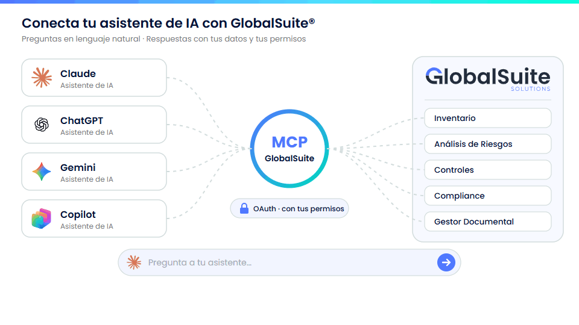
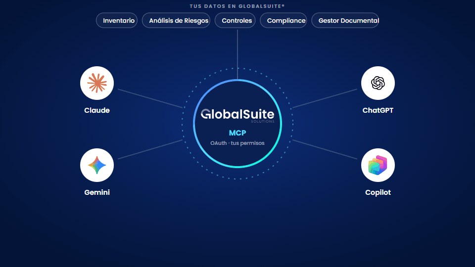
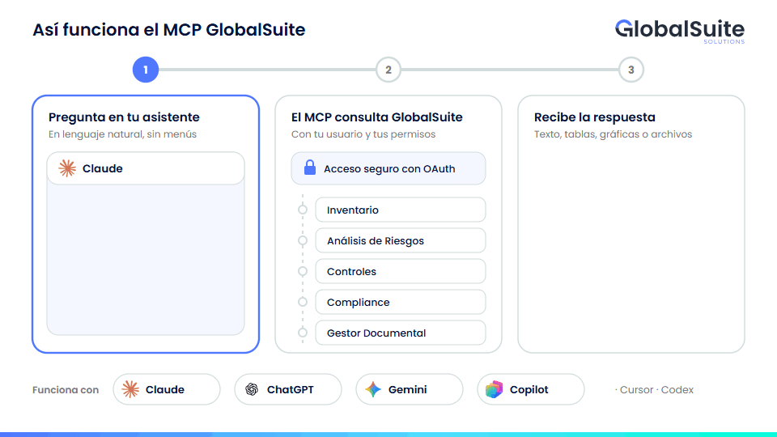
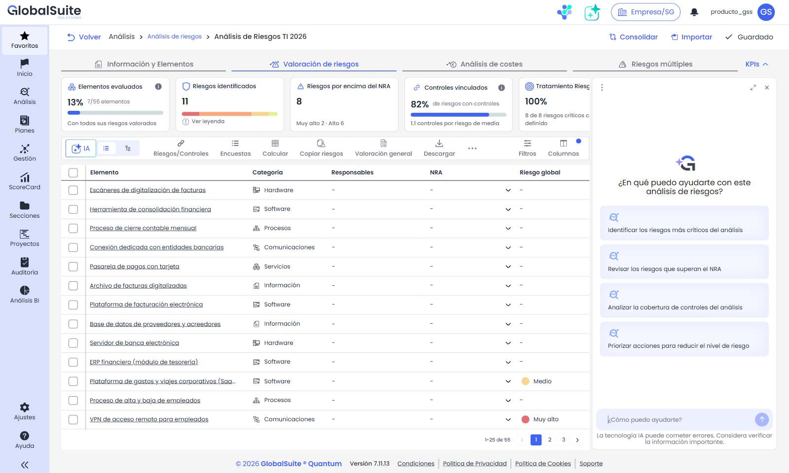

# MCP de GlobalSuite para conexión a Sistemas IA

**El MCP GlobalSuite conecta tu asistente de IA —Claude, ChatGPT, Microsoft Copilot o Cursor— con GlobalSuite®, para que consultes y gestiones tu GRC en lenguaje natural sin salir de la conversación.**

## ¿Qué es el MCP GlobalSuite?

MCP (Model Context Protocol) es un estándar abierto que permite a los asistentes de IA usar, de forma segura, las funciones de otras aplicaciones. El MCP GlobalSuite es el conector oficial de GlobalSuite® para ese estándar.

Funciona como un puente: tu asistente le pide a GlobalSuite® la información que necesita para responderte, siempre con tu usuario y con tus permisos, y te contesta con los datos reales de tu sistema de gestión. No tienes que exportar informes, copiar datos ni navegar por varias pantallas: basta con preguntar.

## Capacidades

El MCP GlobalSuite da acceso a las áreas principales de la plataforma. En Inventario, Análisis de Riesgos y Controles puedes consultar y también actuar; en Compliance y Gestor Documental, consultar.

|  |  |  |
| --- | --- | --- |
| **Área** | **Consultar** | **Actuar** |
| **Inventario** | Elementos, categorías y valoración de sus dimensiones (confidencialidad, integridad, disponibilidad…). | Dar de alta y modificar elementos, valorar sus dimensiones y recalcular las automáticas. |
| **Análisis de Riesgos** | Análisis, riesgos de cada elemento con sus valoraciones y la metodología con sus niveles y criterios. | Añadir o quitar elementos de un análisis, crear y valorar riesgos y lanzar el recálculo del análisis. |
| **Controles** | Controles implantados y del plan de tratamiento, con su valoración, sus acciones y los riesgos que mitigan. | Crear y modificar controles y acciones, asociarlos a riesgos y gestionar sus evidencias. |
| **Compliance** | Evaluaciones normativas y su grado de cumplimiento, árbol de requisitos, controles comunes e incidencias asociadas. | Solo consulta. |
| **Gestor Documental** | Búsqueda de documentos por nombre y lectura de su contenido (Word, PDF e imágenes). | Solo consulta. |
| **Novedades de GlobalSuite®** | Novedades de cada versión y búsqueda en el historial de cambios. | — |

Descubre qué puedes pedirle y copia prompts listos para usar en [Casos de uso y ejemplos de prompts](casos-de-uso-y-ejemplos-de-prompts-del-mcp-globalsuite.md).

## Beneficios

* **Respuestas en segundos** a preguntas que antes exigían navegar por varias vistas, aplicar filtros y exportar.
* **Tus datos, tus permisos:** el asistente accede exactamente a lo mismo que ves en GlobalSuite®, en tu empresa y tu sistema de gestión.
* **Resultados listos para usar:** tablas, gráficas, informes y archivos Excel o Word generados en la propia conversación a partir de datos reales.
* **Con la IA que ya usa tu organización:** Claude, ChatGPT, Microsoft Copilot o Cursor, sin cambiar de herramienta. Si usas otro asistente, podemos valorar incluirlo.
* **Contexto combinado:** cruza la información de GlobalSuite® con documentos que adjuntes o con otras fuentes conectadas a tu asistente.
* **Tú decides:** el asistente solo cambia datos cuando se lo pides y con tus permisos, y puedes pedirle antes una propuesta para revisarla.

## ¿Cómo funciona?

Tu asistente de IA y GlobalSuite® se comunican a través del MCP GlobalSuite. Tú escribes en lenguaje natural y el asistente se encarga de pedir a GlobalSuite® los datos que necesita.

**PENDIENTE: ELEGIR UNA DE LAS TRES VERSIONES DE LA ANIMACIÓN Y ELIMINAR LAS OTRAS DOS (V1 CLARA, V2 OSCURA, V3 EN TRES PASOS).**

**Versión 1 · Clara**

**Versión 2 · Oscura**

**Versión 3 · En tres pasos**

*Las marcas y logotipos de terceros se muestran con fines meramente descriptivos e informativos y no implican patrocinio, respaldo ni relación comercial con sus titulares.*

### Paso a paso

1. **Preguntas.** Escribes tu petición en el chat de tu asistente, por ejemplo: «¿Qué riesgos del análisis de seguridad no tienen controles?».
2. **El asistente elige las herramientas.** Decide qué funciones del MCP GlobalSuite necesita (consultar elementos, riesgos, controles, requisitos, documentos…) y las invoca, encadenando varias si la pregunta lo requiere.
3. **GlobalSuite® comprueba quién eres.** Cada petición viaja con el acceso que obtuviste al iniciar sesión con tu usuario de GlobalSuite®. El MCP valida ese acceso y consulta la plataforma con tus permisos, dentro de tu empresa y tu sistema de gestión.
4. **Recibes la respuesta.** GlobalSuite® devuelve los datos y el asistente te responde con texto, tablas, gráficas o archivos.
5. **Tú controlas los cambios.** El asistente solo modifica datos cuando se lo pides. La confirmación previa la gestiona cada asistente a su manera: ChatGPT la pide en algunas acciones y Claude según su modo de permisos. Para revisar un cambio antes de aplicarlo, pídele primero una propuesta.

### Datos técnicos

|  |  |
| --- | --- |
| **Aspecto** | **Detalle** |
| **Protocolo** | Model Context Protocol (MCP) sobre HTTPS (transporte Streamable HTTP). |
| **Dirección del conector** | Depende de tu entorno: `https://<dominio-de-tu-entorno>/mcp/mcp`. Por ejemplo, en el entorno de demostración: `https://demo.globalsuite.es/mcp/mcp`. |
| **Autenticación** | OAuth 2.1 con PKCE. Inicias sesión en la pantalla de GlobalSuite® con tu método habitual (usuario y contraseña, Active Directory/LDAP o SSO) y tu doble factor si lo tienes activado. |
| **Permisos** | Los mismos que tu usuario en la web: el MCP no amplía ni reduce tu acceso. |
| **Sesión** | El acceso dura 60 minutos y el asistente lo renueva solo. Si pasa más de 7 días sin usarse, te pedirá iniciar sesión otra vez. |
| **Disponibilidad** | GlobalSuite® Cloud. No disponible en instalaciones OnPremise. |

## También dentro de GlobalSuite®: Agente IA de Análisis y Evaluación de Riesgos

Si prefieres no salir de la plataforma, el **Agente IA de Análisis y Evaluación de Riesgos** usa estas mismas capacidades desde dentro de GlobalSuite®, sin conectar ningún asistente externo. Se abre con el botón «IA» de la pestaña «Valoración de riesgos» de cada análisis y, en un panel lateral, responde a tus preguntas sobre el análisis abierto y aplica los cambios que le pidas.

*El Agente IA se abre en un panel lateral, junto a la valoración del análisis, con consultas sugeridas para empezar.*

Más información en [Agente IA en Riesgos](../../analisis/analisis-riesgos/agente-ia-en-riesgos.md).

## Próximamente

* Acciones de escritura en Compliance y en el Gestor Documental.
* Respuestas visuales e interactivas dentro del propio chat (MCP Apps).
* Publicación del conector en los directorios de Claude y ChatGPT, para añadirlo sin configurar ninguna dirección.
* Conexión sin necesidad de introducir el identificador de cliente.

## En esta sección

* [Guía de instalación y configuración](guia-de-instalacion-y-configuracion-del-mcp-globalsuite.md): cómo conectar tu asistente, en cuentas propias y corporativas.
* [Casos de uso y ejemplos de prompts](casos-de-uso-y-ejemplos-de-prompts-del-mcp-globalsuite.md): qué puedes pedirle, con prompts listos para copiar.
* [Preguntas frecuentes](preguntas-frecuentes-del-mcp-globalsuite.md): asistentes compatibles, límites, sesiones, permisos y desconexión.
* [Aviso legal y condiciones de uso](aviso-y-condiciones-de-uso-del-mcp-globalsuite.md): responsabilidades, tratamiento de datos y uso de marcas.

**Ten en cuenta:** las respuestas las genera el asistente de IA que elijas y pueden contener errores. Revisa siempre la información antes de tomar decisiones. Los datos que consulta el asistente se procesan en el servicio del proveedor de IA que utilices, según sus propias condiciones; consulta el [aviso legal](aviso-y-condiciones-de-uso-del-mcp-globalsuite.md).
