# Casos de uso y ejemplos de prompts del MCP GlobalSuite

Estos prompts son puntos de partida para sacar el máximo partido al MCP GlobalSuite. Cópialos tal cual o adáptalos a tu caso: cambia lo que va entre [corchetes] por el nombre de tu análisis, tu elemento o tu normativa. Funcionan con cualquier asistente compatible.

*Las capturas de esta página son respuestas reales de Claude y de ChatGPT con el MCP GlobalSuite conectado a un entorno demo de GlobalSuite®. Tus respuestas variarán según tus datos y el asistente que uses.*

* [Consejos para obtener mejores respuestas](#CasosdeusoyejemplosdepromptsdelMCPGlobalSuite-Consejosparaobtenermejoresrespuestas)
* [1. Primeros pasos](#CasosdeusoyejemplosdepromptsdelMCPGlobalSuite-1.Primerospasos)
* [2. Inventario de activos](#CasosdeusoyejemplosdepromptsdelMCPGlobalSuite-2.Inventariodeactivos)
* [3. Análisis de riesgos](#CasosdeusoyejemplosdepromptsdelMCPGlobalSuite-3.Análisisderiesgos)
* [4. Controles y planes de tratamiento](#CasosdeusoyejemplosdepromptsdelMCPGlobalSuite-4.Controlesyplanesdetratamiento)
* [5. Compliance](#CasosdeusoyejemplosdepromptsdelMCPGlobalSuite-5.Compliance)
* [6. Gestor Documental](#CasosdeusoyejemplosdepromptsdelMCPGlobalSuite-6.GestorDocumental)
* [7. Gráficas y cuadros de mando](#CasosdeusoyejemplosdepromptsdelMCPGlobalSuite-7.Gráficasycuadrosdemando)
* [8. Informes y plantillas](#CasosdeusoyejemplosdepromptsdelMCPGlobalSuite-8.Informesyplantillas)
* [9. Acciones de escritura](#CasosdeusoyejemplosdepromptsdelMCPGlobalSuite-9.Accionesdeescritura)
* [10. Novedades de GlobalSuite®](#CasosdeusoyejemplosdepromptsdelMCPGlobalSuite-10.NovedadesdeGlobalSuite®)
* [Si la respuesta no es completa](#CasosdeusoyejemplosdepromptsdelMCPGlobalSuite-Silarespuestanoescompleta)

## Consejos para obtener mejores respuestas

* **Llama a las cosas como en GlobalSuite®.** Usa el nombre exacto del análisis, la evaluación normativa o el elemento: el asistente lo busca por su nombre.
* **Pide el formato que necesitas:** una tabla, una gráfica, un Excel, un Word o un resumen para dirección.
* **Empieza por lo general y profundiza.** Pregunta primero por el estado de un análisis y después por los riesgos o controles que te interesen.
* **Con mucho volumen de datos, acota o investiga.** Limita la pregunta a un análisis, una categoría o un elemento, o activa el modo de investigación de tu asistente (por ejemplo, Investigación en Claude o Investigación profunda en ChatGPT) y pídele que revise todas las páginas de resultados.
* **Pídele que te diga qué ha revisado.** En consultas que cruzan muchos datos, pide que indique qué elementos, riesgos o requisitos ha consultado: así sabrás si la respuesta está completa. Con los mismos datos, cada asistente y cada modelo pueden llegar a conclusiones distintas.
* **Revisa siempre el resultado.** La IA puede equivocarse; contrasta los datos importantes en GlobalSuite®.

## 1. Primeros pasos

### Qué puede hacer el conector


```
¿Qué información de GlobalSuite puedes consultar y qué acciones puedes
hacer con el conector?
```


**ChatGPT**

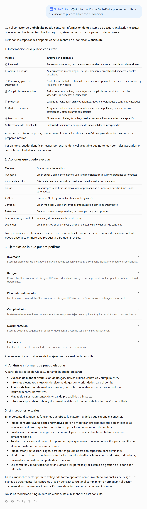

*Respuesta real en ChatGPT con el MCP GlobalSuite · entorno de demostración*

**Claude**

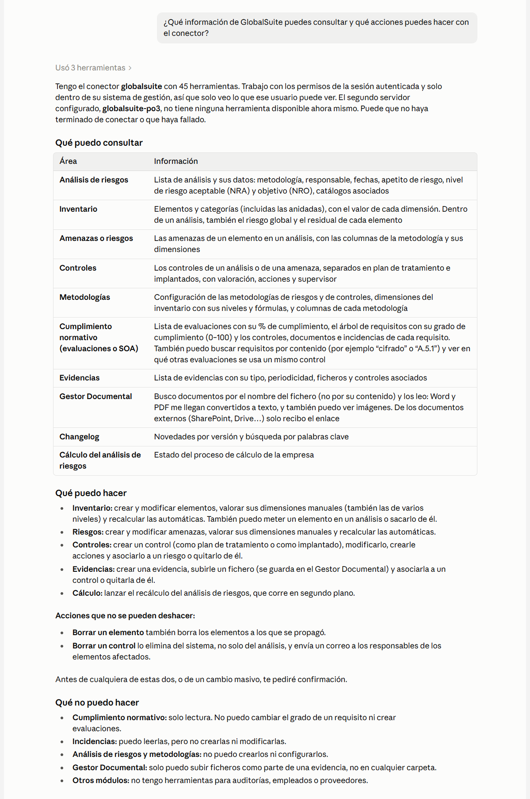

*Respuesta real en Claude con el MCP GlobalSuite · entorno de demostración*

### Resumen de tu sistema de gestión


```
Hazme un resumen del estado de mi sistema de gestión en GlobalSuite:
análisis de riesgos activos, evaluaciones normativas con su grado de
cumplimiento y los tres puntos que requieren más atención.
```


*Herramientas: get\_all\_risk\_analysis · list\_compliance\_evaluations*

**ChatGPT**

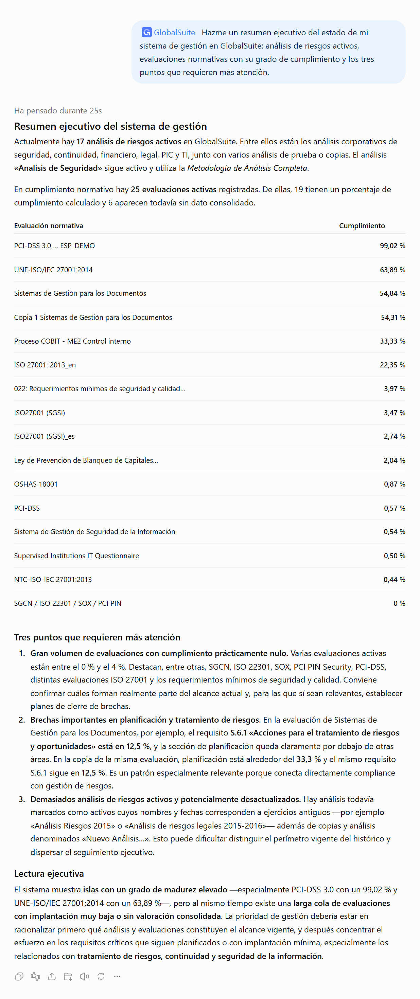

*Respuesta real en ChatGPT con el MCP GlobalSuite · entorno de demostración*

**Claude**

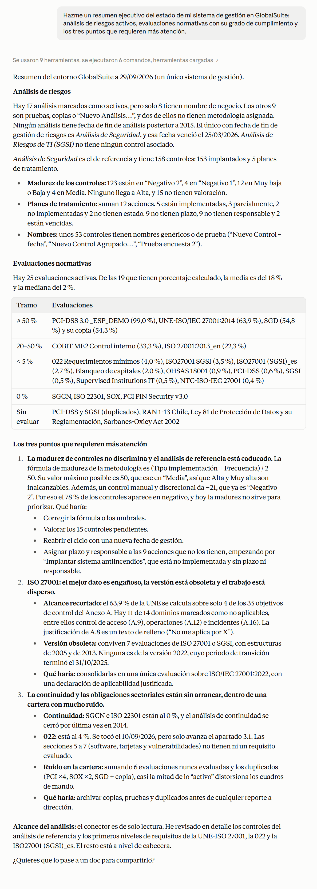

*Respuesta real en Claude con el MCP GlobalSuite · entorno de demostración*

### Revisa la calidad de tus datos


```
Revisa la calidad de los datos del análisis [nombre] antes de presentarlo
al comité: elementos sin valorar o sin categoría, controles duplicados o
con nombres de prueba y acciones del plan de tratamiento sin responsable o
sin plazo. Dame una tabla con cada problema, cuántos casos hay y cómo lo
corregirías.
```


*Herramientas: get\_all\_risk\_analysis · get\_elements\_by\_analysis · get\_controls*

**ChatGPT**

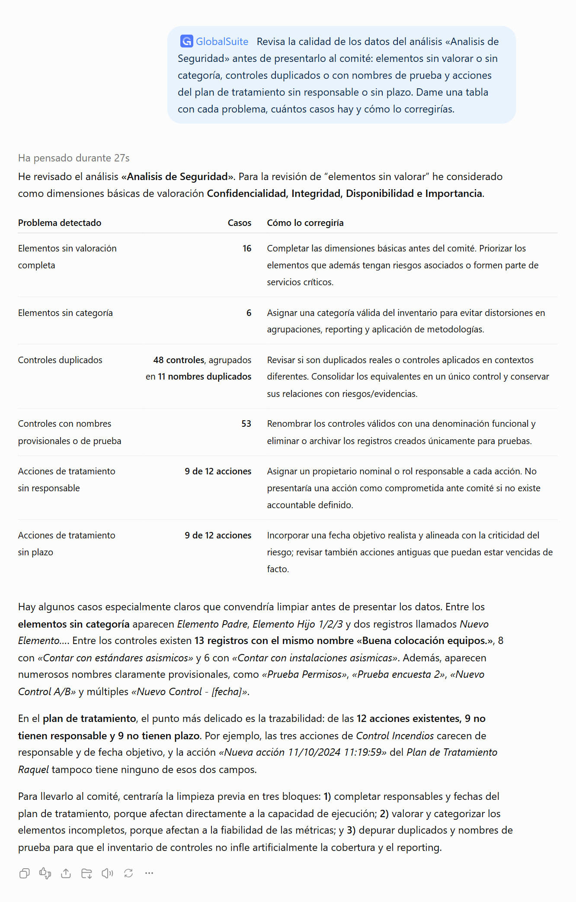

*Respuesta real en ChatGPT con el MCP GlobalSuite · entorno de demostración*

**Claude**

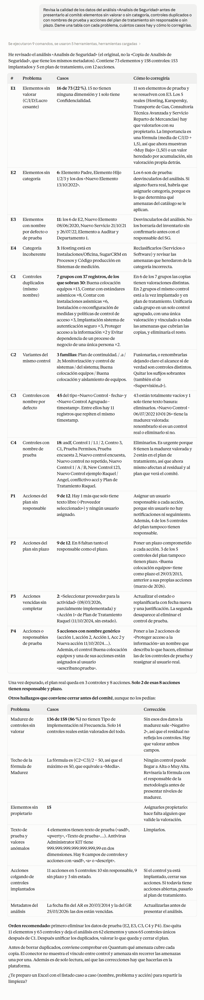

*Respuesta real en Claude con el MCP GlobalSuite · entorno de demostración*

### Localiza tus análisis


```
Lista mis análisis de riesgos activos con su responsable, su metodología y
su nivel de riesgo aceptable.
```


*Herramientas: get\_all\_risk\_analysis*

**ChatGPT**

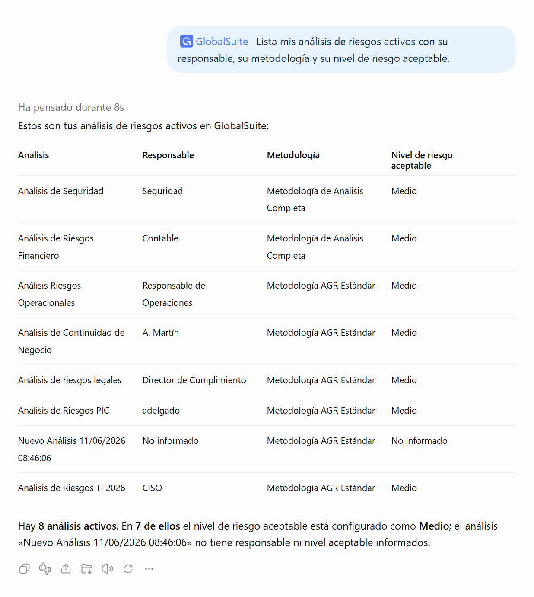

*Respuesta real en ChatGPT con el MCP GlobalSuite · entorno de demostración*

**Claude**

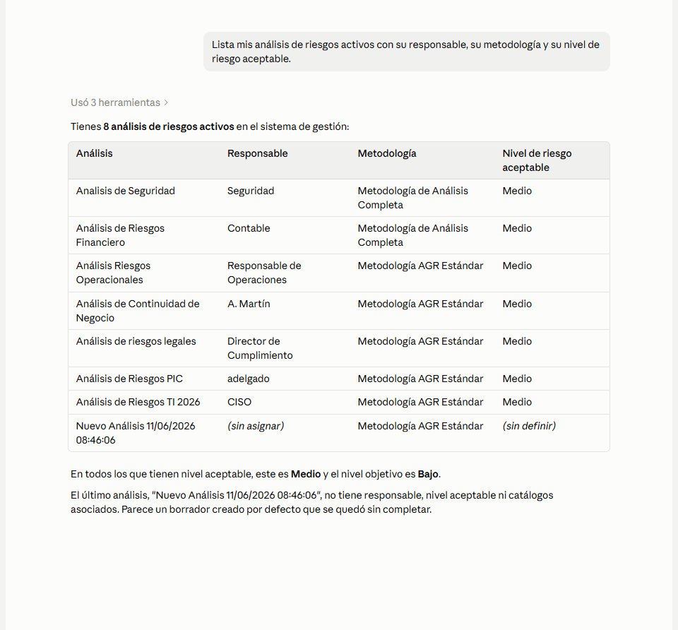

*Respuesta real en Claude con el MCP GlobalSuite · entorno de demostración*

## 2. Inventario de activos

### Elementos más críticos


```
¿Cuáles son los [10] elementos más críticos de [mi inventario / el análisis
«nombre»]? Ordénalos por importancia y dime cómo están valorados en
confidencialidad, integridad y disponibilidad.
```


*Herramientas: get\_elements o get\_elements\_by\_analysis · get\_methodology\_elements*

**ChatGPT**

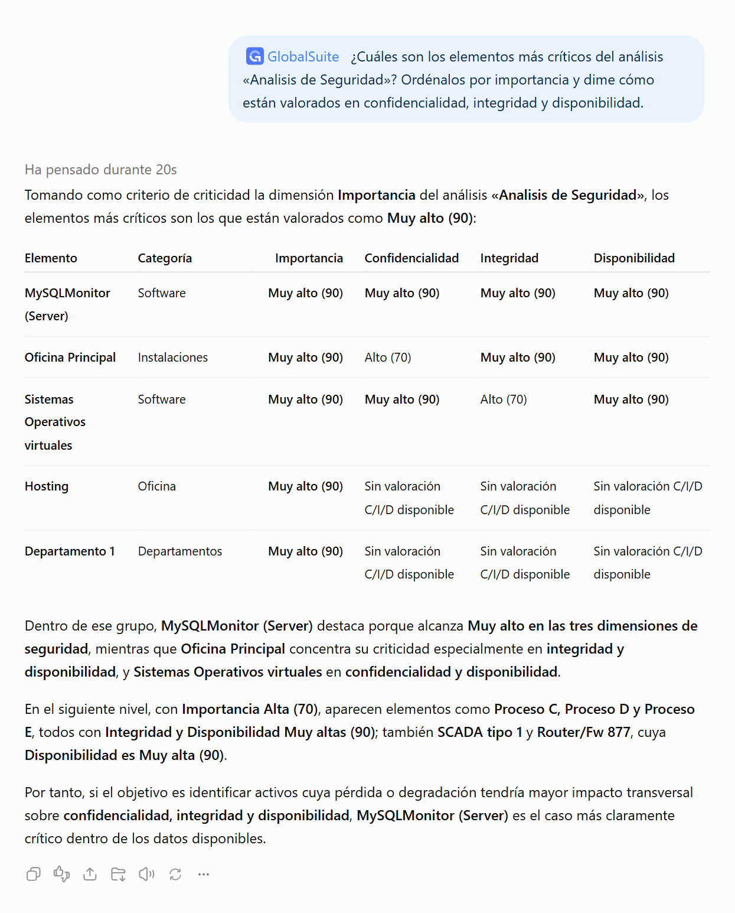

*Respuesta real en ChatGPT con el MCP GlobalSuite · entorno de demostración*

**Claude**

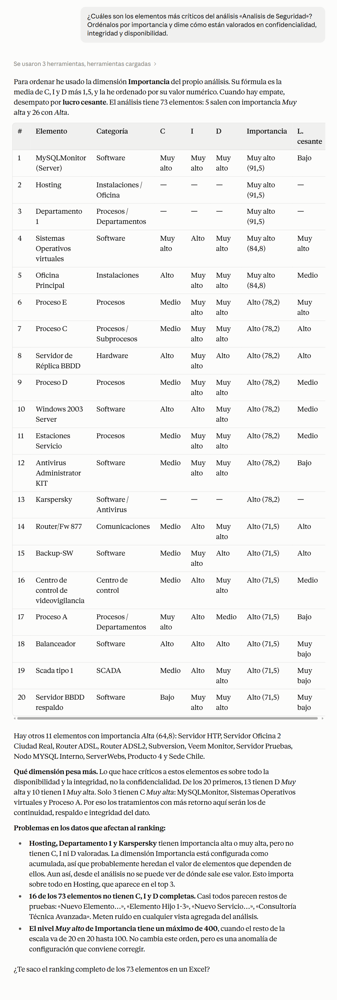

*Respuesta real en Claude con el MCP GlobalSuite · entorno de demostración*

### Elementos sin valorar


```
¿Qué elementos de la categoría [Software] no tienen valoradas la
confidencialidad, la integridad o la disponibilidad?
```


*Herramientas: get\_categories · get\_elements*

**ChatGPT**

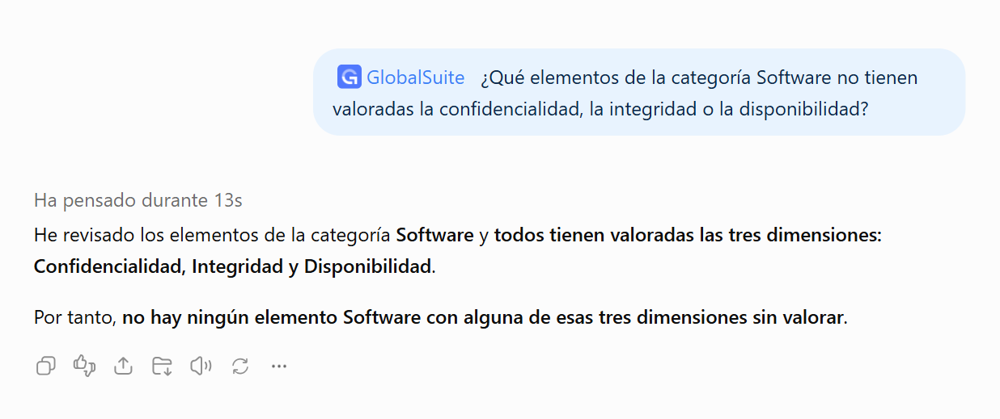

*Respuesta real en ChatGPT con el MCP GlobalSuite · entorno de demostración*

**Claude**

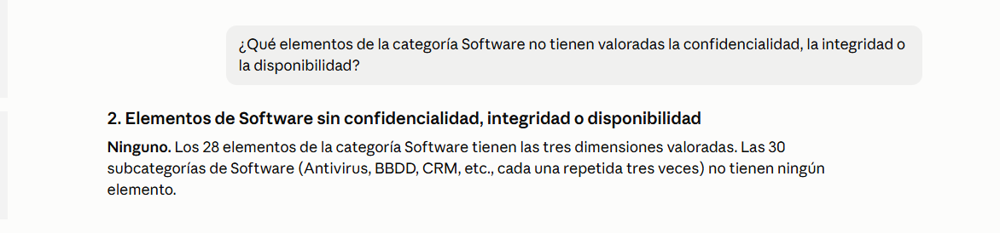

*Respuesta real en Claude con el MCP GlobalSuite · entorno de demostración*

### Elementos de un responsable


```
¿Qué elementos del inventario tiene asignados [propietario] y cuál es su
importancia?
```


*Herramientas: get\_elements*

**ChatGPT**

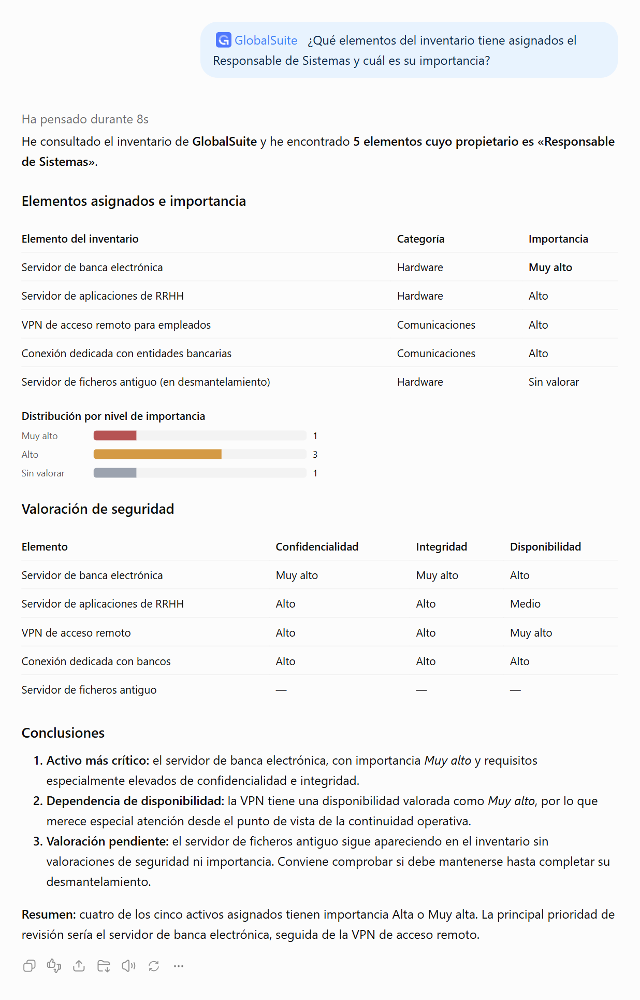

*Respuesta real en ChatGPT con el MCP GlobalSuite · entorno de demostración*

**Claude**

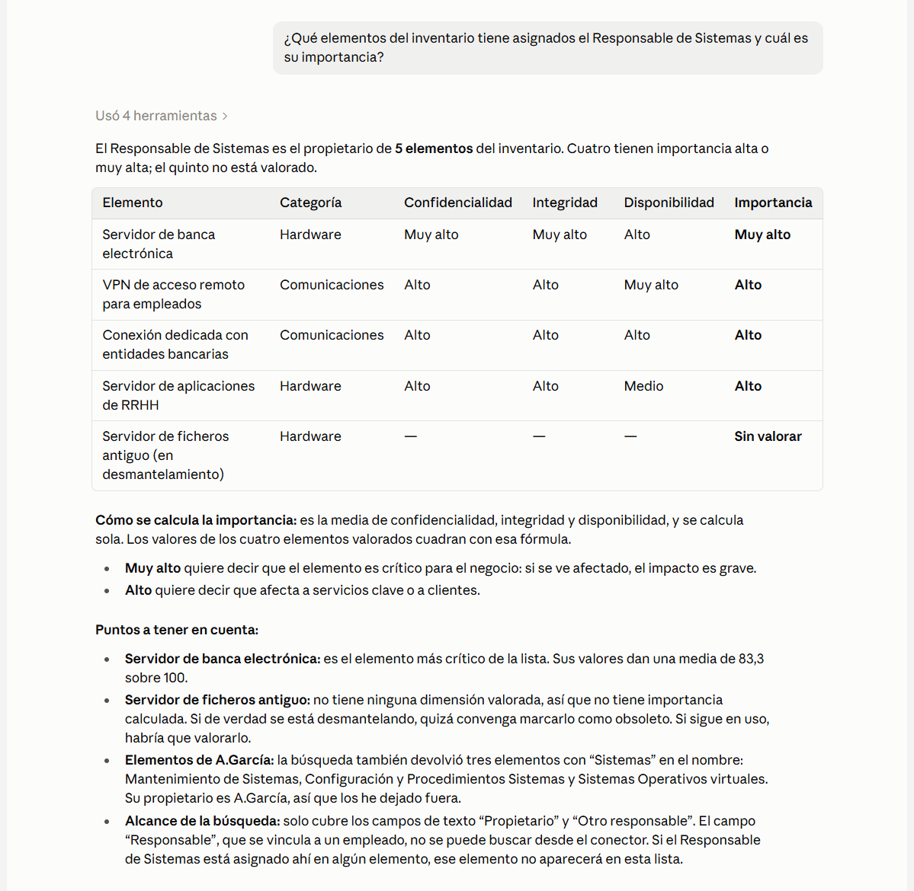

*Respuesta real en Claude con el MCP GlobalSuite · entorno de demostración*

### Qué significa cada nivel


```
Explícame qué criterio define cada nivel de [disponibilidad] en la
metodología de mi inventario.
```


*Herramientas: get\_methodology\_elements*

**ChatGPT**

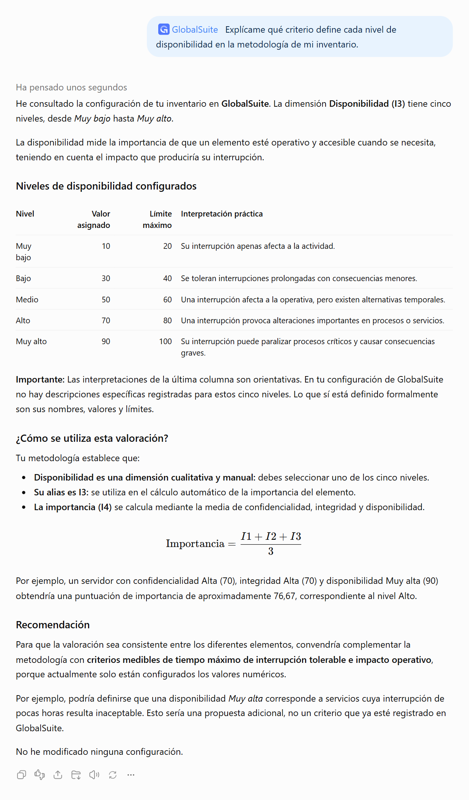

*Respuesta real en ChatGPT con el MCP GlobalSuite · entorno de demostración*

**Claude**

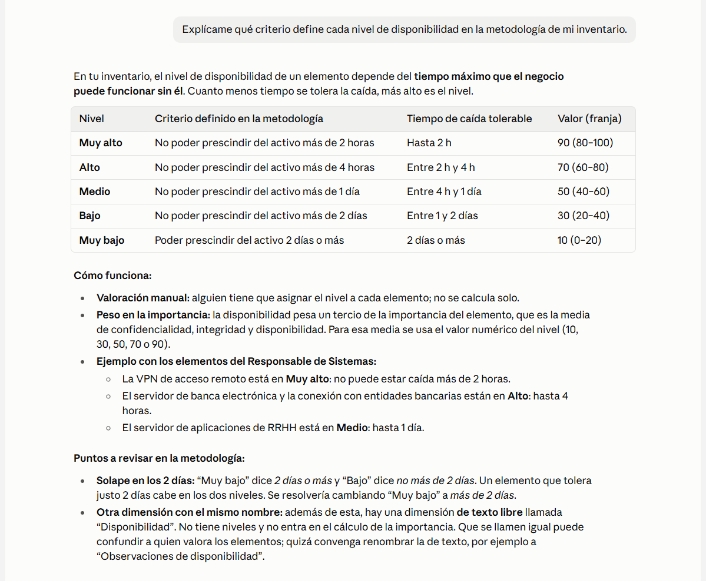

*Respuesta real en Claude con el MCP GlobalSuite · entorno de demostración*

## 3. Análisis de riesgos

### Riesgos de un elemento


```
¿Qué riesgos tiene el elemento [nombre] en el análisis [nombre]? Dime su
nivel de riesgo y de riesgo residual y cuáles debería tratar primero.
```


*Herramientas: get\_elements\_by\_analysis · get\_element\_threats · get\_methodology\_risks*

**ChatGPT**

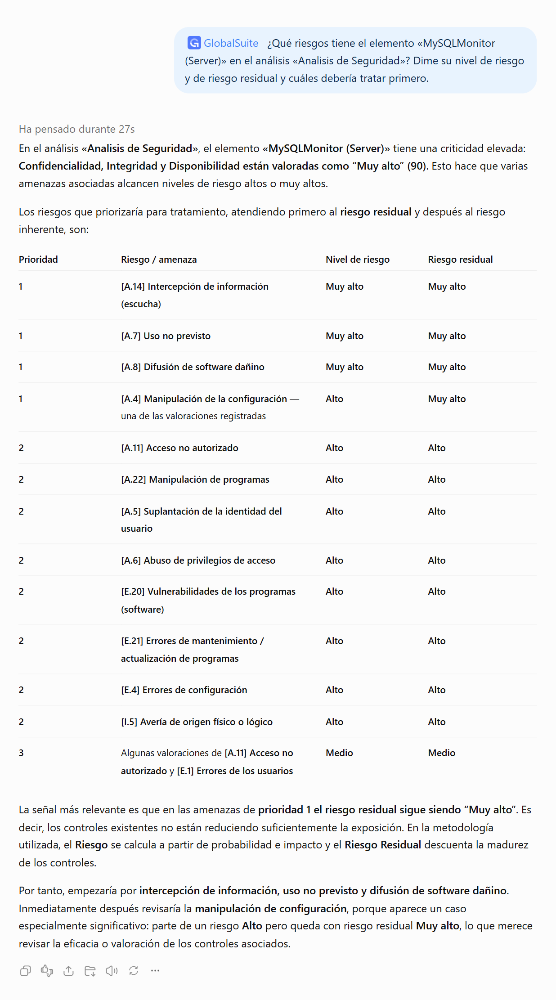

*Respuesta real en ChatGPT con el MCP GlobalSuite · entorno de demostración*

**Claude**

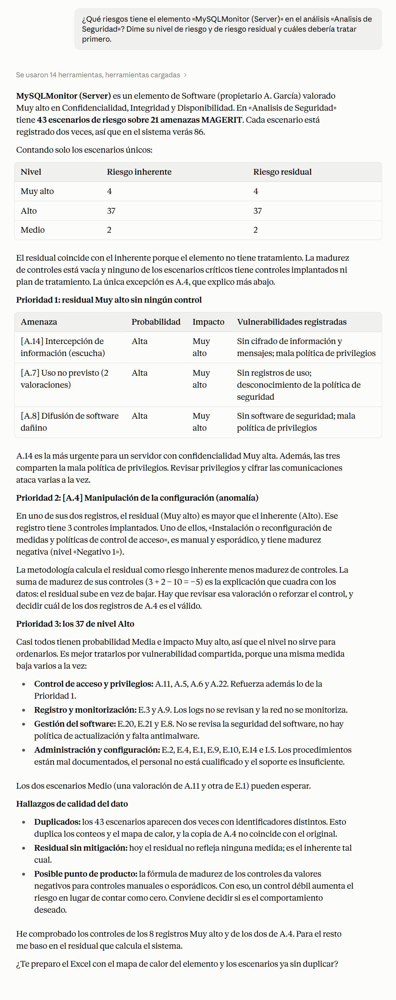

*Respuesta real en Claude con el MCP GlobalSuite · entorno de demostración*

### Riesgos críticos de un análisis


```
Identifica los riesgos con riesgo residual [Muy alto] del análisis [nombre]
y agrúpalos por elemento. Revisa todas las páginas de resultados.
```


*Herramientas: get\_elements\_by\_analysis · get\_element\_threats · get\_methodology\_risks · Recomendado: modo de investigación*

**ChatGPT**

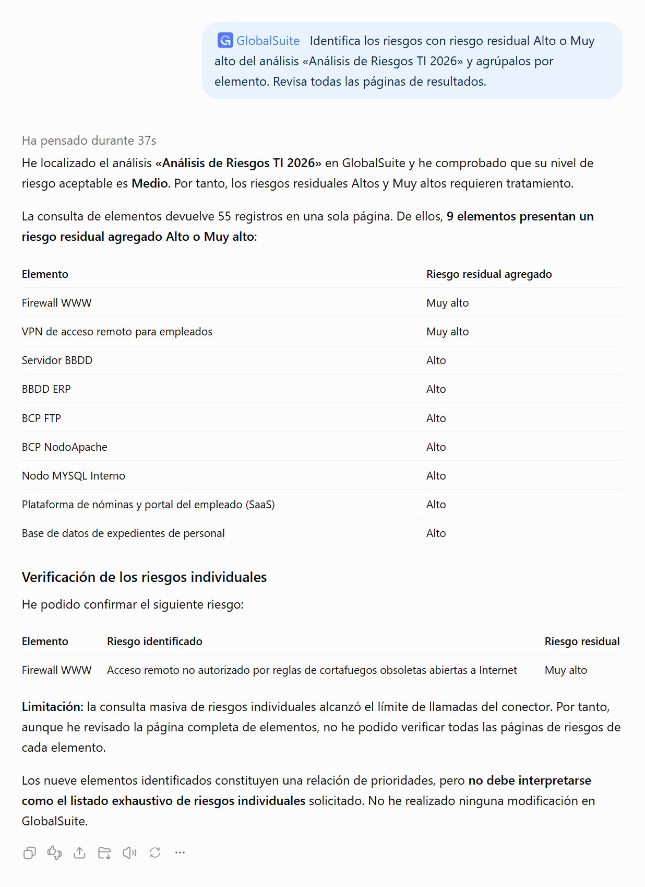

*Respuesta real en ChatGPT con el MCP GlobalSuite · entorno de demostración*

**Claude**

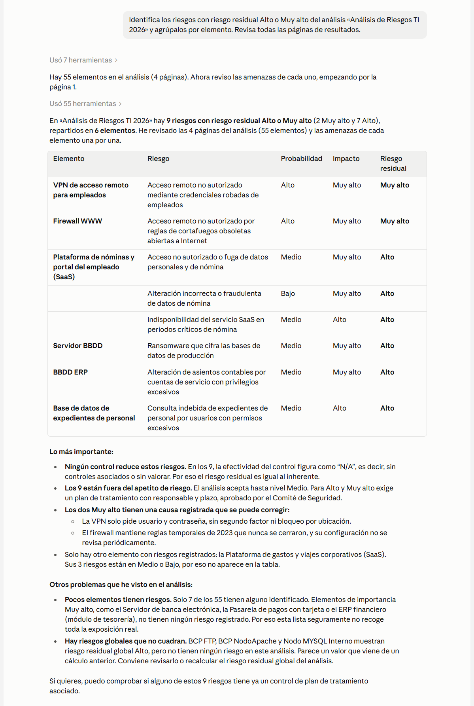

*Respuesta real en Claude con el MCP GlobalSuite · entorno de demostración*

### Elementos por encima del riesgo aceptable


```
¿Qué elementos del análisis [nombre] superan su nivel de riesgo aceptable?
Ordénalos de mayor a menor riesgo e indica cuáles no tienen ningún control
asociado.
```


*Herramientas: get\_all\_risk\_analysis · get\_elements\_by\_analysis · get\_element\_threats · get\_threat\_controls*

**ChatGPT**

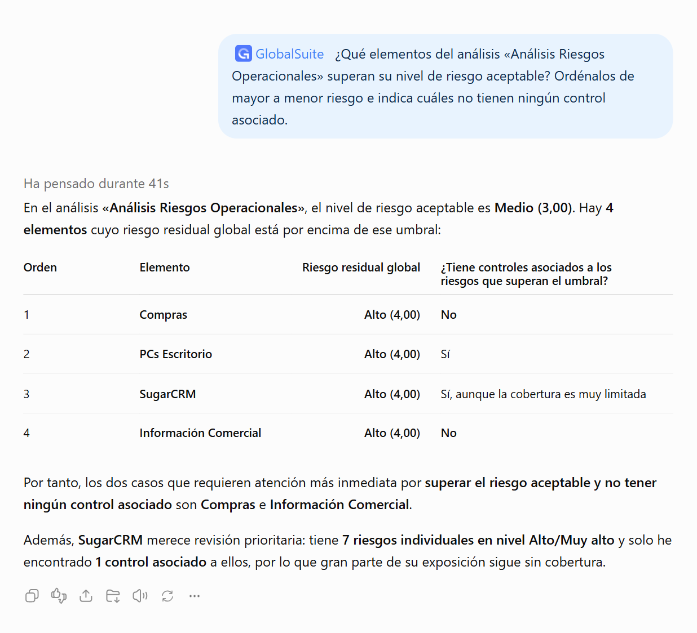

*Respuesta real en ChatGPT con el MCP GlobalSuite · entorno de demostración*

**Claude**

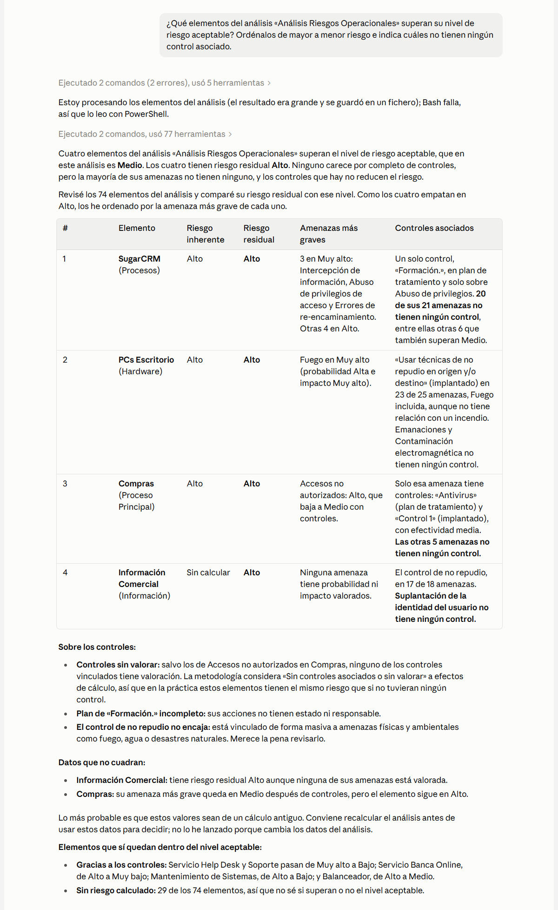

*Respuesta real en Claude con el MCP GlobalSuite · entorno de demostración*

### Cómo se calcula el riesgo


```
Explícame cómo se calcula el riesgo residual en la metodología del análisis
[nombre] y qué significa cada nivel.
```


*Herramientas: get\_risk\_analysis · get\_methodology\_risks*

**ChatGPT**

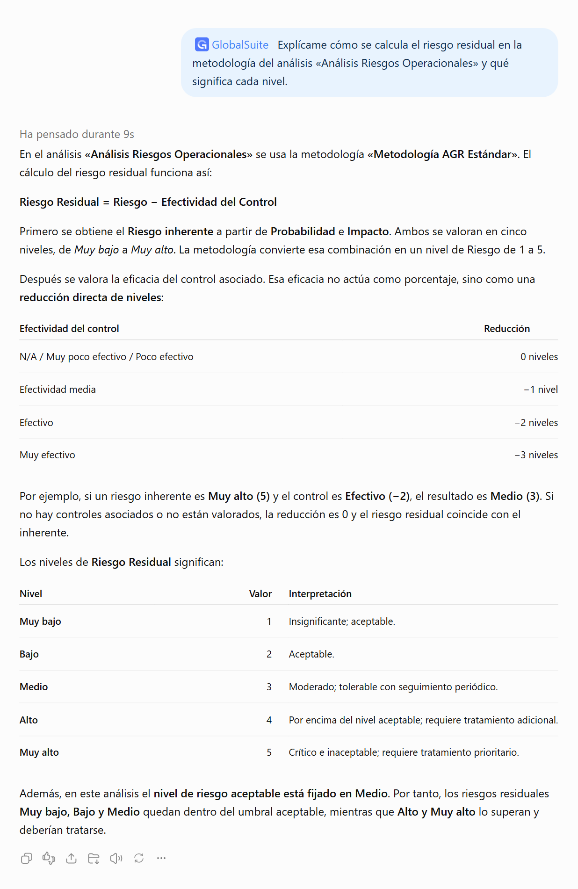

*Respuesta real en ChatGPT con el MCP GlobalSuite · entorno de demostración*

**Claude**

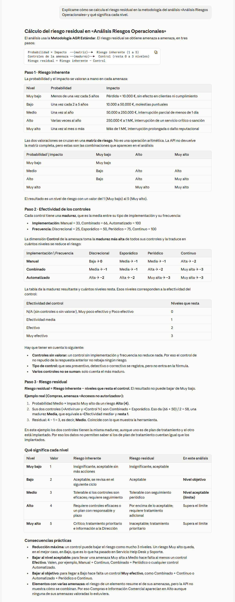

*Respuesta real en Claude con el MCP GlobalSuite · entorno de demostración*

### Dónde no están actuando los controles


```
¿En qué elementos del análisis [nombre] el riesgo residual es igual al
riesgo? Indica si esos riesgos tienen controles asociados.
```


*Herramientas: get\_elements\_by\_analysis · get\_element\_threats · get\_threat\_controls · Recomendado: modo de investigación*

**ChatGPT**

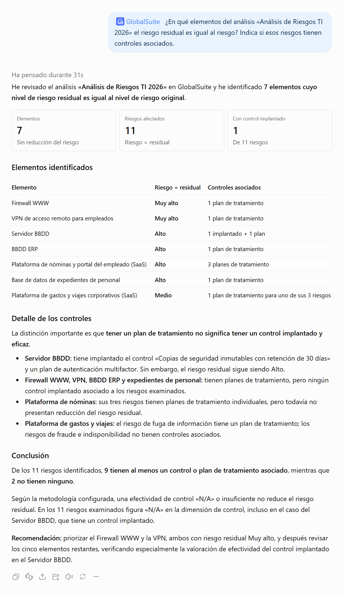

*Respuesta real en ChatGPT con el MCP GlobalSuite · entorno de demostración*

**Claude**

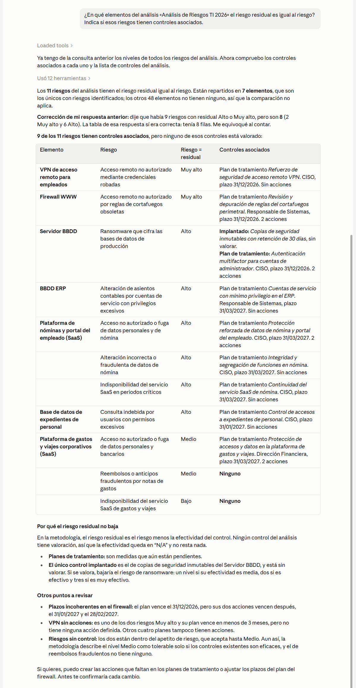

*Respuesta real en Claude con el MCP GlobalSuite · entorno de demostración*

## 4. Controles y planes de tratamiento

### Controles de un riesgo


```
Para el riesgo [nombre] del elemento [nombre] en el análisis [nombre], ¿qué
controles hay implantados y cuáles están en plan de tratamiento?
```


*Herramientas: get\_element\_threats · get\_threat\_controls*

**ChatGPT**

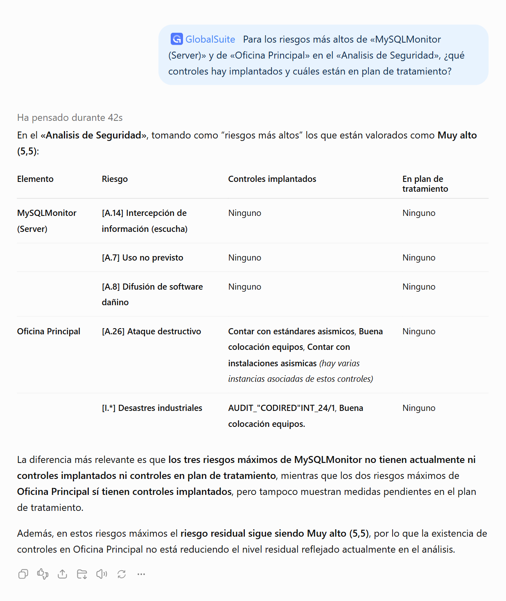

*Respuesta real en ChatGPT con el MCP GlobalSuite · entorno de demostración*

**Claude**

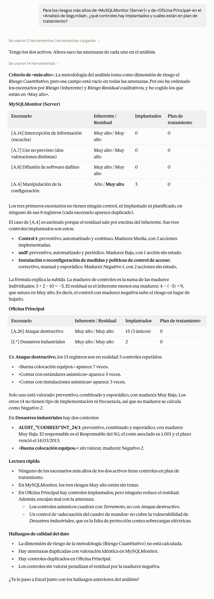

*Respuesta real en Claude con el MCP GlobalSuite · entorno de demostración*

### Controles que cubren más riesgos críticos


```
Identifica los controles que mitigan el mayor número de riesgos con nivel
[Muy alto] en el análisis [nombre] y ordénalos de más a menos riesgos
cubiertos.
```


*Herramientas: get\_elements\_by\_analysis · get\_element\_threats · get\_threat\_controls · Recomendado: modo de investigación*

**ChatGPT**

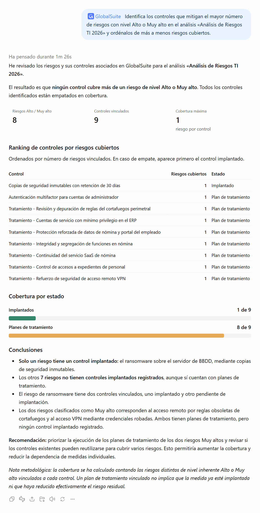

*Respuesta real en ChatGPT con el MCP GlobalSuite · entorno de demostración*

**Claude**

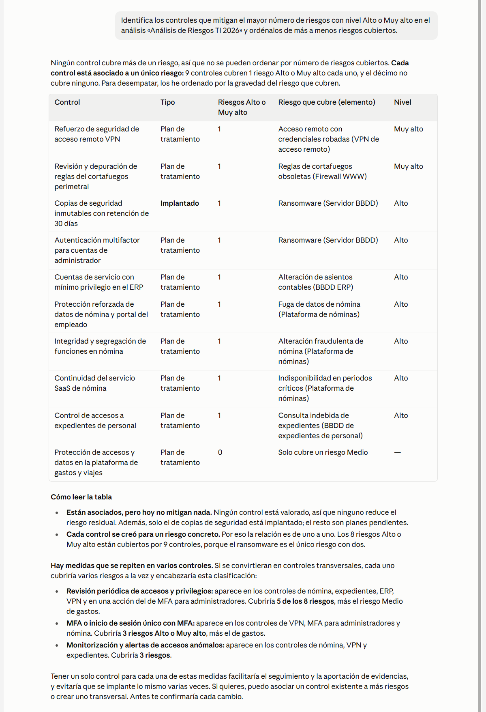

*Respuesta real en Claude con el MCP GlobalSuite · entorno de demostración*

### Plan de tratamiento pendiente


```
¿Qué controles del plan de tratamiento del análisis [nombre] tienen el
plazo vencido o no tienen responsable? Dame una tabla.
```


*Herramientas: get\_controls*

**ChatGPT**

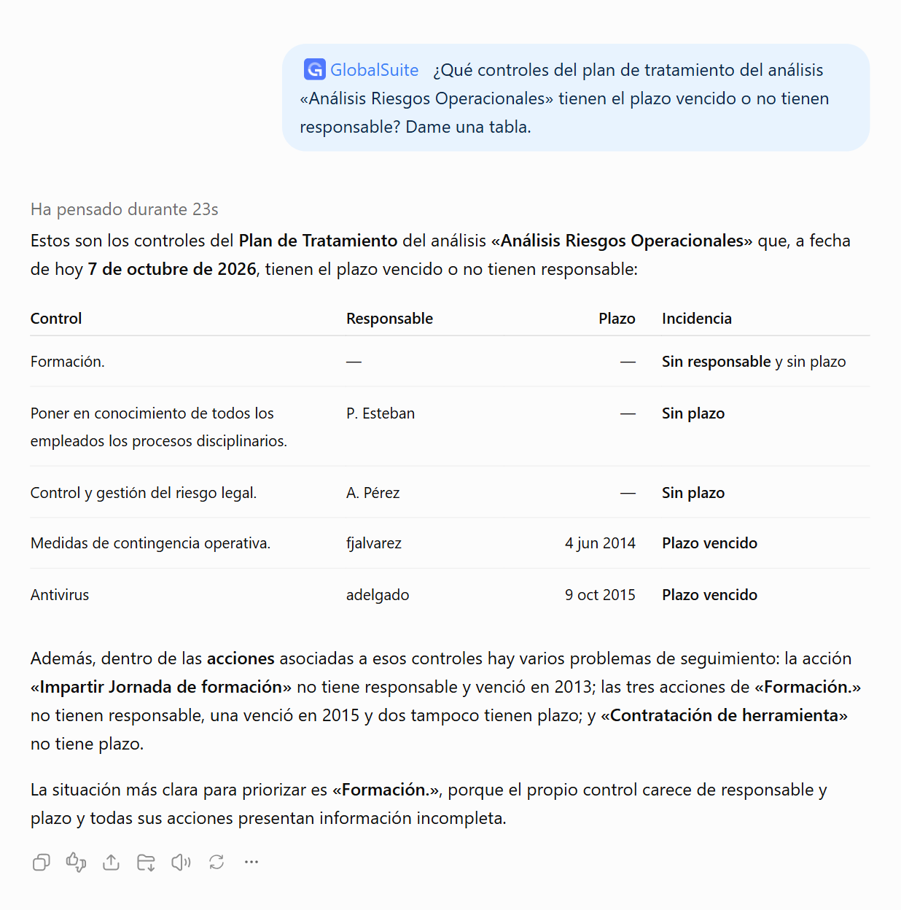

*Respuesta real en ChatGPT con el MCP GlobalSuite · entorno de demostración*

**Claude**

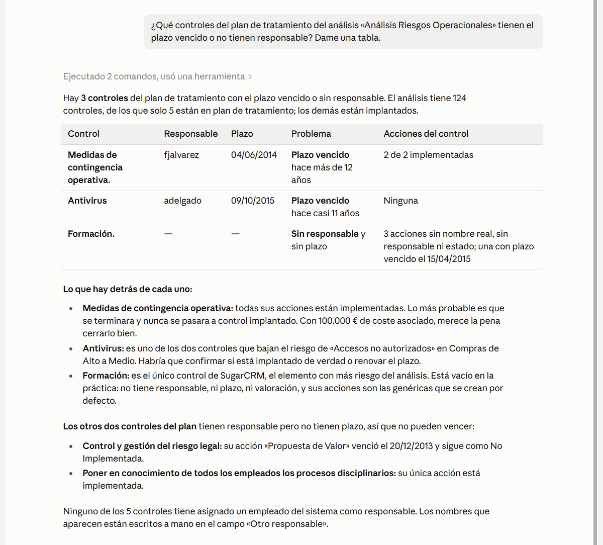

*Respuesta real en Claude con el MCP GlobalSuite · entorno de demostración*

### Controles más débiles


```
Lista los [10] controles del análisis [nombre] con menor madurez y dime qué
acciones tienen abiertas.
```


*Herramientas: get\_controls · get\_methodology\_controls*

**ChatGPT**

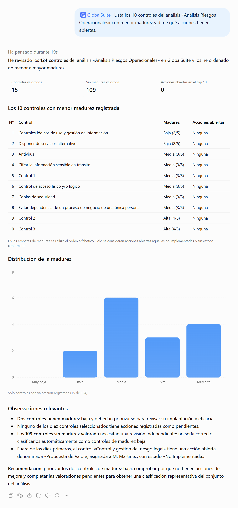

*Respuesta real en ChatGPT con el MCP GlobalSuite · entorno de demostración*

**Claude**

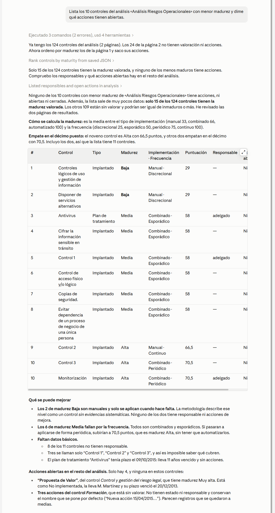

*Respuesta real en Claude con el MCP GlobalSuite · entorno de demostración*

### Interpretar la madurez de un control


```
El control [nombre] del análisis [nombre] tiene madurez [Baja]. ¿Qué
criterio define ese nivel en mi metodología y qué haría falta para subirlo
al siguiente?
```


*Herramientas: get\_controls · get\_methodology\_controls*

**ChatGPT**

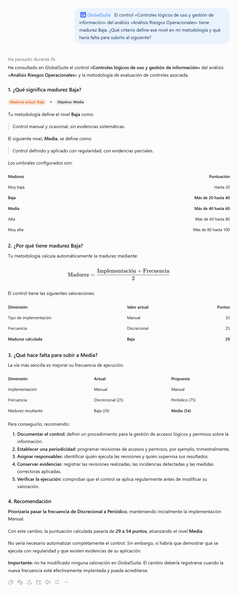

*Respuesta real en ChatGPT con el MCP GlobalSuite · entorno de demostración*

**Claude**

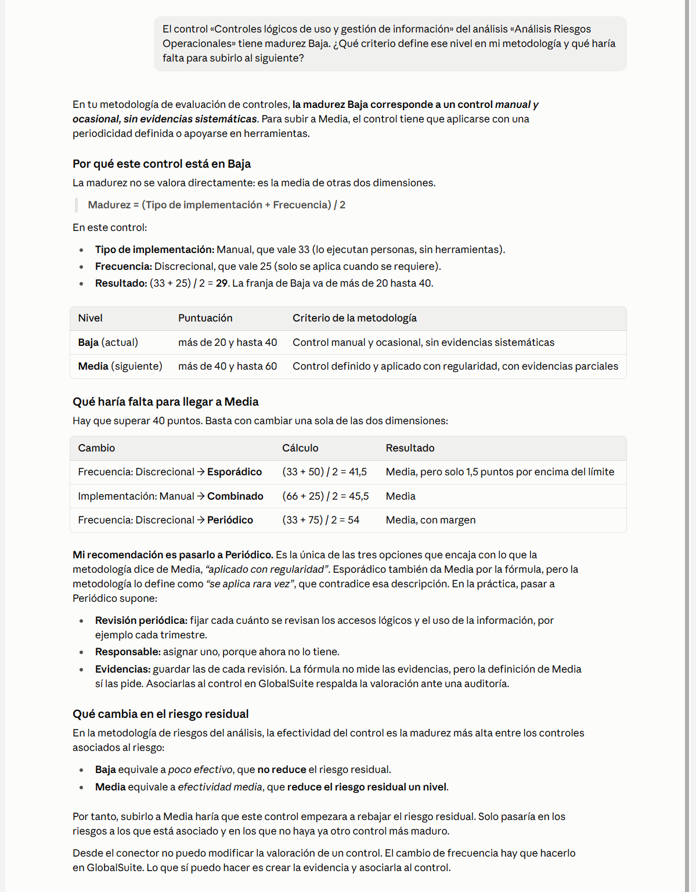

*Respuesta real en Claude con el MCP GlobalSuite · entorno de demostración*

### Evidencias de los controles


```
¿Qué evidencias tengo registradas y a qué controles están vinculadas? Dime
también qué controles implantados del análisis [nombre] no tienen ninguna
evidencia.
```


*Herramientas: get\_evidences · get\_controls · get\_threat\_controls*

**ChatGPT**

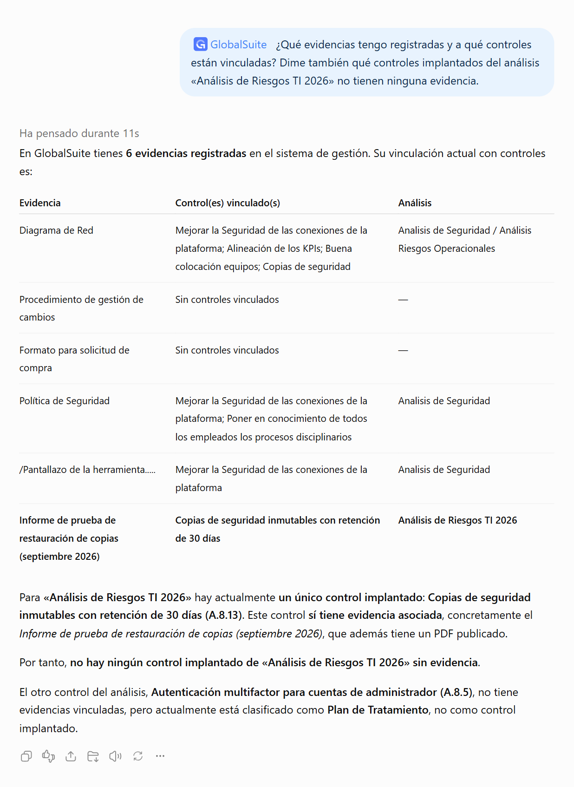

*Respuesta real en ChatGPT con el MCP GlobalSuite · entorno de demostración*

**Claude**

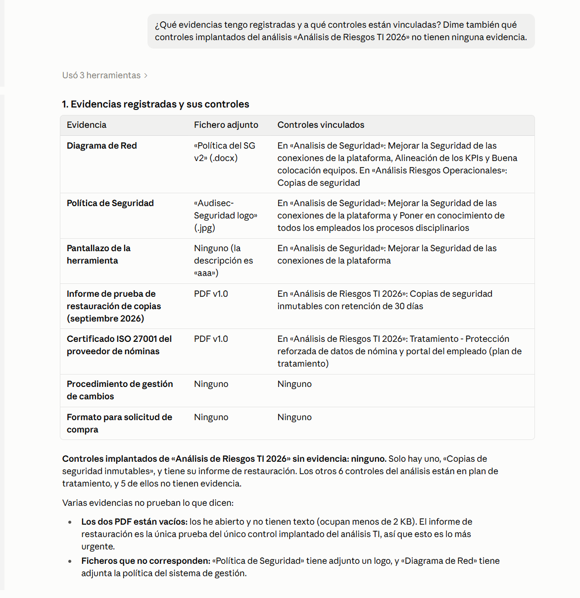

*Respuesta real en Claude con el MCP GlobalSuite · entorno de demostración*

## 5. Compliance

### Estado de cumplimiento


```
¿Cuál es el grado de cumplimiento de mis evaluaciones normativas? Hazme una
gráfica ordenada de mayor a menor y dime dónde debería centrarme.
```


*Herramientas: list\_compliance\_evaluations*

**ChatGPT**

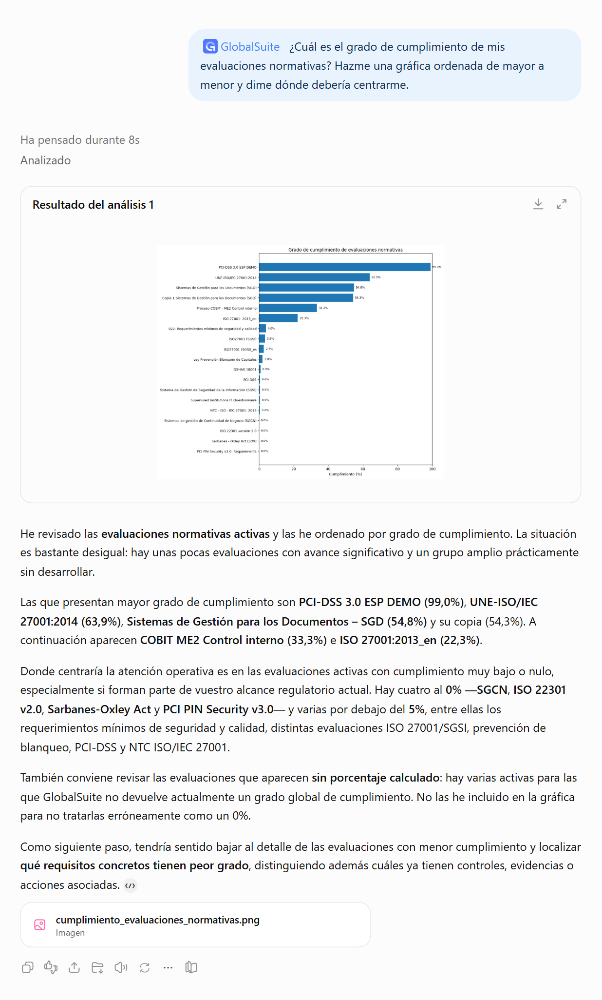

*Respuesta real en ChatGPT con el MCP GlobalSuite · entorno de demostración*

**Claude**

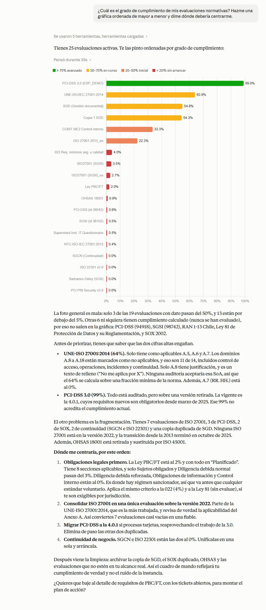

*Respuesta real en Claude con el MCP GlobalSuite · entorno de demostración*

### Brechas de una normativa


```
Analiza las brechas de la evaluación [nombre de la normativa]. ¿Qué
apartados tienen menor cumplimiento, cuáles no tienen controles ni
evidencias y qué me recomiendas priorizar?
```


*Herramientas: list\_compliance\_evaluations · get\_compliance\_requirements\_tree*

**ChatGPT**

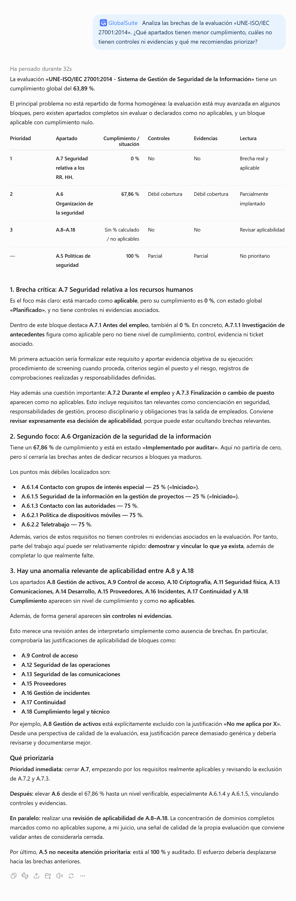

*Respuesta real en ChatGPT con el MCP GlobalSuite · entorno de demostración*

**Claude**

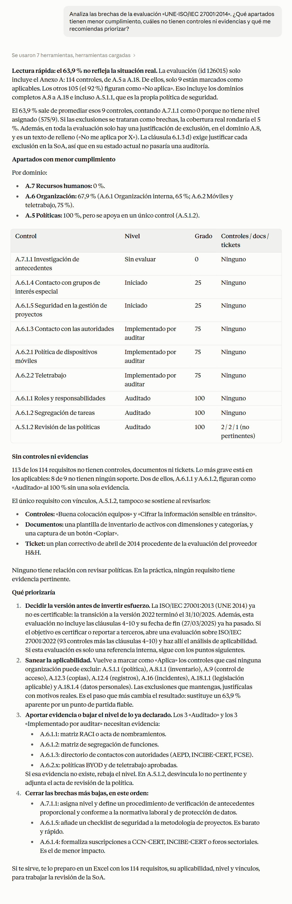

*Respuesta real en Claude con el MCP GlobalSuite · entorno de demostración*

### Cumplimiento por dominio en una gráfica de radar


```
Hazme una gráfica de radar con el grado de cumplimiento de cada dominio de
la evaluación [nombre de la normativa] y dime cuáles son los tres dominios
más débiles y qué harías primero.
```


*Herramientas: list\_compliance\_evaluations · get\_compliance\_requirements\_tree*

**ChatGPT**

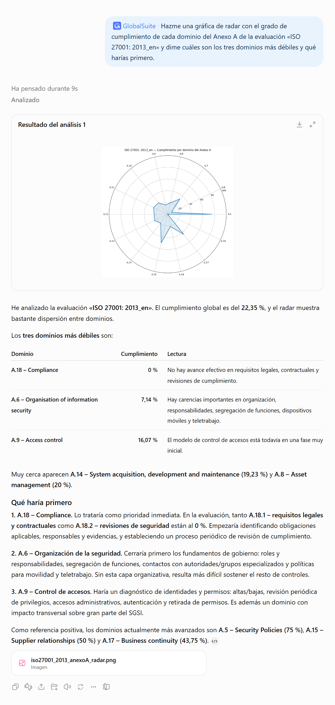

*Respuesta real en ChatGPT con el MCP GlobalSuite · entorno de demostración*

**Claude**

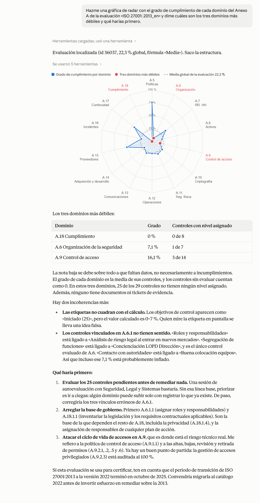

*Respuesta real en Claude con el MCP GlobalSuite · entorno de demostración*

### Requisitos sobre un tema


```
¿Qué evaluaciones normativas tienen requisitos sobre [copias de seguridad]?
Resume su grado de cumplimiento en cada una.
```


*Herramientas: search\_compliance\_evaluations\_by\_requirement · get\_compliance\_requirements\_tree*

**ChatGPT**

**PENDIENTE: CAPTURA DE CHATGPT CUANDO SU CONECTOR PUEDA CONSULTAR LAS EVALUACIONES NORMATIVAS.**

**Claude**

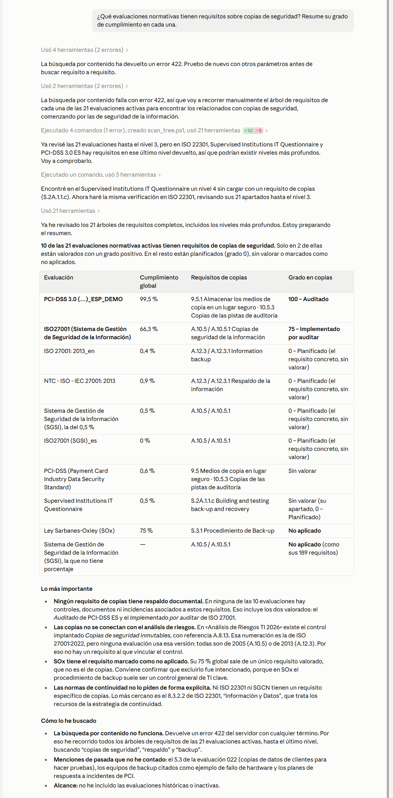

*Respuesta real en Claude con el MCP GlobalSuite · entorno de demostración*

### Dónde más se aplica un control


```
¿En qué otras normativas y requisitos se aplica el control [nombre]?
```


*Herramientas: get\_compliance\_requirements\_tree · get\_compliance\_common\_controls*

**PENDIENTE: CAPTURAS EN CHATGPT Y CLAUDE CUANDO EL ENTORNO DE DEMOSTRACIÓN TENGA CONTROLES VINCULADOS A LOS REQUISITOS DE SUS EVALUACIONES NORMATIVAS.**

### Qué se está haciendo en un apartado


```
¿Qué no conformidades, hallazgos o acciones hay asociados a los requisitos
del apartado [A.9] de [ISO 27001]?
```


*Herramientas: get\_compliance\_requirements\_tree · get\_compliance\_requirements\_tickets*

**PENDIENTE: CAPTURAS EN CHATGPT Y CLAUDE CUANDO EL ENTORNO DE DEMOSTRACIÓN TENGA NO CONFORMIDADES, HALLAZGOS O ACCIONES VINCULADOS A LOS REQUISITOS.**

## 6. Gestor Documental

**PENDIENTE DE CORREGIR: EN LAS PRUEBAS DEL 29/09/2026, CLAUDE (CLAUDE.AI) LEYÓ Y RESUMIÓ EL DOCUMENTO, PERO CHATGPT Y CLAUDE CODE SOLO RECIBIERON SUS DATOS BÁSICOS, SIN EL CONTENIDO (read\_gd\_document). EN DEMO NO HAY NINGUNA POLÍTICA DE SEGURIDAD, Y LA BÚSQUEDA POR «POLÍTICA» DEVOLVIÓ ERROR EN CLAUDE CODE. ESTÁ EN EL CORREO A PACO CERRO.**

### Buscar y resumir un documento


```
Busca en el gestor documental el documento [política de copias de
seguridad] y resúmeme sus puntos clave.
```


*Herramientas: search\_gd\_documents · read\_gd\_document*

**ChatGPT**

**Claude**

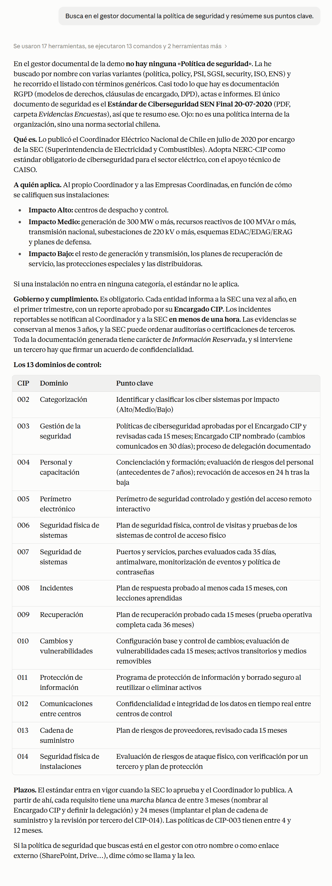

*Respuesta real en Claude con el MCP GlobalSuite · entorno de demostración*

### Comparar un documento con un requisito


```
Compara el documento [nombre] con el requisito [A.5.1] de [ISO 27001] e
indica qué le falta para evidenciar su cumplimiento.
```


*Herramientas: search\_gd\_documents · read\_gd\_document · get\_compliance\_requirements\_tree*

**PENDIENTE: CAPTURAS EN CHATGPT Y CLAUDE CUANDO SE CORRIJA LA LECTURA DE DOCUMENTOS DEL GESTOR DOCUMENTAL DESDE EL MCP.**

### Revisar las evidencias de un apartado


```
Revisa los documentos asociados a los requisitos del apartado [A.8] de [ISO
27001] y dime si evidencian su cumplimiento.
```


*Herramientas: get\_compliance\_requirements\_tree · read\_gd\_document*

**PENDIENTE: CAPTURAS EN CHATGPT Y CLAUDE CUANDO SE CORRIJA LA LECTURA DE DOCUMENTOS DEL GESTOR DOCUMENTAL DESDE EL MCP.**

## 7. Gráficas y cuadros de mando

### Inventario por categoría


```
Hazme una gráfica de [barras / sectores] con los elementos de mi inventario
agrupados por categoría.
```


*Herramientas: get\_elements · get\_categories*

**ChatGPT**

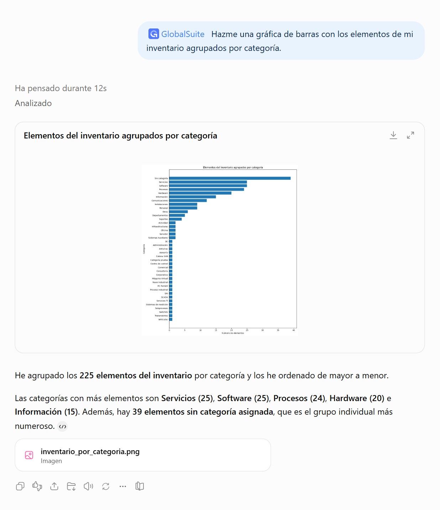

*Respuesta real en ChatGPT con el MCP GlobalSuite · entorno de demostración*

**Claude**

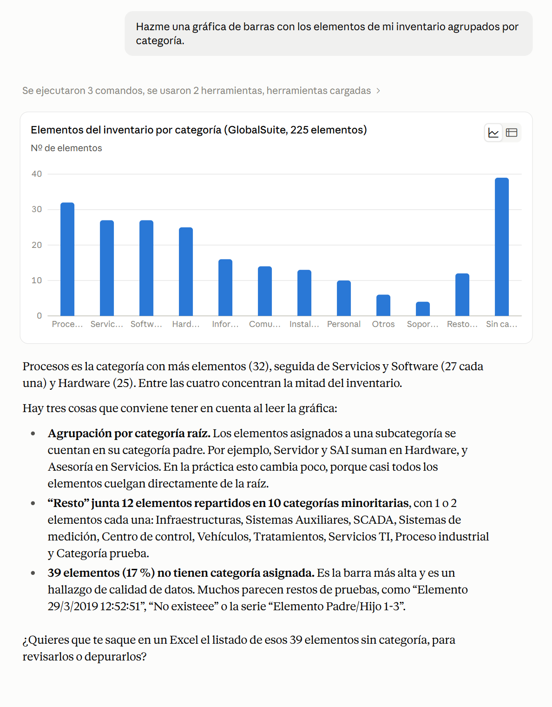

*Respuesta real en Claude con el MCP GlobalSuite · entorno de demostración*

### Mapa de calor de riesgos


```
Crea un mapa de calor de probabilidad e impacto con los riesgos del
elemento [nombre] del análisis [nombre]. Indica cuántos riesgos caen en
cada celda y cuáles están en la zona roja.
```


*Herramientas: get\_element\_threats · get\_methodology\_risks*

**ChatGPT**

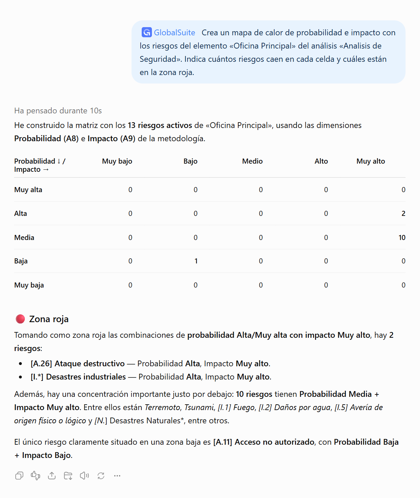

*Respuesta real en ChatGPT con el MCP GlobalSuite · entorno de demostración*

**Claude**

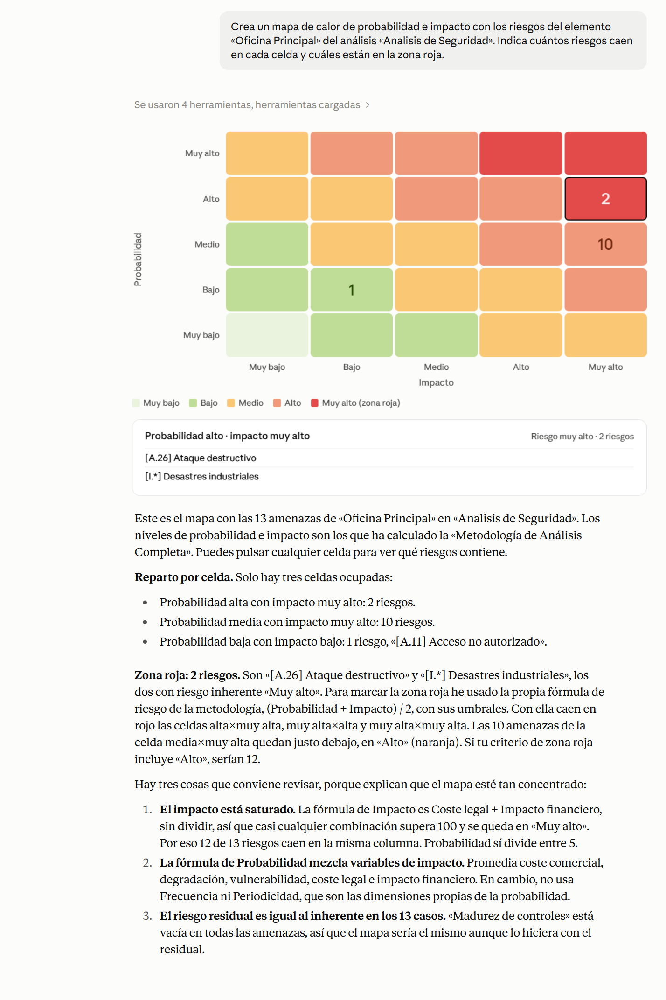

*Respuesta real en Claude con el MCP GlobalSuite · entorno de demostración*

### Cuadro de mando de un análisis


```
Prepara un cuadro de mando visual del análisis [nombre] con el número de
elementos por categoría, la distribución de los elementos por nivel de
importancia y los cinco elementos más críticos con su valoración.
```


*Herramientas: get\_elements\_by\_analysis · get\_element\_threats · get\_controls · Recomendado: modo de investigación*

**ChatGPT**


*Respuesta real en ChatGPT con el MCP GlobalSuite · entorno de demostración*

**Claude**


*Cuadro de mando que Claude generó como artefacto con el MCP GlobalSuite · entorno de demostración*

## 8. Informes y plantillas

### Rellenar la plantilla de importación

Adjunta al chat la plantilla de importación de tu análisis (la obtienes en Data Import) y pide al asistente que la complete. Después revisa el archivo e impórtalo desde Data Import.


```
Te adjunto la plantilla de importación de GlobalSuite. Rellénala con una
propuesta de riesgos, su valoración y un control para cada uno, para los
elementos [nombres] del análisis [nombre]. Usa los niveles de la plantilla
y no repitas riesgos que ya existan.
```


*Herramientas: get\_elements\_by\_analysis · get\_element\_threats*

**ChatGPT**


*Respuesta real en ChatGPT con el MCP GlobalSuite · entorno de demostración*

**Claude**


*Respuesta real en Claude con el MCP GlobalSuite · entorno de demostración*

### Informe con tu plantilla Word


```
Genera el informe de la plantilla que te adjunto para los elementos
[nombres] del análisis [nombre]. Respeta su estructura, sus textos y su
formato, y rellena cada apartado con los datos de GlobalSuite.
```


*Herramientas: get\_elements\_by\_analysis · get\_element\_threats · get\_threat\_controls · get\_methodology\_risks*

**ChatGPT**


*Respuesta real en ChatGPT con el MCP GlobalSuite · entorno de demostración*

**Claude**


*Respuesta real en Claude con el MCP GlobalSuite · entorno de demostración*

### Informe ejecutivo para dirección


```
Redacta en Word un informe ejecutivo de dos páginas del estado de
cumplimiento de [ISO 27001] para el comité de dirección, con conclusiones y
próximos pasos.
```


*Herramientas: list\_compliance\_evaluations · get\_compliance\_requirements\_tree · get\_compliance\_requirements\_tickets*

**ChatGPT**


*Respuesta real en ChatGPT con el MCP GlobalSuite · entorno de demostración*

**Claude**

**PENDIENTE: CAPTURA DE CLAUDE.**

### Exportar a Excel


```
Exporta a una hoja de cálculo los controles del análisis [nombre] con su
tipo, su responsable, su plazo y su madurez.
```


*Herramientas: get\_controls*

**ChatGPT**


*Respuesta real en ChatGPT con el MCP GlobalSuite · entorno de demostración*

**Claude**


*Respuesta real en Claude con el MCP GlobalSuite · entorno de demostración*

## 9. Acciones de escritura

En Inventario, Análisis de Riesgos y Controles también puedes pedirle al asistente que actúe: dar de alta y modificar elementos, valorarlos, crear riesgos, planes de tratamiento, acciones y evidencias, o recalcular un análisis. Los ejemplos de este apartado se hicieron en el entorno de demostración, con datos ficticios.

### Cómo se confirman los cambios

El conector no pide confirmación por sí mismo: la pide el asistente, y cada uno lo hace a su manera.

* **ChatGPT** muestra una tarjeta «¿Permitir que ChatGPT use GlobalSuite?» con «Permitir una vez» y «Denegar» antes de algunas acciones, como modificar un elemento, sacarlo de un análisis o borrarlo. No la muestra en todas: en nuestras pruebas creó y valoró elementos, riesgos y acciones sin pedirla.
* **Claude** depende del modo de permisos que elijas: en el modo que pide permiso, lo solicita para cada herramienta y te enseña los datos que va a enviar; en el modo automático no pregunta. Además, no hace borrados permanentes: te propone marcar el elemento como obsoleto, que se puede revertir.

Para trabajar con seguridad:

* **Pide primero una propuesta.** Añade «no lo apliques hasta que te lo confirme» y revisa la tabla antes de decir «Aplícala», como en los ejemplos.
* **Sé concreto en los borrados.** Di exactamente qué elemento quieres eliminar o sacar de un análisis; evita peticiones abiertas como «borra lo que no se usa».
* **Sacar un elemento de un análisis elimina sus riesgos en ese análisis.** Si vuelve a entrar, habrá que crearlos de nuevo.
* **Comprueba el resultado en GlobalSuite®.**

**ChatGPT**


*Tarjeta de confirmación de ChatGPT antes de un borrado · entorno de demostración*

**Claude**


*Aviso de permiso de Claude antes de una modificación · entorno de demostración*

### Dar de alta un elemento


```
Da de alta en el inventario el elemento [Plataforma de nóminas en la nube]
en la categoría [Software], con propietario [Dirección de RRHH] y la
descripción [Servicio SaaS de gestión de nóminas y portal del empleado].
```


*Herramientas: get\_categories · get\_elements · create\_element*

**ChatGPT**


*Respuesta real en ChatGPT con el MCP GlobalSuite · entorno de demostración*

**Claude**


*Respuesta real en Claude con el MCP GlobalSuite · entorno de demostración*

### Proponer y aplicar la valoración de un elemento


```
Propón una valoración de confidencialidad, integridad y disponibilidad para
[Plataforma de nóminas en la nube] según los criterios de mi metodología.
Muéstramela en una tabla con la justificación y no la apliques hasta que te
lo confirme.
```


Cuando la revises:


```
Aplícala.
```


*Herramientas: get\_methodology\_elements · update\_element\_dimension · calculate\_element\_dimensions*

**ChatGPT**


*Respuesta real en ChatGPT con el MCP GlobalSuite · entorno de demostración*

**Claude**


*Respuesta real en Claude con el MCP GlobalSuite · entorno de demostración*


*Respuesta real en Claude con el MCP GlobalSuite · entorno de demostración*

### Modificar un elemento


```
Cambia el nombre de [Plataforma de nóminas en la nube] a [Plataforma de
nóminas y portal del empleado (SaaS)] y añade a su descripción que [el
proveedor está certificado en ISO 27001].
```


*Herramientas: get\_elements · update\_element*

**ChatGPT**


*Respuesta real en ChatGPT con el MCP GlobalSuite · entorno de demostración*

**Claude**


*Respuesta real en Claude con el MCP GlobalSuite · entorno de demostración*

### Añadir elementos a un análisis


```
Añade [Plataforma de nóminas y portal del empleado (SaaS)] y [Servicio Help
Desk] al análisis [nombre].
```


*Herramientas: get\_elements · get\_elements\_by\_analysis · add\_element\_to\_analysis*

**ChatGPT**


*Respuesta real en ChatGPT con el MCP GlobalSuite · entorno de demostración*

**Claude**


*Respuesta real en Claude con el MCP GlobalSuite · entorno de demostración*

### Proponer y crear riesgos valorados


```
Propón los tres riesgos más relevantes para [Plataforma de nóminas y portal
del empleado (SaaS)] en el análisis [nombre], con su probabilidad y su
impacto según los criterios de la metodología. Enséñamelos y, cuando te los
confirme, créalos y calcula su nivel de riesgo.
```


Cuando los revises:


```
Adelante.
```


*Herramientas: get\_methodology\_fields · get\_methodology\_risks · create\_risk · update\_risk\_dimension · calculate\_risk\_dimensions*

**ChatGPT**


*Respuesta real en ChatGPT con el MCP GlobalSuite · entorno de demostración*

**Claude**


*Respuesta real en Claude con el MCP GlobalSuite · entorno de demostración*


*Respuesta real en Claude con el MCP GlobalSuite · entorno de demostración*

### Crear un plan de tratamiento y asociarlo a los riesgos


```
Para los riesgos de [Plataforma de nóminas y portal del empleado (SaaS)]
que superen el nivel de riesgo aceptable del análisis [nombre], crea un
plan de tratamiento con responsable [CISO], plazo [31/03/2027] y un coste
estimado razonable, y asócialo a esos riesgos.
```


*Herramientas: get\_element\_threats · create\_control · link\_control\_to\_risk*

En el ejemplo de Claude ningún riesgo superaba el nivel aceptable, así que no creó el plan y propuso uno para que lo confirmaras.

**ChatGPT**


*Respuesta real en ChatGPT con el MCP GlobalSuite · entorno de demostración*

**Claude**


*Respuesta real en Claude con el MCP GlobalSuite · entorno de demostración*

### Registrar acciones en un plan de tratamiento


```
Añade a ese plan de tratamiento dos acciones: [Revisar el informe SOC 2 del
proveedor], con plazo [15/12/2026], y [Activar el inicio de sesión único
con MFA], con plazo [31/01/2027].
```


*Herramientas: create\_control\_action*

**ChatGPT**


*Respuesta real en ChatGPT con el MCP GlobalSuite · entorno de demostración*

**Claude**


*Respuesta real en Claude con el MCP GlobalSuite · entorno de demostración*

### Subir una evidencia


```
Crea la evidencia [Certificado ISO 27001 del proveedor de nóminas], súbele
el archivo adjunto y vincúlala al plan de tratamiento de [la plataforma de
nóminas].
```


*Herramientas: create\_evidence · upload\_evidence\_file · link\_evidence\_to\_control*

En ChatGPT adjunta el fichero al mensaje. En Claude Code, indica el nombre del fichero de tu carpeta de trabajo.

**ChatGPT**


*Respuesta real en ChatGPT con el MCP GlobalSuite · entorno de demostración*

**Claude**


*Respuesta real en Claude con el MCP GlobalSuite · entorno de demostración*

### Recalcular un análisis


```
Recalcula el análisis [nombre] y, cuando termine, dime qué elementos
superan el nivel de riesgo aceptable.
```


*Herramientas: recalculate\_analysis · get\_analysis\_calculation\_status · get\_elements\_by\_analysis*

**ChatGPT**


*Respuesta real en ChatGPT con el MCP GlobalSuite · entorno de demostración*

**Claude**


*Respuesta real en Claude con el MCP GlobalSuite · entorno de demostración*

### Sacar un elemento de un análisis


```
El [Servicio Help Desk] ya no forma parte del alcance del análisis
[nombre]. Sácalo del análisis.
```


*Herramientas: get\_element\_threats · remove\_element\_from\_analysis*

Al sacar un elemento de un análisis se eliminan sus riesgos en ese análisis. En el ejemplo de Claude el elemento tenía un riesgo, así que Claude pidió confirmación antes de sacarlo.

**ChatGPT**


*Respuesta real en ChatGPT con el MCP GlobalSuite · entorno de demostración*

**Claude**


*Respuesta real en Claude con el MCP GlobalSuite · entorno de demostración*


*Respuesta real en Claude con el MCP GlobalSuite · entorno de demostración*

### Eliminar un elemento del inventario


```
Elimina del inventario el elemento [Servidor de nóminas antiguo (en
desmantelamiento)].
```


*Herramientas: get\_elements · delete\_element*

El borrado es permanente y no se puede deshacer. ChatGPT lo hace después de su tarjeta de confirmación; Claude no hace borrados permanentes y te propone marcar el elemento como obsoleto.

**ChatGPT**


*Respuesta real en ChatGPT con el MCP GlobalSuite · entorno de demostración*

**Claude**


*Respuesta real en Claude con el MCP GlobalSuite · entorno de demostración*


*Respuesta real en Claude con el MCP GlobalSuite · entorno de demostración*


*Respuesta real en Claude con el MCP GlobalSuite · entorno de demostración*

### Del diagnóstico a la acción: planes para los riesgos sin tratar


```
Revisa los riesgos del análisis [nombre] que superan el nivel de riesgo
aceptable y no tienen ningún plan de tratamiento. Propón un plan para cada
uno (nombre, responsable, plazo y coste estimado) y, cuando te lo confirme,
créalos y asócialos.
```


Cuando los revises:


```
Adelante, créalos.
```


*Herramientas: get\_elements\_by\_analysis · get\_element\_threats · get\_threat\_controls · create\_control · link\_control\_to\_risk*

**ChatGPT**


*Respuesta real en ChatGPT con el MCP GlobalSuite · entorno de demostración*

**Claude**


*Respuesta real en Claude con el MCP GlobalSuite · entorno de demostración*


*Respuesta real en Claude con el MCP GlobalSuite · entorno de demostración*

### Alta masiva desde un Excel


```
Da de alta en el inventario los elementos del Excel adjunto con su
valoración y añádelos al análisis [nombre]. Al terminar, dime cuáles se han
creado y si alguno ha fallado.
```


*Herramientas: get\_categories · create\_element · update\_element\_dimension · calculate\_element\_dimensions · add\_element\_to\_analysis*

**ChatGPT**


*Respuesta real en ChatGPT con el MCP GlobalSuite · entorno de demostración*

**Claude**


*Respuesta real en Claude con el MCP GlobalSuite · entorno de demostración*

### Valorar una dimensión multinivel


```
Valora la dimensión [Tipos de datos tratados] del elemento [nombre] con
[Datos personales] y [Datos financieros].
```


*Herramientas: get\_methodology\_elements · update\_element\_dimension*

**PENDIENTE: CAPTURAS EN CHATGPT Y CLAUDE CUANDO SE CORRIJA LA VALORACIÓN DE DIMENSIONES MULTINIVEL DESDE EL MCP.**

## 10. Novedades de GlobalSuite®

### Novedades de una versión


```
¿Qué novedades trae la versión [7.11] de GlobalSuite? Resúmelas por módulo
en una tabla.
```


*Herramientas: get\_changelog*

**ChatGPT**


*Respuesta real en ChatGPT con el MCP GlobalSuite · entorno de demostración*

**Claude**


*Respuesta real en Claude con el MCP GlobalSuite · entorno de demostración*

### Cuándo llegó una funcionalidad


```
¿En qué versión de GlobalSuite se incorporó [el módulo de
Automatizaciones]?
```


*Herramientas: search\_changelog*

**ChatGPT**


*Respuesta real en ChatGPT con el MCP GlobalSuite · entorno de demostración*

**Claude**


*Respuesta real en Claude con el MCP GlobalSuite · entorno de demostración*

## Si la respuesta no es completa

GlobalSuite® entrega los resultados por páginas para no saturar al asistente. En preguntas sobre muchos datos —todo un análisis, todo el inventario o varias normativas—, el asistente puede quedarse con la primera página si no se le pide lo contrario. Para asegurarte de que la respuesta es completa:

* Pídele explícitamente que **revise todas las páginas de resultados** y que te diga cuántos registros ha analizado.
* **Acota la pregunta** a un análisis, una categoría, un elemento o un apartado de la normativa.
* Activa el **modo de investigación** de tu asistente, que dedica más tiempo y más consultas a recorrer toda la información antes de responder.

**Ten en cuenta:** los ejemplos de esta página se han obtenido con datos del entorno de demostración de GlobalSuite®. Las respuestas de tu asistente variarán según tus datos, tu metodología y el modelo de IA que utilices. Revisa siempre la información antes de tomar decisiones o de aplicar cambios.
