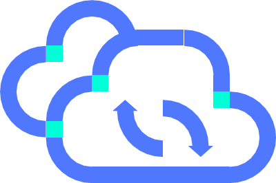
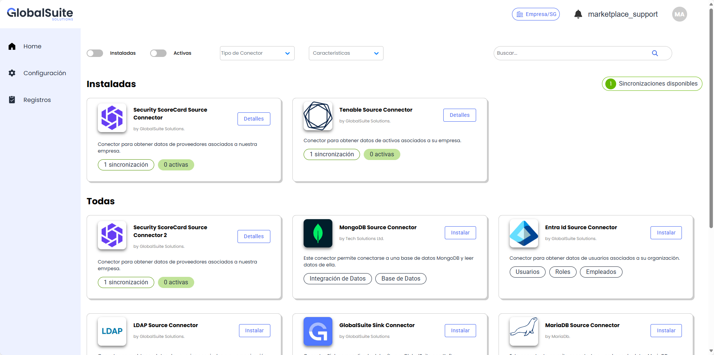

# Modalidades de Distribución


En este apartado se indican las distintas modalidades de distribución para GlobalSuite® y se indican las principales características comunes y específicas para cada una de ellas. En caso de necesitar más información sobre algún aspecto, ponte en contacto con el equipo de soporte.


# Principales características

### Cloud GlobalSuite®

##### Software as a Service en la infraestructura de GlobalSuite®

### On Premise

##### Despliegue mediante contenedores en infraestructura del cliente

•Reducción de costes.

•Migraciones sencillas.

•Acceso desde cualquier punto.

•Despliegue inicial rápido y sencillo.

•Flexibilidad en el dimensionamiento.

•Actualizaciones continuas.

•Instalación y puesta en marcha.

•Incluye todas las tareas necesarias para  el correcto despliegue de GlobalSuite® en SaaS Dedicado en las instalaciones de GlobalSuite Solutions.

•Mantenimiento y soporte.

•Soporte ágil y rápido

•Menor esfuerzo de los dptos. de IT.

•Ecológico.

•Incluye todos los elementos y servicios necesarios para la instalación de GlobalSuite® en el centro de datos de clientes, utilizando una infraestructura virtual ya existente en dicho cliente.

•Consta de la infraestructura básica (sin alta disponibilidad ni copias de seguridad).

## Detalle de características de modalidades Cloud y Onprem

1. **Infraestructura GlobalSuite®:**

Ambas modalidades se encuentran alojadas en la infraestructura propia gestionada por GlobalSuite Solutions.

2. **Actualizaciones continuas:**

En ambos casos, el usuario dispondrá de manera inmediata y transparente de las nuevas capacidades y mejoras funcionales que se liberan en cada versión del producto, ya que se encuentran dentro de un proceso de mejora continua.

3. **Soporte y mantenimiento:**

Dentro de los dos modelos de distribución, nuestro [Centro de Soporte a Clientes](https://support.services.globalsuitesolutions.com/servicedesk/customer/portals), puede atender cualquier solicitud o incidencia de manera inmediata, y atenderlo y realizar los ajustes rápida y eficazmente.

4. **Flexibilidad en el dimensionamiento:**

Tanto en el Cloud GlobalSuite® como en el Cloud Dedicado es posible ajustar el número de usuarios, almacenamiento y límites funcionales, acorde al licenciamiento contratado y las necesidades del cliente.

5. **Alta disponibilidad:**

Ambos modelos cuentan con medidas aplicadas dentro de la ISO 22301 de Continuidad de Negocio para soportar el servicio en dos CPDs redundantes.

6. **Gestión de backups:**

Para ambos casos, se cuenta con una política de backup que permite guardar una copia de seguridad cada 2 horas.

7. **Medidas de seguridad perimetral:**

Para las dos modalidades, existen unas medidas de seguridad de networking (WAF, Firewall) frente ataques externos.

1. **Infraestructura corporativa:**

En esta modalidad, GlobalSuite se desplegará en el centro de datos del cliente.

2. **Actualizaciones planificadas:**

Las actualizaciones se llevarán a cabo de manera programada periódicamente, incluyendo en un mismo paquete cambios agrupados de varias versiones del producto.

4. **Soporte y mantenimiento:**

Dentro de esta modalidad de distribución, nuestro [Centro de Soporte a Clientes](https://support.services.globalsuitesolutions.com/servicedesk/customer/portals) deberá disponer de apoyo del equipo IT del cliente para poder realizar las actividades de mantenimiento, o bien contar con acceso al Appliance (mediante VPN u otro).

5. **Dimensionamiento:**

En modalidades OnPremise el dimensionamiento de capacidades de cómputo, espacio de almacenamiento son proporcionados por el cliente.

7. **Gestión de backups:**

La gestión de copias de seguridad y monitorización del sistema se realiza por parte del cliente de acuerdo a las políticas establecidas.

8. **Medidas de seguridad perimetral:**

Las medidas de seguridad dependen de la red interna de la compañía.

## Características Cloud GlobalSuite®

1. **Personalización GlobalSuite®:**

La modalidad de Cloud Dedicado permite personalizar diversos aspectos propios para la instancia del cliente, como el logo corporativo, la imagen de la pantalla principal y el nombre de la URL de la plataforma.

2. **Limitación de acceso y mecanismos de autenticación:**

Al disponer de una URL personalizada y única, es posible configurar restricciones para limitar el uso de la herramienta, además de permitir mecanismos de autenticación específicos como Active Directory o LDAP.

3. **Soporte y mantenimiento:**

Con esta modalidad de distribución, será posible realizar intervenciones y corrección de problemas de manera independiente y acordada con el cliente.

4. **Medidas de seguridad adicionales:**

Estos entornos cuentan una capa de seguridad adicional debido al aislamiento tanto a nivel de BBDD como a nivel de ficheros.

5. **Recursos propios de procesamiento:**

Los recursos para realizar grandes procesamientos de datos (cálculos, generación de informes) se gestionan de manera independiente, por lo que no se ven afectados por picos de usuarios o trabajos concurrentes en otras instancias de GlobalSuite®.

# Capacidades exclusivas GlobalSuite Cloud

Dentro de las capacidades y funcionalidades avanzadas que incorporan los distintos módulos de GlobalSuite® existen algunas que sólo están disponibles en modalidad Cloud, entre las que destacan:

### Asistentes de Inteligencia Artificial

Los distintos asistentes y agentes de Inteligencia Artificial integrados en varios módulos de GlobalSuite® están disponibles únicamente en modalidades Cloud, ya que de esta forma pueden utilizar de forma segura y controlada el servicio y ecosistema propio detallado en [este apartado](ia-mecanismos-de-seguridad-en-globalsuite.md).

Las principales características de IA incorporadas a GlobalSuite cloud son:

* [Asistente de IA](asistente-de-ia.md): un chatbot conversacional que permite resolver dudas sobre el GRC y uso de GlobalSuite, así como las capacidades incorporadas en cada nueva versión.
* [Generador de Riesgos y Control de IA](https://globalsuitesolutions.atlassian.net/wiki/spaces/GlobalSUITEes/pages/716079124/Descubre+Nuestro+Recomendador+de+Riesgos+y+Controles+Potenciado+por+Inteligencia+Artificial): Asistente guiado que propone riesgos y controles según el contexto de la empresa y el ámbito del análisis de riesgo.
* [Procesamiento de documentos con IA](https://globalsuitesolutions.atlassian.net/wiki/spaces/GlobalSUITEes/pages/1196425281/C+mo+procesar+documentos+con+IA+desde+el+Gestor+Documental+de+GlobalSuite): Asistente para analizar y proponer mejoras sobre los documentos incorporados al gestor documental del sistema.
* [Asistente de Compliance para IA](../analisis/compliance/asistente-de-ia-que-requisitos-aplican.md): Asistente para analizar una evaluación de cumplimiento (una normativa) de GlobalSuite, identificando los puntos más importantes y realizando mejoras o propuestas para adecuarse a la misma.

### Business Intelligence

El módulo de [GlobalSuite® Análisis BI](../analisis-bi-reportes-e-informes/README.md) permite integrar las capacidades de visualización y ayuda a la toma de decisiones directamente en GlobalSuite®, aportando informes interactivos, gráficas y tablas dentro de la solución. Tanto visualizaciones predefinidas como dashboards personalizados con distintas fuentes de datos del ecosistema corporativo que permiten cruzar y explotar la información en este módulo de inteligencia empresarial.

### Marketplace de Integraciones (Conectores Predefinidos)

GlobalSuite® dispone de un [Marketplace](https://globalsuitesolutions.atlassian.net/wiki/spaces/MIG) de conectores que permite integrar la información del GRC de forma sencilla, segura y eficiente con otras herramientas comerciales o corporativas utilizadas en la organización. Dispone de un catálogo de conectores out-of-the-box que permiten configurar y sincronizar los datos de forma rápida y directa en instancias de GlobalSuite Cloud.

Aunque en modalidad OnPremise sí está disponible el [API de GlobalSuite](https://globalsuitesolutions.atlassian.net/wiki/spaces/GlobalSUITEes/pages/266731551/GlobalSuite+API) para poder realizar integraciones específicas, de forma autónoma o con el apoyo del equipo de integraciones de GlobalSuite Solutions.
