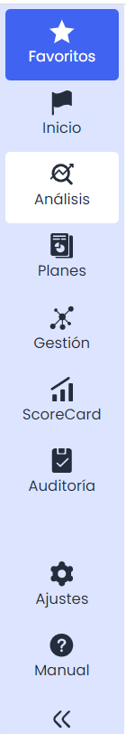
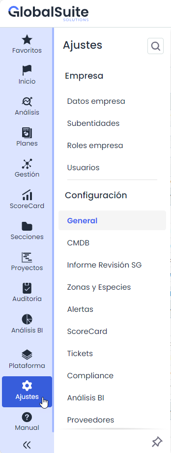
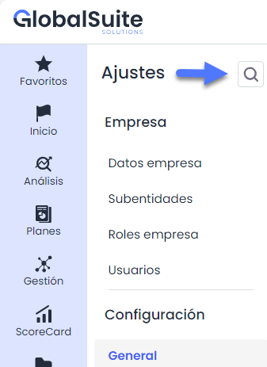
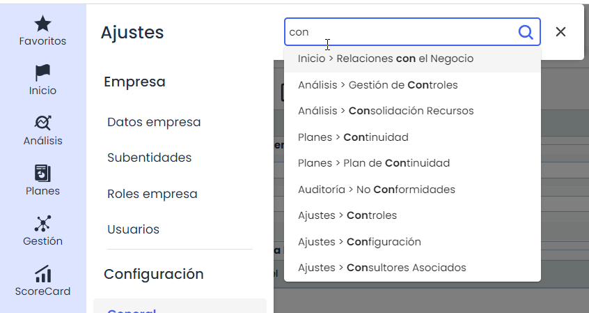
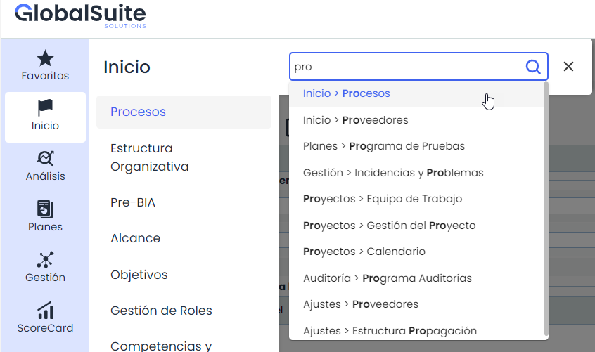
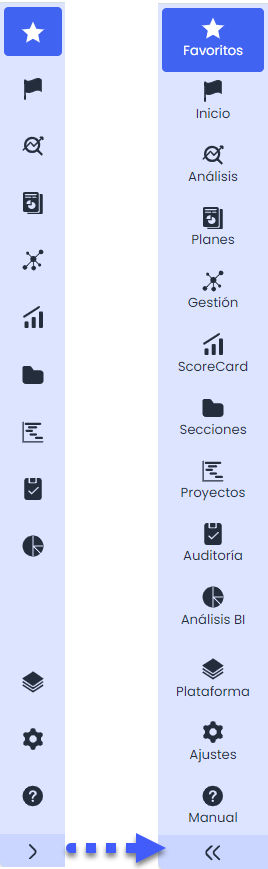
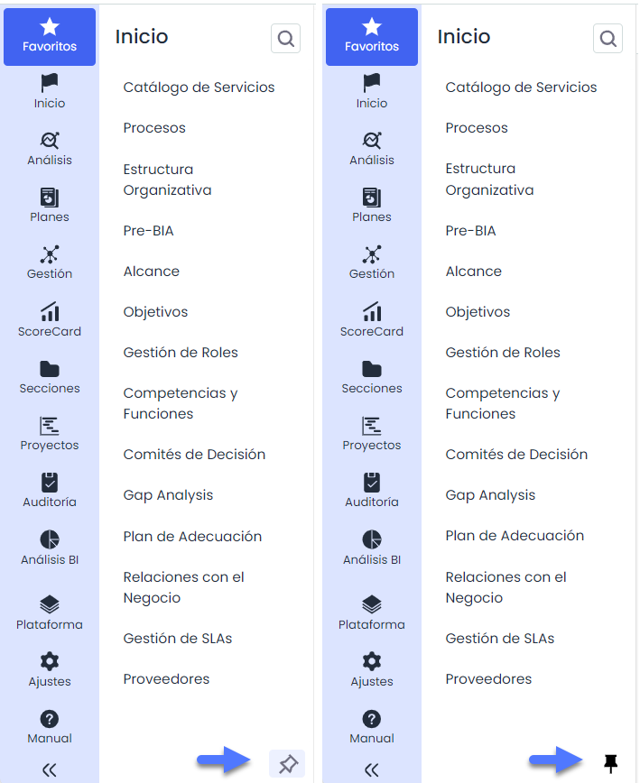

# Navegación del menú


En esta sección se explica cómo utilizar el menú principal de la aplicación para acceder a los diferentes módulos y funcionalidades.


## Estructura General del Menú

El menú principal de la aplicación se encuentra ubicado en el lado izquierdo de la pantalla y proporciona acceso a los módulos y funcionalidades más importantes. La estructura y las opciones del menú pueden variar según la configuración y los permisos de cada cliente.

### Apartados y opciones del Menú

* Favoritos: Acceso rápido a los módulos o secciones marcadas como favoritas.
* Apartados Principales: Incluyen las áreas de funcionalidad específicas de la aplicación, que pueden diferir entre los clientes según sus licencias y/o permisos.
* Ajustes: Área para la configuración de la aplicación y ajustes personalizados.
* Manual: Acceso a la documentación de usuario para obtener ayuda.

### Opciones del Menú

Al acceder a cada apartado del menú, las opciones disponibles pueden variar según las licencias contratadas y los permisos asignados a cada Usuario.

## Búsqueda

La funcionalidad de búsqueda permite encontrar rápidamente secciones o apartados específicos dentro del menú. Para utilizarla, se deben seguir los siguientes pasos:

**Acceder a la barra de búsqueda**: Al hacer clic en el ícono de lupa ubicado en la parte superior del menú, se despliega un campo de texto donde se puede ingresar el término o las primeras letras del nombre de la opción que se desea buscar.

**Ingreso de texto a buscar**: A medida que se escribe, el sistema sugiere opciones relevantes que coinciden con el texto ingresado. Los resultados se despliegan en una lista que muestra el nombre de las opciones disponibles y la ruta de acceso correspondiente, permitiendo identificar fácilmente la sección.

**Selección de resultados**: Es posible hacer clic en cualquiera de las opciones mostradas en la lista de resultados para acceder directamente a la sección seleccionada.

## Expandir y colapsar el Menú

El botón ubicado en la parte inferior del menú permite expandir y colapsar la lista de opciones. Al hacer clic en este botón:

* **Expandir**: Si el menú está colapsado, al hacer clic en el botón, se desplegarán todas las opciones, mostrando de forma completa los el nombre de los apartados.
* **Colapsar**: Si el menú está expandido, al hacer clic nuevamente en el botón se ocultarán los nombres de los apartados, dejando visibles únicamente los íconos y proporcionando más espacio de trabajo.

* **Fijar**: Adicionalmente, se puede fijar el menú cuando se encuentra expandido. Esto permite que el menú permanezca visible mientras se realizan otras interacciones en la interfaz. Para fijar el menú, se debe presionar el icono de la chincheta que aparece en la parte inferior derecha del menú mientras esta expandido.

