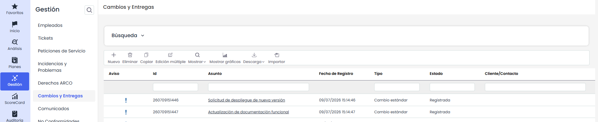
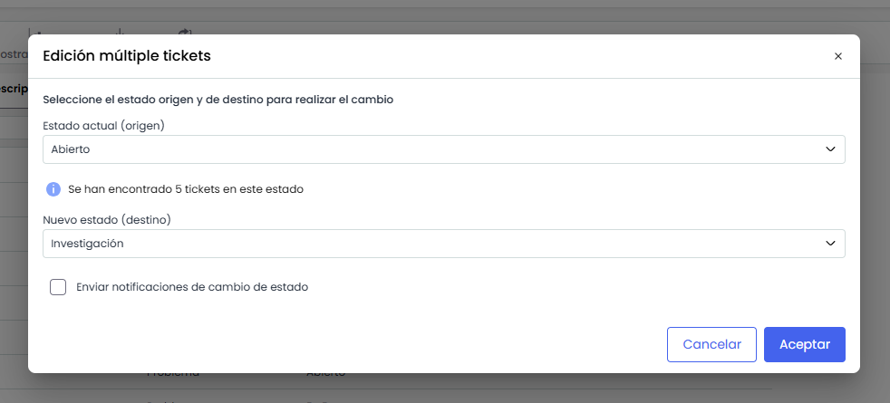

# Cambios y Entregas

La opción de Cambios y Entregas permitirá gestionar todos aquellos cambios y sus correspondientes entregas realizados. Hay que tener en cuenta que podrán ser abiertos manualmente, o por otra parte, ser generados por clientes de forma automática desde el portal de clientes a través de un Ticket.

En la pantalla principal nos aparecen todas aquellas peticiones que aun no están en estado cerrado, así como las siguientes opciones:

* **Nuevo:** Permite generar diferentes tipos de cambios.

* **Eliminar:** Permite eliminar cambios.

* **Copiar:** Esta opción permite copiar un cambio que ha sido definido con anterioridad.

* **Edición Múltiple:** Esta opción aparecerá en la barra de herramientas si hay configurado para este tipo de ticket un campo de estado.   
  El proceso se realiza desde un modal: se selecciona el estado actual (origen) —acompañado de su flujo de trabajo cuando corresponda y del número de tickets que se encuentran en él— y, a continuación, el nuevo estado (destino), que el sistema propone según el flujo de trabajo configurado. También puede decidirse si se envían las notificaciones de cambio de estado, activadas por defecto.

  

  Antes de ejecutar, el sistema muestra un mensaje de confirmación con el número de tickets afectados y la transición que se va a aplicar. Al confirmar, la operación se ejecuta en segundo plano —su avance puede seguirse en Procesos de trabajo—, de modo que es posible continuar trabajando mientras se completa.
* **Mostrar:** Al utilizar GlobalSUITE como base de datos de conocimientos, mediante esta opción podrá seleccionar que se muestren tan sólo aquellas no conformidades que estén abiertas, o por el contrario todas, a través del desplegable del que dispone esta opción.

  

  Adicionalmente, cuando el campo **Empleado** se encuentre configurado para el tipo de ticket, estarán disponibles las opciones **Abiertos por empleados** y **Todos por empleados**, que permiten mostrar los tickets agrupados por el empleado asociado.

* **Mostrar gráficas:** Permite representar todas aquellos cambios y entregas que se han definido. Esta opción nos permite mostrar las imágenes estadísticas tal y como se ha podido ver en las opciones de incidencias.

La solución le permite ver gráficamente y de forma separada el estado de los cambios realizados y generados.

Las imágenes generadas permiten mostrar:

* **Totales:** Todas las cambios registrados.

* **Abiertas:** Tan sólo representar aquellas que permanecen abiertas.

* **Cerradas:** Tan sólo representar aquellas que permanecen cerradas.

A su vez permite representar cualquier tipo de combinación entra estas opciones. De la misma forma las imágenes pueden ser impresas directamente o ser descargadas en formato PNG, JPEG, PDF y vectorial SVG.

* **Descarga:** Permite descargar el listado de Cambios y Entregas representados en formato Excel o CSV.  Este Informe estará disponible en [Descargas Pendientes.](https://help.globalsuite.es/display/GlobalSUITEes/.Descargas+Pendientes+vv6.53)  
  Para las descargas en formato **Excel**, el sistema podrá limitar la generación del fichero cuando la información a exportar supere las **100.000 celdas**. Este límite se calcula en función de la cantidad de registros y columnas incluidas en la descarga.

  En caso de que no sea posible generar el fichero en formato Excel, se recomienda realizar la descarga en formato **CSV**.

* **Importar:** Esta opción permite realizar una carga masiva de Cambios que se encuentran en un archivo Excel. Al pulsar el botón, la herramienta solicita un archivo en formato Excel que debe contener un conjunto de columnas con la información de los Cambios que se desean importar, no importa el orden de las columnas ya que permite seleccionar aquellas que se quieren importar.

* [Formulario del Cambio](formulario-del-cambio.md)
* [Workflow Cambios](workflow-cambios.md)
