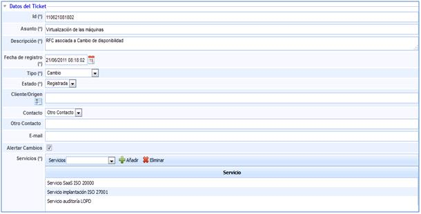
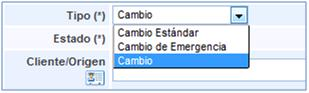
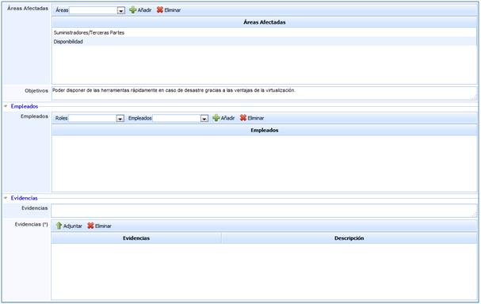
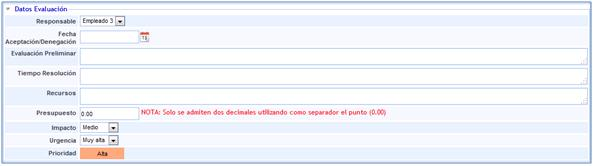
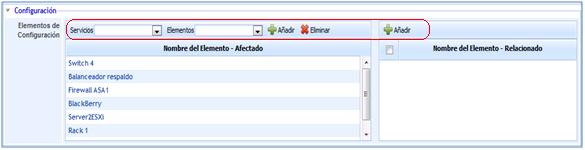
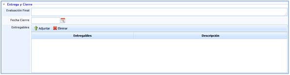
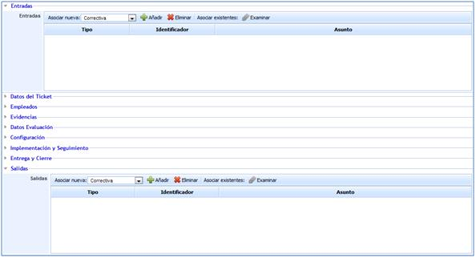

# Formulario del Cambio

## Datos del ticket

Para acceder a cualquier tipo de cambio basta con pulsar sobre el ID o el asunto en el listado de la pantalla principal. Una vez dentro, GlobalSUITE nos proporciona las siguientes opciones:

* **Id:** Corresponde con el nombre o identificador del cambio que se está registrando.

* **Asunto:** En este campo se define el título del cambio.

* **Descripción:** Es uno de los puntos más importantes, ya que es a través de este campo mediante el cual se especificará lo más detallado posible, en qué consiste el cambio.

* **Fecha de registro:** Fecha de comunicación.

* **Tipo:** Permite definir el tipo de cambio que se va a proceder a realizar.

* **Estado:** Se define si la petición de servicio se encuentra registrada, aprobada, denegada o cerrada.

* **Servicios:** En este campo se asociarán los servicios asociados a la petición.

Todos los campos anteriormente identificados son los que aparecerán en la información que recibirá el cliente en caso de que la necesidad de realizar el cambio haya sido comunicado mediante un ticket a través del Portal de Clientes.

GlobalSUITE también permite definir la siguiente información en las peticiones de servicio:

* **Cliente/Origen:** En caso de que se haya abierto desde el portal, este campo se completará de forma automática. Si este se abre manualmente, la solución le permite establecer el origen o el origen del mismo.

* **Contacto:** Si se ha procedido a generar desde el portal de clientes, el contacto corresponderá a la persona encargada de generar dicho evento. Este campo contacto es modificable, pudiendo concretar otro usuario al cual proceder a informar sobre el estado de la petición.

En caso de haberse generado de forma manual, en este campo se indicará con quién se debe poner en contacto para informar sobre el estado del cambio.

* **E-mail:** Se indica el correo al cual se podrá comunicar el estado de la petición.

* **Alertar cambios:** Seleccionando esta opción, GlobalSUITE enviará al e-mail indicado en el campo superior, información sobre cambios de estado y clasificaciones realizadas de la petición.

* **NOTA:** En caso que se haya generado un grupo de correo en el aparatado de 'Inicio/Relaciones con el Negocio' la herramienta permite el envío de alertas a un grupo determinado. Para ello se ha de seleccionar la empresa deseada (debe estar creada en el apartado 'Inicio/Relaciones con el Negocio'), y determinar si alertar a un Contacto o a un Grupo. En el caso de seleccionar un Grupo, la herramienta ofrece la posibilidad de elegir el grupo al que notificar los cambios del ticket.

* **Áreas Afectadas:** Permite determinar qué áreas de la empresa se ven afectadas por el cambio a realizar.

## Empleados

* **Empleados:** Permite definir los empleados que se encargarán de la realización del cambio. Es necesario que estos empleados hayan sido definidos en la opción gestión de empleados.

## Evidencias

* **Evidencias:** Con el fin de definir de la forma más completa posible, la solución le permite adjuntar cualquier tipo de archivo. En caso de no adjuntar dicha documentación, también es posible realizar una descripción en el campo Evidencias.

## Datos de evaluación

* **Responsable:** Permite definir el empleado que será responsable de la realización de la evaluación del cambio antes de proceder a realizarlo.

* **Fecha de Aceptación/Denegación:** Permite definir cuándo se ha procedido a aceptar o denegar el cambio registrado.

* **Evaluación preliminar:** Permite registrar la información generada durante la evaluación inicial realizada.

* **Tiempo de resolución:** Permite establecer el tiempo que se ha dedicado a establecer si el cambio es aceptado o denegado.

* **Recursos:** Permite definir todos aquellos recursos que son necesarios para proceder a realizar el cambio.

* **Presupuesto:** Permite establecer el presupuesto disponible para realizar el cambio.

* **Impacto:** Establece un valor cualitativo, para determinar el nivel de daño que provoca el cambio.

* **Urgencia:** Permite establecer un valor cualitativo, para determinar la celeridad con la que debe ser resuelto el cambio.

* **Prioridad:** Este valor es generado de forma automática por GlobalSUITE®, realizando la media aritmética de los valores establecidos en los campos de impacto y urgencia.

## Configuración

* **Elementos de Configuración:** Permite determinar qué elementos de configuración se han ven afectados por la realización del cambio. A través de este campo se pueden asociar de forma automática a determinados elementos de configuración la RFC correspondiente.

Hay que tener en cuenta para asociar estos elementos de configuración, la opción Servicios y la opción Elementos.

* **Servicios:** Permite determinar a qué servicio afecta el cambio que hay que realizar.

De esta forma GlobalSUITE ofrecerá en la siguiente opción aquellos elementos que intervienen en la prestación del servicio que se ve afectado por el cambio.

* **Elementos:** Establece, en función del servicio que se haya determinado, todos aquellos elementos de configuración que se ven afectados por el cambio que se ha evaluado y aprobado.

## Riesgos

Ofrece la posibilidad de visualizar los elementos afectados por el suceso y valores definidos en el análisis de riesgos. Las tareas que se pueden realizar sobre esta apartado son:

* **Elementos:** Permite seleccionar el/los elementos afectados por el suceso.

* **Análisis:** Permite seleccionar el/los análisis de riesgos donde se encuentra valorado el elemento seleccionado.

**NOTA:** Un mismo elemento puede estar evaluado en diferentes análisis de riesgos y con valoraciones diferentes, de ahí la necesidad de indicar el análisis de riesgos que queremos cargar.

* **Añadir Elemento:** Una vez seleccionado el elemento, permite insertar el mismo en la tabla.

* **Eliminar Elemento:** Permite eliminar uno o varios elementos de la tabla. Para ello se ha de seleccionar la fila deseada y pulsar sobre el botón 'Eliminar elemento'

Una vez seleccionamos la fila del elemento deseado, la tabla situada en la parte inferior permite al usuario visualizar o modificar los valores definidos en el apartado 'Análisis/Análisis de Riesgos'. La herramienta destaca en color rojo aquellas valoraciones que han sido modificadas.

**NOTA:** La herramienta permite simular como afecta la incidencia a los elementos valorados en el apartado 'Gestión de Riesgos/Proyección y Simulación'. En función de la metodología definida en el apartado 'Ajustes'/Metodología Análisis', las valoraciones de las dimensiones pueden ser cualitativas o cuantitativas.

Las acciones que se pueden realizar sobre la tabla son:

* **Restaurar Amenazas:** Permite restaurar los valores iniciales de la tabla segun el Análisis de Riesgos realizado.

## Implementación y Seguimiento

GlobalSUITE permite establecer todas aquellas acciones realizadas para la Implementación y Seguimiento del cambio definido a través de las siguientes opciones:

* **Responsable de implementación:** Establece el empleado que se encargará de controlar las acciones realizadas para la consecución del cambio.

* **Fecha Implementación:** Permite registrar la fecha en la que se ha implementado el cambio.
* **Plan Implementación:** Permite hacer referencia o definir las acciones a seguir para realizar el cambio.
* Planes de vuelta atrás:**Permite hacer referencia o definir las acciones a realizar en caso de que el proceso del cambio haya derivado en incidencias, de tal forma que se tenga que restaurar el estado anterior al cambio.**

* **Revisión post-implantación:** Permite dejar registro de las acciones realizadas de comprobación de que el cambio realizado ha sido correcto.

* **Seguimientos:** Dentro de esta opción, se podrá identificar cualquier acción realizada con respecto a la gestión del cambio.

Cualquier seguimiento que quede registrado puede ser enviado a través de correo electrónico a todas aquellas personas a las que se considere necesario informar. Tal y como se indica, es necesario especificar los correos electrónicos y utilizar la opción Enviar e-mail.

## Entrega y Cierre

GlobalSUITE le permite gestionar los cambios y sus posteriores entregas dentro de la misma opción. Para la gestión del cierre de un cambio y su posterior entrega, la solución proporciona los siguientes registros.

* **Evaluación Final:** Permite dejar registro de las acciones asociadas a la evaluación de la entrega.

* **Fecha Cierre:** Determina la fecha de cierre o fecha de realización de entrega.

* **Entregables:** Permite asociar cualquier documento que se necesario para registrar una correcta entrega tras el cambio.

## Entradas y Salidas

* **Entradas:** Permite determinar si la incidencia o problema definido procede de otro tipo de evento, proporcionando la herramienta las siguientes opciones:

  * Acción correctiva.
  * Acción preventiva.
  * No conformidad.
  * Cambio
  * Petición de Servicio.
  * Incidencia.
  * Problema.
  * Evento.
  * Falso positivo.

* Salidas: Permite determinar si la incidencia o problema definido deriva en otro tipo de evento, proporcionando la herramienta las opciones anteriormente expuestas para la entrada.

Tanto para las entradas como para las salidas se identifican una serie de opciones comunes:

* **Añadir:** Seleccionando el tipo de evento del que procede o en el que deriva, se incluirá en el campo correspondiente, generándose dicho evento en otra opción de las que proporciona GlobalSUITE®, exceptuando los casos de Evento y Falso Positivo.

* **Eliminar:** Elimina cualquier evento que haya sido añadido.

* **Asociar existentes:** En caso de que el evento del que derive haya sido creado con anterioridad, esta opción permite buscar dicho evento de tal forma que se pueda asociar a la petición de servicio correspondiente.
