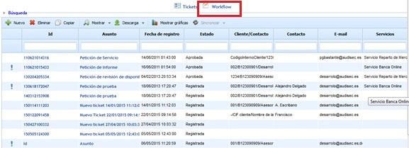
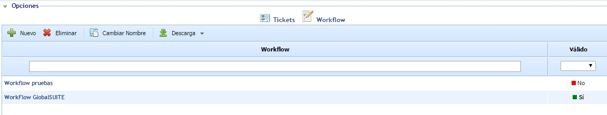
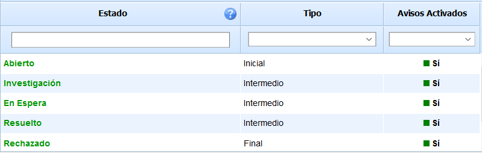
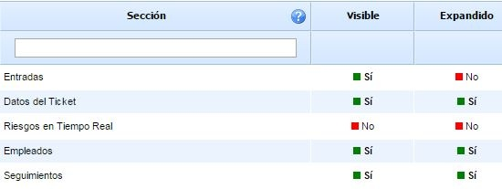
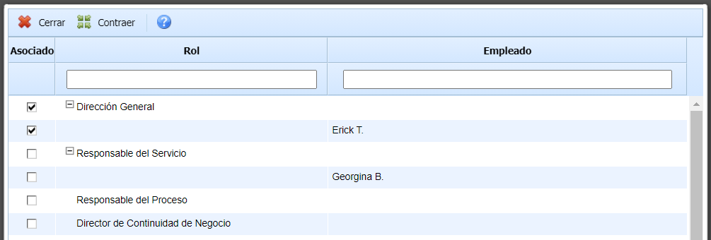
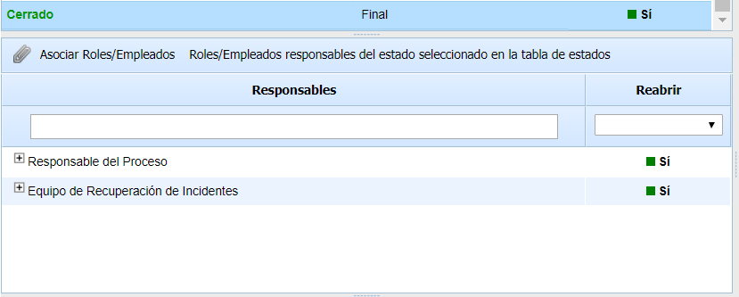
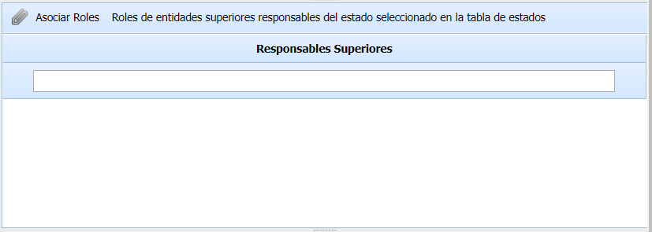
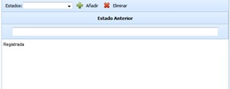
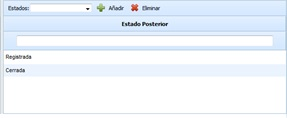
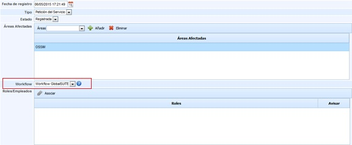

# Workflow Cambios

La opción de workflow permite a la organización parametrizar el flujo de estados asociados a los tickets.

Una vez se accede a la opción, se muestra una funcionalidad que permite establecer los diferentes workflows requeridos por la organización. Para ello, se ofrecen las siguientes opciones:

* **Nuevo:** Permite al usuario insertar una nueva entrada en la tabla.
* **Eliminar:** Ofrece la posibilidad de eliminar una entrada en la tabla de workflows. Para ello se ha de seleccionar la línea deseada y pulsar sobre el botón 'Eliminar'.
* **Cambiar Nombre:** Permite al usuario modificar el nombre del workflow.
* **Descarga:** Ofrece la posibilidad de descargar el listado de workflows en formato editable (xlsx) o en PDF.

Al seleccionar un workflow de la tabla se accede a una pantalla que permite configurar el workflow. En la parte superior izquierda se muestran los estados que forman parte del workflow.

La tabla permite definir los diferentes estados que componen el workflow seleccionado. La tabla muestra la siguiente información:

* **Estado:** La columna permite visualizar los diferentes estados definidos. Para insertar un nuevo estado se ha de pulsar sobre el botón 'Nuevo' situado en la parte superior de la tabla. En caso de querer eliminar un estado de la tabla, se ha de seleccionar la línea deseada y pulsar sobre el botón 'Eliminar'

* **Tipo:** Esta columna permite definir el tipo de estado. Para asociar un tipo se debe pulsar dos veces sobre la celda y seleccionar el tipo en el desplegable. Los tipos establecidos por defecto son los siguientes:

  * **Inicial:** Primer estado de un ticket. Esta tipología solo se permite asociar a un único estado de la tabla.
  * **Intermedio:** La tipologia intermedia es un estado posterior al tipo inicial. Se pueden asociar tantos tipos intermedios como se requieran.
  * **Final:** Esta tipología esta asociada al cierre de un ticket. Se pueden asociar tantos tipos finales como se requieran.
* **Avisos Activados**: Esta campo permite configurar si, por defecto, se notificará por correo electrónico a los responsables del estado cuando se le asigne el ticket.

Los estados aparecen en color verde o rojo en función de si el estado es válido o inválido, respectivamente. Para definir un estado válido se deben cumplir las siguientes condiciones (estas condiciones se muestran al poner el cursor sobre el icono de interrogación:

1. Tiene asociado, como mínimo, un empleado como responsable del estado y que tiene acceso a la herramienta. Para ello, existen dos posibilidades:

a. Asignar un rol de la empresa que tenga al menos un empleado que sea usuario de la herramienta.

b. Asignar un rol de entidades superiores que tenga al menos un empleado que sea usuario de la herramienta.

2. Tiene asociados estados anteriores y posteriores que permiten avanzar en el workflow. En función del tipo de estado, se debe cumplir.

a. Estado tipo Inicial: Tiene que tener al menos un estado posterior (si el workflow tiene más estados).

b. Estado tipo Intermedio: Tiene que tener al menos un estado anterior y un estado posterior.

c. Estado tipo Final: Tiene que tener al menos un estado anterior.

En la parte superior derecha se encuentra una tabla que contiene las secciones del formulario del ticket. Esta tabla se encuentra asociada a la tabla de estados, de forma que una vez que se selecciona un estado, la tabla muestra la configuración de secciones específica para dicho estado.

El objetivo de esta tabla es configurar qué secciones son visibles para cada uno de los estados del workflow, permitiendo por tanto que determinadas secciones no se muestren cuando el ticket está en un determinado estado. Existen dos columnas que permiten la siguiente configuración:

* **Visible:** Permite indicar si la sección es visible en el formulario del ticket cuando éste se encuentra en el estado seleccionado. Por defecto, todas las secciones son visibles para todos los estados. Si se quiere deshabilitar una sección, hay que pulsar sobre el "Sí", cambiándose automáticamente a "No".
* **Expandido:** Para aquellas secciones que son visibles, permite indicar si la sección se muestra expandida o contraída en el formulario del ticket. Por defecto, todas las secciones visibles se muestran expandidas. Si se quiere contraer una sección, hay que pulsar sobre el "Sí", cambiándose automáticamente a "No".

La tabla de roles y empleados ofrece la posibilidad de asignar a cada uno de los estados los perfiles o empleados que se van a poder asignar a la gestión del estado. Las opciones que permite la herramienta son las siguientes:

* **Asociar Roles/Empleados:** Ofrece la posibilidad de asignar, en base a un estado los perfiles y recursos encargados de la gestión.

Los empleados que aparecerán en la ventana, serán únicamente los que tengan usuario asociado, ya que es necesario que dispongan de acceso a la herramienta para la gestión de los tickets.

**NOTA:** En función de los roles definidos en un estado, a la hora de gestionar un ticket, únicamente se podrán seleccionar de entre los roles definidos en el workflow.

En el caso de los estados de tipo "Final", se podrá configurar qué roles/empleados tienen privilegios para reabrir un ticket cerrado.

La tabla de asociar Roles es una funcionalidad asociada a aquellas empresas que disponen de la funcionalidad de Subentidades, ofreciendo la posibilidad de asociar Roles de entidades superiores, encargados de gestionar el ticket. Las opciones que permite la herramienta son las siguientes:

* **Asociar Roles:** Ofrece la posibilidad de asignar, en base a un estado los roles de la entidad superior encargados de la gestión.
* **Asociar Áreas:** Permite definir las áreas afectadas a un estado.

La tabla de 'Estado Anterior' ofrece la posibilidad a los usuarios de definir, en base a un estado seleccionado, aquellos estados de los que puede derivar. La gestión que permite la herramienta es la siguiente:

* **Estados:** Permite seleccionar, del listado mostrado, cual es el estado anterior al seleccionado en la tabla superior.
* **Añadir:** Una vez seleccionado el estado en el desplegable, permite insertar el mismo en la tabla y asociarlo al estado seleccionado.
* **Eliminar:** Permite eliminar un estado insertado en la tabla. Para ello se ha de seleccionar la fila deseado y pulsar sobre el botón 'Eliminar'

La tabla de 'Estado Posterior' ofrece la posibilidad a los usuarios de definir, en base a un estado seleccionado, aquellos estados siguientes que se podrán definir al gestionar el ticket. La gestión que permite la herramienta es la siguiente:

* **Estados:** Permite seleccionar, del listado mostrado, cual es el estado posterior al seleccionado en la tabla superior.
* **Añadir:** Una vez seleccionado el estado en el desplegable, permite insertar el mismo en la tabla y asociarlo al estado seleccionado.
* **Eliminar:** Permite eliminar un estado insertado en la tabla. Para ello se ha de seleccionar la fila deseado y pulsar sobre el botón 'Eliminar'

**NOTA:** Una vez establecido el workflow este se ha de asociar en el ticket correspondiente, para el cual se aplicará el flujo asociado, tal y como se muestra en la siguiente imagen.

