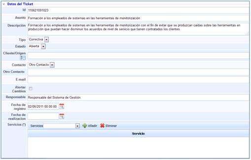
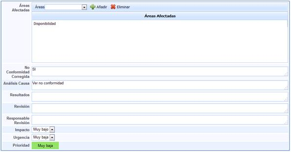
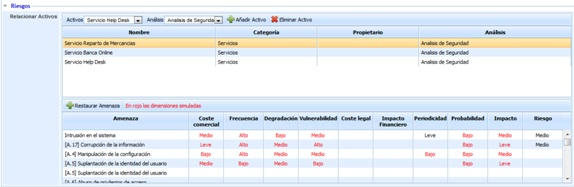
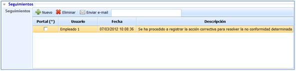
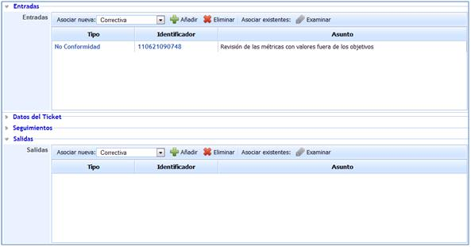

# Formulario de Correctivas y Preventivas

## Datos del ticket

A continuación se definen todos los campos que le permitirán realizar un adecuado registro de las Acciones correctivas y preventivas.

* **Identificador (Id):** Este será generado de forma automática y corresponderá a un número único de no conformidad que permita diferenciarla del resto.

* **Asunto:** Permite asignar un nombre que describa la acción correctiva o preventiva.

* **Descripción:** Permite especificar en qué consiste la acción correctiva o preventiva.

* **Tipo:** Esta opción permite determinar si la acción que se está procediendo a registrar se trata de una correctiva o preventiva.

* **Estado:** Define cómo se encuentra durante su gestión la no conformidad. La solución nos proporciona las siguientes opciones:

  * *Abierta:* Define si la acción determinada permanece abierta debido a que no se ha procedido a implantar.
  * *Cerrada:* Establece que se ha procedido a implantar la acción.
* **Cliente/Origen:** Permite establecer si la acción se encuentra asociada a un cliente o de un origen concreto.
* **Contacto:** Define la persona o el cliente que se ve afectado por la acción.
* **Otro contacto:** Permite determinar cualquier otro contacto de interés en la implantación de dichas acciones.
* **Email:** Dirección de correo electrónico de la persona de contacto.
* **Alertar Cambios:** Permite mandar de forma automática un correo, con cualquier modificación del estado que se produzca sobre la acción gestionada. De esta forma, permitirá al cliente saber en todo momento cómo se está llevando a cabo la gestión de la acción implantada.

* **NOTA:** En caso que se haya generado un grupo de correo en el aparatado de 'Inicio/Relaciones con el Negocio' la herramienta permite el envío de alertas a un grupo determinado. Para ello se ha de seleccionar la empresa deseada (debe estar creada en el apartado 'Inicio/Relaciones con el Negocio'), y determinar si alertar a un Contacto o a un Grupo. En el caso de seleccionar un Grupo, la herramienta ofrece la posibilidad de elegir el grupo al que notificar los cambios del ticket.

* **Responsable:** Permite definir la persona encargada de realizar la implantación de la acción correctiva o preventiva.
* **Fecha de Registro:** Permite determinar la fecha en la cual se establece la acción a realizar.
* **Fecha de Realización:** Establece la fecha en la cual se ha implementado la acción.
* **Servicios:** Podrán seleccionarse los servicios a los que afecte la acción correctiva o preventiva implantada.

A su vez dentro de la definición de cada una de las acciones correctivas o preventivas, se puede identificar:

* **Áreas Afectadas:** Podrán seleccionarse aquellas áreas que se ven afectadas por acción implantada.
* **No Conformidad Corregida:** Determina la No conformidad que se procede a solucionar mediante la acción definida si procede de esta.
* **Análisis de la Causa:** Establece el origen de la no conformidad que soluciona la acción correctiva definida.
* **Resultados:** Permite determinar los cambios que ha supuesto la implantación de la acción definida.
* **Revisión:** Permite establecer si los resultados obtenidos han conseguido los efectos deseados a la hora de implantar la acción.
* **Responsable Revisión:** Define la persona encargada de revisar si los resultados de la acción correctiva o preventiva son los deseados.
* **Impacto:** Establece el impacto que supone la no implantación de la acción definida.
* **Urgencia:** Establece la necesidad de implantación de la acción en el tiempo.
* **Prioridad:** Determina qué acción debe ser implantada con mayor necesidad. Se obtiene a través de la media del impacto y urgencia anteriormente definidos.

## Riesgos

Ofrece la posibilidad de visualizar los elementos afectados por el suceso y valores definidos en el análisis de riesgos. Las tareas que se pueden realizar sobre esta apartado son:

* **Elementos:** Permite seleccionar el/los elementos afectados por el suceso.

* **Análisis:** Permite seleccionar el/los análisis de riesgos donde se encuentra valorado el elemento seleccionado.

**NOTA:** Un mismo elemento puede estar evaluado en diferentes análisis de riesgos y con valoraciones diferentes, de ahí la necesidad de indicar el análisis de riesgos que queremos cargar.

* **Añadir Elemento:** Una vez seleccionado el elemento, permite insertar el mismo en la tabla.

* **Eliminar Elemento:** Permite eliminar uno o varios elementos de la tabla. Para ello se ha de seleccionar la fila deseada y pulsar sobre el botón 'Eliminar elemento'

Una vez seleccionamos la fila del elemento deseado, la tabla situada en la parte inferior permite al usuario visualizar o modificar los valores definidos en el apartado 'Análisis/Análisis de Riesgos'. La herramienta destaca en color rojo aquellas valoraciones que han sido modificadas.

**NOTA:** La herramienta permite simular como afecta la incidencia a los elementos valorados en el apartado 'Gestión de Riesgos/Proyección y Simulación'. En función de la metodología definida en el apartado 'Ajustes /Metodología Análisis', las valoraciones de las dimensiones pueden ser cualitativas o cuantitativas.

Las acciones que se pueden realizar sobre la tabla son:

* **Restaurar Amenazas:** Permite restaurar los valores iniciales de la tabla según el Análisis de Riesgos realizado.

## Seguimientos

GlobalSUITE le permitirá registrar las diferentes acciones llevadas a cabo con respecto al tratamiento y gestión de las No Conformidades.

Las diferentes opciones que pueden realizarse desde el apartado de seguimientos definido con anterioridad.

## Entradas y Salidas

* **Entradas:** Permite determinar si la acción correctiva o preventiva definida procede de otro tipo de evento, proporcionando la herramienta las siguientes opciones:

  * *Acción correctiva.*
  * *Acción preventiva.*
  * *No conformidad.*
  * *Cambio.*
  * *Petición de Servicio.*
  * *Incidencia.*
  * *Problema.*
  * *Evento.*
  * *Falso positivo.*

* **Salidas:** Permite determinar si la no conformidad deriva en otro tipo de evento, proporcionando GlobalSUITE las opciones anteriormente expuestas para las entradas.

Tanto para las entradas como para las salidas se identifican una serie de opciones comunes:

* **Añadir:** Seleccionando el tipo de evento del que procede o en el que deriva, se incluirá en el campo correspondiente, generándose dicho evento en otra opción de las que proporciona GlobalSUITE®, exceptuando los casos de Evento y Falso Positivo.
* **Eliminar:** Elimina cualquier evento que haya sido añadido.
* **Asociar existentes:** En caso de que el evento del que derive haya sido creado con anterioridad, esta opción permite buscar dicho evento de tal forma que se pueda asociar a la petición de servicio correspondiente.
