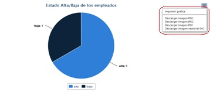
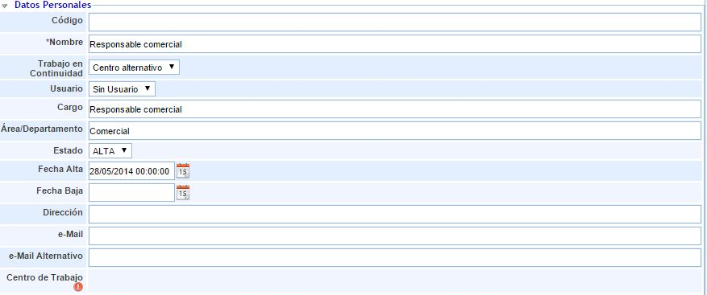
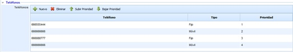
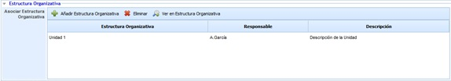
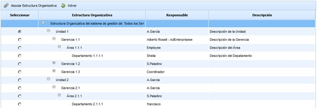
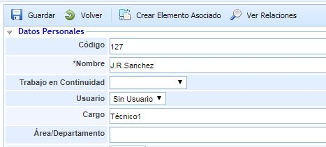
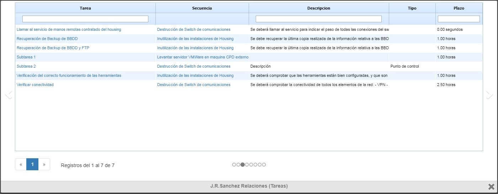
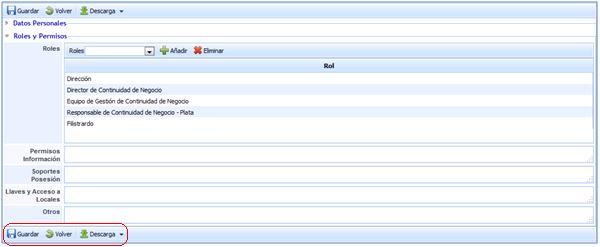
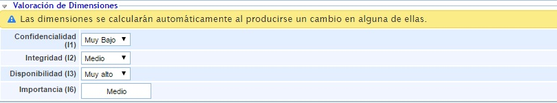

# Empleados

Desde la opción de empleados en la pestaña de Gestión, GlobalSuite® permite registrar y gestionar todos los empleados de la organización.

En la pantalla principal de empleados se muestran aquellos empleados que se encuentran registrados en la herramienta. Por defecto, la tabla muestra un conjunto de columnas específicas que indica los datos principales del empleado. Las columnas por defecto se pueden modificar por el usuario, utilizando para ello el botón derecho del mouse sobre las columnas. Al realizar esta acción, aparece una lista con todas las columnas que se pueden agregar a la tabla, permitiendo seleccionar las columnas deseadas.

Las opciones que se permite realizar en esta tabla son las siguientes:

* **Nuevo:** Permite insertar una nueva entrada (empleado) en la tabla.

* **Eliminar:** Permite eliminar un registro de la tabla. Para ello se debe seleccionar la fila o filas deseadas y pulsar el botón "Eliminar".

* **Importar Datos:** Esta opción permite realizar una carga masiva de empleados que se encuentran en un archivo Excel. Al pulsar el botón, la herramienta solicita un archivo en formato Excel que debe contener un conjunto de columnas con la información de los empleados que se desean importar. Aunque la herramienta acepta archivos Excel con diferente orden de columnas (permite seleccionar aquellas que se quieren importar), también se proporciona un modelo Excel válido en el botón "Descarga".

* **Descarga:** Ofrece la posibilidad de descargar el listado de clientes en un formato editable (xls) o en formato PDF, además del modelo Excel para realizar una importación de datos de empleados.

* **Sincronizar:** Esta opción se encuentra habilitada en aquellas empresas que tienen configurada la sincronización con el Directorio Elemento. En caso de que la sincronización esté activada, la herramienta permite registrar los empleados del Directorio Elemento como empleados de la herramienta, actualizándose la información si existen cambios en el Directorio Elemento. Si desea más información acerca de la sincronización de GlobalSUITE® con el Directorio Elemento, póngase en contacto con su distribuidor.

* **Mostrar Gráfica:** Permite generar una grafica con los empleados dados de alta y baja en la herramienta.

## Datos Personales

En la pantalla principal podrá incluir cualquier tipo de información que considere necesaria para un correcto registro de los empleados.

Para el caso del servicio de Continuidad de Negocio, permite indicar para cada empleado como desempeñará su trabajo en una situación de contingencia/continuidad (Teletrabajo o Centro Alternativo) mediante el campo "Trabajo en Continuidad".

## Teléfonos

La presente opción permite establecer los números de contacto del usuario.

La información que aporta la tabla es la siguiente:

* **Teléfono:** Permite incluir un numero de contacto en la tabla
* **Tipo:** Ofrece la posibilidad de establecer la tipologia del contacto, pudiendo optar entre móvil, fijo, celular personal o teléfono de trabajo.
* **Prioridad:** Permite definir la prioridad de llamada o contacto al usuario.

## Estructura Organizativa

La opción permite al usuario asociar una unidad organizativa al usuario. Las opciones que permite la herramienta son las siguientes:

* **Añadir Estructura Organizativa:** Permite definir la unidad asociada a un usuario. Para ello se ha de pulsar sobre el botón y seleccionar la unidad en la opción mostrada en la siguiente imagen.

* **Eliminar:** Ofrece la posibilidad de desasociar una unidad organizativa. Para ello se ha de seleccionar la línea deseada y pulsar sobre el botón 'Eliminar'.

* **Ver en Estructura Organizativa:** Permite al usuario visualizar las dependencias de la unidad asociada, tal y como se muestra en la siguiente imagen.

## Relaciones

Esta opción permite ver las relaciones del empleado con los aspectos más importantes del Sistema de Gestión. De esta forma, si un empleado se da de baja en la compañía, se puede ver en que opciones estaría asociado o tendría responsabilidad para realizar los cambios en estas opciones que se consideren necesarios. Para ello habría que pulsar el botón Ver Relaciones y se abrirá una ventana emergente donde se puede ver la relación con las siguientes opciones de la herramienta

* Responsable de Plan de Continuidad
* Responsable de Plan de Recuperación
* Responsable de tareas del Plan de Recuperación
* Perteneciente a algún grupo de RRHH Críticos
* Perteneciente a algún grupo de Comités de Decisión
* Responsable en Servicios
* Responsable en Procesos
* Responsable de Elemento (Activos de cualquier categoría)

Dentro de la ventana emergente, para ir visualizando las opciones anteriormente citadas se pulsará en la flecha que está situada a ambos lados de esta ventana. También se podría ir navegando por esta opción pulsando los círculos situados debajo de la tabla. Cada círculo se corresponde con una tabla.

## Roles y Permisos

En esta opción se le permite incluir qué Roles desarrolla cada empleado, que serán dados de alta en su opción correspondiente en la pestaña de Inicio, y de qué permisos dispone, entre los que se pueden destacar permisos para el acceso a la información, cualquier soporte que tenga a su disposición para realizar su trabajo, así como la posesión de llaves o de permisos de acceso. Como última opción la solución le permite incluir en el campo “Otros” cualquier otro tipo de permiso del que pueda disponer el empleado en cuestión.

Hay que tener en cuenta que una vez sea incluida o modificada cualquier información contenida en este punto es necesario proceder a realizar su Guardado.

Por último, GlobalSUITE le permite descargar toda la información definida de los empleados con el fin de que pueda disponer de la misma en cualquier otra ubicación que se considere.

## Valoración de Dimensiones

Esta sección del formulario permite realizar la valoración del empleado en las dimensiones configuradas para el inventario de elementos.

Las dimensiones que aparecen son configurables en 'Ajustes - Metodologías Análisis - Configuración General'. Se puede indicar qué dimensiones son visibles y cuales no. En caso de que no haya ninguna dimensión visible, esta sección no se muestra en el formulario del empleado.
