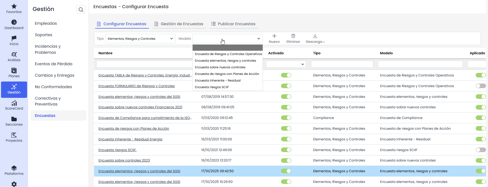
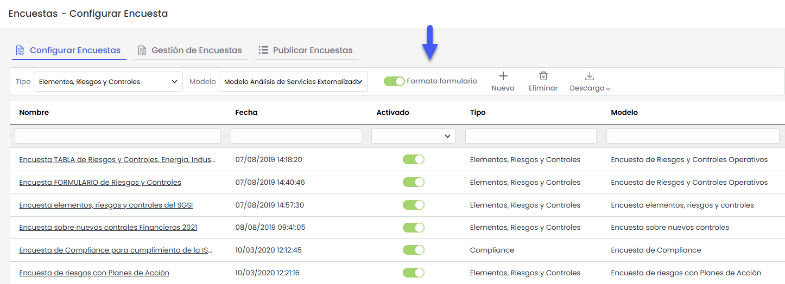

# Configurar encuestas

Este apartado permite al usuario configurar cada una de las encuestas que posteriormente serán generadas y/o publicadas. En función del tipo de encuesta, se podrá configurar de una forma u otra, aunque existen datos generales a todas las encuestas.

* [Encuestas RRHH Críticos (Configuración)](encuestas-rrhh-criticos-configuracion.md)
* [Encuestas Elementos, Riesgos y Controles (Configuración)](encuestas-elementos-riesgos-y-controles-configuracion.md)
* [Encuestas BIA (Configuración)](encuestas-bia-configuracion.md)
* [Encuestas Compliance (Configuración)](encuestas-compliance-configuracion.md)

La información que ofrece la tabla de encuestas es la siguiente:

* **Nombre:** Identifica el nombre del modelo de encuesta que se ha generado.
* **Fecha:** Informa de la fecha de creación de la encuesta.
* **Activado:** Permite visualizar si la encuesta se encuentra activada y disponible a los usuarios.
* **Tipo:** Informa sobre la tipología de la encuesta.
* **Modelo:** Informa sobre el modelo en base a la cual se va a realizar la encuesta.
* **Aplicado:** Ofrece la posibilidad de visualizar si la encuesta ha sido generada en el apartado de 'Gestión encuestas'  
  Las opciones que permite realizar la herramienta sobre la tabla son las siguientes:
* **Tipo:** Permite definir el tipo de encuesta que se va a crear.
* **Modelo:** Permite seleccionar qué modelo utilizar para la configuración de la encuesta. Los modelos que aparecen corresponden a aquellos que se han definido en el apartado de Ajustes > [Modelos de Encuestas](https://help.globalsuitesolutions.com/es/globalsuite/v1/modelos-de-encuestas).
* **Nuevo:** Al pulsar sobre el botón, genera una nueva entrada en la tabla de encuestas.
* **Eliminar:** Permite eliminar una encuesta ya creada en la tabla. Para ello se ha de seleccionar la fila deseada y pulsar sobre el botón ‘Eliminar’.
* **Descarga:** Ofrece la posibilidad de descargar el listado de encuestas en formato editable (xlsx) o en formato PDF.

## Encuesta formato formulario

Si el modelo de encuesta seleccionado corresponde a un encuesta únicamente elementos, se habilitará la opción de seleccionar este formato al crearla.

