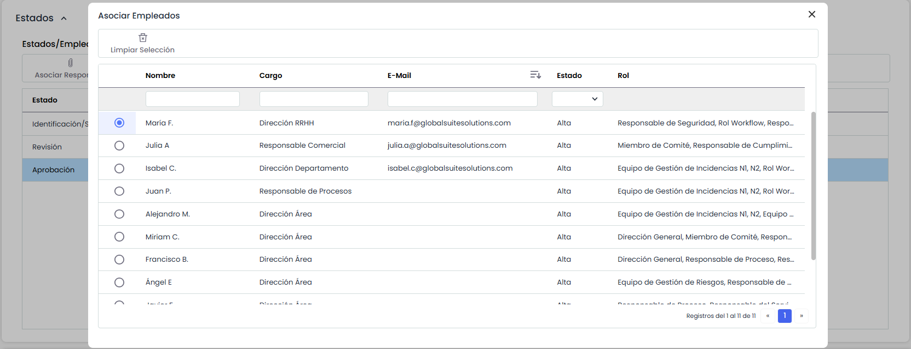
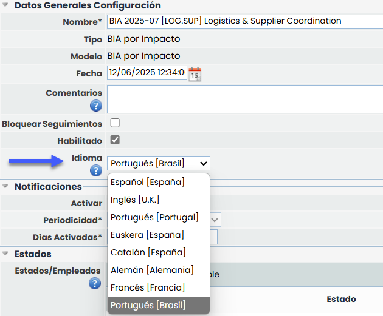
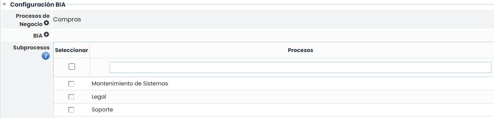
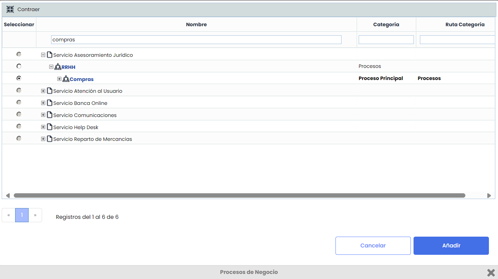
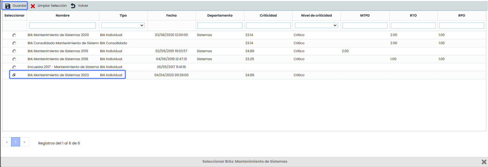
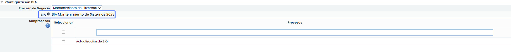

# Encuestas BIA (Configuración)

## Datos Generales de la configuración

### Datos Generales Configuración

Al acceder a un elemento de la tabla (configuración de una encuesta), la herramienta permite definir los siguientes parámetros para cualquier tipo de encuesta:

* **Nombre:** Permite identificar el nombre de la encuesta. Este nombre se mostrará en el listado inicial de encuestas.
* **Tipo:** Permite visualizar la tipología de la encuesta.
* **Modelo:** Permite visualizar la tipología de la encuesta.
* **Fecha:** Identifica la fecha de creación de la encuesta.
* **Comentarios:** Este campo permite incluir información o instrucciones para completar la encuesta, que recibirán los destinatarios de las encuestas.
* **Habilitado:** Permite mostrar la encuesta en el Portal de Clientes.
* **Bloquear Seguimientos**
* **Idioma:** Esta opción permite configurar el idioma en el que se enviarán las notificaciones asociadas a las encuestas que utilicen esta configuración.  
  El selector de idioma solo está habilitado cuando la SG tiene más de un idioma configurado.  
  Por defecto, se muestra seleccionado el idioma principal de la entidad.   
  El idioma elegido se aplicará al contenido de todos los correos, notificaciones y enlaces a la encuesta destinados a usuarios que no tienen cuenta en GlobalSuite®. Para los usuarios registrados en la plataforma, se utilizará siempre el idioma definido en su perfil, independientemente del valor configurado aquí.   
  En caso de eliminarse un idioma previamente configurado, las configuraciones que lo usaban se actualizarán automáticamente, sustituyéndolo por el idioma principal de la organización.
* **Usar como Plantilla:** Indica que la encuesta podrá utilizarse como plantilla para el envío de encuestas desde Inventario y Análisis de Riesgos.

### Notificaciones

Se puede configurar el envío de alertas al destinatario para notificar que tiene encuestas asignadas pendientes. Estas notificaciones se configuran tanto para encuestas internas como externas y están disponibles para todos los tipos de encuestas. La configuración permite definir la periodicidad del envío y el tiempo durante el cual la notificación permanecerá activa, iniciándose su aplicación a partir de la fecha de lanzamiento de la encuesta. Las alertas se envían siempre que la encuesta no se encuentre finalizada.

Las opciones son las siguientes:

* **Activar**: Al marcar esta opción se activará el apartado para configurar el envío de las notificaciones.
* **Periodicidad:** Se podrá configurar

  * Diaria
  * Semanal
  * Mensual
* **Días Activadas:** Se indicarán los días durante los cuales estarán activas las notificaciones, teniendo en cuenta la periodicidad.


\*\*NOTA:\*\* El valor máximo establecido para este campo es de 365 días.


### Estados

Si el modelo de encuesta seleccionado dispone de estados configurados, la configuración de la encuesta muestra una sección denominada "Estados" que contiene una tabla con los estados configurados y los empleados asignados como responsable a cada estado. Esta tabla permite, por tanto, asignar un empleado como responsable de cada estado de la encuesta, de forma que en función del estado de la encuesta, la herramienta asignará como responsable de la misma al empleado indicado.

La asignación de un responsable a cada estado se realiza seleccionando un estado de la tabla y pulsando el botón "Asociar Responsable". Al realizar esta acción, se muestra una ventana emergente que contiene todos los empleados de la organización permitiendo la selección de uno de ellos y pulsar sobre el botón "Asociar Empleados" para asignarlo.

### Idioma

Esta opción permite configurar el idioma en el que se enviarán las notificaciones asociadas a las encuestas que utilicen esta configuración.

El selector de idioma solo está habilitado cuando la SG tiene más de un idioma configurado. Por defecto, se muestra seleccionado el idioma principal de la entidad.

El idioma elegido se aplicará al contenido de todos los correos, notificaciones y enlaces a la encuesta destinados a usuarios que no tienen cuenta en GlobalSuite®.  
Para los usuarios registrados en la plataforma, se utilizará siempre el idioma definido en su perfil, independientemente del valor configurado aquí.

Este cambio se aplica de forma retroactiva a las configuraciones ya existentes, que adoptarán como valor inicial el idioma principal de la organización.

En caso de eliminarse un idioma previamente configurado, las configuraciones que lo usaban se actualizarán automáticamente, sustituyéndolo por el idioma principal de la organización.

### Configuración BIA.

Para el caso de encuestas de BIA, aparecen los siguientes campos:

* **Proceso de Negocio:** Permite establecer el proceso del negocio sobre el que se va a realizar la encuesta.

* **BIA:**Permite la posibilidad de crear una encuesta por Tiempo o por Impacto a partir de los datos de un BIA ya creado, tanto individual como consolidado del Proceso de Negocio seleccionado.  Esta opción permite al destinatario actualizar sólo los cambios producidos desde la última actualización. De este modo se parte de la información vigente y se simplifica la consolidación.

* **Subprocesos:** Al seleccionar un Proceso en la ventana superior, se cargarán en la tabla los procesos inferiores definidos en el [Árbol de Procesos](https://help.globalsuitesolutions.com/es/globalsuite/v1/procesos#Procesos-%C3%81rboldeProcesos).

Estos procesos pueden seleccionarse para incluirlos en la configuración. En ese caso, a la hora de generar encuestas a partir de dicha configuración se creará una encuesta para cada uno de los subprocesos marcados, además de para el proceso principal.
