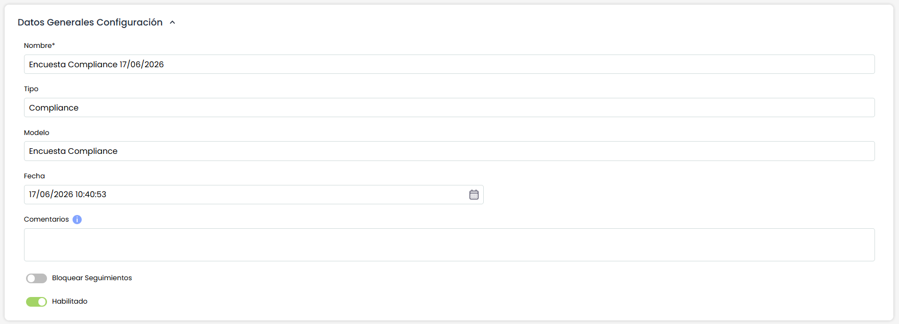
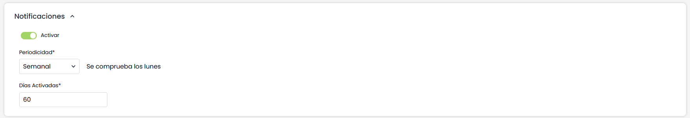
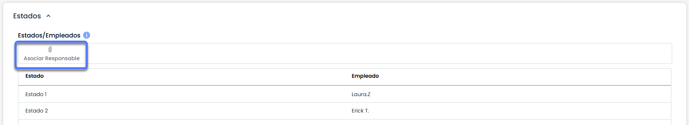

# Encuestas Compliance (Configuración)

## Datos Generales Configuración

Al acceder a un elemento de la tabla (configuración de una encuesta), la herramienta permite definir los siguientes parámetros para cualquier tipo de encuesta:

* **Nombre:** Permite identificar el nombre de la encuesta. Este nombre se mostrará en el listado inicial de encuestas.
* **Tipo:** Permite visualizar la tipología de la encuesta.
* **Modelo:** Permite visualizar la tipología de la encuesta.
* **Fecha:** Identifica la fecha de creación de la encuesta.
* **Comentarios:** Este campo permite incluir información o instrucciones para completar la encuesta, que recibirán los destinatarios de las encuestas.
* **Bloquear Seguimientos:** Si se marca este indicador, se bloquea el seguimiento, no pudiéndose crear nuevos seguimientos ni modificar ni eliminar los que ya hubiera en la tabla.
* **Habilitado:** Permite mostrar la encuesta en el Portal de Clientes.
* **Idioma:** Esta opción permite configurar el idioma en el que se enviarán las notificaciones asociadas a las encuestas que utilicen esta configuración.  
  El selector de idioma solo está habilitado cuando la SG tiene más de un idioma configurado.  
  Por defecto, se muestra seleccionado el idioma principal de la entidad.  
  El idioma elegido se aplicará al contenido de todos los correos, notificaciones y enlaces a la encuesta destinados a usuarios que no tienen cuenta en GlobalSuite®. Para los usuarios registrados en la plataforma, se utilizará siempre el idioma definido en su perfil, independientemente del valor configurado aquí.  
  En caso de eliminarse un idioma previamente configurado, las configuraciones que lo usaban se actualizarán automáticamente, sustituyéndolo por el idioma principal de la organización.

## Notificaciones

Se podrá configurar el envío de alertas al destinatario para notificar que se tienen encuestas asignadas.

Las  principales son:

* Se podrán configurar tanto para encuestas internas como externas.
* Se podrán configurar para todos los tipos de encuestas.
* Son configurables a partir de la fecha de lanzamiento de la encuesta.
* Posibilidad de elegir la periodicidad del envío y;
* el tiempo durante el cual estará activa la notificación.
* Se enviarán siempre que la encuesta no se encuentre finalizada.

Las opciones son las siguientes:

* **Activar**: Al marcar esta opción se activará el apartado para configurar el envío de las notificaciones.
* **Periodicidad:** Se podrá configurar

  * Diaria
  * Semanal
  * Mensual
* **Días Activadas:** Se indicarán los días durante los cuales estarán activas las notificaciones, teniendo en cuenta la periodicidad.


\*\*NOTA:\*\* El valor máximo establecido para este campo es de 365 días.


## Estados

Si el modelo de encuesta seleccionado dispone de estados configurados, la configuración de la encuesta muestra una sección denominada "Estados" que contiene una tabla con los estados configurados y los empleados asignados como responsable a cada estado. Esta tabla permite, por tanto, asignar un empleado como responsable de cada estado de la encuesta, de forma que en función del estado de la encuesta, la herramienta asignará como responsable de la misma al empleado indicado.

La asignación de un responsable a cada estado se realiza seleccionando un estado de la tabla y pulsando el botón "Asociar Responsable". Al realizar esta acción, se muestra una ventana emergente que contiene todos los empleados de la organización permitiendo la selección de uno de ellos y pulsar sobre el botón "Asociar Empleados" para asignarlo.
