# Encuestas Elementos, Riesgos y Controles (Configuración)

En el caso de las encuestas de tipo Elementos, Riesgos y Controles, la herramienta permite definir los siguientes parámetros (los campos y tablas que aparecen en este formulario dependerán del tipo de encuesta seleccionado en el modelo de encuesta):

## Datos Generales Configuración

Al acceder a un elemento de la tabla (configuración de una encuesta), la herramienta permite definir los siguientes parámetros para cualquier tipo de encuesta:

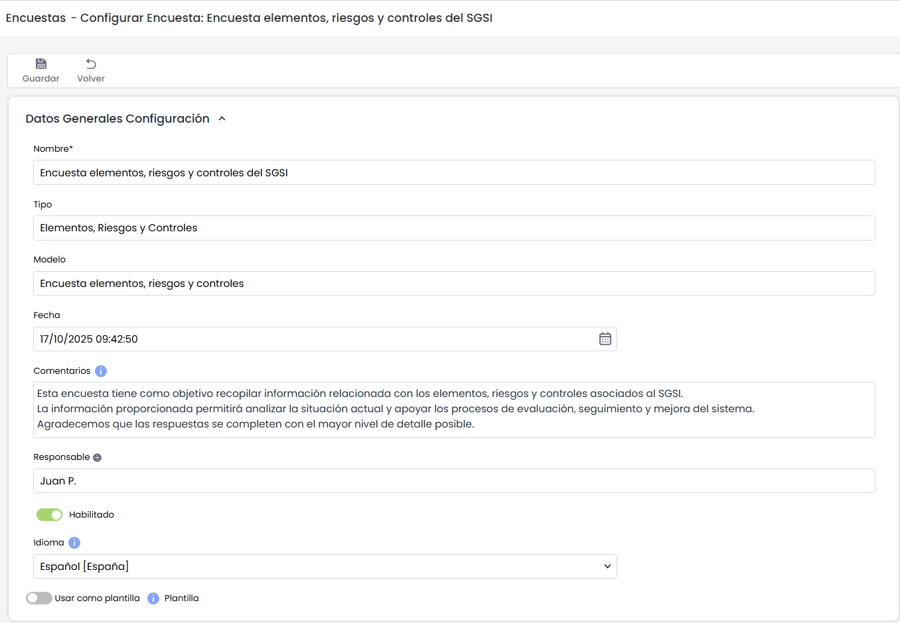

* **Nombre:** Permite identificar el nombre de la encuesta. Este nombre se mostrará en el listado inicial de encuestas.
* **Tipo:** Permite visualizar la tipología de la encuesta.
* **Modelo:** Permite visualizar la tipología de la encuesta.
* **Fecha:** Identifica la fecha de creación de la encuesta.
* **Comentarios:** Este campo permite incluir información o instrucciones para completar la encuesta, que recibirán los destinatarios de las encuestas.
* **Habilitado:** Permite mostrar la encuesta en el Portal de Clientes.
* **Bloquear Seguimientos**
* **Idioma:** Esta opción permite configurar el idioma en el que se enviarán las notificaciones asociadas a las encuestas que utilicen esta configuración.  
  El selector de idioma solo está habilitado cuando la SG tiene más de un idioma configurado.  
  Por defecto, se muestra seleccionado el idioma principal de la entidad.   
  El idioma elegido se aplicará al contenido de todos los correos, notificaciones y enlaces a la encuesta destinados a usuarios que no tienen cuenta en GlobalSuite®. Para los usuarios registrados en la plataforma, se utilizará siempre el idioma definido en su perfil, independientemente del valor configurado aquí.   
  En caso de eliminarse un idioma previamente configurado, las configuraciones que lo usaban se actualizarán automáticamente, sustituyéndolo por el idioma principal de la organización.
* **Usar como Plantilla:** Esta opción aparece en encuestas de Elementos, encuestas de Riesgos-Controles y encuestas de Elementos, Riesgos y Controles.

  Indica que la encuesta podrá utilizarse como plantilla para el envío de encuestas desde los módulos de Inventario y Análisis de Riesgos.

  Según se marque o no esta opción, la configuración de la encuesta variará. Su funcionamiento se detalla [más adelante.](encuestas-elementos-riesgos-y-controles-configuracion.md#Plantilla)

## Notificaciones

Se puede configurar el envío de alertas al destinatario para notificar que tiene encuestas asignadas pendientes. Estas notificaciones se configuran tanto para encuestas internas como externas y están disponibles para todos los tipos de encuestas. La configuración permite definir la periodicidad del envío y el tiempo durante el cual la notificación permanecerá activa, iniciándose su aplicación a partir de la fecha de lanzamiento de la encuesta. Las alertas se envían siempre que la encuesta no se encuentre finalizada.

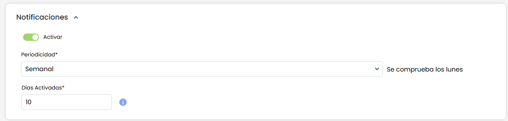

Las opciones son las siguientes:

* **Activar**: Al marcar esta opción se activará el apartado para configurar el envío de las notificaciones.
* **Periodicidad:** Se podrá configurar

  * Diaria
  * Semanal
  * Mensual
* **Días Activadas:** Se indicarán los días durante los cuales estarán activas las notificaciones, teniendo en cuenta la periodicidad.


\*\*NOTA:\*\* El valor máximo establecido para este campo es de 365 días.


## Programación de encuestas

El apartado Programación de encuestas, ubicado dentro de la configuración de la encuesta, programar la creación y lanzamiento de encuestas de Elementos, Riesgos y Controles de forma periódica

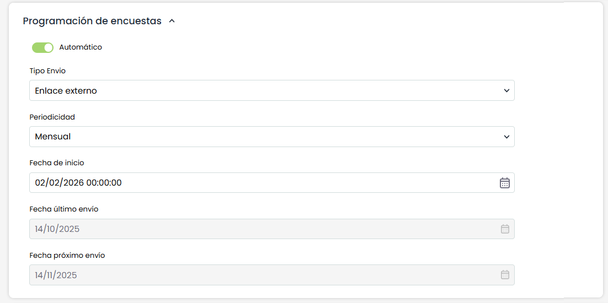

Para habilitar esta funcionalidad se dispone del check Automático, el cual se encuentra desmarcado por defecto. Al activarlo, se habilitan los campos de parametrización de la programación.

Los campos disponibles son los siguientes:

* **Tipo envío:** Permite definir la modalidad de envío de la encuesta:

  * Enlace externo: la encuesta se enviará mediante link externo, bajo el funcionamiento de Publicación.
  * Acceso interno: la encuesta se gestionará desde el módulo de Gestión de Encuestas.
* **Periodicidad:** Permite establecer la frecuencia con la que se realizará el lanzamiento automático:

  * Mensual: se lanzará el mismo día del mes siguiente (ej: 15 de enero → 15 de febrero)
  * Trimestral: se lanzará el mismo día del mes, tres meses después (ej: 15 de enero → 15 de abril)
  * Semestral: se lanzará el mismo día del mes, seis meses después
  * Anual: se lanzará el mismo día del mes, un año después
* **Fecha de inicio:** Indica la fecha a partir de la cual comenzará a ejecutarse la programación definida.
* **Fecha último envío:** Muestra la fecha en la que se realizó el último lanzamiento automático.(si no existe ninguna encuesta, aparecerá vacío)
* **Fecha próximo envío:** Muestra la fecha prevista para el siguiente lanzamiento según la periodicidad configurada.


Este lanzamiento automático es compatible con la creación de encuestas de forma manual, ya que la próxima fecha de envío se obtiene a partir de la última encuesta lanzada.


## Destinatarios

Si el [Modelo de Encuesta](https://help.globalsuite.es/display/GlobalSUITEes/Modelos+de+Encuestas) **no tiene configurados estados** (en cuyo caso hay que definir el responsable para cada estado), se podrán definir qué personas, seleccionadas de Empleados, recibirán la encuesta que se cree a partir de esta configuración. En caso de incluir más de un destinatario, se creará una encuesta independiente para cada uno de ellos.

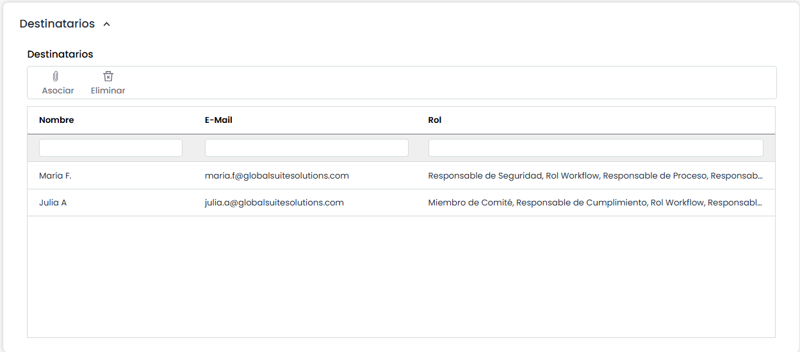

* Al pulsar el botón "Asociar" se abre una ventana con el listado de empleados del sistema, pudiendo seleccionar los que se quieran incorporar.

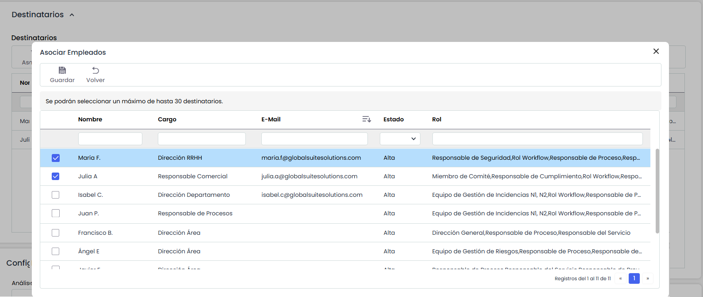

## Estados

Si el [Modelo de Encuesta](https://help.globalsuite.es/display/GlobalSUITEes/Modelos+de+Encuestas) **tiene configurados estados,** la configuración de la encuesta muestra una sección denominada "Estados" que contiene una tabla con los estados configurados y los empleados asignados como responsable a cada estado. Esta tabla permite, por tanto, asignar un empleado como responsable de cada estado de la encuesta, de forma que en función del estado de la encuesta, la herramienta asignará como responsable de la misma al empleado indicado.

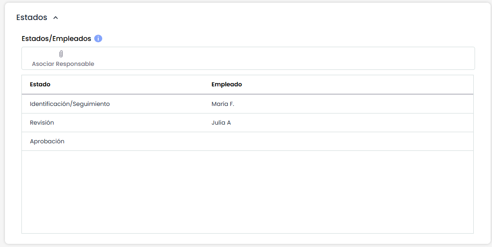

La asignación de un responsable a cada estado se realiza seleccionando un estado de la tabla y pulsando el botón "Asociar Responsable". Al realizar esta acción, se muestra una ventana emergente que contiene todos los empleados de la organización permitiendo la selección de uno de ellos y pulsar sobre el botón "Asociar Empleados" para asignarlo.

## Configuración de Riesgos.

La configuración del formulario de la encuesta variará en función del tipo de encuesta seleccionado. En base a esta tipología, se habilitarán los distintos apartados de parametrización, tales como Elementos, Riesgos y Controles, así como las relaciones existentes entre ellos.

La disponibilidad, contenido y comportamiento de cada apartado dependerán de la configuración definida en el modelo de encuesta y de las dependencias establecidas dentro del análisis seleccionado. De este modo, el formulario mostrará únicamente la información necesaria para la cumplimentación de la encuesta según su alcance.

### Análisis de Riesgos

En las encuestas que contemplen la evaluación de Riesgos y/o Controles, el primer apartado visible será **Análisis de riesgos**.

Desde este campo se deberá seleccionar el análisis de riesgos sobre el cual se configurará la encuesta. Esta selección determinará la información disponible en los apartados posteriores, tales como catálogos, elementos, riesgos y controles asociados.

En función del análisis seleccionado, el sistema mostrará únicamente los registros vinculados al mismo, permitiendo acotar el alcance de la encuesta al contexto definido.

### Elementos

En las encuestas de solo Elementos, al presionar “Añadir” aparecerán los elementos del Inventario de Elementos sobre los que se va a realizar la encuesta. Si se deja en blanco, aun se podrá rellenar la encuesta creando elementos nuevos desde la misma.

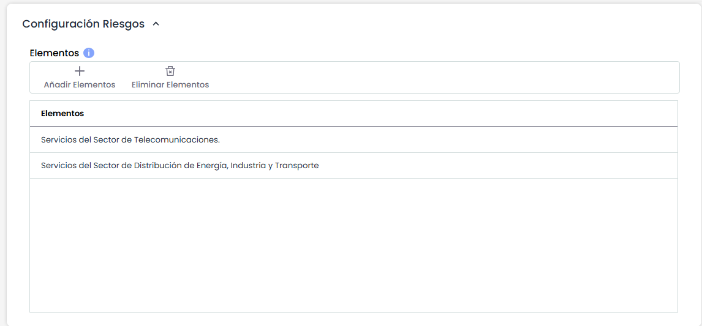

### Encuestas de Riesgos

En las encuestas de Riesgos, el primer apartado visible es **Análisis de riesgos**.  
Tras su selección, se mostrarán los catálogos asociados y el apartado de **Elementos**, desde el cual podrán seleccionarse los elementos sobre los que se realizará la evaluación.

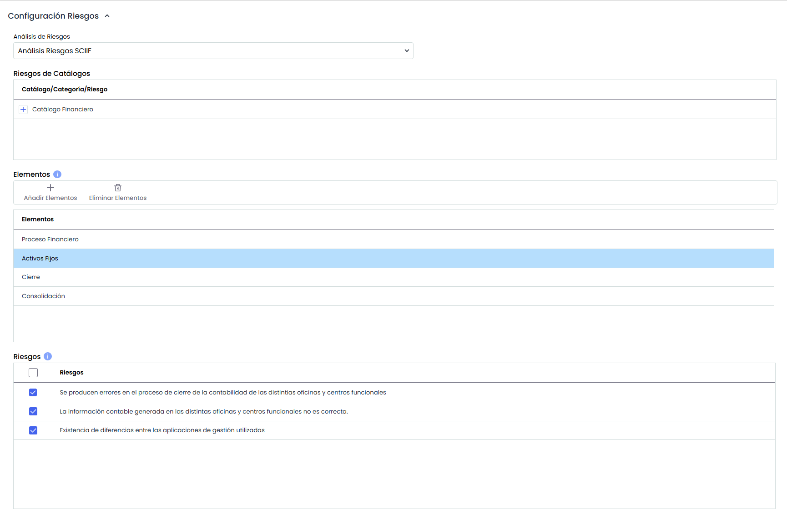

Una vez añadidos los elementos, al hacer clic sobre cada uno se desplegará, en la parte inferior, la lista de riesgos asociados a dicho elemento. Estos aparecerán marcados por defecto; no obstante, podrán desmarcarse si se desea. Asimismo, en la encuesta podrán crearse nuevos riesgos en caso de ser necesario.

* **Controles:** Permite definir los controles concretos sobre los que se realizará la encuesta. Dependiendo de si en el tipo de encuesta los controles se evalúan de manera general, por riesgo, o por elemento, se mostrarán el listado total de controles del análisis, los controles del riesgo seleccionado, o un árbol de controles por elemento, respectivamente.

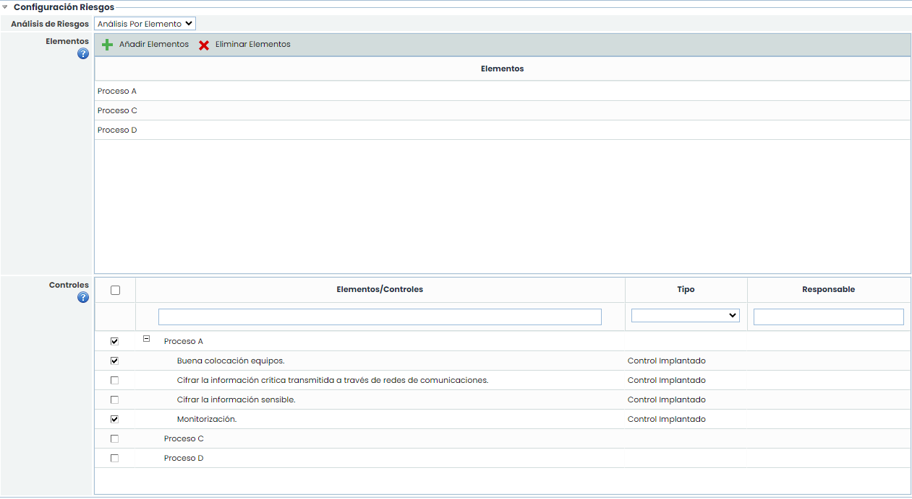

## Evidencias

En el caso de que la encuesta sea de tipo "Encuesta de Elemento-Controles (Metodología Por Elemento)" y se marque el check de Incluir Evidencias, al final aparecerá una tabla de Evidencias para seleccionar las que se quieran incluir en la encuesta, lo cual se realiza marcándolas en la propia tabla.

También se pueden incluir automáticamente en función de los controles que se vayan a evaluar (ver tabla anterior). Para ello, al pulsar el botón "Incluir Evidencias Controles" se marcarán todas las evidencias que estén asociadas a los controles que se van a evaluar.

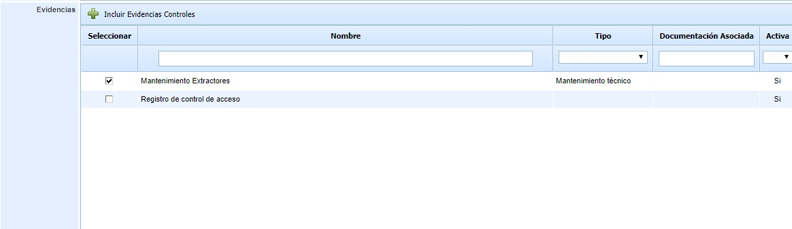

## Documentación Evidencia

En el caso en que se marque la opción **Incluir documentación evidencias** en el [modelo de encuesta](https://help.globalsuitesolutions.com/es/globalsuite/v1/modelo-encuesta-elementos-riesgos-y-controles#ModeloEncuestaElementos,RiesgosyControles-ConfiguraciónAdicional), se habilitará esta opción, para poder configurar la visibilidad de los documentos que se necesite en las encuestas.

### Configuración de visibilidad y consolidación de documentación

Existen dos opciones para gestionar la visibilidad de los documentos mostrados en las encuestas:

* **Visibilidad total de la documentación de la evidencia** > **Sin carpeta asociada**

  * Si no se selecciona ninguna carpeta y se incluye más de un elemento en el alcance, en la encuesta se mostrarán todos los documentos de las evidencias.
  * La consolidación de la encuesta se realiza en la carpeta "Evidencias Encuestas".
* **Restringir la visibilidad de la documentación de las evidencias > Asociar carpeta**

  * Los documentos visibles en la encuesta serán únicamente los que estén incluidos en la carpeta seleccionada y que estén asociados a la evidencia.
  * La consolidación de la encuesta se realiza en la misma carpeta seleccionada.

**Opción TPRM**

Para los usuarios del módulo de TPRM, se ofrece una opción que simplifica la creación de carpetas para cada proveedor. En lugar de tener que crear manualmente una carpeta para cada uno, la carpeta se generará automáticamente al consolidar la encuesta.

Cuando no se selecciona ninguna carpeta en el campo **Asociar carpeta** y solo se incluye **un único elemento** en la encuesta, se creará automáticamente una carpeta en la raíz del Gestor Documental con el nombre del elemento incluido (Proveedor). Si dicha carpeta ya existe, no se creará una nueva.

Además, al consolidarse la encuesta, la documentación se consolidará en esa misma carpeta generada.

## Adjuntos

En la configuración de Encuesta, es posible cargar archivos y documentos con ayudas, guías o una explicación detallada, que se enviarán por correo a los destinatarios de las encuestas cuando se lancen, además de estar disponibles en la propia encuesta para su consulta.

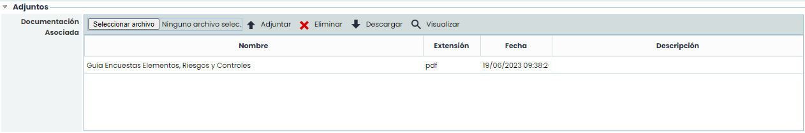

## Plantilla

Esta opción aparece en encuestas de Elementos , encuestas de Riesgos-Controles y Encuestas de Elementos Riesgos controles.

### Encuestas de Elementos:

Al marcar esta opción, se podrán definir plantillas de encuestas para permitir el envío directo de **encuestas de elementos** desde Inventario > [Tabla de elementos](https://help.globalsuitesolutions.com/es/globalsuite/v1/tabla-de-elementos), a partir de estas plantillas. Esto brinda a los usuarios, incluso aquellos sin privilegios de administración de encuestas, la capacidad de seleccionar uno o varios elementos para incluir en el alcance y configurar el envío de manera rápida y sencilla.

Las configuraciones que se marquen con esta opción, estarán disponibles como plantillas en la [Tabla de elementos](https://help.globalsuitesolutions.com/es/globalsuite/v1/tabla-de-elementos), donde se podrán seleccionar y utilizar directamente para gestionar el envío de encuestas.

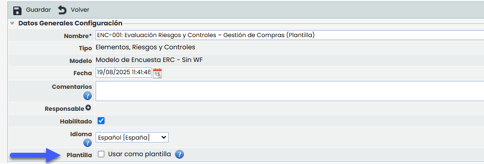

\*\*Nota\*\*
Al marcar una configuración de encuesta como Plantilla, no podrá elegirse un alcance de elementos concretos, ya que estos se seleccionan en el momento de lanzarse, en Inventario > [Tabla de elementos](https://help.globalsuitesolutions.com/es/globalsuite/v1/tabla-de-elementos).


### Encuestas de Riesgos-Controles y Encuestas de Elementos Riesgos controles. Elementos:

Al marcar esta opción, se podrán definir plantillas de encuestas para permitir el envío desde un Análisis de Riesgos a partir de estas plantillas.

Al seleccionar esta opción, aparece un campo llamado “Origen de los riesgos”, que incluye dos opciones posibles (excluyentes):

* Riesgos desde el Análisis
* Riesgos desde el Catálogo

#### Configuración de Plantilla con Riesgos desde el Análisis

Al seleccionar esta opción, el formulario para configurar este tipo de encuestas se comporta de la siguiente forma:

* “Notificaciones” se mantiene activo/habilitado. Opcional.
* “Programación de encuestas” deshabilitado
* Destinatarios:

  * Encuestas sin estados configurados: El fieldset ‘Destinatarios’ habilitado/opcional.
  * Encuestas con estados configurados: El fieldset ‘Estados’ habilitado/opcional.
* “Configurar Riesgos” deshabilitado

#### Configuración de Plantilla con Riesgos desde el Catalogo

Las plantillas con Origen de los riesgos desde el Catálogo permiten seleccionar específicamente los riesgos sobre los cuales se enviará la encuesta.

Al seleccionar esta opción, el formulario para configurar este tipo de encuestas se comporta de la siguiente forma:

* “Notificaciones” se mantiene activo/habilitado. Opcional.
* “Programación de encuestas” deshabilitado
* Destinatarios:

  * Encuestas sin estados configurados: El fieldset ‘Destinatarios’ habilitado/opcional.
  * Encuestas con estados configurados: El fieldset ‘Estados’ habilitado/opcional.
* “Configuración Riesgos”

  * Análisis de Riesgos: habilitado y obligatorio.
  * Tabla de Riesgos de Catálogo: Habilitado y obligatorio seleccionar al menos un riesgo

