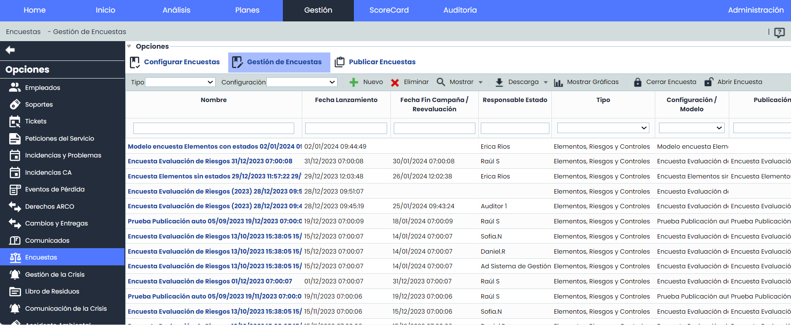
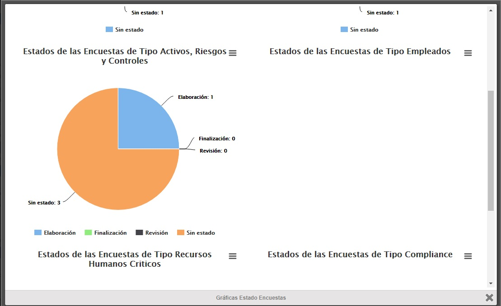
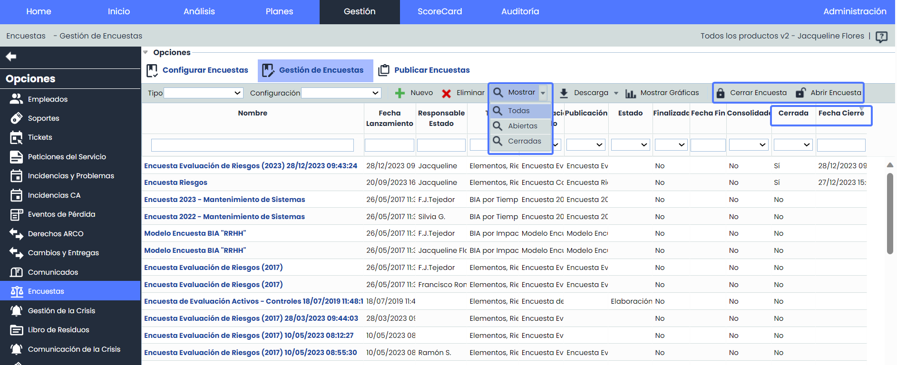

# Gestión encuestas

* [Encuestas BIA Impactos](encuestas-bia-impactos/README.md)
* [Encuestas RRHH Críticos](encuestas-rrhh-criticos.md)
* [Encuestas BIA Tiempo](encuestas-bia-tiempo.md)
* [Encuestas Elementos, Riesgos y Controles](encuestas-elementos-riesgos-y-controles/README.md)
* [Encuestas Compliance](encuestas-compliance.md)
* [Encuestas Empleados](encuestas-empleados.md)

Al acceder a la opción de ‘Encuestas’ se muestra una tabla que ofrece la siguiente información:

* **Nombre:** Nombre identificativo de la encuesta realizada.
* **Fecha:** Fecha de realización de la encuesta.
* **Departamento:** Nombre del Departamento sobre el cual se han obtenido los resultados de la encuesta realizada.
* **Responsable:** Nombre identificativo del responsable de realización de la encuesta.
* **Tipo:** Permite visualizar la tipología de encuesta generada.
* **Modelo:** Indica en Modelo en base al cual se ha realizado la encuesta.


\*\*Nota\*\*
 Los modelos de encuestas se definen en el apartado Ajustes > [Modelos de Encuestas](https://help.globalsuitesolutions.com/es/globalsuite/v1/modelos-de-encuestas)


* **Publicación:** Identifica el nombre de publicación de la encuesta.

Las opciones que permite realizar la herramienta sobre la tabla inicial son las siguientes:

* **Modelos:** Permite elegir dentro del desplegable, el modelo de encuesta creado en el apartado de Ajustes > [Modelos de Encuestas](https://help.globalsuitesolutions.com/es/globalsuite/v1/modelos-de-encuestas) sobre el cual realizar la encuesta. Para ello, debe seleccionar en el desplegable de 'Tipo' de entre qué modelos seleccionar.

* **Nuevo:** Una vez seleccionado el modelo deseado, al pulsar sobre el botón, genera una nueva entrada en la tabla de encuestas.
* **Eliminar:** Permite eliminar una encuesta ya creada en la tabla. Para ello se ha de seleccionar la fila deseada y pulsar sobre el botón ‘Eliminar’.
* **Descarga:** Ofrece la posibilidad de descargar el listado de encuestas en formato editable (xlsx) o en formato PDF.
* **Mostrar Gráficas:** Permite visualizar gráficas por Tipo de Encuesta y estado, para verificar la situación de todas las encuestas generadas.

Al pulsar sobre cualquier entrada de la tabla inicial, se accede a la información específica de la encuesta.

### Cerrar y archivar encuestas

Esta funcionalidad incorpora la capacidad de cerrar encuestas y archivarlas en cualquier momento, adaptándose a las necesidades del usuario.

Al cerrar una encuesta, se evitará cualquier modificación en la información, y la encuesta se ocultará automáticamente del listado principal.

Se tienen las siguientes opciones relacionadas con la funcionalidad:

* **Mostrar:** Será posible filtrar por estado de la encuesta.

  * Todas: Todas las encuestas (abiertas y cerradas).
  * Abiertas: Encuestas abiertas únicamente.
  * Cerradas: Encuestas cerradas únicamente.
* **Cerrar Encuesta:**  Al pulsar esta opción la encuesta se cerrará y archivará para evitar modificaciones posteriores por parte de los destinatarios.
* **Abrir Encuesta:** Permite reabrir encuestas previamente cerradas, permitiendo realizar ajustes y actualizaciones según sea necesario.
