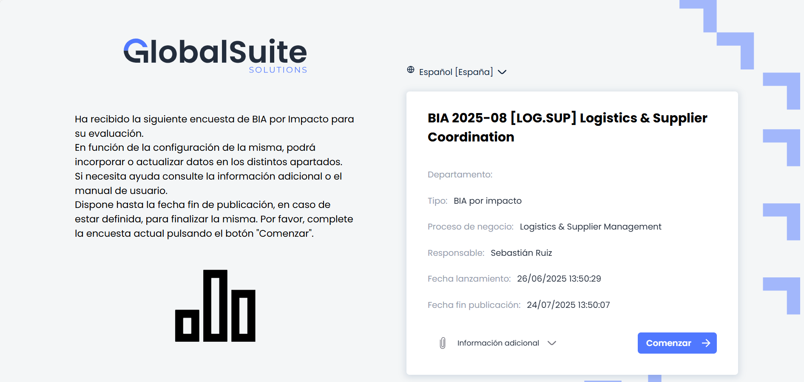

# Encuestas BIA Impactos

Cuando un usuario recibe una encuesta BIA por impacto, accede a una pantalla inicial en la que se muestra un resumen de la encuesta junto con un botón para comenzar su cumplimentación.

Esta pantalla presenta dos bloques diferenciados:

* **Información general**: incluye una introducción con instrucciones básicas sobre la finalidad de la encuesta y cómo completarla.

> Este texto es configurable desde la opción **Gestión > Encuestas >** [**Configuración de encuesta**](https://help.globalsuitesolutions.com/es/globalsuite/v1/encuestas-bia-configuracion)**,** dentro del campo **"Comentario"** de la configuración correspondiente.

* **Detalles de la encuesta**: A la derecha, un panel lateral que resume la información clave de la encuesta. A continuación se describen:

  * **Título de la encuesta**
  * **Departamento**: nombre del área funcional o unidad organizativa a la que pertenece el proceso evaluado (si ha sido definido).
  * **Tipo**: indica el tipo de encuesta (en este caso, *BIA por impacto*).
  * **Proceso de negocio**: nombre del proceso vinculado a la evaluación.
  * **Responsable**: persona responsable de completar la encuesta.
  * **Fecha de lanzamiento**: momento en que se publicó la encuesta.
  * **Fecha fin de publicación**: fecha límite para completar la encuesta.
  * **Información adicional:** Aquí se muestran los archivos adjuntos de la encuestas. Estos se pueden añadir tanto desde el Ajustes> [Modelo de Encuestas](https://help.globalsuitesolutions.com/es/globalsuite/v1/modelo-encuesta-bia-por-impacto) como desde la Gestión > Encuestas>[Configuración de encuestas.](https://help.globalsuitesolutions.com/es/globalsuite/v1/encuestas-bia-configuracion)
